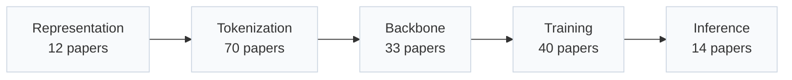
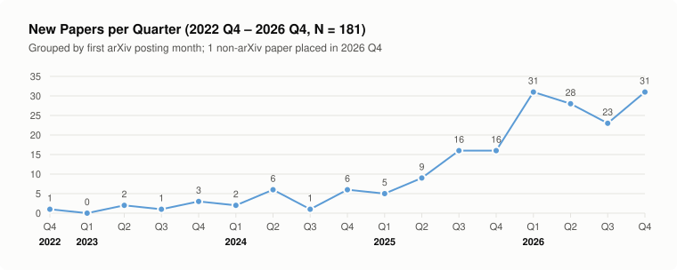
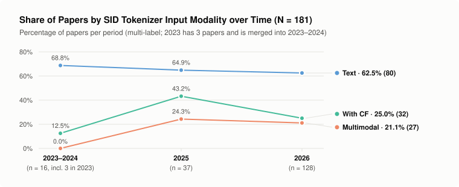

<!--lint disable awesome-github table-pipe-alignment double-link-->

# Awesome Semantic ID Generative Recommendation 

Papers and annotated deep dives on Semantic ID generative recommendation, indexed by research problem and pipeline stage.

  

English | [中文](README.zh.md)

[Problem × Stage Matrix](#problem--stage-matrix) · [What Each Paper Changes](#what-each-paper-changes) · [Papers by Modality](#papers-by-modality) · [Papers by Domain](#papers-by-domain) · [All Papers](#all-papers) · [Contributing](#contributing)

## Scope

This repository indexes 181 papers on Semantic ID (SID) generative recommendation—where each item is represented as a short tuple of discrete codes so a sequence model can generate the next item token by token (169 method papers in the matrix below, plus 12 on paradigms, systems and benchmarks; [POI / local-life index](pages/index/poi.md)). The chart below tracks quarterly paper volume by first arXiv posting date.

Data

| Quarter | New Papers |
| :--- | :--- |
| 2022 Q4 | 1 |
| 2023 Q1 | 0 |
| 2023 Q2 | 2 |
| 2023 Q3 | 1 |
| 2023 Q4 | 3 |
| 2024 Q1 | 2 |
| 2024 Q2 | 6 |
| 2024 Q3 | 1 |
| 2024 Q4 | 6 |
| 2025 Q1 | 5 |
| 2025 Q2 | 9 |
| 2025 Q3 | 16 |
| 2025 Q4 | 16 |
| 2026 Q1 | 31 |
| 2026 Q2 | 28 |
| 2026 Q3 | 23 |
| 2026 Q4 | 31 |

## Where to Start

Pick an entry point below based on what you want to look up:

| I want to...                                                                           | Where to go                                         |
| :------------------------------------------------------------------------------------- | :-------------------------------------------------- |
| Understand how Semantic IDs work and which papers to read first                        | [Start Here](guides/start-here.md)                  |
| Find methods for a specific research problem (e.g., collisions, alignment, efficiency) | [Problem × Stage Matrix](#problem--stage-matrix)    |
| See which pipeline stages a paper modifies                                             | [What Each Paper Changes](#what-each-paper-changes) |
| Compare methods side by side within one pipeline stage                                 | [Papers by Stage](pages/index/stages.md)            |
| Find papers that tokenize multimodal content or collaborative filtering (CF) signals   | [Papers by Modality](pages/index/modality.md)       |
| Find papers in a specific domain (e.g., e-commerce, POI, short video)                  | [Papers by Domain](pages/index/domain.md)           |
| Find papers with open-source code                                                      | [Papers with Code](pages/index/code.md)             |
| Feed this repository to an LLM or search tool                                          | [llms.txt](llms.txt)                                |

## Starter Papers

Read these three papers first for the standard five-stage pipeline, industrial local-life extension, and parallel long-ID generation:

| Paper      | Core mechanism                                                                                                                                                                                                  | Venue      |
| :--------- | :-------------------------------------------------------------------------------------------------------------------------------------------------------------------------------------------------------------- | :--------- |
| [TIGER][]  | TIGER encodes item text into RQ-VAE Semantic IDs and trains a Transformer encoder-decoder to decode the next item's ID, instead of retrieving items by approximate nearest neighbor search.                     | NeurIPS’23 |
| [OneLoc][] | OneLoc extends end-to-end generative recommendation to local-life videos by adding geographic information to tokenization, encoder attention, and a decoder prompt, and by DPO with geographic and GMV rewards. | arXiv’25   |
| [RPG][]    | RPG predicts long, unordered OPQ Semantic IDs in parallel with a multi-token prediction loss and decodes over a graph of valid IDs, replacing autoregressive beam search over short IDs.                        | KDD’25     |

## Problem × Stage Matrix

Rows are the six research problems and columns are the five pipeline stages each paper primarily modifies; click any count badge to jump to that paper list.

| Problem                         |                                      Representation                                     |                                       Tokenization                                      |                                      Backbone                                     |                                      Training                                      |                                     Inference                                      |  Total  |
| :------------------------------ | :-------------------------------------------------------------------------------------: | :-------------------------------------------------------------------------------------: | :-------------------------------------------------------------------------------: | :--------------------------------------------------------------------------------: | :--------------------------------------------------------------------------------: | :-----: |
| **I.** Informativeness          |  |    |    |     |    |  **59** |
| **II.** Uniqueness and Validity |                                                                                         |   |                                                                                   |                                                                                    |                                                                                    |  **12** |
| **III.** SID–Model Alignment    |                                                                                         |  |  |   |  |  **31** |
| **IV.** Utility                 |                                                                                         |     |   |  |   |  **28** |
| **V.** Efficiency               |                                                                                         |      |  |     |    |  **21** |
| **VI.** Generalization          |                                                                                         |     |   |    |   |  **18** |
| **Total**                       |                                          **12**                                         |                                          **70**                                         |                                       **33**                                      |                                       **40**                                       |                                       **14**                                       | **169** |

Common symbols and abbreviations used across tables and paper cards (full definitions in the [glossary](guides/glossary.md)):

| Mark       | Meaning                                                                      |
| :--------- | :--------------------------------------------------------------------------- |
| `†`        | Inferred from the configuration the paper names.                             |
| `A / B`    | Two branches or configurations.                                              |
| `–`        | Not reported.                                                                |
| `n/a`      | Not applicable.                                                              |
| `●` / `○`  | Primary Table 1 cell (`●`) and additional column with a new mechanism (`○`). |
| **Bold**   | The stage the paper mainly changes.                                          |
| Empty cell | No paper yet.                                                                |
| `warm`     | Protocol label in setup cards.                                               |

## What Each Paper Changes

In the heatmap below, each row is the column a paper mainly modifies (●) and each column is another stage it modifies at the same time (○).

Data

| Primary (●) \ Co-modified (○) | Representation | Tokenization | Backbone | Tokenizer | Objective | Inference |
| :--- | :--- | :--- | :--- | :--- | :--- | :--- |
| Representation (n=12) | – | 4 | 3 | 1 | 7 | 0 |
| Tokenization (n=70) | 13 | – | 20 | 8 | 36 | 16 |
| Backbone (n=33) | 2 | 7 | – | 0 | 27 | 13 |
| Tokenizer (n=1) | 0 | 0 | 0 | – | 1 | 0 |
| Objective (n=39) | 1 | 6 | 6 | 0 | – | 6 |
| Inference (n=14) | 0 | 0 | 2 | 0 | 5 | – |

In the tables below, ● marks the primary Table 1 column, ○ marks co-modified columns (`Tokenizer` = how codebook parameters are updated during generator training; `Objective` = generator training loss), and blank cells use standard choices.

I. Informativeness · 59 papers

| Method | Representation | Tokenization | Backbone | Tokenizer | Objective | Inference |
| :--- | :--- | :--- | :--- | :--- | :--- | :--- |
| [Molar](pages/papers/molar.md) | ● `Text+Img+CF` |  | ○ `Dec-Only` |  | ○ `Discrim.` |  |
| [OneLoc](pages/papers/oneloc.md) | ● `Text+Img+Geo†` |  | ○ `Enc-Dec` |  | ○ `NTP → DPO` |  |
| [Q-BERT4Rec](pages/papers/q-bert4rec.md) | ● `Text+Img+CF` |  |  |  | ○ `Masked` |  |
| [UNGER](pages/papers/unger.md) | ● `Text+CF` |  |  |  | ○ `NTP + Ctr.` |  |
| [GeoGR](pages/papers/geogr.md) | ● `Text+Geo+CF` |  |  | ○ `Altern.†` |  |  |
| [HF-SID](pages/papers/hf-sid.md) | ● `Text+Attr+Geo` | ○ `R-KM` |  |  |  |  |
| [LGRID](pages/papers/lgrid.md) | ● `Text+Geo` | ○ `DSRQ` |  |  |  |  |
| [LGSID](pages/papers/lgsid.md) | ● `Text+Geo+CF` | ○ `Geo-Idx+RQ` |  |  |  |  |
| [ReSID](pages/papers/resid.md) | ● `Attr+CF` | ○ `GAOQ` |  |  |  |  |
| [SCRec](pages/papers/screc.md) | ● `Text+CF` |  | ○ `Non-AR / Enc-Dec` |  | ○ `MTP + Ctr.` |  |
| [SPAR](pages/papers/spar.md) | ● `Text+Geo` |  |  |  | ○ `Multi-task NTP` |  |
| [TriAlignGR](pages/papers/trialigngr.md) | ● `Text+Img` |  |  |  | ○ `Multi-task NTP` |  |
| [CoST](pages/papers/cost.md) |  | ● `C-RQ` |  |  |  |  |
| [LETTER](pages/papers/letter.md) |  | ● `Learn. RQ` |  |  | ○ `NTP + Rank` |  |
| [LMIndexer](pages/papers/lmindexer.md) |  | ● `Self-Sup. ID` |  |  |  |  |
| [ActionPiece](pages/papers/actionpiece.md) |  | ● `OPQ` |  |  |  | ○ `Ensemble` |
| [ADC-SID](pages/papers/adc-sid.md) |  | ● `MoE-VQ` |  |  | ○ `NTP` |  |
| [DAS](pages/papers/das.md) | ○ `Text+CF` | ● `Dual RQ` |  |  |  |  |
| [EAGER-LLM](pages/papers/eager-llm.md) |  | ● `Dual H-KM` | ○ `Dec-Only` |  | ○ `Multi-task NTP` |  |
| [FlexCode](pages/papers/flexcode.md) |  | ● `Dual RQ-VAE` |  | ○ `Joint` | ○ `NTP` |  |
| [GenSAR](pages/papers/gensar.md) |  | ● `Shared/Spec. RQ` |  |  | ○ `Multi-task NTP` |  |
| [GNPR-SID](pages/papers/gnpr-sid.md) | ○ `Attr+Geo+CF` | ● `RQ-VAE` |  |  |  |  |
| [GRAM](pages/papers/gram.md) | ○ `Text+CF` | ● `H-KM` | ○ `Enc-Dec` |  |  |  |
| [KGTB](pages/papers/kgtb.md) | ○ `Attr+Geo+CF` | ● `KG-RQ` |  |  | ○ `Multi-task NTP` |  |
| [MME-SID](pages/papers/mme-sid.md) |  | ● `MM-RQ` | ○ `Dec-Only` |  |  |  |
| [MQL4GRec](pages/papers/mql4grec.md) |  | ● `Dual RQ` |  |  | ○ `Multi-task NTP` | ○ `Beam` |
| [PSRQ](pages/papers/psrq.md) |  | ● `Prog. RQ` | ○ `Encoder` |  |  |  |
| [QT-Mob](pages/papers/qt-mob.md) |  | ● `RQ-VAE` |  |  | ○ `Multi-task NTP` |  |
| [TokenRec](pages/papers/tokenrec.md) |  | ● `Masked VQ` | ○ `Encoder` |  | ○ `Discrim.` | ○ `Scoring` |
| [CapsID](pages/papers/capsid.md) |  | ● `Soft-RQ` |  |  |  |  |
| [ChronoID](pages/papers/chronoid.md) | ○ `Text+Time` | ● `RQ-VAE / Par. VQ` |  |  |  |  |
| [GrIS (RecDMoN / RQ-GAE)](pages/papers/gris-recdmon-rq-gae.md) | ○ `Text+CF` | ● `RecDMoN / RQ-GAE` |  |  |  |  |
| [MACRec](pages/papers/macrec.md) |  | ● `Cross RQ` |  |  | ○ `NTP + Ctr.` |  |
| [MMGRec](pages/papers/mmgrec.md) | ○ `Text+Img+CF` | ● `Graph RQ-VAE` | ○ `Enc-Dec` |  |  |  |
| [MMQ](pages/papers/mmq.md) |  | ● `MoE-VQ` |  | ○ `Joint` | ○ `MTP` |  |
| [MSCGRec](pages/papers/mscgrec.md) |  | ● `RQ-VAE+DINO` |  |  | ○ `NTP` |  |
| [PCR-CA](pages/papers/pcr-ca.md) |  | ● `PC-AE` | ○ `Disc.` | ○ `Joint` | ○ `Discrim.` |  |
| [Pctx](pages/papers/pctx.md) |  | ● `RQ` |  |  | ○ `NTP` | ○ `Beam+Agg.` |
| [ProGEO](pages/papers/progeo.md) |  | ● `R-KM+Geo-CB` |  |  |  |  |
| [RoFiGR](pages/papers/rofigr.md) |  | ● `CF-Aligned MM RQ` | ○ `Enc-Dec` |  | ○ `NTP + Aux.` |  |
| [ROS](pages/papers/ros.md) |  | ● `Geo-Prefix+RQ-VAE` |  |  | ○ `NTP → RL` |  |
| [SPRIG](pages/papers/sprig.md) |  | ● `R-KM` |  |  | ○ `NTP` |  |
| [Tlow](pages/papers/tlow.md) |  | ● `Flow+PQ` |  |  | ○ `MTP + Rel.MSE` |  |
| [UniRec](pages/papers/unirec.md) |  | ● `RQ` | ○ `Dec-Only` |  | ○ `NTP → DPO` |  |
| [UniSID](pages/papers/unisid.md) | ○ `Text+Img+Attr` | ● `Direct SID Heads` |  |  |  |  |
| [VarLenRec (TIGER)](pages/papers/varlenrec-tiger.md) |  | ● `HARQ` | ○ `Enc-Dec` |  | ○ `NTP + Aux.` | ○ `C-Beam` |
| [ColaRec](pages/papers/colarec.md) |  |  | ● `Enc-Dec` |  | ○ `NTP + Ctr.` |  |
| [EAGER](pages/papers/eager.md) |  | ○ `Dual H-KM` | ● `Dual Enc-Dec` |  | ○ `NTP + Ctr.` | ○ `Fusion` |
| [COBRA](pages/papers/cobra.md) | ○ `Text+SID` |  | ● `Dec-Only` |  | ○ `NTP + Dense` | ○ `BeamFusion` |
| [DiscRec](pages/papers/discrec.md) |  |  | ● `Enc-Dec` |  |  |  |
| [Spacetime-GR](pages/papers/spacetime-gr.md) | ○ `Geo` | ○ `Geo-Idx` | ● `Dec-Only` |  | ○ `NTP → DPO` |  |
| [SPAR-Youku](pages/papers/spar-youku.md) |  | ○ `RQ-PIB` | ● `Dec-Only` |  |  |  |
| [UniSGR-V2](pages/papers/unisgr-v2.md) |  |  | ● `Enc-Dec` |  | ○ `NTP + Rank` |  |
| [MBGen](pages/papers/mbgen.md) |  | ○ `Bal. VQ+KM` | ○ `Enc-Dec` |  | ● `NTP` |  |
| [RAGR](pages/papers/ragr.md) |  | ○ `RQ-VAE` | ○ `Enc-Dec` |  | ● `NTP → DPO` |  |
| [REGER](pages/papers/reger.md) |  |  | ○ `Enc-Dec` |  | ● `NTP → (NTP + Aux.)` |  |
| [SynGR](pages/papers/syngr.md) |  |  |  |  | ● `NTP + Ctr.` |  |
| [CAPE](pages/papers/cape.md) |  |  |  |  |  | ● `Hybrid` |
| [CITE](pages/papers/cite.md) |  |  |  |  |  | ● `Scoring` |

II. Uniqueness and Validity · 12 papers

| Method | Representation | Tokenization | Backbone | Tokenizer | Objective | Inference |
| :--- | :--- | :--- | :--- | :--- | :--- | :--- |
| [CID](pages/papers/cid.md) |  | ● `Spectral Clus.` |  |  |  |  |
| [TransRec](pages/papers/transrec.md) |  | ● `Multi-Facet ID` |  |  |  | ○ `FM-Index+Agg.` |
| [HiD-VAE](pages/papers/hid-vae.md) | ○ `Text` | ● `Hier. RQ` |  |  |  |  |
| [PSI](pages/papers/psi.md) |  | ● `Post-hoc RQ` |  |  |  |  |
| [AdaSID](pages/papers/adasid.md) |  | ● `RQ` |  |  |  |  |
| [API](pages/papers/api.md) | ○ `Text` | ● `PID (P-SAE)` | ○ `Enc-Dec / Dec-Only (AR); Non-AR (PR)` |  | ○ `NTP + Rank + Aux. / MTP + Rank + Aux.` | ○ `C-Beam / Scoring` |
| [CARD](pages/papers/card.md) | ○ `Text+Img+CF` | ● `NU-RQ` |  |  |  |  |
| [DIGER](pages/papers/diger.md) |  | ● `Learn. RQ` |  | ○ `Joint` |  |  |
| [Gwhere](pages/papers/gwhere.md) |  | ● `Contr. RQ` |  |  | ○ `NTP → DPO` |  |
| [QuaSID](pages/papers/quasid.md) |  | ● `QA-RQ` |  |  |  |  |
| [R3-VAE](pages/papers/r3-vae.md) |  | ● `Ref.-RQ` |  |  |  |  |
| [SnapLGR](pages/papers/snaplgr.md) |  | ● `RQ-VAE+PPR` |  |  |  | ○ `Beam` |

III. SID–Model Alignment · 31 papers

| Method | Representation | Tokenization | Backbone | Tokenizer | Objective | Inference |
| :--- | :--- | :--- | :--- | :--- | :--- | :--- |
| [IDGenRec](pages/papers/idgenrec.md) |  | ● `LLM-Vocab` |  | ○ `Altern.` |  |  |
| [SIIT](pages/papers/siit.md) |  | ● `Self-Imp.` |  | ○ `Altern.` |  |  |
| [SemConv](pages/papers/semconv.md) |  | ● `Align. RQ` |  |  | ○ `Multi-task NTP` | ○ `Beam` |
| [Align3GR](pages/papers/align3gr.md) |  | ● `Dual RQ` |  |  | ○ `NTP → DPO` |  |
| [CogRec](pages/papers/cogrec.md) |  | ● `R-KM+Graph` |  |  | ○ `Multi-task NTP` |  |
| [DOS](pages/papers/dos.md) |  | ● `Orth. RQ` |  |  |  |  |
| [GR4AD-X](pages/papers/gr4ad-x.md) |  | ● `Multi-Path R-KM+Hash` | ○ `Enc-Dec` |  | ○ `NTP + PV-RSPO + Rank + Aux.` | ○ `PV-Beam+Rerank` |
| [GRLM](pages/papers/grlm.md) |  | ● `Term-ID` |  |  |  | ○ `Beam` |
| [HoloRec](pages/papers/holorec.md) |  | ● `Nested RQ` | ○ `Enc-Dec` |  | ○ `NTP + Aux.` |  |
| [SST](pages/papers/sst.md) |  | ● `RQ+IST` |  |  |  |  |
| [TopoGR](pages/papers/topogr.md) |  | ● `BDQ` | ○ `Non-AR` |  | ○ `MTP + Aux.` | ○ `Scoring+Rerank` |
| [LLaDA-Rec](pages/papers/llada-rec.md) |  | ○ `Par. VQ` | ● `Non-AR` |  | ○ `Masked` | ○ `Diff.` |
| [DECOR](pages/papers/decor.md) |  |  | ● `Enc-Dec` |  |  |  |
| [FLASH](pages/papers/flash.md) |  | ○ `SimHash` | ● `Non-AR` |  | ○ `MTP + Aux.` |  |
| [Latte](pages/papers/latte.md) |  |  | ● `Dec-Only` |  | ○ `NTP` | ○ `C-Beam` |
| [LESSRec](pages/papers/lessrec.md) |  |  | ● `Enc-Dec` |  |  |  |
| [MDGR](pages/papers/mdgr.md) |  |  | ● `Non-AR` |  | ○ `Masked` | ○ `Diff.+Beam` |
| [PrefixMem](pages/papers/prefixmem.md) |  |  | ● `Dec-Only` |  | ○ `Multi-task NTP` |  |
| [S2GR](pages/papers/s2gr.md) |  | ○ `CoBa RQ-VAE` | ● `Enc-Dec` |  | ○ `NTP + Ctr.` |  |
| [TrieRec](pages/papers/trierec.md) |  |  | ● `Enc-Dec` |  |  |  |
| [LC-Rec](pages/papers/lc-rec.md) |  | ○ `RQ-VAE` |  |  | ● `Multi-task NTP` |  |
| [ETEGRec](pages/papers/etegrec.md) |  |  |  | ● `Altern.` | ○ `NTP + Ctr.` |  |
| [GREAM](pages/papers/gream.md) | ○ `Text+CF` |  |  |  | ● `NTP → RL` |  |
| [OneRec-Think](pages/papers/onerec-think.md) |  |  |  |  | ● `NTP → RL` | ○ `CoT` |
| [Evo-Rec](pages/papers/evo-rec.md) |  |  |  |  | ● `NTP → RL` |  |
| [GTI](pages/papers/gti.md) |  |  |  |  | ● `Multi-task NTP` |  |
| [Intent-Driven-News](pages/papers/intent-driven-news.md) |  |  |  |  | ● `Multi-task NTP` | ○ `CoT+Fuzzy Match` |
| [SIDReasoner](pages/papers/sidreasoner.md) |  |  |  |  | ● `NTP → RL` |  |
| [Think2Go](pages/papers/think2go.md) |  |  |  |  | ● `NTP → RL` |  |
| [GRC](pages/papers/grc.md) |  |  |  |  | ○ `NTP → RL` | ● `GRC+Beam` |
| [PROMISE](pages/papers/promise.md) |  |  |  |  | ○ `NTP + Aux.` | ● `PRM-Beam` |

IV. Utility · 28 papers

| Method | Representation | Tokenization | Backbone | Tokenizer | Objective | Inference |
| :--- | :--- | :--- | :--- | :--- | :--- | :--- |
| [TRACER](pages/papers/tracer.md) |  | ● `Soft Reassign. RQ` |  | ○ `Joint` | ○ `NTP + Aux.` |  |
| [DiGR](pages/papers/digr.md) |  |  | ● `Dec-Only` |  | ○ `Discrim.` | ○ `Scoring` |
| [Gryphon](pages/papers/gryphon.md) |  |  | ● `Enc-Dec` |  | ○ `NTP + Rank` | ○ `Hybrid` |
| [RecoChain](pages/papers/recochain.md) |  |  | ● `Dec-Only` |  | ○ `NTP + Rank` | ○ `Hybrid` |
| [APAO](pages/papers/apao.md) |  |  |  |  | ● `NTP + Rank` |  |
| [DASO](pages/papers/daso.md) |  |  |  |  | ● `NTP → RL` |  |
| [DPE-Rec](pages/papers/dpe-rec.md) |  |  |  |  | ● `Masked → RL (→ Masked KD for Fast)` |  |
| [GEM-Rec](pages/papers/gem-rec.md) |  |  |  |  | ● `NTP` | ○ `Bid-Aware Beam` |
| [GenRec-JD](pages/papers/genrec-jd.md) |  |  | ○ `Dec-Only` |  | ● `NTP → RL` |  |
| [GFlowGR](pages/papers/gflowgr.md) |  |  |  |  | ● `NTP + Aux.` |  |
| [Ghost](pages/papers/ghost.md) |  | ○ `Skeleton R-KM` |  |  | ● `NTP + Aux.` |  |
| [HASTE](pages/papers/haste.md) |  |  |  |  | ● `NTP + Aux.` |  |
| [HCGRec](pages/papers/hcgrec.md) |  |  |  |  | ● `NTP → RL` |  |
| [IDM/CMM](pages/papers/idm-cmm.md) |  |  |  |  | ● `MTP + Aux.` |  |
| [KL-MOPD](pages/papers/kl-mopd.md) |  |  |  |  | ● `(NTP† / (NTP + Aux.)†) → KL-weighted OPD` |  |
| [MuSID-KD](pages/papers/musid-kd.md) |  |  |  |  | ● `NTP + Aux.` |  |
| [NAU](pages/papers/nau.md) |  |  |  |  | ● `NTP + Aux.` |  |
| [OneChord](pages/papers/onechord.md) |  |  | ○ `Non-AR` |  | ● `Next-item CE + Cons. KD + Rank KD` | ○ `Scoring` |
| [Retrieval-Grounded-Credit](pages/papers/retrieval-grounded-credit.md) |  |  |  |  | ● `NTP → RL` |  |
| [SAGE-SID](pages/papers/sage-sid.md) |  |  |  |  | ● `NTP → RL` |  |
| [SAHL](pages/papers/sahl.md) |  | ○ `SRBQ` |  |  | ● `(MTP + Masked Rec.) → MTP` |  |
| [SAPO](pages/papers/sapo.md) |  |  |  |  | ● `NTP → RL` |  |
| [SLIDE](pages/papers/slide.md) |  |  |  |  | ● `NTP` |  |
| [Token-Weighted](pages/papers/token-weighted.md) |  |  |  |  | ● `NTP` |  |
| [UGR](pages/papers/ugr.md) |  |  |  |  | ● `NTP → (RL + Rank)` |  |
| [V-STAR](pages/papers/v-star.md) |  |  |  |  | ● `NTP → RL` | ○ `C-Beam` |
| [ISD](pages/papers/isd.md) |  |  |  |  |  | ● `ISD Beam` |
| [TCBSA](pages/papers/tcbsa.md) |  |  |  |  |  | ● `CF-Guided C-Beam` |

V. Efficiency · 21 papers

| Method | Representation | Tokenization | Backbone | Tokenizer | Objective | Inference |
| :--- | :--- | :--- | :--- | :--- | :--- | :--- |
| [SEATER](pages/papers/seater.md) |  | ● `Tree-Clus.` |  |  | ○ `NTP + Ctr.` |  |
| [Dynamic-Single-Codebook](pages/papers/dynamic-single-codebook.md) |  | ● `Dyn. KM+Disamb.` |  |  |  |  |
| [JevRec](pages/papers/jevrec.md) |  | ● `Freq. R-KM` | ○ `Enc-Dec` |  | ○ `NTP + Aux.` | ○ `Length-Quota Beam` |
| [OneRec-V2](pages/papers/onerec-v2.md) |  |  | ● `Lazy Dec-Only` |  | ○ `NTP → RL` |  |
| [RPG](pages/papers/rpg.md) |  |  | ● `Non-AR` |  | ○ `MTP` | ○ `Graph` |
| [ACERec](pages/papers/acerec.md) |  |  | ● `Non-AR` |  | ○ `MTP + Ctr. + Aux.` |  |
| [Deco](pages/papers/deco.md) |  |  | ● `Dec-Only` |  |  |  |
| [IBA](pages/papers/iba.md) |  |  | ● `Enc-Dec` |  | ○ `NTP → (NTP + Aux.)` | ○ `C-Beam` |
| [LoopGR](pages/papers/loopgr.md) |  |  | ● `Enc-Dec` |  | ○ `NTP / NTP + Aux.` |  |
| [Merge-and-Branch](pages/papers/merge-and-branch.md) |  |  | ● `Dec-Only` |  | ○ `NTP` | ○ `C-Beam` |
| [PinGER](pages/papers/pinger.md) |  | ○ `RQ-VAE` | ● `Dec-Only` |  | ○ `NTP → DPO` | ○ `Div. C-Beam` |
| [SID-MLP](pages/papers/sid-mlp.md) |  |  | ● `Enc-MLP` |  | ○ `NTP + Aux.` |  |
| [SPRINT](pages/papers/sprint.md) |  |  | ● `Non-AR` |  | ○ `Dual-level Flow Ctr.` |  |
| [STAMP](pages/papers/stamp.md) |  |  | ● `Enc-Dec / Dec-Only` |  | ○ `NTP + Aux.` |  |
| [OneLatent](pages/papers/onelatent.md) |  |  | ○ `Dec-Only` |  | ● `Multi-task NTP` | ○ `Beam` |
| [AtSpeed](pages/papers/atspeed.md) |  |  |  |  | ○ `NTP` | ● `Spec. Dec.` |
| [NEZHA](pages/papers/nezha.md) |  |  | ○ `Dec-Only` |  |  | ● `Self-Draft+Hash` |
| [OneRec-V2-Quantized](pages/papers/onerec-v2-quantized.md) |  |  |  |  |  | ● `FP8+RecoGEM` |
| [PAD-Rec](pages/papers/pad-rec.md) |  |  |  |  |  | ● `Spec. Dec.` |
| [PFA](pages/papers/pfa.md) |  |  |  |  |  | ● `Beam` |
| [STATIC](pages/papers/static.md) |  |  |  |  |  | ● `Vec. C-Beam` |

VI. Generalization · 18 papers

| Method | Representation | Tokenization | Backbone | Tokenizer | Objective | Inference |
| :--- | :--- | :--- | :--- | :--- | :--- | :--- |
| [VQ-Rec](pages/papers/vq-rec.md) |  | ● `OPQ` | ○ `Encoder` |  | ○ `Discrim.` |  |
| [GMC](pages/papers/gmc.md) |  | ● `Unified RQ` | ○ `Enc-Dec` |  |  |  |
| [UTGRec](pages/papers/utgrec.md) |  | ● `Tree` |  |  |  |  |
| [DACT](pages/papers/dact.md) |  | ● `RQ-VAE` |  |  |  |  |
| [DREAM](pages/papers/dream.md) | ○ `Text+CF` | ● `CART` |  | ○ `Altern.` | ○ `NTP + Aux.` | ○ `C-Beam` |
| [GenCDR](pages/papers/gencdr.md) |  | ● `RQ+LoRA` | ○ `Dec-Only` |  | ○ `NTP` | ○ `C-Beam` |
| [MBGR](pages/papers/mbgr.md) |  | ● `RQ` | ○ `Dec-Only` |  | ○ `NTP + Aux.` |  |
| [OneLive](pages/papers/onelive.md) | ○ `Text+Img+Audio+CF` | ● `R-KM` | ○ `Lazy Dec-Only` |  | ○ `NTP → RL` | ○ `Beam` |
| [UniTok](pages/papers/unitok.md) |  | ● `TokenMoE` |  |  |  |  |
| [DualGR](pages/papers/dualgr.md) |  |  | ● `Dec-Only` |  | ○ `NTP + Rank` | ○ `Dual Beam` |
| [FedCGR](pages/papers/fedcgr.md) |  |  | ● `Enc-Dec` |  | ○ `NTP + Aux.` |  |
| [LION](pages/papers/lion.md) |  |  | ● `Enc-Dec` |  | ○ `NTP + Aux.` |  |
| [RecBase](pages/papers/recbase.md) |  | ○ `Curr. RQ` |  |  | ● `NTP` |  |
| [AWARE](pages/papers/aware.md) |  |  |  |  | ● `NTP` |  |
| [CausalDPO](pages/papers/causaldpo.md) |  |  |  |  | ● `NTP → DPO` |  |
| [CMRec](pages/papers/cmrec.md) |  |  |  |  | ● `NTP` |  |
| [LIGER](pages/papers/liger.md) |  |  | ○ `Enc-Dec` |  | ○ `NTP + Dense` | ● `Hybrid` |
| [SpecGR](pages/papers/specgr.md) |  |  |  |  | ○ `NTP + Rank` | ● `Hybrid` |

Paradigms, Systems and Benchmarks · 12 papers

| Method | Representation | Tokenization | Backbone | Tokenizer | Objective | Inference |
| :--- | :--- | :--- | :--- | :--- | :--- | :--- |
| [TIGER](pages/papers/tiger.md) |  | ○ `RQ-VAE` | ○ `Enc-Dec` |  |  | ○ `Beam` |
| [FORGE](pages/papers/forge.md) |  | ○ `RQ-VAE` |  |  |  | ○ `Dyn. Beam` |
| [GRID](pages/papers/grid.md) |  |  |  |  |  |  |
| [MiniOneRec](pages/papers/minionerec.md) |  |  |  |  | ○ `NTP → RL` |  |
| [OneRec](pages/papers/onerec.md) |  | ○ `R-KM` | ○ `Enc-Dec` |  | ○ `NTP → DPO` |  |
| [GR-Generalize](pages/papers/gr-generalize.md) |  |  |  |  |  | ○ `Hybrid` |
| [NEO](pages/papers/neo.md) | ○ `Text / Audio` | ○ `R-KM` |  |  | ○ `Multi-task NTP` | ○ `C-Beam` |
| [Netflix-SID-Comparison](pages/papers/netflix-sid-comparison.md) |  |  |  |  | ○ `Multi-task NTP / (Text NTP + MTP + Rank); Lang. RL after SFT` |  |
| [OneMall](pages/papers/onemall.md) | ○ `Text+Img+CF` | ○ `R-KM+FSQ` | ○ `Enc-Dec` |  | ○ `(NTP + Ctr.) → RL` |  |
| [PLUM](pages/papers/plum.md) | ○ `Text+Img+CF` | ○ `RQ-VAE` |  |  | ○ `Multi-task NTP` |  |
| [ReRankID](pages/papers/rerankid.md) |  |  |  |  | ○ `NTP → RL` | ○ `CoT+Greedy` |
| [SIDScope](pages/papers/sidscope.md) |  |  |  |  |  |  |

[↑ Back to top](#awesome-semantic-id-generative-recommendation)

## Papers by Modality

The chart below shows the yearly share of papers whose SID tokenizer uses item text only (`Text`), multimodal content (`Multimodal`), or collaborative filtering signals from user–item interactions (`With CF`).

Data

| Period | Total Papers | Text | Multimodal | With CF |
| :--- | :--- | :--- | :--- | :--- |
| 2023–2024 (n = 16, incl. 3 in 2023) | 16 | 11 (68.8%) | 0 (0.0%) | 2 (12.5%) |
| 2025 (n = 37) | 37 | 24 (64.9%) | 9 (24.3%) | 16 (43.2%) |
| 2026 (n = 128) | 128 | 80 (62.5%) | 27 (21.1%) | 32 (25.0%) |

Each row below groups papers by one aspect of tokenizer input signals (content per branch, collaborative and context across branches; multi-label):

| Aspect | Groups |
| :--- | :--- |
| **Content** | [Text (115)](pages/index/modality.md#text) · [Single non-text (8)](pages/index/modality.md#single-non-text) · [Multimodal (36)](pages/index/modality.md#multimodal) · [No content (11)](pages/index/modality.md#no-content) |
| **Collaborative** | [CF only (7)](pages/index/modality.md#cf-only) · [With CF (50)](pages/index/modality.md#with-cf) |
| **Context** | [Attr (7)](pages/index/modality.md#attr) · [Geo (14)](pages/index/modality.md#geo) · [Time (2)](pages/index/modality.md#time) |
| **Unknown** | [Unknown (28)](pages/index/modality.md#unknown) |

## Papers by Domain

Each row groups evaluation domains into one business category, ordered by paper count within each category (multi-domain papers appear in each matching domain):

| Category | Domains |
| :--- | :--- |
| **Commerce & Local** | [E-commerce (142)](pages/index/domain.md#e-commerce) · [POI / Local (44)](pages/index/domain.md#poi--local) · [Food / Recipe (1)](pages/index/domain.md#food--recipe) · [Travel / Hotel (1)](pages/index/domain.md#travel--hotel) |
| **Video & Entertainment** | [Short video / Live (21)](pages/index/domain.md#short-video--live) · [Movie (12)](pages/index/domain.md#movie) · [Music (10)](pages/index/domain.md#music) · [Games (5)](pages/index/domain.md#games) · [Long video (3)](pages/index/domain.md#long-video) · [Podcast (1)](pages/index/domain.md#podcast) · [Video (1)](pages/index/domain.md#video) |
| **News, Reading & Visual** | [News (6)](pages/index/domain.md#news) · [Book (5)](pages/index/domain.md#book) · [Image / Article (3)](pages/index/domain.md#image--article) |
| **Platform Services & Other** | [Ads (17)](pages/index/domain.md#ads) · [Search (10)](pages/index/domain.md#search) · [Apps (1)](pages/index/domain.md#apps) · [Recruitment (1)](pages/index/domain.md#recruitment) · [unknown (industrial) (6)](pages/index/domain.md#unknown-industrial) |

## Recent Updates

Recent additions and Table 1 synchronization logs in reverse chronological order:

- 2026-11-04: Marked every column each paper changes, added SID-input and domain indexes, and added four data figures.
- 2026-11-01: Added deep-dive notes, experimental setup cards, related-work graphs, stage and code indexes, and a controlled-vocabulary glossary. Papers: [TIGER][], [RPG][], [OneLoc][], [LETTER][], [SIDScope][].
- 2026-10-30: Synchronized all 181 paper records with Table 1 of the survey across the six research problems and five pipeline stages.

## All Papers

Full paper list organized by research problem and primary modified stage (each entry includes a one-sentence summary and paper/code links):

- [Paradigms, Systems and Benchmarks][]
- [I. Informativeness][]
- [II. Uniqueness and Validity][]
- [III. SID–Model Alignment][]
- [IV. Utility][]
- [V. Efficiency][]
- [VI. Generalization][]

## Paradigms, Systems and Benchmarks

> Baseline (TIGER), end-to-end multi-stage paradigms, open-source frameworks, benchmarks, and diagnostic resources.

- [TIGER][] - NeurIPS’23 
  TIGER encodes item text into RQ-VAE Semantic IDs and trains a Transformer encoder-decoder to decode the next item's ID, instead of retrieving items by approximate nearest neighbor search. 
  [Paper](https://arxiv.org/abs/2305.05065) · [Code (third-party)](https://github.com/baiyimeng/TIGER)
- [FORGE][] - KDD’26 
  FORGE benchmarks Semantic ID construction strategies on a released Taobao dataset and proposes metrics that evaluate ID quality without training a generator. 
  [Paper](https://arxiv.org/abs/2509.20904) · [Code](https://github.com/selous123/al_sid)
- [GRID][] - CIKM’25 
  GRID provides an open-source modular framework with swappable Semantic ID tokenizers, backbones, and decoding rules to ablate design choices on public benchmarks. 
  [Paper](https://arxiv.org/abs/2507.22224) · [Code](https://github.com/snap-research/GRID)
- [MiniOneRec][] - arXiv’25 
  MiniOneRec is an open-source framework for RQ-VAE Semantic ID construction, supervised fine-tuning of Qwen backbones, and reinforcement learning with constrained decoding, to test generative scaling on public benchmarks. 
  [Paper](https://arxiv.org/abs/2510.24431) · [Code](https://github.com/AkaliKong/MiniOneRec)
- [OneRec][] - arXiv’25 
  OneRec replaces the retrieve-and-rank cascade with one encoder-decoder generator using sparse MoE, generates whole sessions of videos, and aligns preferences by iterative DPO with a reward model. 
  [Paper](https://arxiv.org/abs/2502.18965)
- [GR-Generalize][] - arXiv’26 
  GR-Generalize partitions test instances into memorization and generalization subsets, compares generative and item-ID recommenders on each, and ensembles both per instance. 
  [Paper](https://arxiv.org/abs/2603.19809) · [Code](https://github.com/Jamesding000/MemGen-GR)
- [NEO][] - arXiv’26 
  NEO adapts a decoder-only LLM to interleave natural language and typed item Semantic IDs in one sequence, with constrained decoding, to unify search, recommendation, and reasoning without tools. 
  [Paper](https://arxiv.org/abs/2603.17533)
- [Netflix-SID-Comparison][] - NeurIPS’26 PALM Workshop 
  Netflix-SID-Comparison evaluates single-head autoregressive beam search against multi-token prediction for LLM Semantic ID generation on ranking quality and serving cost. 
  [Paper](https://arxiv.org/abs/2610.15864)
- [OneMall][] - CIKM’26 
  OneMall unifies product-card, short-video, and live-streaming e-commerce in one generator, with a business-aware tokenizer, Query-Former and sparse MoE layers, and a ranking model as reinforcement learning reward. 
  [Paper](https://arxiv.org/abs/2601.21770)
- [PLUM][] - WWW’26 
  PLUM adapts a pre-trained LLM to industrial recommendation through Semantic ID tokenization, continued pre-training on domain data, and fine-tuning for generative retrieval, instead of large embedding tables. 
  [Paper](https://arxiv.org/abs/2510.07784)
- [ReRankID][] - arXiv’26 
  ReRankID evaluates how language models reason over and rerank candidate slates represented solely by Semantic IDs across different post-training recipes. 
  [Paper](https://arxiv.org/abs/2610.22797) · [Code](https://github.com/lilv98/ReRankID)
- [SIDScope][] - arXiv’26 
  SIDScope audits released Semantic ID mappings across tokenizer families for code organization, item resolution, and generator compatibility after catalog refreshes. 
  [Paper](https://arxiv.org/abs/2608.18779) · [Code](https://github.com/jdding/sidscope)

[↑ Back to top](#awesome-semantic-id-generative-recommendation)

## I. Informativeness

> Do the SIDs, or the model reading them, carry the collaborative and multimodal signals recommendation needs?

### I × Representation

- [Molar][] - arXiv’24 
  Molar builds item representations from text and images with a multimodal LLM and aligns its user representations with an ID-based model, to add collaborative signals that LLM recommenders lack. 
  [Paper](https://arxiv.org/abs/2412.18176) · [Code](https://anonymous.4open.science/r/Molar-8B06/)
- [OneLoc][] - arXiv’25 · `POI` 
  OneLoc extends end-to-end generative recommendation to local-life videos by adding geographic information to tokenization, encoder attention, and a decoder prompt, and by DPO with geographic and GMV rewards. 
  [Paper](https://arxiv.org/abs/2508.14646)
- [Q-BERT4Rec][] - arXiv’25 
  Q-BERT4Rec fuses text, image, and structural features into item embeddings, quantizes them into Semantic ID tokens by residual vector quantization, and pre-trains a bidirectional encoder with several masking strategies. 
  [Paper](https://arxiv.org/abs/2512.02474)
- [UNGER][] - TOIS’25 
  UNGER learns one integrated semantic-collaborative embedding through cross-modality alignment and next-item prediction, quantizes it into a unified code, and adds intra-modality distillation, instead of separate codes per modality. 
  [Paper](https://arxiv.org/abs/2502.06269)
- [GeoGR][] - arXiv’26 · `POI` 
  GeoGR builds geo-aware POI Semantic IDs from geographically constrained co-visited pairs, contrastive learning, and iterative refinement, then aligns an LLM to them through continued pre-training and fine-tuning. 
  [Paper](https://arxiv.org/abs/2602.10411)
- [HF-SID][] - arXiv’26 · `POI` 
  HF-SID restores geographic, numerical, and structural detail in POI representations before quantization, through Cartesian coordinates, unit-encoded numbers, and residual contrastive learning, instead of lengthening the Semantic ID. 
  [Paper](https://arxiv.org/abs/2608.30479)
- [LGRID][] - arXiv’26 · `POI` 
  LGRID encodes item fields jointly with an LLM, routes hidden states into geographic and semantic slots, and quantizes the two streams separately, instead of quantizing one entangled representation. 
  [Paper](https://arxiv.org/abs/2607.27944)
- [LGSID][] - AAAI’26 · `POI` 
  LGSID aligns an LLM to spatial relationships with a reward model and G-DPO, then builds Semantic IDs from spatial and content attributes plus residual tokens from the aligned LLM representation. 
  [Paper](https://arxiv.org/abs/2511.14221) · [Code](https://github.com/JiangHaoPG11/LGSID)
- [ReSID][] - arXiv’26 
  ReSID learns item representations from structured features with field-aware masked autoencoding and quantizes them with globally aligned orthogonal quantization, instead of LLM embeddings and generic quantizers. 
  [Paper](https://arxiv.org/abs/2602.02338) · [Code](https://github.com/FuCongResearchSquad/ReSID)
- [SCRec][] - RecSys’26 
  SCRec injects textualized collaborative signals into semantic tokenization, recalibrates semantic priors with learnable code embeddings during generation, and aligns codebook and semantic spaces, to couple the two stages. 
  [Paper](https://arxiv.org/abs/2609.13678) · [Code](https://github.com/DanJiayi/SCRec)
- [SPAR][] - arXiv’26 · `POI` 
  SPAR fuses sinusoidal coordinate embeddings into Semantic ID construction, continually pre-trains the LLM on geospatial data, and anchors that knowledge as a frozen task vector during behavioral fine-tuning. 
  [Paper](https://arxiv.org/abs/2609.02062)
- [TriAlignGR][] - arXiv’26 
  TriAlignGR adds visual content and LLM-mined user intents to Semantic ID construction and trains several generation tasks linking Semantic IDs, text, and images under one autoregressive loss. 
  [Paper](https://arxiv.org/abs/2605.05249)

### I × Tokenization

- [CoST][] - RecSys’24 
  CoST trains the item tokenizer with a contrastive quantization objective that captures neighborhood relationships between items, instead of the reconstruction loss used by RQ-VAE. 
  [Paper](https://arxiv.org/abs/2404.14774)
- [LETTER][] - CIKM’24 
  LETTER regularizes an RQ-VAE tokenizer with a collaborative alignment loss and a diversity loss, so that item Semantic IDs carry collaborative signals and reduce code assignment bias found in earlier identifiers. 
  [Paper](https://arxiv.org/abs/2405.07314) · [Code](https://github.com/HonghuiBao2000/LETTER)
- [LMIndexer][] - ICML’24 
  LMIndexer learns sequential Semantic IDs with a generative language model through progressive training, contrastive learning, and self-supervised reconstruction, instead of quantizing embeddings from an off-the-shelf encoder. 
  [Paper](https://arxiv.org/abs/2310.07815) · [Code](https://github.com/PeterGriffinJin/LMIndexer)
- [ActionPiece][] - ICML’25 
  ActionPiece represents each action as a set of item features and merges co-occurring feature patterns into new tokens, so identical actions get context-dependent tokens instead of fixed independent ones. 
  [Paper](https://arxiv.org/abs/2502.13581) · [Code](https://github.com/google-deepmind/action_piece)
- [ADC-SID][] - arXiv’25 
  ADC-SID adds collaborative information to Semantic ID quantization with alignment strength that adapts to collaborative noise and learned weights for behavioral IDs, instead of uniform alignment and equal weights. 
  [Paper](https://arxiv.org/abs/2510.25622)
- [DAS][] - CIKM’25 
  DAS optimizes quantization and collaborative alignment in one stage, with multi-view contrastive alignment and dual quantization of users and ads, instead of two-stage alignment that loses information. 
  [Paper](https://arxiv.org/abs/2508.10584)
- [EAGER-LLM][] - WWW’25 
  EAGER-LLM adds dual-source behavior and semantic item indices, multiscale alignment reconstruction tasks, and an annealing adapter to a decoder-only LLM, instead of learning collaborative semantics from scratch. 
  [Paper](https://arxiv.org/abs/2502.14735)
- [FlexCode][] - arXiv’25 
  FlexCode splits a fixed token budget between a collaborative codebook and a semantic codebook according to item popularity through a lightweight MoE, instead of one uniform codebook for all items. 
  [Paper](https://arxiv.org/abs/2511.20673)
- [GenSAR][] - RecSys’25 
  GenSAR unifies search and recommendation in one generator with dual-purpose identifiers carrying semantic and collaborative signals and task-specific training, to reduce the trade-off between the two tasks. 
  [Paper](https://arxiv.org/abs/2504.05730)
- [GNPR-SID][] - KDD’25 · `POI` 
  GNPR-SID replaces random numeric POI IDs with RQ-VAE Semantic IDs built from semantic and collaborative features under a diversity loss, and fine-tunes an LLM to generate the next POI. 
  [Paper](https://arxiv.org/abs/2506.01375) · [Code](https://github.com/wds1996/GNPR-SID)
- [GRAM][] - ACL’25 
  GRAM translates hierarchical and collaborative item relationships into LLM vocabulary words and encodes multi-granular prompts separately, fusing them only at decoding, to use lengthy item text efficiently. 
  [Paper](https://arxiv.org/abs/2506.01673) · [Code](https://github.com/skleee/GRAM)
- [KGTB][] - arXiv’25 · `POI` 
  KGTB organizes POI data as a knowledge graph, quantizes each node into a structural ID under graph supervision, and fine-tunes an LLM on POI, category, and region visit tasks. 
  [Paper](https://arxiv.org/abs/2509.12350)
- [MME-SID][] - CIKM’25 
  MME-SID feeds an LLM multimodal embeddings together with Semantic ID embeddings from MM-RQ-VAE, trained with maximum mean discrepancy and contrastive alignment, to reduce embedding collapse and forgetting. 
  [Paper](https://arxiv.org/abs/2509.02017) · [Code](https://github.com/Applied-Machine-Learning-Lab/MME-SID)
- [MQL4GRec][] - ICLR’25 
  MQL4GRec translates item text and images from several domains into a shared quantitative language and pre-trains generation tasks over it, to transfer recommendation knowledge across domains and modalities. 
  [Paper](https://arxiv.org/abs/2504.05314) · [Code](https://github.com/zhaijianyang/MQL4GRec)
- [PSRQ][] - CIKM’25 
  PSRQ generates modality-specific and modality-joint Semantic IDs that preserve prefix semantic features and models music interests with multi-codebook cross-attention, to reduce semantic drift in residual quantization. 
  [Paper](https://arxiv.org/abs/2508.20359)
- [QT-Mob][] - KDD’25 · `POI` 
  QT-Mob tokenizes locations into compact semantic tokens and fine-tunes an LLM with complementary objectives that align the tokens with its representations, for next-location prediction and mobility recovery. 
  [Paper](https://arxiv.org/abs/2506.11109) · [Code](https://github.com/shadowfall09/QT-Mob)
- [TokenRec][] - TKDE’25 
  TokenRec quantizes masked collaborative user and item representations into discrete tokens and retrieves top-K items without autoregressive decoding or beam search, to generalize to new users and items. 
  [Paper](https://arxiv.org/abs/2406.10450) · [Code](https://github.com/Quhaoh233/TokenRec)
- [CapsID][] - arXiv’26 
  CapsID replaces hard residual quantization with capsule routing, which soft-routes each item across capsules and ends its Semantic ID once confidence is high, so ID length varies per item. 
  [Paper](https://arxiv.org/abs/2605.05096)
- [ChronoID][] - arXiv’26 
  ChronoID benchmarks time-aware Semantic ID construction across temporal encoding, fusion, and quantization choices, replacing static time-agnostic IDs. 
  [Paper](https://arxiv.org/abs/2606.14260)
- [GrIS (RecDMoN / RQ-GAE)][gris-recdmon-rq-gae] - CIKM’26 
  GrIS (RecDMoN / RQ-GAE) treats Semantic ID construction as hierarchical partition of an item graph with collaborative edges, recovering RQ-VAE and RQ-KMeans as the empty-graph case. 
  [Paper](https://arxiv.org/abs/2610.01533) · [Code](https://github.com/hirc-airecs/graph-informed-sids)
- [MACRec][] - AAAI’26 
  MACRec applies cross-modal quantization over text and image features to build Semantic IDs with fewer conflicts, and adds implicit and explicit cross-modal alignment to generator training. 
  [Paper](https://arxiv.org/abs/2511.15122) · [Code](https://github.com/zhangfw123/MACRec)
- [MMGRec][] - TOMM’26 
  MMGRec assigns each item a Rec-ID with Graph RQ-VAE over multimodal and collaborative features and trains a Transformer with relation-aware self-attention to generate it, instead of embed-and-retrieve. 
  [Paper](https://arxiv.org/abs/2404.16555) · [Code](https://github.com/hanliu95/MMGRec)
- [MMQ][] - WSDM’26 
  MMQ trains a multimodal tokenizer with modality-shared and modality-specific experts under orthogonal regularization, then fine-tunes its Semantic IDs on behavior objectives with a multimodal reconstruction loss. 
  [Paper](https://arxiv.org/abs/2508.15281)
- [MSCGRec][] - arXiv’26 
  MSCGRec quantizes images with self-supervised DINO-based learning, adds collaborative features as a separate modality, and restricts training outputs to permissible tokens, to scale generative recommendation to large catalogs. 
  [Paper](https://arxiv.org/abs/2602.03713)
- [PCR-CA][] - KDD’26 
  PCR-CA learns parallel codebook representations of app text, unlike hierarchical RQ-VAE, and aligns them contrastively with collaborative signals for CTR prediction on multiple-category apps. 
  [Paper](https://arxiv.org/abs/2508.18166)
- [Pctx][] - CIKM’26 
  Pctx tokenizes each item with the user's interaction history as context, so the same item can receive different Semantic IDs for different users, instead of one static item-only mapping. 
  [Paper](https://arxiv.org/abs/2510.21276) · [Code](https://github.com/YoungZ365/Pctx)
- [ProGEO][] - arXiv’26 · `POI` 
  ProGEO builds a proximity-aware geo-codebook with a geo-centroid local coordinate system and geo-rotary position encoding, so Semantic IDs model semantics and geography jointly. 
  [Paper](https://arxiv.org/abs/2604.23156)
- [RoFiGR][] - arXiv’26 
  RoFiGR aligns coarse Semantic ID code vectors with collaborative embeddings and distills a sequential teacher over legal branches with level-adaptive weights, to reduce early routing errors. 
  [Paper](https://arxiv.org/abs/2610.39470)
- [ROS][] - ACL’26 · `POI` 
  ROS adds hierarchical spatial Semantic IDs, a mobility chain-of-thought with locality-informed pruning, and spatial-guided reinforcement learning to LLM-based next-POI generation. 
  [Paper](https://arxiv.org/abs/2601.04562) · [Code](https://github.com/amap-cvlab/Reasoning-Over-Space)
- [SPRIG][] - CIKM’26 Short 
  SPRIG trains a generator on knowledge-graph paths that end in content-derived Semantic IDs, combining relational grounding with shared item tokens instead of opaque tokens tied to embedding tables. 
  [Paper](https://arxiv.org/abs/2610.06590) · [Code](https://github.com/justinhangoebl/semantic-id-knowledge-graph-recommender)
- [Tlow][] - CIKM’26 Applied 
  Tlow maps semantic embeddings with a normalizing flow into a standard normal latent space before independent quantization, and aligns codebook and token embedding spaces, unlike RQ-VAE or OPQ. 
  [Paper](https://arxiv.org/abs/2608.24176) · [Code](https://github.com/wjjln/Tlow)
- [UniRec][] - arXiv’26 
  UniRec prefixes each Semantic ID with category, seller, and brand tokens through Chain-of-Attribute, to recover the item-side feature crossing of discriminative models, and adds capacity-constrained quantization. 
  [Paper](https://arxiv.org/abs/2604.12234)
- [UniSID][] - arXiv’26 
  UniSID optimizes embeddings and Semantic IDs end to end from raw advertising data with multi-granularity contrastive learning and summary-based reconstruction, instead of embedding first and quantizing afterwards. 
  [Paper](https://arxiv.org/abs/2602.10445)
- [VarLenRec (TIGER)][varlenrec-tiger] - arXiv’26 
  VarLenRec (TIGER) gives popular items shorter Semantic IDs and tail items longer ones through hyperbolic residual quantization and a soft length controller, instead of fixed-length tokenization. 
  [Paper](https://arxiv.org/abs/2605.17779)

### I × Backbone

- [ColaRec][] - CIKM’24 
  ColaRec builds generative identifiers from a pretrained collaborative filtering model and generates them from interacted-item content, with an item indexing task and a contrastive loss aligning both spaces. 
  [Paper](https://arxiv.org/abs/2403.18480) · [Code](https://github.com/Junewang0614/ColaRec)
- [EAGER][] - KDD’24 
  EAGER decodes behavior tokens and semantic tokens with a shared encoder and two decoders, adding contrastive and semantic-guided transfer tasks, instead of using only one type of item information. 
  [Paper](https://arxiv.org/abs/2406.14017) · [Code](https://github.com/yewzz/EAGER)
- [COBRA][] - NeurIPS’25 
  COBRA generates a sparse Semantic ID and then a dense vector conditioned on it, trains both end to end, and decodes with BeamFusion, which combines beam search with nearest-neighbor scores. 
  [Paper](https://arxiv.org/abs/2503.02453)
- [DiscRec][] - arXiv’25 
  DiscRec adds item-level position embeddings and splits semantic and collaborative signals into two gated branches, one with attention inside each item, instead of fusing them in one embedding space. 
  [Paper](https://arxiv.org/abs/2506.15576) · [Code](https://github.com/Ten-Mao/DiscRec)
- [Spacetime-GR][] - arXiv’25 · `POI` 
  Spacetime-GR indexes POIs with a geographic hierarchy, encodes spatiotemporal context into action sequences, adds multimodal POI embeddings, and post-trains for embeddings, ranking scores, and candidates. 
  [Paper](https://arxiv.org/abs/2508.16126)
- [SPAR-Youku][] - arXiv’26 
  SPAR-Youku guides each Semantic ID decoding step with prefix-relevant evidence from compressed user memory and balances interaction loads among sibling branches with RQ-PIB, to reduce branch errors and popularity bias. 
  [Paper](https://arxiv.org/abs/2610.27898)
- [UniSGR-V2][] - arXiv’26 
  UniSGR-V2 anticipates a continuous target-side feature vector before each codeword and crosses it with the semantic prefix and user behavior inside the decoder, using it for generation and ranking. 
  [Paper](https://arxiv.org/abs/2610.16132)

### I × Training

- [MBGen][] - CIKM’24 
  MBGen interleaves behavior tokens and item tokens in one sequence, predicts the next behavior type and then the next item, and scales with a position-routed sparse architecture. 
  [Paper](https://arxiv.org/abs/2405.16871) · [Code](https://github.com/anananan116/MBGen)
- [RAGR][] - arXiv’26 
  RAGR interleaves item Semantic IDs and review Semantic IDs chronologically in the user sequence and uses DPO to favor item tokens at prediction positions, instead of modeling item-only sequences. 
  [Paper](https://arxiv.org/abs/2605.17267) · [Code](https://github.com/Zhang-Yingyi/TKDE_RAGR)
- [REGER][] - arXiv’26 
  REGER pretrains a generator to produce semantic neighbors' Semantic IDs, combines global and ID-boundary local attention, and distills a discriminative teacher's next-token distributions along the target prefix path. 
  [Paper](https://arxiv.org/abs/2610.37584)
- [SynGR][] - ICML’26 
  SynGR constrains reliance on dominant modalities during generation, so the generator uses synergistic cross-modal information beyond shared or modality-specific signals, instead of alignment-centric fusion. 
  [Paper](https://arxiv.org/abs/2605.18920) · [Code](https://github.com/gxingyu/SynGR)

### I × Inference

- [CAPE][] - arXiv’26 
  CAPE is a training-free plug-in that retrieves co-occurrence-supported tail items outside the beam and fuses co-occurrence evidence into ranking, restoring item-level memorization that shared-prefix generation lacks. 
  [Paper](https://arxiv.org/abs/2610.29298)
- [CITE][] - Electronics’26 
  CITE adds an item-level transition score with separate source and destination embeddings to a fixed parallel Semantic ID generator, modeling the directed relation between the latest item and each candidate. 
  [Paper](https://doi.org/10.3390/electronics15204749)

[↑ Back to top](#awesome-semantic-id-generative-recommendation)

## II. Uniqueness and Validity

> Does every item get its own SID, every generated SID name a real item, and the codebook get used evenly?

### II × Tokenization

- [CID][] - SIGIR-AP’23 
  CID studies item indexing for the P5 foundation model and proposes sequential, collaborative, semantic, and hybrid indexing, replacing random, title, and independent IDs that cause long outputs or hallucinated items. 
  [Paper](https://arxiv.org/abs/2305.06569) · [Code](https://github.com/Wenyueh/LLM-RecSys-ID)
- [TransRec][] - KDD’24 
  TransRec indexes items with multi-facet identifiers combining ID, title, and attributes, constrains generation with FM-index substring indexing, and aggregates generated identifiers to rank catalog items. 
  [Paper](https://arxiv.org/abs/2310.06491) · [Code](https://github.com/Linxyhaha/TransRec/)
- [HiD-VAE][] - arXiv’25 
  HiD-VAE aligns each Semantic ID level with multi-level item tags through hierarchically supervised quantization and adds a uniqueness loss against ID collisions, instead of flat unsupervised tokenization. 
  [Paper](https://arxiv.org/abs/2508.04618) · [Code](https://anonymous.4open.science/r/HiD-VAE-84B2)
- [PSI][] - arXiv’25 
  PSI assigns unique, semantic-preserving IDs by relaxing nearest-centroid selection with exhaustive candidate matching or recursive residual searching, instead of appending a non-semantic token to resolve conflicts. 
  [Paper](https://arxiv.org/abs/2509.16446) · [Code](https://github.com/wangshanyw/PurelySemanticIndexing)
- [AdaSID][] - arXiv’26 
  AdaSID regulates Semantic ID overlaps during tokenizer training by relaxing repulsion for semantically compatible items and scaling the rest by local collision load, instead of fixed overlap regularization. 
  [Paper](https://arxiv.org/abs/2604.23522)
- [API][] - arXiv’26 
  API reuses feature indices of a pretrained sparse autoencoder as an interpretable Semantic ID vocabulary and trains an adapter to predict indices and strengths, instead of fitting a new vocabulary. 
  [Paper](https://arxiv.org/abs/2610.36763) · [Code](https://anonymous.4open.science/r/API-C1F9/)
- [CARD][] - arXiv’26 
  CARD fuses text, image, and collaborative signals into a visual semantic unit before encoding and quantizes it with NU-RQ-VAE, whose learnable non-uniform transformation balances skewed embeddings. 
  [Paper](https://arxiv.org/abs/2604.26427) · [Code](https://github.com/HAI-UESTC/CARD)
- [DIGER][] - SIGIR’26 
  DIGER makes Semantic IDs differentiable so recommendation gradients update the tokenizer, and adds decaying Gumbel noise against codebook collapse, instead of a tokenizer trained only for reconstruction. 
  [Paper](https://arxiv.org/abs/2601.19711) · [Code](https://github.com/junchen-fu/DIGER)
- [Gwhere][] - RecSys’26 · `POI` 
  Gwhere learns POI Semantic IDs with a contrastive residual-quantization tokenizer over text, image, spatial, and collaborative signals, then adapts an LLM through continued pretraining, fine-tuning, and exposure-aware KTO. 
  [Paper](https://arxiv.org/abs/2607.26073) · [Code](https://github.com/alibaba/SimCIT)
- [QuaSID][] - KDD’26 ADS 
  QuaSID repels only qualified conflicting Semantic ID pairs with Hamming-scaled margins, masks benign overlaps, and adds a dual-tower contrastive objective, instead of treating all collisions equally. 
  [Paper](https://arxiv.org/abs/2603.00632)
- [R3-VAE][] - arXiv’26 
  R3-VAE stabilizes residual quantization with a reference vector as semantic anchor and a dot-product rating mechanism, and uses two Semantic ID quality metrics as training regularizers. 
  [Paper](https://arxiv.org/abs/2604.11440) · [Code](https://github.com/wwqq/R3-VAE)
- [SnapLGR][] - arXiv’26 
  SnapLGR builds Semantic IDs from multimodal embeddings with Personalized PageRank contrastive learning, grounds them by continued pretraining before fine-tuning an LLM, and serves beam search with TensorRT-LLM. 
  [Paper](https://arxiv.org/abs/2607.28895)

[↑ Back to top](#awesome-semantic-id-generative-recommendation)

## III. SID–Model Alignment

> Can the generator read, write, and reason over SIDs, and do the tokenizer and generator work toward the same goal?

### III × Tokenization

- [IDGenRec][] - SIGIR’24 
  IDGenRec trains a textual ID generator alongside an LLM recommender, so each item receives a concise ID made of natural-language tokens, and tests zero-shot transfer to unseen platforms. 
  [Paper](https://arxiv.org/abs/2403.19021) · [Code](https://github.com/agiresearch/IDGenRec)
- [SIIT][] - arXiv’24 
  SIIT starts from item tokenizations of any external model and periodically adjusts them to the LLM's learned patterns during training, so tokenization matches the LLM's internal item understanding. 
  [Paper](https://arxiv.org/abs/2412.17171)
- [SemConv][] - AAAI’25 
  SemConv converts item IDs into token sequences aligned with the LLM space through Alignment Tokenization, adds tasks linking collaborative signals and language, and pre-caches top-K results for serving. 
  [Paper](https://arxiv.org/abs/2412.13771)
- [Align3GR][] - AAAI’26 
  Align3GR aligns an LLM recommender at three levels, with dual semantic and collaborative tokenization, bidirectional semantic alignment in behavior modeling, and progressive DPO from self-play and real-world feedback. 
  [Paper](https://arxiv.org/abs/2511.11255)
- [CogRec][] - arXiv’26 
  CogRec grounds reasoning in Semantic ID structure through intra-layer graphs, item neighborhoods, and Match, LateralJump, and Explore routing steps, instead of a natural-language rationale weakly tied to the IDs. 
  [Paper](https://arxiv.org/abs/2607.24402) · [Code](https://github.com/caskcsg/CogRec)
- [DOS][] - WWW’26 Short · `POI` 
  DOS aligns the Semantic ID codebook with the generation space through a user-item dual flow over collaborative signals and rotates the semantic space with orthogonal residual quantization. 
  [Paper](https://arxiv.org/abs/2602.04460)
- [GR4AD-X][] - arXiv’26 
  GR4AD-X extends GR4AD for advertising with multi-path Semantic ID assignment, capacity scaling beyond wider or deeper backbones, and value-guided generation with beam pruning and discriminative reranking. 
  [Paper](https://arxiv.org/abs/2610.38378)
- [GRLM][] - arXiv’26 
  GRLM identifies items by Term IDs, standardized textual keywords generated from metadata, and fine-tunes an LLM on them, avoiding free-text hallucination and the vocabulary expansion of Semantic IDs. 
  [Paper](https://arxiv.org/abs/2601.06798) · [Code](https://github.com/ZY0025/GRLM)
- [HoloRec][] - arXiv’26 
  HoloRec builds hierarchical Semantic IDs by nested residual quantization with a reconstruction loss over all granularities and generates chain-of-thought steps inside decoding, instead of using external annotated rationales. 
  [Paper](https://arxiv.org/abs/2606.15331)
- [SST][] - CIKM’26 
  SST represents history items as variable-length subwords merged from stable adjacent Semantic ID tokens while keeping fixed-length target decoding, to reduce intra-item attention in the encoder. 
  [Paper](https://arxiv.org/abs/2608.22734) · [Code](https://github.com/mxrcandy/Semantic-Subword-Tokenization)
- [TopoGR][] - arXiv’26 
  TopoGR learns bit-decomposable binary Semantic IDs and uses their Hamming geometry in input features, soft training targets, and reranking, instead of treating Semantic ID tokens as independent symbols. 
  [Paper](https://arxiv.org/abs/2607.25216)

### III × Backbone

- [LLaDA-Rec][] - arXiv’25 
  LLaDA-Rec generates parallel Semantic IDs by discrete diffusion with bidirectional attention, history-level and item-level masking, and an adapted beam search, instead of left-to-right autoregressive decoding. 
  [Paper](https://arxiv.org/abs/2511.06254) · [Code](https://github.com/TengShi-RUC/LLaDA-Rec)
- [DECOR][] - SIGIR’26 
  DECOR refines Semantic ID token embeddings by interaction context and fuses pretrained codebook embeddings with learned collaborative embeddings, instead of static token assignments that overwrite pretrained semantics. 
  [Paper](https://arxiv.org/abs/2509.10468) · [Code](https://github.com/yliuaa/DECOR.git)
- [FLASH][] - NeurIPS’26 
  FLASH pairs training-free SimHash Semantic IDs with parallel decoding and explicit semantic alignment, attributing the weakness of hashing to autoregressive decoding and rigid discretization rather than hashing itself. 
  [Paper](https://arxiv.org/abs/2610.07402) · [Code](https://github.com/KevinC2015/Flash)
- [Latte][] - arXiv’26 
  Latte inserts a latent token before each Semantic ID, turning one decoding tree into several latent-conditioned trees, to relax the probability coupling between items that are close in the tree. 
  [Paper](https://arxiv.org/abs/2605.06331) · [Code](https://github.com/hyp1231/Latte)
- [LESSRec][] - arXiv’26 
  LESSRec encodes the history separately at each Semantic ID level and restricts attention to the target token's level, adding an item-level semantic sequence, instead of attending to all levels. 
  [Paper](https://arxiv.org/abs/2610.37286)
- [MDGR][] - arXiv’26 
  MDGR uses a parallel codebook, adaptive masking along time and samples, and warm-up two-stage parallel decoding for masked diffusion recommendation, instead of fixed-order autoregressive Semantic ID decoding. 
  [Paper](https://arxiv.org/abs/2601.19501)
- [PrefixMem][] - arXiv’26 
  PrefixMem gives an LLM a pre-trainable Semantic ID encoder built from prefix n-gram memory tables, so each token gets a prefix-conditioned representation instead of a plain vocabulary embedding. 
  [Paper](https://arxiv.org/abs/2606.00324)
- [S2GR][] - KDD’26 
  S2GR inserts a thinking token before each Semantic ID step, supervised contrastively with codebook cluster distributions, and builds the codebook with co-occurrence, load-balancing, and uniformity objectives. 
  [Paper](https://arxiv.org/abs/2601.18664)
- [TrieRec][] - NeurIPS’26 
  TrieRec adds a trie-aware absolute positional encoding and a topology-aware relative positional encoding to Transformer generators, so attention reflects the Semantic ID prefix tree instead of a flat token stream. 
  [Paper](https://arxiv.org/abs/2602.21677)

### III × Training

- [LC-Rec][] - ICDE’24 
  LC-Rec assigns non-conflicting item indices by vector quantization with uniform semantic mapping and tunes an LLM with alignment tasks, so it generates items from the whole catalog without candidate lists. 
  [Paper](https://arxiv.org/abs/2311.09049) · [Code](https://github.com/RUCAIBox/LC-Rec/)
- [ETEGRec][] - SIGIR’25 
  ETEGRec trains the item tokenizer and the generator in alternation with sequence-item and preference-semantic alignment losses, instead of building the tokenizer separately before generator training. 
  [Paper](https://arxiv.org/abs/2409.05546) · [Code](https://github.com/RUCAIBox/ETEGRec)
- [GREAM][] - arXiv’25 
  GREAM adapts an LLM into a reasoning recommender with collaborative-semantic item indices, a chain-of-thought curriculum, and SRPO post-training, and supports direct and reasoning-first inference modes. 
  [Paper](https://arxiv.org/abs/2510.20815) · [Code](https://github.com/Indolent-Kawhi/GRRM)
- [OneRec-Think][] - arXiv’25 
  OneRec-Think adds explicit in-text reasoning to OneRec-style generation through item-text alignment, reasoning scaffolding, and a recommendation reward for multiple valid targets, instead of implicit prediction alone. 
  [Paper](https://arxiv.org/abs/2510.11639) · [Code](https://github.com/wangshy31/OneRec-Think)
- [Evo-Rec][] - arXiv’26 
  Evo-Rec aligns Semantic IDs with text and behavior, fine-tunes on sampled reasoning traces that improve target prediction, and then refines reasoning with catalog-constrained reinforcement learning. 
  [Paper](https://arxiv.org/abs/2609.29973) · [Code](https://github.com/mengdanzhu/evo-rec)
- [GTI][] - arXiv’26 
  GTI maps new Semantic ID tokens to distinct locations in the pretrained embedding space with paired linguistic supervision before fine-tuning, instead of initializing them as the mean of existing embeddings. 
  [Paper](https://arxiv.org/abs/2604.02324)
- [Intent-Driven-News][] - ACL’26 Industry 
  Intent-Driven-News trains an LLM to map implicit conversational intents to hierarchical Semantic ID prefixes and fuzzy-matches them to the current news pool, instead of retrieving articles first. 
  [Paper](https://arxiv.org/abs/2605.07613)
- [SIDReasoner][] - KDD’26 
  SIDReasoner strengthens Semantic ID-language alignment with multi-task training on a teacher-synthesized corpus, then improves reasoning through outcome-driven reinforcement learning, without annotated recommendation reasoning traces. 
  [Paper](https://arxiv.org/abs/2603.23183) · [Code](https://github.com/HappyPointer/SIDReasoner)
- [Think2Go][] - KDD’26 · `POI` 
  Think2Go unifies supervised fine-tuning and reinforcement learning reasoning for next-POI generation, weighting advantages by prompt epistemic uncertainty and normalized rewards, to deepen the LLM's understanding of Semantic IDs. 
  [Paper](https://arxiv.org/abs/2607.28997) · [Code](https://doi.org/10.5281/zenodo.18206701)

### III × Inference

- [GRC][] - CIKM’26 
  GRC extends single-pass decoding into generation, reflection, and correction in the semantic token space, trains the trajectory with GRPO, and allocates correction budget by entropy during beam search. 
  [Paper](https://arxiv.org/abs/2602.23639)
- [PROMISE][] - arXiv’26 
  PROMISE adds a lightweight process reward model that scores intermediate Semantic ID steps and prunes beam branches with it, to correct early-token semantic drift and scale with inference compute. 
  [Paper](https://arxiv.org/abs/2601.04674)

[↑ Back to top](#awesome-semantic-id-generative-recommendation)

## IV. Utility

> Are training and search aimed at what users and the platform value, rather than at token likelihood?

### IV × Tokenization

- [TRACER][] - NeurIPS’26 
  TRACER removes sensitive concepts from a generative recommender by reassigning concept-related items to alternative Semantic ID tokens with a coherence regularizer, instead of suppressing tokens shared with retained items. 
  [Paper](https://arxiv.org/abs/2606.07688)

### IV × Backbone

- [DiGR][] - arXiv’26 
  DiGR uses Semantic ID tokens as item representations and scores items with one item-level function, instead of generating tokens, after showing that token decoding adds no ranking expressiveness. 
  [Paper](https://arxiv.org/abs/2602.07847) · [Code](https://anonymous.4open.science/r/SimGR-C408/)
- [Gryphon][] - CIKM’26 Short 
  Gryphon adds a jointly trained item-level scoring component to an encoder-decoder generator, resolving each generated Semantic ID to its items and re-scoring them, instead of ranking by token likelihood. 
  [Paper](https://arxiv.org/abs/2606.08604)
- [RecoChain][] - arXiv’26 
  RecoChain generates candidates by hierarchical Semantic ID prediction and then ranks them with SIM-based click estimation in the same Transformer, to close the gap between generation and ranking. 
  [Paper](https://arxiv.org/abs/2604.25787)

### IV × Training

- [APAO][] - KDD’26 
  APAO adds prefix-level losses and an adaptive worst-prefix strategy to training, so correct items survive beam-search pruning, closing the gap between token-level cross-entropy training and beam-search inference. 
  [Paper](https://arxiv.org/abs/2603.02730) · [Code](https://github.com/yuyq18/APAO)
- [DASO][] - arXiv’26 
  DASO reallocates part of each GRPO rollout group to prefix-guided completions at Semantic ID levels where candidates leave the target path and adds a graded prefix reward, unlike vanilla GRPO. 
  [Paper](https://arxiv.org/abs/2608.20611) · [Code](https://github.com/LucasXinYu/DASO)
- [DPE-Rec][] - arXiv’26 
  DPE-Rec completes bundles with a diffusion language model, adding semantic-fork-aware GRPO to keep bundles diverse and pseudo-trajectory distillation to reveal more tokens per denoising step. 
  [Paper](https://arxiv.org/abs/2610.34700)
- [GEM-Rec][] - arXiv’26 
  GEM-Rec adds control tokens that decide whether to show an ad and bid-aware decoding that injects real-time bids, so one generator serves both semantic relevance and ad revenue. 
  [Paper](https://arxiv.org/abs/2603.22231)
- [GenRec-JD][] - SIGIR’26 
  GenRec-JD trains a decoder-only generator with page-wise next-token prediction, compresses prompt Semantic IDs with a Token Merger, and aligns outputs with GRPO-SR under hybrid rewards. 
  [Paper](https://arxiv.org/abs/2604.14878)
- [GFlowGR][] - SIGIR’26 
  GFlowGR fine-tunes generative recommenders as multi-step generation with GFlowNets, using a collaborative trajectory sampler and reward model to explore unobserved positives, instead of next-token or DPO fine-tuning. 
  [Paper](https://arxiv.org/abs/2506.16114) · [Code](https://github.com/Applied-Machine-Learning-Lab/SIGIR26_GFlowGR)
- [Ghost][] - NeurIPS’26 
  Ghost reduces popularity bias in generative recommenders with an asymmetric unlikelihood loss and skeleton-founded tokenization, addressing token-level optimization and undifferentiated item tokenization as its causes. 
  [Paper](https://arxiv.org/abs/2605.16825) · [Code](https://github.com/Esperanto-mega/Ghost)
- [HASTE][] - arXiv’26 
  HASTE adds a loss at each Semantic ID level and attribute-specific losses to generator training, to speed convergence and improve tail items beyond a standard causal cross-entropy objective. 
  [Paper](https://arxiv.org/abs/2610.17368)
- [HCGRec][] - CIKM’26 
  HCGRec gives a minimal target-prefix hint when GRPO rollouts miss the correct item, training hinted tokens with supervised loss and sampled suffixes with GRPO, to recover signal from zero-reward groups. 
  [Paper](https://arxiv.org/abs/2608.11980) · [Code](https://github.com/WncFht/GRec)
- [IDM/CMM][idm-cmm] - arXiv’26 
  IDM/CMM distills a sequential recommender into a parallel Semantic ID generator by matching a reconstructed item distribution or per-position code marginals, instead of training on hard next-item labels alone. 
  [Paper](https://arxiv.org/abs/2610.32943)
- [KL-MOPD][] - arXiv’26 
  KL-MOPD distills click and conversion teachers into a student generator token by token, weighting each teacher by its initial KL divergence from the student, instead of vanilla on-policy distillation. 
  [Paper](https://arxiv.org/abs/2610.36973) · [Code](https://github.com/Yandorn/KL-MOPD)
- [MuSID-KD][] - arXiv’26 
  MuSID-KD distills a generative teacher into lightweight students by aligning candidate distributions at successive Semantic ID prefix levels and weighting supervision by ranking impact, instead of uniform alignment. 
  [Paper](https://arxiv.org/abs/2610.35218) · [Code](https://anonymous.4open.science/r/m7k2-review-83f9/)
- [NAU][] - arXiv’26 
  NAU adds explicit control over the probability mass on forgotten items' Semantic ID neighborhoods to interaction-level unlearning, because shared tokens let unlearning degrade neighboring items. 
  [Paper](https://arxiv.org/abs/2610.27232) · [Code](https://github.com/pierre-lubitzsch/neighborhood-aware-unlearning)
- [OneChord][] - arXiv’26 
  OneChord uses one catalog-normalized fusion of Semantic ID evidence and item-matching scores for supervision, distillation, and inference in a parallel decoder, so training targets the ranking used in serving. 
  [Paper](https://arxiv.org/abs/2610.25805) · [Code](https://anonymous.4open.science/r/OneChord-D1A2/)
- [Retrieval-Grounded-Credit][] - arXiv’26 
  Retrieval-Grounded-Credit splits each reasoning trace into interest hypotheses, runs each as a query through a frozen retriever, and rewards hypotheses that hit the target, not only the decoded Semantic ID. 
  [Paper](https://arxiv.org/abs/2609.29983) · [Code](https://github.com/YuFan-Microsoft/Retrieval-Grounded-Credit-Assignment-for-Generative-Recommendation)
- [SAGE-SID][] - arXiv’26 
  SAGE-SID optimizes list-wise generators with a geometric-mean sequence ratio, decoupled multi-objective advantages, asymmetric adaptive bounds, and an entropy-aware penalty, replacing the symmetric bounds of GBPO. 
  [Paper](https://arxiv.org/abs/2601.21452)
- [SAHL][] - arXiv’26 
  SAHL quantizes items with SRBQ into a balanced token-subspace-item hierarchy and reconstructs user history at those granularities, moving by curriculum to next-item prediction, instead of next-item prediction alone. 
  [Paper](https://arxiv.org/abs/2610.25093) · [Code](https://github.com/CQU-MM-Intelligent-Lab/SAHL)
- [SAPO][] - arXiv’26 
  SAPO computes a separate group-relative advantage for each reasoning step, one thinking block plus one Semantic ID token, instead of broadcasting one exact-match advantage to the whole response. 
  [Paper](https://arxiv.org/abs/2605.17648) · [Code](https://github.com/zhengzaiyi/SAPO)
- [SLIDE][] - arXiv’26 
  SLIDE concatenates a teacher's offline beam-search candidates into list-wise Semantic ID targets, so a student generates the whole top-K list in one greedy pass instead of item-level beam search. 
  [Paper](https://arxiv.org/abs/2610.34764)
- [Token-Weighted][] - CIKM’26 
  Token-Weighted weights Semantic ID tokens by prefix ambiguity reduction and by token frequency, combining both with the standard likelihood under curriculum learning, instead of uniform token training. 
  [Paper](https://arxiv.org/abs/2601.17787) · [Code](https://github.com/CHIUWEINING/Token-Weighted-Multi-Target-Learning-for-Generative-Recommenders-with-Curriculum-Learning)
- [UGR][] - KDD’26 
  UGR adds uncertainty to preference optimization through an uncertainty-weighted reward, difficulty-aware optimization, and explicit confidence alignment, instead of rewards based only on binary outcome correctness. 
  [Paper](https://arxiv.org/abs/2602.11719) · [Code](https://github.com/cxfann/UGR)
- [V-STAR][] - KDD’26 
  V-STAR deepens high-value prefixes with value-guided decoding during reinforcement learning sampling and computes sibling-relative advantages with Sibling-GRPO, instead of likelihood-driven beam search. 
  [Paper](https://arxiv.org/abs/2602.10699)

### IV × Inference

- [ISD][] - arXiv’26 
  ISD lets a user-specific item ranking support Semantic ID prefixes before beam search discards them, at inference time and without retraining, after showing that Semantic IDs lose local item structure. 
  [Paper](https://arxiv.org/abs/2607.24995) · [Code](https://anonymous.4open.science/r/ISD-CF7C)
- [TCBSA][] - arXiv’26 
  TCBSA converts a discriminative recommender's score margins into potentials on shared Semantic ID prefixes and adds them, gated by confidence, to path scores before beam pruning, without retraining. 
  [Paper](https://arxiv.org/abs/2610.32098)

[↑ Back to top](#awesome-semantic-id-generative-recommendation)

## V. Efficiency

> Can it be trained and served within latency and cost budgets?

### V × Tokenization

- [SEATER][] - SIGIR-AP’24 
  SEATER builds item identifiers on a balanced k-ary tree and trains an encoder-decoder with generation, infoNCE, and triplet losses, to learn token hierarchy with equal inference cost for all items. 
  [Paper](https://arxiv.org/abs/2309.13375) · [Code](https://github.com/Ethan00Si/SEATER_Generative_Retrieval)
- [Dynamic-Single-Codebook][] - arXiv’26 
  Dynamic-Single-Codebook replaces multi-level residual codes with one token from a large single-level codebook plus a collaborative disambiguation token, and updates the codebook as exposure changes. 
  [Paper](https://arxiv.org/abs/2608.21012)
- [JevRec][] - arXiv’26 
  JevRec gives frequent items shorter Semantic IDs and long-tail items longer ones, and predicts length and content with separate heads, instead of one ID length for all items. 
  [Paper](https://arxiv.org/abs/2610.36937)

### V × Backbone

- [OneRec-V2][] - arXiv’25 
  OneRec-V2 replaces the OneRec encoder-decoder with a lazy decoder-only architecture that cuts sequence-encoding compute, and aligns with real user feedback through duration-aware reward shaping and adaptive ratio clipping. 
  [Paper](https://arxiv.org/abs/2508.20900)
- [RPG][] - KDD’25 
  RPG predicts long, unordered OPQ Semantic IDs in parallel with a multi-token prediction loss and decodes over a graph of valid IDs, replacing autoregressive beam search over short IDs. 
  [Paper](https://arxiv.org/abs/2506.05781) · [Code](https://github.com/facebookresearch/RPG_KDD2025)
- [ACERec][] - arXiv’26 
  ACERec compresses long Semantic IDs into compact latent tokens with an Attentive Token Merger and adds an Intent Token with a dual-granularity objective, to keep long-ID expressiveness at short-ID cost. 
  [Paper](https://arxiv.org/abs/2602.13573)
- [Deco][] - arXiv’26 
  Deco reads each history item as one fused token, condenses the history into a next-item concept, and runs beam search in a light KV-cached decoder instead of the full backbone. 
  [Paper](https://arxiv.org/abs/2610.32980)
- [IBA][] - arXiv’26 
  IBA allocates latent reasoning steps across Semantic ID positions by information gain, giving more refinement to the informative early positions, instead of a fixed number of steps per token. 
  [Paper](https://arxiv.org/abs/2607.12425)
- [LoopGR][] - arXiv’26 
  LoopGR adds recurrent depth by alternating a shared generative decoder with a lightweight context updater and distills a low-budget student, to scale computation without proportionally growing model size. 
  [Paper](https://arxiv.org/abs/2610.34157)
- [Merge-and-Branch][] - arXiv’26 
  Merge-and-Branch compresses each history item's Semantic ID and text into few learned tokens and predicts several target IDs from one shared history in a tree layout, reducing fine-tuning cost. 
  [Paper](https://arxiv.org/abs/2610.37973)
- [PinGER][] - arXiv’26 
  PinGER interleaves Semantic ID and dense tokens with an asymmetric attention mask so serving uses one token per item, and steers retrieval by goal conditioning, reinforcement learning, and diversity penalties. 
  [Paper](https://arxiv.org/abs/2610.33435)
- [SID-MLP][] - arXiv’26 
  SID-MLP distills an autoregressive Transformer decoder into position-specific MLP heads over a single user-context computation, replacing repeated attention steps in Semantic ID decoding. 
  [Paper](https://arxiv.org/abs/2605.12617) · [Code](https://github.com/ztguo715/SID-MLP.git)
- [SPRINT][] - arXiv’26 
  SPRINT predicts all Semantic ID token probabilities in one forward pass of a bidirectional Transformer, based on average probability velocity, and restores token coherence with a dual-level flow contrastive objective. 
  [Paper](https://arxiv.org/abs/2609.34306) · [Code](https://github.com/iamZhuoCai/SPRINT)
- [STAMP][] - arXiv’26 
  STAMP prunes redundant Semantic ID tokens adaptively in the forward pass and adds a multi-step auxiliary prediction objective, to cut training cost and densify supervision for long Semantic IDs. 
  [Paper](https://arxiv.org/abs/2604.05329)

### V × Training

- [OneLatent][] - arXiv’26 
  OneLatent compresses explicit chain-of-thought into learnable latent tokens through multi-view teacher traces, staged alignment, and curriculum post-training, instead of generating long reasoning traces at inference. 
  [Paper](https://arxiv.org/abs/2610.30675)

### V × Inference

- [AtSpeed][] - ICLR’25 
  AtSpeed aligns a draft model with the target LLM on top-K sequences and relaxes speculative-decoding verification, to speed up beam-search generation of top-K items in LLM-based generative recommendation. 
  [Paper](https://arxiv.org/abs/2410.05165) · [Code](https://github.com/Linxyhaha/AtSpeed)
- [NEZHA][] - WWW’26 Industry 
  NEZHA adds an autoregressive draft head inside the main model for self-drafting and checks drafts against a hash set of valid IDs, instead of separate draft models and model-based verifiers. 
  [Paper](https://arxiv.org/abs/2511.18793)
- [OneRec-V2-Quantized][] - arXiv’26 
  OneRec-V2-Quantized applies low-precision floating-point post-training quantization and an optimized inference stack to OneRec-V2, whose weight and activation statistics resemble LLMs more than traditional recommenders. 
  [Paper](https://arxiv.org/abs/2603.11486)
- [PAD-Rec][] - arXiv’26 
  PAD-Rec adds gated item-slot and draft-step position embeddings to the draft model of speculative decoding, instead of treating all Semantic ID draft tokens uniformly. 
  [Paper](https://arxiv.org/abs/2604.27747) · [Code](https://github.com/Jiaju-Chen/PAD-Rec)
- [PFA][] - arXiv’26 
  PFA keeps full attention at the first decoding step, then reuses a shared importance ranking across beams to shrink the attended history at later steps, accelerating long-sequence generative decoding. 
  [Paper](https://arxiv.org/abs/2610.39273) · [Code](https://anonymous.4open.science/r/PFA-review-088D)
- [STATIC][] - KDD’26 ADS 
  STATIC flattens the prefix tree of valid Semantic IDs into a sparse CSR matrix, turning trie traversal into vectorized operations for constrained decoding on TPUs and GPUs. 
  [Paper](https://arxiv.org/abs/2602.22647) · [Code](https://github.com/youtube/static-constraint-decoding)

[↑ Back to top](#awesome-semantic-id-generative-recommendation)

## VI. Generalization

> Does it still work for new items, new domains, and shifting interests?

### VI × Tokenization

- [VQ-Rec][] - WWW’23 
  VQ-Rec maps item text to discrete codes and looks up code embeddings as item representations, with contrastive pre-training and cross-domain fine-tuning, to loosen the binding between text and representation. 
  [Paper](https://arxiv.org/abs/2210.12316) · [Code](https://github.com/RUCAIBox/VQ-Rec)
- [GMC][] - arXiv’25 
  GMC assigns domain-shared Semantic IDs with a domain-aware contrastive loss and trains one sequence-to-sequence generator across domains, instead of relying on users or items shared between domains. 
  [Paper](https://arxiv.org/abs/2507.12871)
- [UTGRec][] - arXiv’25 
  UTGRec builds a universal item tokenizer from a multimodal LLM with tree-structured codebooks, text and image reconstruction, and co-occurrence alignment, and pre-trains a generator that transfers across domains. 
  [Paper](https://arxiv.org/abs/2504.04405) · [Code](https://github.com/RUCAIBox/UTGRec)
- [DACT][] - SIGIR’26 
  DACT fine-tunes a collaborative tokenizer as interactions drift, with an item-level drift detector and relaxed-to-strict code reassignment, to update Semantic IDs without full retraining or mass ID changes. 
  [Paper](https://arxiv.org/abs/2603.29705) · [Code](https://github.com/HomesAmaranta/DACT)
- [DREAM][] - arXiv’26 
  DREAM refines cold-start item Semantic IDs after the initial assignment, with an intent-aware tokenizer proposing candidates, the frozen generator selecting one, and a dynamic beam keeping weighted ID hypotheses. 
  [Paper](https://arxiv.org/abs/2606.06947)
- [GenCDR][] - AAAI’26 
  GenCDR generates domain-disentangled Semantic IDs by routing between a universal encoder and domain adapters, and decodes over a domain-aware prefix tree, instead of relying on shared user or item IDs. 
  [Paper](https://arxiv.org/abs/2511.08006) · [Code](https://github.com/hupeiyu21/GenCDR)
- [MBGR][] - arXiv’26 
  MBGR adds business-aware Semantic IDs, business-specific prediction, and dynamic label routing to generative recommendation, to avoid a seesaw between businesses that share one ID space. 
  [Paper](https://arxiv.org/abs/2604.02684)
- [OneLive][] - KDD’26 ADS 
  OneLive adapts generative recommendation to live streaming with a dynamic residual-quantization tokenizer, time-aware gated attention, a decoder-only generator with Sequential MTP, and multi-objective alignment. 
  [Paper](https://arxiv.org/abs/2602.08612)
- [UniTok][] - AAAI’26 
  UniTok tokenizes items from multiple domains with a shared encoder, domain-specific and shared experts, and codebooks, calibrating mutual information across domains, instead of one tokenizer per domain. 
  [Paper](https://arxiv.org/abs/2511.12922) · [Code](https://github.com/jackfrost168/UniTok)

### VI × Backbone

- [DualGR][] - WWW’26 Short 
  DualGR adds a long- and short-term interest router, decodes fine Semantic ID levels inside the current coarse bucket, and treats unclicked exposures as coarse-level hard negatives in training. 
  [Paper](https://arxiv.org/abs/2511.12518)
- [FedCGR][] - CIKM’26 
  FedCGR performs federated cross-domain recommendation over shared Semantic IDs from public metadata, injects local collaborative evidence, and aggregates parameters by domain relatedness, without exchanging private interactions. 
  [Paper](https://arxiv.org/abs/2608.10929) · [Code](https://github.com/ZhuodLiu/FedCGR)
- [LION][] - CIKM’26 
  LION adds a sparse key-value memory layer that isolates the evolution of different behavior patterns, with a consolidation loss, instead of updating all shared parameters on streaming interactions. 
  [Paper](https://arxiv.org/abs/2609.15598) · [Code](https://github.com/JazyJiang/Self-Evolving-Memory-for-Generative-Recommendation)

### VI × Training

- [RecBase][] - EMNLP’25 
  RecBase pretrains a domain-agnostic foundation model on a cross-domain corpus with a unified tokenizer of hierarchical concept identifiers, for zero-shot recommendation instead of language-centric pretraining. 
  [Paper](https://arxiv.org/abs/2509.03131) · [Code](https://github.com/reczoo/RecBase)
- [AWARE][] - arXiv’26 · `POI` 
  AWARE adds agent-generated narratives about local events, culture, and seasonal trends, grounded in each user's behavior, to LLM-based next-POI generation, whose knowledge otherwise stays fixed after training. 
  [Paper](https://arxiv.org/abs/2605.11807)
- [CausalDPO][] - ICML’26 
  CausalDPO extends DPO for LLM-based recommendation with backdoor adjustment, soft clustering of latent environments, and invariance constraints, to remove spurious correlations that DPO amplifies under distribution shift. 
  [Paper](https://arxiv.org/abs/2603.22335) · [Code](https://github.com/user683/CausalDPO)
- [CMRec][] - CIKM’26 Short 
  CMRec learns a shared cross-country codebook and synthesizes mixed-country sequences by constrained token substitution, so knowledge transfers at the data level and not only through shared parameters. 
  [Paper](https://arxiv.org/abs/2609.28972)

### VI × Inference

- [LIGER][] - arXiv’24 
  LIGER integrates sequential dense retrieval into a Semantic ID generative retriever, after a controlled comparison of both approaches, to narrow their performance gap and improve cold-start recommendation. 
  [Paper](https://arxiv.org/abs/2411.18814)
- [SpecGR][] - AAAI’26 
  SpecGR uses an inductive drafter to propose existing and new items and the generative recommender as verifier, so the model can recommend items unseen in training. 
  [Paper](https://arxiv.org/abs/2410.02939) · [Code](https://github.com/Jamesding000/SpecGR)

[↑ Back to top](#awesome-semantic-id-generative-recommendation)

## Contributing

Add or update `data/papers/<id>.yaml` and run `make build && make check`; see [`CONTRIBUTING.md`](CONTRIBUTING.md).

[paradigms, systems and benchmarks]: #paradigms-systems-and-benchmarks
[i. informativeness]: #i-informativeness
[ii. uniqueness and validity]: #ii-uniqueness-and-validity
[iii. sid–model alignment]: #iii-sidmodel-alignment
[iv. utility]: #iv-utility
[v. efficiency]: #v-efficiency
[vi. generalization]: #vi-generalization
[acerec]: pages/papers/acerec.md
[actionpiece]: pages/papers/actionpiece.md
[adasid]: pages/papers/adasid.md
[adc-sid]: pages/papers/adc-sid.md
[align3gr]: pages/papers/align3gr.md
[apao]: pages/papers/apao.md
[api]: pages/papers/api.md
[atspeed]: pages/papers/atspeed.md
[aware]: pages/papers/aware.md
[cape]: pages/papers/cape.md
[capsid]: pages/papers/capsid.md
[card]: pages/papers/card.md
[causaldpo]: pages/papers/causaldpo.md
[chronoid]: pages/papers/chronoid.md
[cid]: pages/papers/cid.md
[cite]: pages/papers/cite.md
[cmrec]: pages/papers/cmrec.md
[cobra]: pages/papers/cobra.md
[cogrec]: pages/papers/cogrec.md
[colarec]: pages/papers/colarec.md
[cost]: pages/papers/cost.md
[dact]: pages/papers/dact.md
[das]: pages/papers/das.md
[daso]: pages/papers/daso.md
[deco]: pages/papers/deco.md
[decor]: pages/papers/decor.md
[diger]: pages/papers/diger.md
[digr]: pages/papers/digr.md
[discrec]: pages/papers/discrec.md
[dos]: pages/papers/dos.md
[dpe-rec]: pages/papers/dpe-rec.md
[dream]: pages/papers/dream.md
[dualgr]: pages/papers/dualgr.md
[dynamic-single-codebook]: pages/papers/dynamic-single-codebook.md
[eager]: pages/papers/eager.md
[eager-llm]: pages/papers/eager-llm.md
[etegrec]: pages/papers/etegrec.md
[evo-rec]: pages/papers/evo-rec.md
[fedcgr]: pages/papers/fedcgr.md
[flash]: pages/papers/flash.md
[flexcode]: pages/papers/flexcode.md
[forge]: pages/papers/forge.md
[gem-rec]: pages/papers/gem-rec.md
[gencdr]: pages/papers/gencdr.md
[genrec-jd]: pages/papers/genrec-jd.md
[gensar]: pages/papers/gensar.md
[geogr]: pages/papers/geogr.md
[gflowgr]: pages/papers/gflowgr.md
[ghost]: pages/papers/ghost.md
[gmc]: pages/papers/gmc.md
[gnpr-sid]: pages/papers/gnpr-sid.md
[gr-generalize]: pages/papers/gr-generalize.md
[gr4ad-x]: pages/papers/gr4ad-x.md
[gram]: pages/papers/gram.md
[grc]: pages/papers/grc.md
[gream]: pages/papers/gream.md
[grid]: pages/papers/grid.md
[gris-recdmon-rq-gae]: pages/papers/gris-recdmon-rq-gae.md
[grlm]: pages/papers/grlm.md
[gryphon]: pages/papers/gryphon.md
[gti]: pages/papers/gti.md
[gwhere]: pages/papers/gwhere.md
[haste]: pages/papers/haste.md
[hcgrec]: pages/papers/hcgrec.md
[hf-sid]: pages/papers/hf-sid.md
[hid-vae]: pages/papers/hid-vae.md
[holorec]: pages/papers/holorec.md
[iba]: pages/papers/iba.md
[idgenrec]: pages/papers/idgenrec.md
[idm-cmm]: pages/papers/idm-cmm.md
[intent-driven-news]: pages/papers/intent-driven-news.md
[isd]: pages/papers/isd.md
[jevrec]: pages/papers/jevrec.md
[kgtb]: pages/papers/kgtb.md
[kl-mopd]: pages/papers/kl-mopd.md
[latte]: pages/papers/latte.md
[lc-rec]: pages/papers/lc-rec.md
[lessrec]: pages/papers/lessrec.md
[letter]: pages/papers/letter.md
[lgrid]: pages/papers/lgrid.md
[lgsid]: pages/papers/lgsid.md
[liger]: pages/papers/liger.md
[lion]: pages/papers/lion.md
[llada-rec]: pages/papers/llada-rec.md
[lmindexer]: pages/papers/lmindexer.md
[loopgr]: pages/papers/loopgr.md
[macrec]: pages/papers/macrec.md
[mbgen]: pages/papers/mbgen.md
[mbgr]: pages/papers/mbgr.md
[mdgr]: pages/papers/mdgr.md
[merge-and-branch]: pages/papers/merge-and-branch.md
[minionerec]: pages/papers/minionerec.md
[mme-sid]: pages/papers/mme-sid.md
[mmgrec]: pages/papers/mmgrec.md
[mmq]: pages/papers/mmq.md
[molar]: pages/papers/molar.md
[mql4grec]: pages/papers/mql4grec.md
[mscgrec]: pages/papers/mscgrec.md
[musid-kd]: pages/papers/musid-kd.md
[nau]: pages/papers/nau.md
[neo]: pages/papers/neo.md
[netflix-sid-comparison]: pages/papers/netflix-sid-comparison.md
[nezha]: pages/papers/nezha.md
[onechord]: pages/papers/onechord.md
[onelatent]: pages/papers/onelatent.md
[onelive]: pages/papers/onelive.md
[oneloc]: pages/papers/oneloc.md
[onemall]: pages/papers/onemall.md
[onerec]: pages/papers/onerec.md
[onerec-think]: pages/papers/onerec-think.md
[onerec-v2]: pages/papers/onerec-v2.md
[onerec-v2-quantized]: pages/papers/onerec-v2-quantized.md
[pad-rec]: pages/papers/pad-rec.md
[pcr-ca]: pages/papers/pcr-ca.md
[pctx]: pages/papers/pctx.md
[pfa]: pages/papers/pfa.md
[pinger]: pages/papers/pinger.md
[plum]: pages/papers/plum.md
[prefixmem]: pages/papers/prefixmem.md
[progeo]: pages/papers/progeo.md
[promise]: pages/papers/promise.md
[psi]: pages/papers/psi.md
[psrq]: pages/papers/psrq.md
[q-bert4rec]: pages/papers/q-bert4rec.md
[qt-mob]: pages/papers/qt-mob.md
[quasid]: pages/papers/quasid.md
[r3-vae]: pages/papers/r3-vae.md
[ragr]: pages/papers/ragr.md
[recbase]: pages/papers/recbase.md
[recochain]: pages/papers/recochain.md
[reger]: pages/papers/reger.md
[rerankid]: pages/papers/rerankid.md
[resid]: pages/papers/resid.md
[retrieval-grounded-credit]: pages/papers/retrieval-grounded-credit.md
[rofigr]: pages/papers/rofigr.md
[ros]: pages/papers/ros.md
[rpg]: pages/papers/rpg.md
[s2gr]: pages/papers/s2gr.md
[sage-sid]: pages/papers/sage-sid.md
[sahl]: pages/papers/sahl.md
[sapo]: pages/papers/sapo.md
[screc]: pages/papers/screc.md
[seater]: pages/papers/seater.md
[semconv]: pages/papers/semconv.md
[sid-mlp]: pages/papers/sid-mlp.md
[sidreasoner]: pages/papers/sidreasoner.md
[sidscope]: pages/papers/sidscope.md
[siit]: pages/papers/siit.md
[slide]: pages/papers/slide.md
[snaplgr]: pages/papers/snaplgr.md
[spacetime-gr]: pages/papers/spacetime-gr.md
[spar]: pages/papers/spar.md
[spar-youku]: pages/papers/spar-youku.md
[specgr]: pages/papers/specgr.md
[sprig]: pages/papers/sprig.md
[sprint]: pages/papers/sprint.md
[sst]: pages/papers/sst.md
[stamp]: pages/papers/stamp.md
[static]: pages/papers/static.md
[syngr]: pages/papers/syngr.md
[tcbsa]: pages/papers/tcbsa.md
[think2go]: pages/papers/think2go.md
[tiger]: pages/papers/tiger.md
[tlow]: pages/papers/tlow.md
[token-weighted]: pages/papers/token-weighted.md
[tokenrec]: pages/papers/tokenrec.md
[topogr]: pages/papers/topogr.md
[tracer]: pages/papers/tracer.md
[transrec]: pages/papers/transrec.md
[trialigngr]: pages/papers/trialigngr.md
[trierec]: pages/papers/trierec.md
[ugr]: pages/papers/ugr.md
[unger]: pages/papers/unger.md
[unirec]: pages/papers/unirec.md
[unisgr-v2]: pages/papers/unisgr-v2.md
[unisid]: pages/papers/unisid.md
[unitok]: pages/papers/unitok.md
[utgrec]: pages/papers/utgrec.md
[v-star]: pages/papers/v-star.md
[varlenrec-tiger]: pages/papers/varlenrec-tiger.md
[vq-rec]: pages/papers/vq-rec.md
