# Awesome Semantic-ID Generative Recommendation

面向中文研究者的语义标识生成式推荐论文整理。详细介绍见[论文卡片](papers/)，结构化字段见[方法总表](tables/all-methods.md)。

## 核心方法

### TIGER｜生成式检索推荐
[论文](papers/tiger.md) · NeurIPS 2023  ·  用 RQ-VAE 将物品内容编码为层次化 SID，再由编码器—解码器直接生成 SID。

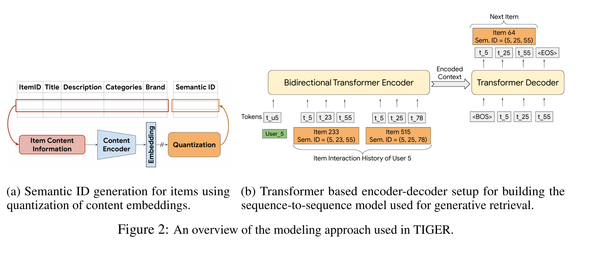

### EAGER｜行为—语义协同双流生成式推荐
[论文](papers/eager.md) · KDD 2024  ·  用行为码与语义码双流生成并在内部合并候选。

### MiniOneRec｜可扩展生成式推荐框架
[论文](papers/minionerec.md) · 2025  ·  统一 SID 对齐、语言模型扩展和推荐偏好强化学习。

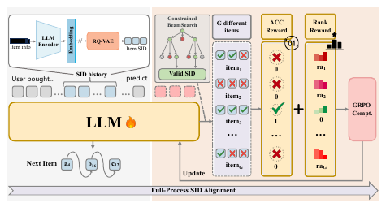

### LC-Rec｜协同语义融合的语言模型推荐
[论文](papers/lcrec.md) · 2024  ·  将语言语义与协同语义共同编码为可生成的物品索引。

### Align3GR｜多层统一对齐生成式推荐
[论文](papers/align3gr.md) · 2025  ·  在 token、行为建模和偏好三个层面对齐语义与协同信息。

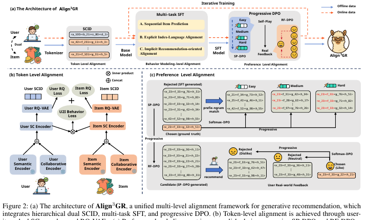

### ColaRec｜基于内容的协同生成推荐
[论文](papers/colarec.md) · CIKM 2024  ·  用 GNN 协同表示构造 GID，并联合内容与推荐目标。

### FORGE｜工业数据集语义标识构建
[论文](papers/forge.md) · 2025  ·  面向工业交互数据融合多模态内容和协同关系构造 SID。

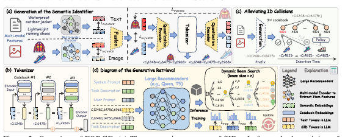

### RPG｜并行生成长语义标识
[论文](papers/rpg.md) · KDD 2025  ·  用多 token 预测和标识图传播降低长 SID 生成成本。

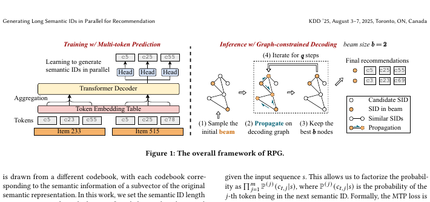

### GRID｜语义标识生成式推荐实践框架
[论文](papers/grid.md) · CIKM 2025  ·  整理 SID 分词、生成、约束解码和评估流程。

### ETEGRec｜端到端可学习物品分词生成推荐
[论文](papers/etegrec.md) · SIGIR 2025  ·  让物品 tokenizer 接受推荐目标的端到端反馈。

### GFlowGR｜生成流网络生成式推荐微调
[论文](papers/gflowgr.md) · SIGIR 2026  ·  把 SID 生成轨迹建模为生成流网络。

### GRAM｜语义感知多粒度后融合生成推荐
[论文](papers/gram.md) · 2025  ·  在解码端后融合多粒度语义与协同信息。

### LETTER｜生成式推荐的可学习物品分词
[论文](papers/letter.md) · CIKM 2024  ·  用语义、协同和多样性目标学习物品标识。

### LLaDA-Rec｜离散扩散并行语义标识生成
[论文](papers/lladarec.md) · 2025  ·  以离散扩散迭代去噪替代逐 token 自回归生成。

### MMQ-v2｜自适应行为挖掘语义标识学习
[论文](papers/mmqv2.md) · 2025  ·  用稀疏混合专家自适应融合内容与行为信号。

### OneRec｜检索排序一体化生成式推荐
[论文](papers/onerec.md) · 2025  ·  以生成列表统一召回与排序，并进行迭代偏好对齐。

### SIDReasoner｜基于语义标识推理的生成式推荐
[论文](papers/sidreasoner.md) · KDD 2026  ·  在生成最终 SID 前显式推理用户偏好。

### S2GR｜潜空间逐步语义引导推理
[论文](papers/s2gr.md) · KDD 2026  ·  在 SID 生成每一步注入语义引导信号。

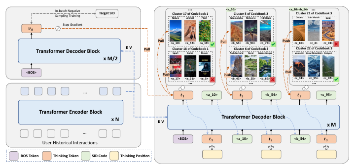

### V-STAR｜价值引导结构化采样与优化
[论文](papers/vstar.md) · KDD 2026  ·  按候选价值分配生成搜索预算。

### TokenRec｜面向 LLM 生成推荐的 ID 分词
[论文](papers/tokenrec.md) · 2024  ·  用多码本量化将协同 ID 学习为可组合 token。

### GREAM｜基于大语言模型的生成式推理推荐
[论文](papers/gream.md) · 2025  ·  将协同—语义对齐、推理课程学习和 SRPO 结合，直接生成物品标识。

### HiD-VAE｜层次解耦语义标识可解释生成推荐
[论文](papers/hidvae.md) · 2025  ·  用层次监督和唯一性损失学习可解释、低碰撞 SID。

### IDGenRec｜文本 ID 学习的 LLM—推荐系统对齐
[论文](papers/idgenrec.md) · SIGIR 2024  ·  以文本 ID 作为 LLM 与推荐器之间的接口。

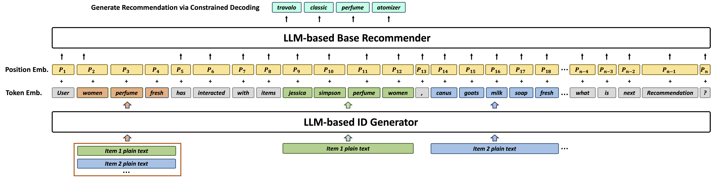

### OneRec-Think｜文本内推理生成式推荐
[论文](papers/onerecthink.md) · 2025  ·  在生成 itemic token 前加入偏好理由和强化学习。

### MACRec｜多方面跨模态量化生成式推荐
[论文](papers/macrec.md) · 2025  ·  在 SID 量化和生成训练中同时建模文本、图像及其交互。

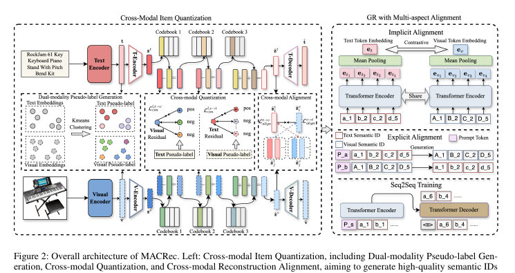

### MQL4GRec｜生成式推荐的多模态量化语言
[论文](papers/mql4grec.md) · ICLR 2025  ·  将多域多模态内容翻译为统一的离散量化语言。

### GenCDR｜带自适应语义分词的跨域生成推荐
[论文](papers/gencdr.md) · 2025  ·  用共享 SID、域特定适配器和动态路由实现跨域生成。

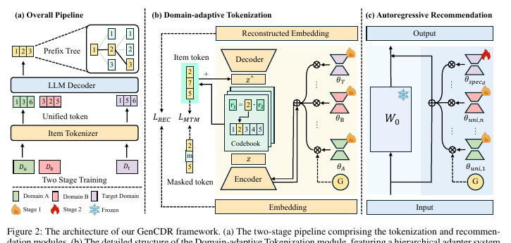

### GMC｜生成式多目标跨域推荐
[论文](papers/gmc.md) · 2025  ·  以共享 SID 连接多个领域，并用 LoRA 适配领域偏好。

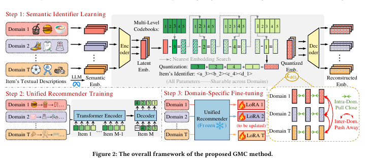

### AdaSID｜多模态语义标识的自适应碰撞处理
[论文](https://arxiv.org/abs/2604.23522) · 2026  ·  按碰撞情况自适应地学习多模态 SID，替代静态的碰撞处理。

### CapsID｜胶囊路由的软变长语义标识
[论文](https://arxiv.org/abs/2605.05096) · 2026  ·  用胶囊路由替代硬残差量化，按置信度决定 SID 长度，再用 Semantic BPE 合并相邻 token。

### CARD｜视觉语义单元与非均匀量化
[论文](https://arxiv.org/abs/2604.26427) · 2026  ·  把文本、图像和协同信号统一成视觉语义单元，再用非均匀 RQ-VAE 缓解码字分布不均。

### CoST｜对比量化语义分词
[论文](https://arxiv.org/abs/2404.14774) · RecSys 2024  ·  在量化中加入对比学习，让 SID 保留物品之间的邻域关系。

### DAS｜双对齐语义标识
[论文](https://arxiv.org/abs/2508.10584) · 2025  ·  单阶段同时优化量化和协同对齐，让用户侧与广告侧的 SID 互相对齐。

### DeepInterestGR（2604.20861；综述记作 DeepContextGR）｜意图增强的语义标识生成推荐
[论文](https://arxiv.org/abs/2604.20861) · 2026  ·  量化前用 VLM 描述和 LLM 意图挖掘丰富物品表示，强化学习阶段加入语义质量奖励。

### DeepInterestGR（2602.18907）｜深层兴趣挖掘生成推荐
[论文](https://arxiv.org/abs/2602.18907) · 2026  ·  用多个 LLM 挖掘深层兴趣并写进 RQ-VAE 离散化，再经 SFT 和 GRPO 训练。

### GEM-Rec｜竞价感知的生成式推荐
[论文](https://arxiv.org/abs/2603.22231) · 2026  ·  用控制 token 决定是否展示广告，并在约束解码时注入实时出价。

### GenRec-JD｜京东偏好导向生成式推荐
[论文](https://arxiv.org/abs/2604.14878) · SIGIR 2026  ·  按页做下一 token 预测，压缩输入侧的多 token SID，并做偏好对齐。

### Latte｜潜 token 扩展生成表达能力
[论文](https://arxiv.org/abs/2605.06331) · 2026  ·  指出逐码解码树限制了表达能力，在每个 SID 前插入潜 token 重塑解码空间。

### MBGR｜美团多业务生成式推荐
[论文](https://arxiv.org/abs/2604.02684) · 2026  ·  用业务感知 SID 和多业务预测结构缓解多业务场景的跷跷板问题。

### MSCGRec｜融合语义与协同信号的多模态生成推荐
[论文](https://arxiv.org/abs/2602.03713) · 2026  ·  用多模态语义码和协同码共同表示物品，以约束 softmax 训练，约束束搜索解码。

### PAD-Rec｜位置感知草稿的推理加速
[论文](https://arxiv.org/abs/2604.27747) · 2026  ·  在投机解码的草稿模型中加入 SID 位置信息，加速列表式生成。

### PROMISE｜过程奖励模型引导的测试时扩展
[论文](https://arxiv.org/abs/2601.04674) · 2026  ·  用过程奖励模型给中间解码步打分，并据此剪枝束搜索。

### PSI｜纯语义索引
[论文](https://arxiv.org/abs/2509.16446) · 2025  ·  放宽最近质心分配，不追加非语义 token 也能得到唯一 SID。

### R3-VAE｜参考向量引导的评分残差量化
[论文](https://arxiv.org/abs/2604.11440) · 2026  ·  用参考向量和点积评分稳定残差量化训练，并给出不用训练生成模型的 SID 评估指标。

### SEATER｜语义树结构标识生成检索
[论文](https://arxiv.org/abs/2309.13375) · 2024  ·  构造等长的平衡树状标识，并用对比学习建模标识结构。

### SIIT｜自我改进的物品分词
[论文](https://arxiv.org/abs/2412.17171) · 2024  ·  让 LLM 在训练中迭代修正自己的物品分词。

### STAMP｜语义裁剪与辅助多步预测
[论文](https://arxiv.org/abs/2604.05329) · 2026  ·  输入侧裁掉冗余 SID token，输出侧加多步预测，提高训练效率。

### SynGR｜跨模态协同生成推荐
[论文](https://arxiv.org/abs/2605.18920) · ICML 2026  ·  在生成阶段显式利用文本和图像之间的协同信息。

### TriAlignGR｜三角多任务对齐生成推荐
[论文](https://arxiv.org/abs/2605.05249) · 2026  ·  把视觉语义编进 SID，并用视觉描述等多任务让模型理解 SID 的含义。

### UniRec｜属性链生成式推荐
[论文](https://arxiv.org/abs/2604.12234) · 2026  ·  解码 SID 前先生成类目、商家、品牌等属性 token，补上物品侧的特征交叉。

### UniTok｜多域统一物品分词
[论文](https://arxiv.org/abs/2511.12922) · AAAI 2026  ·  用共享专家和领域专家码本，把多个领域的物品统一分词。

### UTGRec｜可迁移的通用物品分词
[论文](https://arxiv.org/abs/2504.04405) · 2025  ·  用多模态大模型和树状码本构造跨领域通用的物品标识。

## POI 与本地生活推荐

### GNPR-SID｜基于语义标识的生成式下一兴趣点推荐
[论文](papers/gnprsid.md) · KDD 2025  ·  融合语义、地理、时间和协同信号构造 SID，并直接生成下一 POI。

### OneLoc｜地理感知本地生活生成式推荐
[论文](papers/oneloc.md) · 2025  ·  结合地理感知 SID、位置注意力、邻域提示和多目标偏好优化。

### LGSID｜大语言模型对齐的地理物品分词
[论文](papers/lgsid.md) · 2025  ·  先进行地理 LLM 对齐，再构造层次化地理 SID。

### ROS｜空间推理增强的生成式下一兴趣点推荐
[论文](papers/ros.md) · 2026  ·  通过空间 SID、移动思维链和空间强化学习进行地理约束推理。

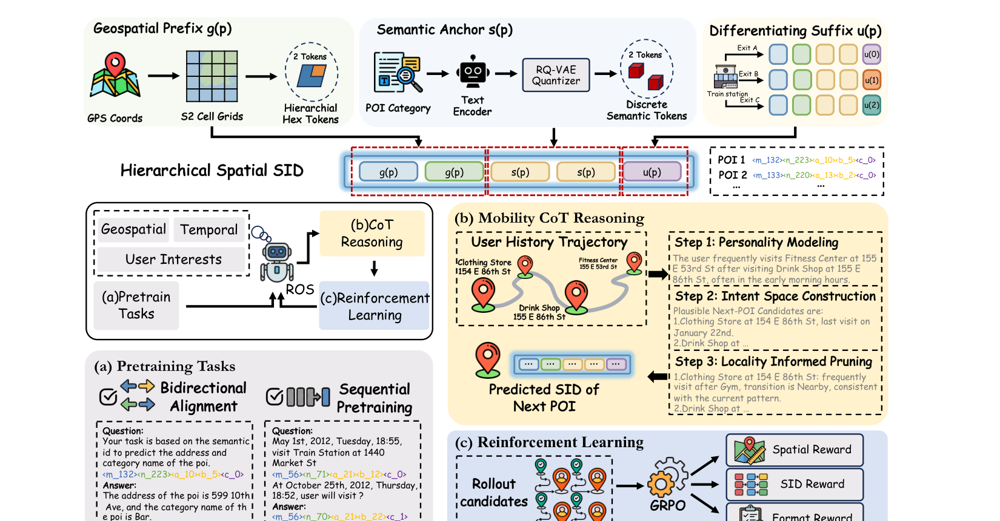

### GeoGR｜工业规模时空感知生成式 POI 推荐
[论文](papers/geogr.md) · 2026  ·  用时空协同 SID 和多阶段 LLM 对齐支持工业级下一 POI 推荐。

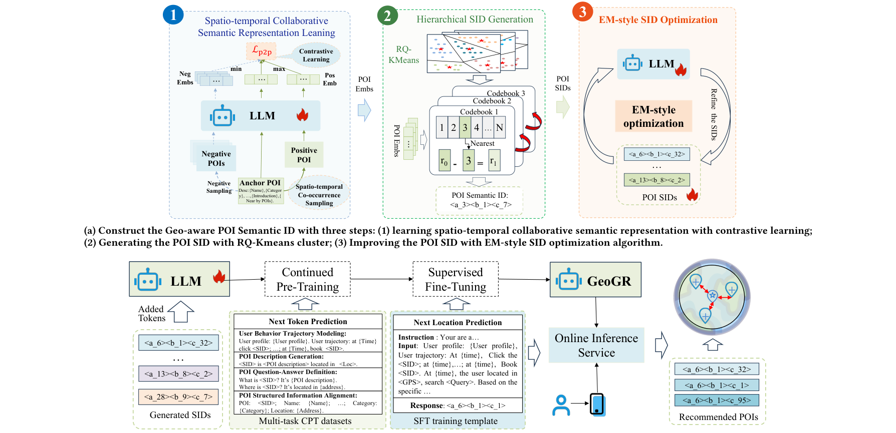

### ProGEO｜距离感知地理码本
[论文](papers/progeo.md) · 2026  ·  用局部坐标和 Geo-RoPE 将地理邻近关系融入 SID。

### Gwhere｜高德生成式下一兴趣点推荐
[论文](papers/gwhere.md) · RecSys 2026  ·  融合多模态 SID、时空语料和暴露感知偏好优化。

### LGRID｜生成解耦的可解释本地生活推荐
[论文](papers/lgrid.md) · 2026  ·  将地理与语义属性解耦并分别量化为双流 SID。

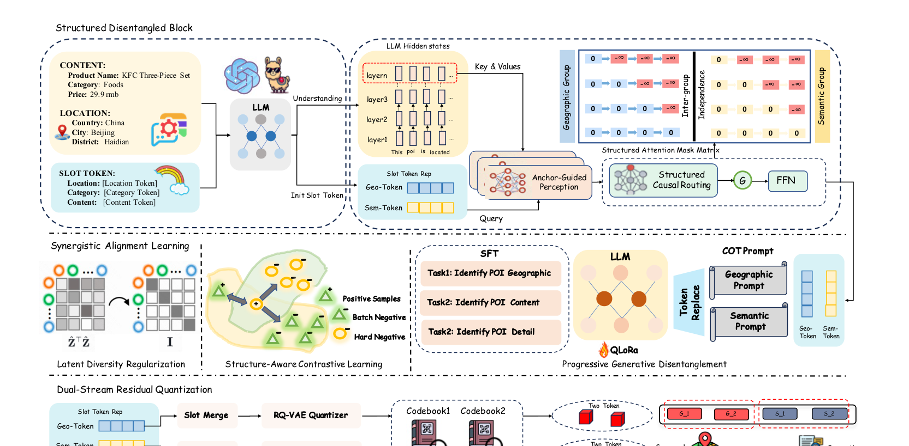

### Think2Go｜带大语言模型推理的生成式下一兴趣点推荐
[论文](papers/think2go.md) · KDD 2026  ·  统一 SFT、推理、自纠错和自适应强化学习。

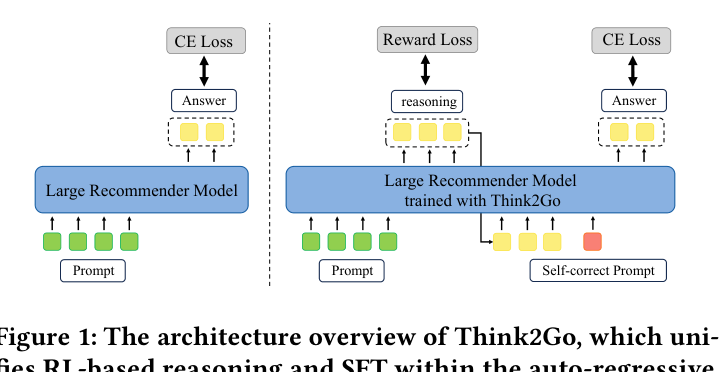

## 边界与排除方法

- [ActionPiece](papers/actionpiece.md)：压缩动作序列 token，不构建并直接生成完整物品 SID。
- [LIGER](papers/liger.md)：生成 SID 后仍依赖稠密检索和最终排序。
- [GRLM](papers/grlm.md)：Term ID 无法精确匹配时仍依赖候选库结构化评分。
- [VQ-Rec](papers/vqrec.md)：量化 code 只作为表示，最终通过全物品评分排序。
- [COBRA](https://arxiv.org/abs/2503.02453)：先生成稀疏 ID，再生成稠密向量并在该 ID 下做近邻检索，用 BeamFusion 融合两种分数排序。
- [GR-Generalize](https://arxiv.org/abs/2603.19809)：以分析为主；提出的方法按实例加权融合生成式模型和 SASRec 的分数，最终物品不由 SID 生成单独决定。
- [Q-BERT4Rec](https://arxiv.org/abs/2512.02474)：掩码预测下一物品的 SID，推理时在物品集合上取概率最大者，原文没有给出生成或解码 SID 的过程。
- [RecBase](https://arxiv.org/abs/2509.03131)：推理时可逐位生成概念 ID，但实验按 AUC 对候选物品打分排序。
- [RecoChain](https://arxiv.org/abs/2604.25787)：束搜索生成候选 SID 后，再由排序头对候选打分重排。
- [CausalDPO](https://arxiv.org/abs/2603.22335)：生成物品标题文本，再对全物品打分映射到物品，不使用 SID。
- [MME-SID](https://arxiv.org/abs/2509.02017)：SID 只作 LLM 的输入，用输出嵌入对全物品打分，不生成 SID。
- [Molar](https://arxiv.org/abs/2412.18176)：用多模态 LLM 产出用户和物品嵌入，按相似度推荐，不使用 SID。
- [PSRQ](https://arxiv.org/abs/2508.20359)：SID 只作音乐推荐排序模型的特征，按 AUC 评估，不生成 SID。

## 维护方式

- [论文详细卡片](papers/)
- [结构化方法总表](tables/all-methods.md)
- [边界与排除方法说明](tables/boundary-and-excluded-methods.md)
