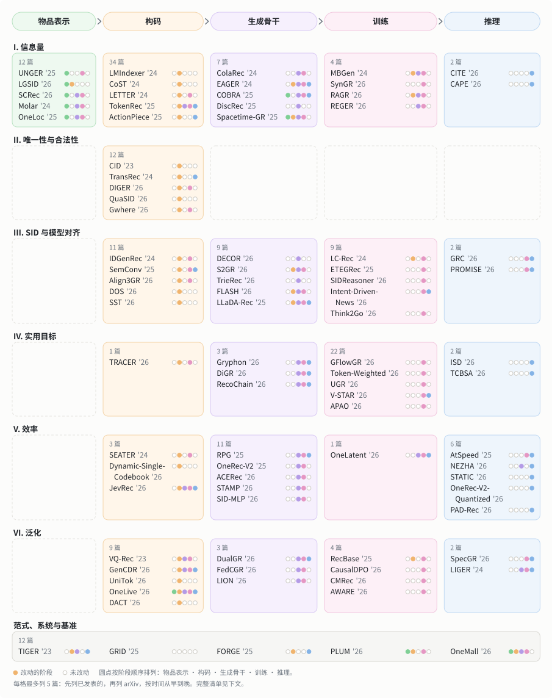

<!--lint disable awesome-github table-pipe-alignment double-link-->

# Awesome Semantic ID Generative Recommendation 

围绕研究问题与五阶段流程组织的语义 ID（Semantic ID）生成式推荐论文索引与精读笔记。

  

[English](README.md) | 中文

[分类总图](#分类总图) · [应用场景](#应用场景) · [阅读导航](#阅读导航) · [全部论文](#全部论文) · [参与贡献](#参与贡献)

## 收录范围

本仓库收录 181 篇语义 ID（Semantic ID，SID）生成式推荐论文。这类方法用编号器将每个物品映射为离散 token，再由生成器逐位解码下一物品的 SID。全库按研究问题与主要改动的流程阶段组织 169 篇方法论文，另收 12 篇范式、系统与基准论文。

## 分类总图

图中按研究问题（行）与主要改动的流程阶段（列）分格，每格给出该格论文总数并列出最多 5 篇论文（已发表优先于 arXiv，按年份从早到晚），篇名后的五个圆点按五阶段顺序标出该文改动的阶段。

## 应用场景

下表按任务形态（可多选）与论文达到的最高部署条件统计篇数；点击行末合计可查看对应论文列表：

| 任务形态      | 公开数据 | 工业数据离线 | 线上实验或部署 |                     合计                     |
| :-------- | :--: | :----: | :-----: | :----------------------------------------: |
| 一般物品推荐    | 107  |   13   |    42   |  [162](pages/zh/index/scenario.md#一般物品推荐)  |
| 查询驱动检索    |  2   |   4    |    2    |   [8](pages/zh/index/scenario.md#查询驱动检索)   |
| POI 与本地生活 |  5   |   5    |    6    | [16](pages/zh/index/scenario.md#poi-与本地生活) |
| 排序与重排     |  2   |   2    |    8    |   [12](pages/zh/index/scenario.md#排序与重排)   |
| 对话与指令推荐   |  1   |   0    |    1    |  [2](pages/zh/index/scenario.md#对话与指令推荐)   |

特殊评测设置：[冷启动（18）](pages/zh/index/scenario.md#冷启动) · [跨域迁移（22）](pages/zh/index/scenario.md#跨域迁移) · [目录动态变化（3）](pages/zh/index/scenario.md#目录动态变化)

## 阅读导航

按你的查找目的，从下表选择对应入口：

| 我想……                                 | 去哪里看                                 |
| :----------------------------------- | :----------------------------------- |
| 刚接触 Semantic ID，了解基本流程并从代表作读起        | [入门指南](guides/start-here.zh.md)      |
| 找解决某类问题的方法（如码字冲突、表征对齐、推理效率）          | [全部论文](#全部论文)                        |
| 在同一个流程阶段内横向对比不同方法                    | [按阶段索引](pages/zh/index/stages.md)    |
| 找用多模态内容或协同过滤（CF）信号构码的论文              | [按模态找论文](pages/zh/index/modality.md) |
| 找某个业务领域的论文（如电商、本地生活 POI、短视频）         | [按领域找论文](pages/zh/index/domain.md)   |
| 找特定任务形态或部署条件的论文（如查询检索、POI、排序重排、线上实验） | [按场景找论文](pages/zh/index/scenario.md) |
| 找公开了开源代码的论文                          | [有代码的论文](pages/zh/index/code.md)     |
| 让大模型或检索工具直接读取这个仓库                    | [llms.txt](llms.txt)（英文）             |

## 代表性必读论文

初读建议先看下表三篇代表作，分别对应标准五阶段流程、工业界本地生活扩展与长 ID 并行生成：

| 论文         | 核心机制                                                                               | 发表         |
| :--------- | :--------------------------------------------------------------------------------- | :--------- |
| [TIGER][]  | TIGER 用 RQ-VAE 将物品文本编码为语义 ID（SID），并训练 Transformer 编码器-解码器自回归解码下一物品的 SID，替代近似最近邻检索。 | NeurIPS’23 |
| [OneLoc][] | OneLoc 在编号、编码器注意力与解码器提示中融入地理信息，并结合地理与 GMV 奖励做 DPO，将端到端生成式推荐扩展到本地生活短视频。             | arXiv’25   |
| [RPG][]    | RPG 用多 token 预测损失并行预测长且无序的 OPQ SID，并在合法 ID 图上解码，替代短 ID 上的自回归束搜索。                   | KDD’25     |

## 最近更新

按日期倒序记录仓库内容增补与综述 Table 1 同步情况：

- 2026-11-04: 仓库新增应用场景标注（任务形态与部署条件）及按场景找论文的索引页。
- 2026-11-04: 仓库新增问题 × 阶段分类总图、逐篇多阶段改动标记与按 SID 编号器输入模态的索引页。
- 2026-11-01: 新增精读笔记、实验设置卡、相关工作关系图、按阶段与代码索引页及受控词表术语表。涉及论文：[TIGER][]、[RPG][]、[OneLoc][]、[LETTER][]、[SIDScope][]。
- 2026-10-30: 同步综述 Table 1 的全部 181 篇论文记录，覆盖六个研究问题与五个流程阶段。

## 全部论文

按研究问题分带与主要改动阶段排列的完整论文列表（每篇含一句话核心机制、论文与代码链接）：

- [范式、系统与基准][]
- [I. 信息量][]
- [II. 唯一性与合法性][]
- [III. SID 与模型对齐][]
- [IV. 实用目标][]
- [V. 效率][]
- [VI. 泛化][]

## 范式、系统与基准

> 基线范式（TIGER）、端到端多阶段工业框架、开源代码库、评测基准与诊断工具。

12 篇

- [TIGER][] - NeurIPS’23 
  TIGER 用 RQ-VAE 将物品文本编码为语义 ID（SID），并训练 Transformer 编码器-解码器自回归解码下一物品的 SID，替代近似最近邻检索。 
  [论文](https://arxiv.org/abs/2305.05065) · [代码（第三方）](https://github.com/baiyimeng/TIGER)

- [FORGE][] - KDD’26 
  FORGE 在开源淘宝工业数据集上评测不同 SID 构建策略，并提出无需训练生成器即可评估 ID 质量的指标。 
  [论文](https://arxiv.org/abs/2509.20904) · [代码](https://github.com/selous123/al_sid)

- [GRID][] - CIKM’25 
  GRID 提供开源模块化框架，支持自由替换 SID 编号器、生成骨干与解码策略，并在公开基准上系统消融各组件的设计选择。 
  [论文](https://arxiv.org/abs/2507.22224) · [代码](https://github.com/snap-research/GRID)

- [MiniOneRec][] - arXiv’25 
  MiniOneRec 是覆盖 RQ-VAE SID 构建、Qwen 骨干监督微调与受约束解码强化学习的开源框架，用于在公开基准上检验生成式扩展规律。 
  [论文](https://arxiv.org/abs/2510.24431) · [代码](https://github.com/AkaliKong/MiniOneRec)

- [OneRec][] - arXiv’25 
  OneRec 用带稀疏 MoE 的单一编码器-解码器生成器替代召回-排序级联，整段生成视频会话，并通过奖励模型与迭代 DPO 对齐用户偏好。 
  [论文](https://arxiv.org/abs/2502.18965)

- [GR-Generalize][] - arXiv’26 
  GR-Generalize 将测试样本划分为记忆型与泛化型子集，分别对比生成式模型与传统物品 ID 模型的表现，并按样本自适应集成二者。 
  [论文](https://arxiv.org/abs/2603.19809) · [代码](https://github.com/Jamesding000/MemGen-GR)

- [NEO][] - arXiv’26 
  NEO 改造仅解码器 LLM，使自然语言与带类型的物品 SID 在同一序列中交错生成，配合受约束解码在不调用外部工具的情况下统一搜索、推荐与推理。 
  [论文](https://arxiv.org/abs/2603.17533)

- [Netflix-SID-Comparison][] - NeurIPS’26 PALM Workshop 
  Netflix-SID-Comparison 在流媒体工业场景中对比 LLM 生成 SID 时的单头自回归束搜索与多 token 预测在推荐质量与推理成本上的权衡。 
  [论文](https://arxiv.org/abs/2610.15864)

- [OneMall][] - CIKM’26 
  OneMall 用业务感知编号器、Query-Former、稀疏 MoE 层以及作为强化学习奖励的排序模型，在单一生成器中统一商品卡、短视频与直播电商。 
  [论文](https://arxiv.org/abs/2601.21770)

- [PLUM][] - WWW’26 
  PLUM 通过 SID 编号、领域数据持续预训练与生成式检索微调将预训练 LLM 适配到工业推荐系统，替代大规模嵌入表。 
  [论文](https://arxiv.org/abs/2510.07784)

- [ReRankID][] - arXiv’26 
  ReRankID 构建纯 SID 候选列表推理重排基准，在仅提供 SID 的条件下对比不同后训练方法对列表重排的影响。 
  [论文](https://arxiv.org/abs/2610.22797) · [代码](https://github.com/lilv98/ReRankID)

- [SIDScope][] - arXiv’26 
  SIDScope 面向公开 SID 映射提供接口诊断工具，检查码组织结构、物品解析精度以及词表刷新后与生成器的兼容性。 
  [论文](https://arxiv.org/abs/2608.18779) · [代码](https://github.com/jdding/sidscope)

[↑ 回到顶部](#awesome-semantic-id-generative-recommendation)

## I. 信息量

> SID 或读取它的模型是否充分携带了推荐所需的协同、多模态与时空信号？

59 篇

### I × Representation

- [Molar][] - arXiv’24 
  Molar 用多模态 LLM 从文本与图像构建物品表示，并将用户表示与基于 ID 的协同过滤模型对齐，补足 LLM 推荐器缺失的协同信号。 
  [论文](https://arxiv.org/abs/2412.18176) · [代码](https://anonymous.4open.science/r/Molar-8B06/)

- [OneLoc][] - arXiv’25 · `POI` 
  OneLoc 在编号、编码器注意力与解码器提示中融入地理信息，并结合地理与 GMV 奖励做 DPO，将端到端生成式推荐扩展到本地生活短视频。 
  [论文](https://arxiv.org/abs/2508.14646)

- [Q-BERT4Rec][] - arXiv’25 
  Q-BERT4Rec 将文本、图像与结构化特征融合为物品嵌入，经残差向量量化转为 SID token，并用多种掩码策略预训练双向编码器。 
  [论文](https://arxiv.org/abs/2512.02474)

- [UNGER][] - TOIS’25 
  UNGER 通过跨模态对齐与下一物品预测学习统一的语义-协同嵌入并量化为单一码，同时加入模态内蒸馏，替代各模态分别编码的做法。 
  [论文](https://arxiv.org/abs/2502.06269)

- [GeoGR][] - arXiv’26 · `POI` 
  GeoGR 从受地理约束的共访对出发，经对比学习与迭代修正构建地理感知 POI SID，再通过持续预训练与微调将 LLM 与之对齐。 
  [论文](https://arxiv.org/abs/2602.10411)

- [HF-SID][] - arXiv’26 · `POI` 
  HF-SID 在量化前通过笛卡尔坐标、带单位数值编码与残差对比学习恢复 POI 表示中的地理、数值与结构细节，无需加长 SID。 
  [论文](https://arxiv.org/abs/2608.30479)

- [LGRID][] - arXiv’26 · `POI` 
  LGRID 用 LLM 联合编码物品各字段，将隐状态路由到地理与语义槽位并分别量化两路表示，替代对混杂表示做单一量化。 
  [论文](https://arxiv.org/abs/2607.27944)

- [LGSID][] - AAAI’26 · `POI` 
  LGSID 用奖励模型与 G-DPO 将 LLM 对齐到空间关系，再由空间与内容属性加上对齐后 LLM 表示的残差 token 构建 SID。 
  [论文](https://arxiv.org/abs/2511.14221) · [代码](https://github.com/JiangHaoPG11/LGSID)

- [ReSID][] - arXiv’26 
  ReSID 用字段感知掩码自编码从结构化特征学习物品表示，并用全局对齐正交量化将它转为离散码，替代 LLM 嵌入与通用量化器。 
  [论文](https://arxiv.org/abs/2602.02338) · [代码](https://github.com/FuCongResearchSquad/ReSID)

- [SCRec][] - RecSys’26 
  SCRec 将文本化的协同信号注入语义编号，在生成时用可学习码嵌入校准语义先验，并对齐码本与语义空间以耦合两个阶段。 
  [论文](https://arxiv.org/abs/2609.13678) · [代码](https://github.com/DanJiayi/SCRec)

- [SPAR][] - arXiv’26 · `POI` 
  SPAR 将正弦坐标嵌入融入 SID 构建，在地理空间数据上持续预训练 LLM，并在行为微调期间将该知识固定为冻结任务向量。 
  [论文](https://arxiv.org/abs/2609.02062)

- [TriAlignGR][] - arXiv’26 
  TriAlignGR 在 SID 构建中引入视觉内容与 LLM 挖掘的用户意图，并在统一自回归损失下训练连接 SID、文本与图像的多项生成任务。 
  [论文](https://arxiv.org/abs/2605.05249)

### I × Tokenization

- [CoST][] - RecSys’24 
  CoST 用刻画物品邻域关系的对比量化目标训练物品编号器，替代 RQ-VAE 使用的重构损失。 
  [论文](https://arxiv.org/abs/2404.14774)

- [LETTER][] - CIKM’24 
  LETTER 用协同对齐损失与多样性损失约束 RQ-VAE 编号器，使物品 SID 融入协同信号并减轻早期标识中的码分配偏置。 
  [论文](https://arxiv.org/abs/2405.07314) · [代码](https://github.com/HonghuiBao2000/LETTER)

- [LMIndexer][] - ICML’24 
  LMIndexer 通过渐进式训练、对比学习与自监督重构用生成式语言模型学习序列 SID，替代对现成编码器嵌入做后验量化。 
  [论文](https://arxiv.org/abs/2310.07815) · [代码](https://github.com/PeterGriffinJin/LMIndexer)

- [ActionPiece][] - ICML’25 
  ActionPiece 将每次交互表示为物品特征集合，把共现特征模式合并为新 token，使相同动作获得随上下文变化的 token，而非固定独立的 token。 
  [论文](https://arxiv.org/abs/2502.13581) · [代码](https://github.com/google-deepmind/action_piece)

- [ADC-SID][] - arXiv’25 
  ADC-SID 在 SID 量化中引入随协同噪声自适应的对齐强度与可学习的行为 ID 权重，替代统一强度的对齐和等权重聚合。 
  [论文](https://arxiv.org/abs/2510.25622)

- [DAS][] - CIKM’25 
  DAS 通过多视图对比对齐以及用户与广告的双重量化，在单阶段内同步优化量化与协同对齐，避免两阶段对齐带来的信息损失。 
  [论文](https://arxiv.org/abs/2508.10584)

- [EAGER-LLM][] - WWW’25 
  EAGER-LLM 为仅解码器 LLM 加入行为与语义双源物品索引、多尺度对齐重构任务以及退火适配器，无需从头学习协同语义。 
  [论文](https://arxiv.org/abs/2502.14735)

- [FlexCode][] - arXiv’25 
  FlexCode 通过轻量 MoE 按物品流行度在协同码本与语义码本之间分配固定 token 预算，替代所有物品共用单一码本的做法。 
  [论文](https://arxiv.org/abs/2511.20673)

- [GenSAR][] - RecSys’25 
  GenSAR 用同时承载语义与协同信号的双用途标识和任务特定训练，把搜索与推荐统一到单个生成器中，缓解两项任务之间的冲突。 
  [论文](https://arxiv.org/abs/2504.05730)

- [GNPR-SID][] - KDD’25 · `POI` 
  GNPR-SID 用融合语义与协同特征并在多样性损失下训练的 RQ-VAE SID 替代随机数字 POI ID，并微调 LLM 生成下一访问 POI。 
  [论文](https://arxiv.org/abs/2506.01375) · [代码](https://github.com/wds1996/GNPR-SID)

- [GRAM][] - ACL’25 
  GRAM 将层级与协同物品关系转化为 LLM 词表中的词，分别编码多粒度提示并仅在解码时融合，以利用长物品文本。 
  [论文](https://arxiv.org/abs/2506.01673) · [代码](https://github.com/skleee/GRAM)

- [KGTB][] - arXiv’25 · `POI` 
  KGTB 将 POI 数据组织为知识图谱，在图监督下把节点量化为结构化 ID，并在 POI、类目与区域访问任务上微调 LLM。 
  [论文](https://arxiv.org/abs/2509.12350)

- [MME-SID][] - CIKM’25 
  MME-SID 将多模态嵌入与经最大均值差异和对比对齐训练的 MM-RQ-VAE SID 嵌入一同输入 LLM，缓解嵌入坍缩与灾难性遗忘。 
  [论文](https://arxiv.org/abs/2509.02017) · [代码](https://github.com/Applied-Machine-Learning-Lab/MME-SID)

- [MQL4GRec][] - ICLR’25 
  MQL4GRec 将多个域的物品文本与图像转化为共享量化语言并在其上预训练多类生成任务，跨领域和模态迁移推荐知识。 
  [论文](https://arxiv.org/abs/2504.05314) · [代码](https://github.com/zhaijianyang/MQL4GRec)

- [PSRQ][] - CIKM’25 
  PSRQ 生成保留前缀语义特征的模态特定与模态联合 SID，并用多码本交叉注意力建模音乐兴趣，减轻残差量化中的语义漂移。 
  [论文](https://arxiv.org/abs/2508.20359)

- [QT-Mob][] - KDD’25 · `POI` 
  QT-Mob 将位置编码为紧凑语义 token，并用将 token 对齐到 LLM 表示的互补目标微调模型，用于下一地点预测与移动轨迹恢复。 
  [论文](https://arxiv.org/abs/2506.11109) · [代码](https://github.com/shadowfall09/QT-Mob)

- [TokenRec][] - TKDE’25 
  TokenRec 将掩码协同用户与物品表示量化为离散 token，无需自回归解码或束搜索即可检索 top-K 物品，并泛化到新用户与新物品。 
  [论文](https://arxiv.org/abs/2406.10450) · [代码](https://github.com/Quhaoh233/TokenRec)

- [CapsID][] - arXiv’26 
  CapsID 用胶囊路由替代硬残差量化，将物品软路由到多个胶囊并在置信度足够高时终止生成，使各物品的 SID 长度按需变化。 
  [论文](https://arxiv.org/abs/2605.05096)

- [ChronoID][] - arXiv’26 
  ChronoID 系统评测显式时间编码、融合与量化方式对时间感知 SID 的影响，替代忽略时间动态的静态 SID。 
  [论文](https://arxiv.org/abs/2606.14260)

- [GrIS (RecDMoN / RQ-GAE)][gris-recdmon-rq-gae] - CIKM’26 
  GrIS (RecDMoN / RQ-GAE) 将 SID 构建视为带协同边的物品图层级划分；当图为空集时，RQ-VAE 与 RQ-KMeans 是它的退化特例。 
  [论文](https://arxiv.org/abs/2610.01533) · [代码](https://github.com/hirc-airecs/graph-informed-sids)

- [MACRec][] - AAAI’26 
  MACRec 对文本与图像特征做跨模态量化以构建低冲突 SID，并在生成器训练中加入隐式与显式跨模态对齐。 
  [论文](https://arxiv.org/abs/2511.15122) · [代码](https://github.com/zhangfw123/MACRec)

- [MMGRec][] - TOMM’26 
  MMGRec 在多模态与协同特征上用 Graph RQ-VAE 为每个物品分配 Rec-ID，并训练带关系感知自注意力的 Transformer 生成该 ID，替代嵌入检索。 
  [论文](https://arxiv.org/abs/2404.16555) · [代码](https://github.com/hanliu95/MMGRec)

- [MMQ][] - WSDM’26 
  MMQ 在正交正则下训练含模态共享与模态特定专家的多模态编号器，再结合多模态重构损失在行为目标上微调 SID。 
  [论文](https://arxiv.org/abs/2508.15281)

- [MSCGRec][] - arXiv’26 
  MSCGRec 用基于 DINO 的自监督学习量化图像，把协同特征作为独立模态引入，并将训练输出限制在合法 token 集合内，以扩展到大物品库。 
  [论文](https://arxiv.org/abs/2602.03713)

- [PCR-CA][] - KDD’26 
  PCR-CA 不同于层级 RQ-VAE，学习应用文本的并行码本表示，并通过对比学习将它与协同信号对齐，用于多类目应用的点击率预测。 
  [论文](https://arxiv.org/abs/2508.18166)

- [Pctx][] - CIKM’26 
  Pctx 将用户交互历史作为上下文对物品编号，使同一物品面向不同用户可获得不同 SID，替代静态的纯物品映射。 
  [论文](https://arxiv.org/abs/2510.21276) · [代码](https://github.com/YoungZ365/Pctx)

- [ProGEO][] - arXiv’26 · `POI` 
  ProGEO 结合地理质心局部坐标系与地理旋转位置编码构建邻近感知地理码本，使 SID 同时刻画语义与地理邻近性。 
  [论文](https://arxiv.org/abs/2604.23156)

- [RoFiGR][] - arXiv’26 
  RoFiGR 将粗粒度 SID 码向量与协同嵌入对齐，并用按层级自适应的权重在合法分支上蒸馏序列推荐教师，减少早期路由错误。 
  [论文](https://arxiv.org/abs/2610.39470)

- [ROS][] - ACL’26 · `POI` 
  ROS 为基于 LLM 的下一 POI 生成加入层级空间 SID、带局部性剪枝的移动思维链以及空间引导强化学习。 
  [论文](https://arxiv.org/abs/2601.04562) · [代码](https://github.com/amap-cvlab/Reasoning-Over-Space)

- [SPRIG][] - CIKM’26 Short 
  SPRIG 在以内容派生 SID 结尾的知识图谱路径上训练生成器，将关系结构锚定与共享物品 token 结合起来，替代绑定嵌入表的不透明 token。 
  [论文](https://arxiv.org/abs/2610.06590) · [代码](https://github.com/justinhangoebl/semantic-id-knowledge-graph-recommender)

- [Tlow][] - CIKM’26 Applied 
  Tlow 在独立量化前用归一化流将语义嵌入映射到标准正态隐空间，并对齐码本与 token 嵌入空间，区别于 RQ-VAE 和 OPQ。 
  [论文](https://arxiv.org/abs/2608.24176) · [代码](https://github.com/wjjln/Tlow)

- [UniRec][] - arXiv’26 
  UniRec 通过属性链在每个 SID 前添加类目、卖家与品牌 token，恢复判别式模型的物品侧特征交叉能力，并加入容量受限量化。 
  [论文](https://arxiv.org/abs/2604.12234)

- [UniSID][] - arXiv’26 
  UniSID 通过多粒度对比学习与基于摘要的重构，从原始广告数据端到端联合优化嵌入与 SID，替代先提取嵌入再后验量化的两步做法。 
  [论文](https://arxiv.org/abs/2602.10445)

- [VarLenRec (TIGER)][varlenrec-tiger] - arXiv’26 
  VarLenRec (TIGER) 通过双曲残差量化与软长度控制器为热门物品分配较短 SID、为长尾物品分配较长 SID，替代固定长度编号。 
  [论文](https://arxiv.org/abs/2605.17779)

### I × Backbone

- [ColaRec][] - CIKM’24 
  ColaRec 从预训练协同过滤模型构造生成式标识，结合物品索引任务与对比损失对齐协同与内容空间，从交互物品内容生成目标 ID。 
  [论文](https://arxiv.org/abs/2403.18480) · [代码](https://github.com/Junewang0614/ColaRec)

- [EAGER][] - KDD’24 
  EAGER 用共享编码器和两个解码器分别解码行为 token 与语义 token，并加入对比学习与语义引导迁移任务，替代仅用单一物品信息的做法。 
  [论文](https://arxiv.org/abs/2406.14017) · [代码](https://github.com/yewzz/EAGER)

- [COBRA][] - NeurIPS’25 
  COBRA 先生成稀疏 SID 再以它为条件生成稠密向量，端到端联合训练二者，并在解码时用 BeamFusion 融合束搜索分数与最近邻相似度。 
  [论文](https://arxiv.org/abs/2503.02453)

- [DiscRec][] - arXiv’25 
  DiscRec 加入物品级位置嵌入，并将语义与协同信号拆分为两个门控分支（其一在物品内部做注意力计算），而非在单一嵌入空间直接混合。 
  [论文](https://arxiv.org/abs/2506.15576) · [代码](https://github.com/Ten-Mao/DiscRec)

- [Spacetime-GR][] - arXiv’25 · `POI` 
  Spacetime-GR 用地理层级索引 POI，将时空上下文编码进动作序列，融入多模态 POI 嵌入，并针对嵌入、排序分数与候选生成做后训练。 
  [论文](https://arxiv.org/abs/2508.16126)

- [SPAR-Youku][] - arXiv’26 
  SPAR-Youku 从压缩用户记忆中提取前缀相关证据引导每步 SID 解码，并用 RQ-PIB 均衡兄弟分支间的交互负载，减少分支错误与流行度偏差。 
  [论文](https://arxiv.org/abs/2610.27898)

- [UniSGR-V2][] - arXiv’26 
  UniSGR-V2 在每个码字前预测连续目标侧特征向量，并在解码器内将它与语义前缀和用户行为交叉，同时用于生成与排序。 
  [论文](https://arxiv.org/abs/2610.16132)

### I × Training

- [MBGen][] - CIKM’24 
  MBGen 在同一序列中交错排列行为 token 与物品 token，先预测下一行为类型再预测下一物品，并用按位置路由的稀疏架构扩展规模。 
  [论文](https://arxiv.org/abs/2405.16871) · [代码](https://github.com/anananan116/MBGen)

- [RAGR][] - arXiv’26 
  RAGR 在用户序列中按时间交错排列物品 SID 与评论 SID，并用 DPO 在预测位置偏好物品 token，替代仅建模物品序列的做法。 
  [论文](https://arxiv.org/abs/2605.17267) · [代码](https://github.com/Zhang-Yingyi/TKDE_RAGR)

- [REGER][] - arXiv’26 
  REGER 预训练生成器以产出语义近邻的 SID，结合全局与 ID 边界局部注意力，并沿目标前缀路径蒸馏判别式教师的下一 token 分布。 
  [论文](https://arxiv.org/abs/2610.37584)

- [SynGR][] - ICML’26 
  SynGR 在生成阶段限制模型对主导模态的依赖，促使生成器利用超出模态共享或模态特定信号的跨模态协同信息，替代以对齐为中心的融合。 
  [论文](https://arxiv.org/abs/2605.18920) · [代码](https://github.com/gxingyu/SynGR)

### I × Inference

- [CAPE][] - arXiv’26 
  CAPE 是免训练插件，在束搜索范围外召回有共现支撑的长尾物品并将共现证据融入排序，补足共享前缀生成缺失的物品级记忆能力。 
  [论文](https://arxiv.org/abs/2610.29298)

- [CITE][] - Electronics’26 
  CITE 在固定并行 SID 生成器上加入源嵌入与目标嵌入分离的物品级转移打分项，刻画最近交互物品到各候选物品的有向转移关系。 
  [论文](https://doi.org/10.3390/electronics15204749)

[↑ 回到顶部](#awesome-semantic-id-generative-recommendation)

## II. 唯一性与合法性

> 每个物品是否拥有无冲突的唯一 SID，生成的 SID 是否对应真实物品，码本是否均衡利用？

12 篇

### II × Tokenization

- [CID][] - SIGIR-AP’23 
  CID 研究 P5 基础模型的物品编号方式，提出顺序、协同、语义与混合索引，替代容易产生长输出或虚构物品的随机、标题和独立 ID。 
  [论文](https://arxiv.org/abs/2305.06569) · [代码](https://github.com/Wenyueh/LLM-RecSys-ID)

- [TransRec][] - KDD’24 
  TransRec 用结合 ID、标题与属性的多面标识索引物品，通过 FM-index 子串索引约束生成，并聚合生成的标识为物品库打分排序。 
  [论文](https://arxiv.org/abs/2310.06491) · [代码](https://github.com/Linxyhaha/TransRec/)

- [HiD-VAE][] - arXiv’25 
  HiD-VAE 通过层级监督量化将各 SID 层与多级物品标签对齐，并加入防冲突唯一性损失，替代扁平的无监督编号。 
  [论文](https://arxiv.org/abs/2508.04618) · [代码](https://anonymous.4open.science/r/HiD-VAE-84B2)

- [PSI][] - arXiv’25 
  PSI 通过穷举候选匹配或递归残差搜索放宽最近质心选择，直接分配唯一且保语义的 ID，避免靠追加无语义后缀 token 消解冲突。 
  [论文](https://arxiv.org/abs/2509.16446) · [代码](https://github.com/wangshanyw/PurelySemanticIndexing)

- [AdaSID][] - arXiv’26 
  AdaSID 在编号器训练中对语义相近物品放松排斥，并按局部冲突负载缩放其余排斥项，替代固定强度的重叠正则。 
  [论文](https://arxiv.org/abs/2604.23522)

- [API][] - arXiv’26 
  API 直接复用预训练稀疏自编码器的特征下标作为可解释 SID 词表，并训练适配器预测下标与激活强度，无需重新拟合词表。 
  [论文](https://arxiv.org/abs/2610.36763) · [代码](https://anonymous.4open.science/r/API-C1F9/)

- [CARD][] - arXiv’26 
  CARD 在编码前将文本、图像与协同信号融合为视觉语义单元，并用带可学习非均匀变换的 NU-RQ-VAE 量化，缓解嵌入分布偏斜。 
  [论文](https://arxiv.org/abs/2604.26427) · [代码](https://github.com/HAI-UESTC/CARD)

- [DIGER][] - SIGIR’26 
  DIGER 使 SID 可微以让推荐梯度直接更新编号器，并加入衰减 Gumbel 噪声防止码本坍缩，替代仅按重构目标训练的编号器。 
  [论文](https://arxiv.org/abs/2601.19711) · [代码](https://github.com/junchen-fu/DIGER)

- [Gwhere][] - RecSys’26 · `POI` 
  Gwhere 在文本、图像、空间与协同信号上用对比残差量化编号器学习 POI SID，再经持续预训练、微调和曝光感知 KTO 适配 LLM。 
  [论文](https://arxiv.org/abs/2607.26073) · [代码](https://github.com/alibaba/SimCIT)

- [QuaSID][] - KDD’26 ADS 
  QuaSID 用按汉明距离缩放的间隔仅排斥判定为有害的冲突 SID 对，屏蔽良性重叠并加入双塔对比目标，不再对所有冲突一视同仁。 
  [论文](https://arxiv.org/abs/2603.00632)

- [R3-VAE][] - arXiv’26 
  R3-VAE 用作为语义锚点的参考向量与点积评分机制稳定残差量化，并将两项 SID 质量指标作为训练正则项。 
  [论文](https://arxiv.org/abs/2604.11440) · [代码](https://github.com/wwqq/R3-VAE)

- [SnapLGR][] - arXiv’26 
  SnapLGR 用个性化 PageRank 对比学习从多模态嵌入构建 SID，经持续预训练奠定表示后再微调 LLM，并用 TensorRT-LLM 部署束搜索。 
  [论文](https://arxiv.org/abs/2607.28895)

[↑ 回到顶部](#awesome-semantic-id-generative-recommendation)

## III. SID 与模型对齐

> 生成模型能否理解并推理离散 SID，编号器与生成器的优化目标是否一致？

31 篇

### III × Tokenization

- [IDGenRec][] - SIGIR’24 
  IDGenRec 将文本 ID 生成器与 LLM 推荐器协同训练，为每个物品生成由自然语言 token 组成的简短 ID，并测试向未见平台的零样本迁移。 
  [论文](https://arxiv.org/abs/2403.19021) · [代码](https://github.com/agiresearch/IDGenRec)

- [SIIT][] - arXiv’24 
  SIIT 从任意外部模型给出的物品编号出发，在训练过程中周期性地按 LLM 学到的模式调整编号，使物品编号匹配 LLM 内部的物品理解。 
  [论文](https://arxiv.org/abs/2412.17171)

- [SemConv][] - AAAI’25 
  SemConv 通过对齐编号将物品 ID 转化为与 LLM 空间对齐的 token 序列，加入连接协同信号与自然语言的任务，并预缓存 top-K 结果用于线上服务。 
  [论文](https://arxiv.org/abs/2412.13771)

- [Align3GR][] - AAAI’26 
  Align3GR 从双语义-协同编号、行为建模中的双向语义对齐，以及结合自博弈与真实反馈的渐进式 DPO 三个层面，对齐 LLM 推荐模型。 
  [论文](https://arxiv.org/abs/2511.11255)

- [CogRec][] - arXiv’26 
  CogRec 借助层内图、物品邻域以及匹配、横向跳转与探索三类路由步骤，把推理锚定在 SID 结构上，替代与 ID 关联松散的自然语言推理。 
  [论文](https://arxiv.org/abs/2607.24402) · [代码](https://github.com/caskcsg/CogRec)

- [DOS][] - WWW’26 Short · `POI` 
  DOS 通过协同信号上的用户-物品双向流将 SID 码本与生成空间对齐，并用正交残差量化旋转语义空间。 
  [论文](https://arxiv.org/abs/2602.04460)

- [GR4AD-X][] - arXiv’26 
  GR4AD-X 面向广告场景扩展 GR4AD，结合多路径 SID 分配、不单纯加宽加深骨干的容量扩展，以及带束剪枝和判别式重排的价值引导生成。 
  [论文](https://arxiv.org/abs/2610.38378)

- [GRLM][] - arXiv’26 
  GRLM 用从元数据生成的标准化文本关键词（Term ID）标识物品并据此微调 LLM，避免自由文本幻觉以及 SID 带来的词表扩张。 
  [论文](https://arxiv.org/abs/2601.06798) · [代码](https://github.com/ZY0025/GRLM)

- [HoloRec][] - arXiv’26 
  HoloRec 用带全粒度重构损失的嵌套残差量化构建层级 SID，并在解码过程中直接生成思维链步骤，不依赖外部标注的推理文本。 
  [论文](https://arxiv.org/abs/2606.15331)

- [SST][] - CIKM’26 
  SST 将历史物品表示为由稳定相邻 SID token 合并而成的变长子词，同时保持目标侧定长解码，以减少编码器在单个物品内部的注意力开销。 
  [论文](https://arxiv.org/abs/2608.22734) · [代码](https://github.com/mxrcandy/Semantic-Subword-Tokenization)

- [TopoGR][] - arXiv’26 
  TopoGR 学习可按位分解的二值 SID，并在输入特征、软训练目标与重排中利用其汉明几何结构，不再将 SID token 视作彼此独立的符号。 
  [论文](https://arxiv.org/abs/2607.25216)

### III × Backbone

- [LLaDA-Rec][] - arXiv’25 
  LLaDA-Rec 用带双向注意力、历史级与物品级掩码以及适配束搜索的离散扩散模型并行生成 SID，替代从左到右的自回归解码。 
  [论文](https://arxiv.org/abs/2511.06254) · [代码](https://github.com/TengShi-RUC/LLaDA-Rec)

- [DECOR][] - SIGIR’26 
  DECOR 按交互上下文修正 SID token 嵌入，并融合预训练码本嵌入与可学习协同嵌入，避免静态 token 分配覆盖预训练语义。 
  [论文](https://arxiv.org/abs/2509.10468) · [代码](https://github.com/yliuaa/DECOR.git)

- [FLASH][] - NeurIPS’26 
  FLASH 将哈希方法的劣势归因于自回归解码和刚性离散化，把免训练的 SimHash SID 与并行解码和显式语义对齐结合起来。 
  [论文](https://arxiv.org/abs/2610.07402) · [代码](https://github.com/KevinC2015/Flash)

- [Latte][] - arXiv’26 
  Latte 在每个 SID 前插入隐 token，把单棵解码树拆成多棵以隐变量为条件的子树，放松树上相邻物品之间的概率耦合。 
  [论文](https://arxiv.org/abs/2605.06331) · [代码](https://github.com/hyp1231/Latte)

- [LESSRec][] - arXiv’26 
  LESSRec 按各 SID 层级分别编码交互历史，将注意力限制在目标 token 所在层级并加入物品级语义序列，替代跨全部层级的全局注意力。 
  [论文](https://arxiv.org/abs/2610.37286)

- [MDGR][] - arXiv’26 
  MDGR 采用并行码本、沿时间步与样本自适应的掩码策略以及预热两阶段并行解码做掩码扩散推荐，替代固定顺序的自回归 SID 解码。 
  [论文](https://arxiv.org/abs/2601.19501)

- [PrefixMem][] - arXiv’26 
  PrefixMem 用前缀 n-gram 记忆表为 LLM 构建可预训练的 SID 编码器，使每个 token 获得以前缀为条件的表示，替代普通词表嵌入。 
  [论文](https://arxiv.org/abs/2606.00324)

- [S2GR][] - KDD’26 
  S2GR 在每个 SID 解码步前插入受码本簇分布对比监督的思考 token，并用共现、负载均衡与均匀性目标构建码本。 
  [论文](https://arxiv.org/abs/2601.18664)

- [TrieRec][] - NeurIPS’26 
  TrieRec 为 Transformer 生成器加入前缀树感知绝对位置编码与拓扑感知相对位置编码，使注意力反映 SID 前缀树结构而非扁平 token 流。 
  [论文](https://arxiv.org/abs/2602.21677)

### III × Training

- [LC-Rec][] - ICDE’24 
  LC-Rec 通过带均匀语义映射的向量量化分配无冲突物品索引，并用多类对齐任务微调 LLM，使模型无需候选列表即可从全库生成物品。 
  [论文](https://arxiv.org/abs/2311.09049) · [代码](https://github.com/RUCAIBox/LC-Rec/)

- [ETEGRec][] - SIGIR’25 
  ETEGRec 用序列-物品对齐损失与偏好-语义对齐损失交替训练物品编号器和生成器，替代先独立训练编号器再训练生成器的两阶段流程。 
  [论文](https://arxiv.org/abs/2409.05546) · [代码](https://github.com/RUCAIBox/ETEGRec)

- [GREAM][] - arXiv’25 
  GREAM 结合协同-语义物品索引、思维链课程学习与 SRPO 后训练将 LLM 改造为推理推荐模型，同时支持直接生成和先推理后生成两种模式。 
  [论文](https://arxiv.org/abs/2510.20815) · [代码](https://github.com/Indolent-Kawhi/GRRM)

- [OneRec-Think][] - arXiv’25 
  OneRec-Think 通过物品-文本对齐、推理脚手架和面向多合法目标的推荐奖励，在 OneRec 式生成中加入显式文本推理，替代单纯隐式预测。 
  [论文](https://arxiv.org/abs/2510.11639) · [代码](https://github.com/wangshy31/OneRec-Think)

- [Evo-Rec][] - arXiv’26 
  Evo-Rec 将 SID 与文本和行为对齐，在能提升目标预测的采样推理轨迹上微调，再用受物品库约束的强化学习修正推理过程。 
  [论文](https://arxiv.org/abs/2609.29973) · [代码](https://github.com/mengdanzhu/evo-rec)

- [GTI][] - arXiv’26 
  GTI 在微调前借助配对语言监督，把新增 SID token 映射到预训练嵌入空间中的区分性位置，而非用已有嵌入的均值初始化。 
  [论文](https://arxiv.org/abs/2604.02324)

- [Intent-Driven-News][] - ACL’26 Industry 
  Intent-Driven-News 训练 LLM 将对话中的隐含意图映射为层级 SID 前缀，再与当前新闻池做模糊匹配，替代先检索文章的流程。 
  [论文](https://arxiv.org/abs/2605.07613)

- [SIDReasoner][] - KDD’26 
  SIDReasoner 在教师合成语料上用多任务训练加强 SID 与自然语言的对齐，再通过结果驱动的强化学习改进推理，不依赖人工标注的推荐推理轨迹。 
  [论文](https://arxiv.org/abs/2603.23183) · [代码](https://github.com/HappyPointer/SIDReasoner)

- [Think2Go][] - KDD’26 · `POI` 
  Think2Go 统一监督微调与强化学习推理以用于下一 POI 生成，按提示的认知不确定性与归一化奖励为优势加权，加深 LLM 对 SID 的理解。 
  [论文](https://arxiv.org/abs/2607.28997) · [代码](https://doi.org/10.5281/zenodo.18206701)

### III × Inference

- [GRC][] - CIKM’26 
  GRC 将单遍解码扩展为语义 token 空间中的“生成-反思-修正”流程，用 GRPO 训练轨迹，并在束搜索中按熵分配修正预算。 
  [论文](https://arxiv.org/abs/2602.23639)

- [PROMISE][] - arXiv’26 
  PROMISE 加入轻量过程奖励模型对中间 SID 步骤打分并据此剪枝束搜索分支，纠正早期 token 的语义漂移并随推理计算量扩展性能。 
  [论文](https://arxiv.org/abs/2601.04674)

[↑ 回到顶部](#awesome-semantic-id-generative-recommendation)

## IV. 实用目标

> 训练目标与解码搜索是否面向用户真实偏好与平台业务价值，而非单纯拟合下一 token 似然？

28 篇

### IV × Tokenization

- [TRACER][] - NeurIPS’26 
  TRACER 通过带连贯性正则的重分配机制将敏感概念相关物品映射到替代 SID token，实现概念级遗忘，避免直接压制与保留物品共享的 token。 
  [论文](https://arxiv.org/abs/2606.07688)

### IV × Backbone

- [DiGR][] - arXiv’26 
  DiGR 论证逐 token 解码不增加排序表达力后，将 SID token 作为物品表示并用单一物品级函数直接打分，不再逐位生成 token。 
  [论文](https://arxiv.org/abs/2602.07847) · [代码](https://anonymous.4open.science/r/SimGR-C408/)

- [Gryphon][] - CIKM’26 Short 
  Gryphon 在编码器-解码器生成器中加入联合训练的物品级打分模块，将生成的 SID 解析为具体物品并重新打分，替代按 token 似然排序。 
  [论文](https://arxiv.org/abs/2606.08604)

- [RecoChain][] - arXiv’26 
  RecoChain 在同一 Transformer 中先通过层级 SID 预测生成候选，再用基于 SIM 的点击率估计做排序，弥合生成与排序之间的差距。 
  [论文](https://arxiv.org/abs/2604.25787)

### IV × Training

- [APAO][] - KDD’26 
  APAO 在训练中加入前缀级损失和自适应最差前缀策略，减少正确物品在束搜索剪枝中被淘汰的情况，弥合逐 token 交叉熵训练与束搜索推理的差距。 
  [论文](https://arxiv.org/abs/2603.02730) · [代码](https://github.com/yuyq18/APAO)

- [DASO][] - arXiv’26 
  DASO 在候选偏离目标路径的 SID 层级将部分 GRPO 采样组重分配给前缀引导补全，并加入分级前缀奖励，改进标准 GRPO。 
  [论文](https://arxiv.org/abs/2608.20611) · [代码](https://github.com/LucasXinYu/DASO)

- [DPE-Rec][] - arXiv’26 
  DPE-Rec 用扩散语言模型做捆绑包补全，加入语义分叉感知的 GRPO 保持组合多样性，并用伪轨迹蒸馏在每步去噪中揭示更多 token。 
  [论文](https://arxiv.org/abs/2610.34700)

- [GEM-Rec][] - arXiv’26 
  GEM-Rec 加入决定是否展示广告的控制 token，以及在解码时注入实时出价的出价感知解码机制，用单一生成器兼顾语义相关性与广告收益。 
  [论文](https://arxiv.org/abs/2603.22231)

- [GenRec-JD][] - SIGIR’26 
  GenRec-JD 用按页下一 token 预测训练仅解码器生成器，用 Token Merger 压缩提示中的 SID，并在混合奖励下用 GRPO-SR 对齐输出。 
  [论文](https://arxiv.org/abs/2604.14878)

- [GFlowGR][] - SIGIR’26 
  GFlowGR 用 GFlowNets 将生成式推荐微调建模为多步生成，借助协同轨迹采样器与奖励模型探索未观测正例，替代下一 token 或 DPO 微调。 
  [论文](https://arxiv.org/abs/2506.16114) · [代码](https://github.com/Applied-Machine-Learning-Lab/SIGIR26_GFlowGR)

- [Ghost][] - NeurIPS’26 
  Ghost 将流行度偏差归因于 token 级优化和无差别的物品编号，结合非对称负似然损失与骨架支撑的编号方法加以缓解。 
  [论文](https://arxiv.org/abs/2605.16825) · [代码](https://github.com/Esperanto-mega/Ghost)

- [HASTE][] - arXiv’26 
  HASTE 在生成器训练中加入各 SID 层级损失与属性特定损失，加快收敛并改善长尾物品表现，优于标准自回归交叉熵目标。 
  [论文](https://arxiv.org/abs/2610.17368)

- [HCGRec][] - CIKM’26 
  HCGRec 在 GRPO 采样全部偏离正确物品时提供最小目标前缀提示，对提示 token 用监督损失、对采样后缀用 GRPO，从零奖励组中恢复训练信号。 
  [论文](https://arxiv.org/abs/2608.11980) · [代码](https://github.com/WncFht/GRec)

- [IDM/CMM][idm-cmm] - arXiv’26 
  IDM/CMM 通过匹配重构的物品分布或各位置码的边缘分布，将序列推荐教师蒸馏到并行 SID 生成器，而非仅用单物品硬标签训练。 
  [论文](https://arxiv.org/abs/2610.32943)

- [KL-MOPD][] - arXiv’26 
  KL-MOPD 按教师与学生的初始 KL 散度加权，将点击与转化教师逐 token 蒸馏到学生生成器，改进标准在线策略蒸馏。 
  [论文](https://arxiv.org/abs/2610.36973) · [代码](https://github.com/Yandorn/KL-MOPD)

- [MuSID-KD][] - arXiv’26 
  MuSID-KD 在逐层 SID 前缀上对齐候选分布，并按排序影响为监督信号加权，将生成式教师蒸馏到轻量学生模型，替代均匀对齐蒸馏。 
  [论文](https://arxiv.org/abs/2610.35218) · [代码](https://anonymous.4open.science/r/m7k2-review-83f9/)

- [NAU][] - arXiv’26 
  NAU 针对共享 token 导致遗忘操作波及邻近物品的问题，在交互级机器遗忘中显式控制被遗忘物品 SID 邻域上的概率质量。 
  [论文](https://arxiv.org/abs/2610.27232) · [代码](https://github.com/pierre-lubitzsch/neighborhood-aware-unlearning)

- [OneChord][] - arXiv’26 
  OneChord 在并行解码器中用经全库归一化的 SID 证据与物品匹配分数融合形式统一监督、蒸馏与推理，使训练目标与线上排序一致。 
  [论文](https://arxiv.org/abs/2610.25805) · [代码](https://anonymous.4open.science/r/OneChord-D1A2/)

- [Retrieval-Grounded-Credit][] - arXiv’26 
  Retrieval-Grounded-Credit 将每条推理轨迹拆为多个兴趣假设，分别作为查询送入冻结检索器，对命中目标的假设直接给予奖励而非仅奖励最终解码的 SID。 
  [论文](https://arxiv.org/abs/2609.29983) · [代码](https://github.com/YuFan-Microsoft/Retrieval-Grounded-Credit-Assignment-for-Generative-Recommendation)

- [SAGE-SID][] - arXiv’26 
  SAGE-SID 用几何平均序列比率、解耦的多目标优势、非对称自适应裁剪界与熵感知惩罚优化列表级生成器，替代 GBPO 的对称裁剪界。 
  [论文](https://arxiv.org/abs/2601.21452)

- [SAHL][] - arXiv’26 
  SAHL 用 SRBQ 将物品量化为均衡的“token-子空间-物品”层级结构，按课程学习从多粒度历史重构过渡到下一物品预测，替代单纯下一物品预测。 
  [论文](https://arxiv.org/abs/2610.25093) · [代码](https://github.com/CQU-MM-Intelligent-Lab/SAHL)

- [SAPO][] - arXiv’26 
  SAPO 以一个思考块加一个 SID token 为一步，为每个推理步单独计算组相对优势，替代将单一精确匹配优势广播到整段回复的做法。 
  [论文](https://arxiv.org/abs/2605.17648) · [代码](https://github.com/zhengzaiyi/SAPO)

- [SLIDE][] - arXiv’26 
  SLIDE 将教师模型离线束搜索得到的候选拼接为列表级 SID 目标，使学生模型通过单次贪心解码生成完整 top-K 列表，替代逐物品束搜索。 
  [论文](https://arxiv.org/abs/2610.34764)

- [Token-Weighted][] - CIKM’26 
  Token-Weighted 按前缀歧义消减量与 token 频率为 SID token 加权，在课程学习下与标准似然结合，替代对所有位置均匀加权的训练。 
  [论文](https://arxiv.org/abs/2601.17787) · [代码](https://github.com/CHIUWEINING/Token-Weighted-Multi-Target-Learning-for-Generative-Recommenders-with-Curriculum-Learning)

- [UGR][] - KDD’26 
  UGR 通过不确定性加权奖励、难度感知优化与显式置信度对齐将不确定性引入偏好优化，替代仅依赖二元结果正误的奖励设计。 
  [论文](https://arxiv.org/abs/2602.11719) · [代码](https://github.com/cxfann/UGR)

- [V-STAR][] - KDD’26 
  V-STAR 在强化学习采样期间用价值引导解码加深高价值前缀的搜索，并用 Sibling-GRPO 计算兄弟分支相对优势，替代似然驱动的束搜索。 
  [论文](https://arxiv.org/abs/2602.10699)

### IV × Inference

- [ISD][] - arXiv’26 
  ISD 在指出 SID 丢失局部物品结构后，于推理阶段无需重训地用用户特定物品排序支撑 SID 前缀，避免它们在束搜索中被过早剪枝。 
  [论文](https://arxiv.org/abs/2607.24995) · [代码](https://anonymous.4open.science/r/ISD-CF7C)

- [TCBSA][] - arXiv’26 
  TCBSA 将判别式推荐器的分数间隔转化为共享 SID 前缀上的势函数，经置信度门控后在束剪枝前加到路径分数上，无需重新训练。 
  [论文](https://arxiv.org/abs/2610.32098)

[↑ 回到顶部](#awesome-semantic-id-generative-recommendation)

## V. 效率

> 训练与在线服务能否满足实际的延迟、显存与吞吐预算？

21 篇

### V × Tokenization

- [SEATER][] - SIGIR-AP’24 
  SEATER 在平衡 k 叉树上构建物品标识，并结合生成损失、InfoNCE 损失与三元组损失训练编码器-解码器，以相等的推理开销学习层级 token。 
  [论文](https://arxiv.org/abs/2309.13375) · [代码](https://github.com/Ethan00Si/SEATER_Generative_Retrieval)

- [Dynamic-Single-Codebook][] - arXiv’26 
  Dynamic-Single-Codebook 用大单层码本的一个 token 加协同消歧 token 替代多层残差码，并随曝光分布变化动态更新码本。 
  [论文](https://arxiv.org/abs/2608.21012)

- [JevRec][] - arXiv’26 
  JevRec 为高频物品分配较短 SID、为长尾物品分配较长 SID，并用独立预测头分别预测长度与内容，替代固定长度编码。 
  [论文](https://arxiv.org/abs/2610.36937)

### V × Backbone

- [OneRec-V2][] - arXiv’25 
  OneRec-V2 用懒惰仅解码器架构替代 OneRec 的编码器-解码器以削减序列编码计算，并通过时长感知奖励塑形与自适应比率裁剪对齐真实反馈。 
  [论文](https://arxiv.org/abs/2508.20900)

- [RPG][] - KDD’25 
  RPG 用多 token 预测损失并行预测长且无序的 OPQ SID，并在合法 ID 图上解码，替代短 ID 上的自回归束搜索。 
  [论文](https://arxiv.org/abs/2506.05781) · [代码](https://github.com/facebookresearch/RPG_KDD2025)

- [ACERec][] - arXiv’26 
  ACERec 用注意力 token 合并器将长 SID 压缩为紧凑隐 token，并加入意图 token 与双粒度训练目标，以短 ID 的开销保留长 ID 的表达力。 
  [论文](https://arxiv.org/abs/2602.13573)

- [Deco][] - arXiv’26 
  Deco 将每个历史物品读作单个融合 token，把交互历史浓缩为下一物品概念，并在带 KV 缓存的轻量解码器而非完整骨干网络中执行束搜索。 
  [论文](https://arxiv.org/abs/2610.32980)

- [IBA][] - arXiv’26 
  IBA 按信息增益在各 SID 位置之间分配隐式推理步数，将更多计算分给信息量更大的前序位置，替代每个位置固定步数的做法。 
  [论文](https://arxiv.org/abs/2607.12425)

- [LoopGR][] - arXiv’26 
  LoopGR 交替运行共享生成解码器与轻量上下文更新器以增加循环深度，并蒸馏出低开销学生模型，在不按比例扩大参数量的前提下扩展计算。 
  [论文](https://arxiv.org/abs/2610.34157)

- [Merge-and-Branch][] - arXiv’26 
  Merge-and-Branch 将每个历史物品的 SID 与文本压缩为少量可学习 token，并以树状布局从共享历史同时预测多个目标 ID，降低微调开销。 
  [论文](https://arxiv.org/abs/2610.37973)

- [PinGER][] - arXiv’26 
  PinGER 用非对称注意力掩码交错排列 SID 与稠密 token，使线上服务每个物品仅占一个 token，并结合目标条件、强化学习与多样性惩罚引导召回。 
  [论文](https://arxiv.org/abs/2610.33435)

- [SID-MLP][] - arXiv’26 
  SID-MLP 将自回归 Transformer 解码器蒸馏为建立在单次用户上下文计算之上的按位置 MLP 预测头，替代 SID 解码中重复的注意力计算。 
  [论文](https://arxiv.org/abs/2605.12617) · [代码](https://github.com/ztguo715/SID-MLP.git)

- [SPRINT][] - arXiv’26 
  SPRINT 基于平均概率速度在双向 Transformer 的单次前向传播中预测全部 SID token 概率，并用双层流对比目标恢复 token 间的一致性。 
  [论文](https://arxiv.org/abs/2609.34306) · [代码](https://github.com/iamZhuoCai/SPRINT)

- [STAMP][] - arXiv’26 
  STAMP 在前向传播中自适应剪除冗余 SID token，并加入多步辅助预测目标，降低训练开销并加密长 SID 的监督信号。 
  [论文](https://arxiv.org/abs/2604.05329)

### V × Training

- [OneLatent][] - arXiv’26 
  OneLatent 通过多视图教师轨迹、分阶段对齐与课程式后训练，将显式思维链压缩为可学习隐 token，避免在推理时生成长推理文本。 
  [论文](https://arxiv.org/abs/2610.30675)

### V × Inference

- [AtSpeed][] - ICLR’25 
  AtSpeed 在 top-K 序列上对齐草稿模型与目标 LLM，并放宽投机解码的验证条件，以加速 LLM 生成式推荐中 top-K 物品的束搜索解码。 
  [论文](https://arxiv.org/abs/2410.05165) · [代码](https://github.com/Linxyhaha/AtSpeed)

- [NEZHA][] - WWW’26 Industry 
  NEZHA 在主模型内部加入自回归草稿头实现自起草，并用合法 ID 哈希集合验证草稿，省去独立草稿模型和基于模型的验证器。 
  [论文](https://arxiv.org/abs/2511.18793)

- [OneRec-V2-Quantized][] - arXiv’26 
  OneRec-V2-Quantized 针对 OneRec-V2 权重与激活分布更接近 LLM 而非传统推荐模型的特点，引入低精度浮点后训练量化与优化的推理栈。 
  [论文](https://arxiv.org/abs/2603.11486)

- [PAD-Rec][] - arXiv’26 
  PAD-Rec 为投机解码的草稿模型加入门控的物品槽位嵌入与起草步位置嵌入，不再对所有 SID 草稿 token 做无差别处理。 
  [论文](https://arxiv.org/abs/2604.27747) · [代码](https://github.com/Jiaju-Chen/PAD-Rec)

- [PFA][] - arXiv’26 
  PFA 在首个解码步保留完整注意力，随后在各束之间复用共享的重要性排序以缩减后续步关注的历史长度，加速长序列生成式解码。 
  [论文](https://arxiv.org/abs/2610.39273) · [代码](https://anonymous.4open.science/r/PFA-review-088D)

- [STATIC][] - KDD’26 ADS 
  STATIC 将合法 SID 前缀树展平为稀疏 CSR 矩阵，把前缀树遍历转化为可在 TPU 和 GPU 上向量化执行的受约束解码运算。 
  [论文](https://arxiv.org/abs/2602.22647) · [代码](https://github.com/youtube/static-constraint-decoding)

[↑ 回到顶部](#awesome-semantic-id-generative-recommendation)

## VI. 泛化

> 面对冷启动新物品、跨领域迁移与动态兴趣漂移时能否保持泛化？

18 篇

### VI × Tokenization

- [VQ-Rec][] - WWW’23 
  VQ-Rec 将物品文本映射为离散码并查表组合码嵌入作为物品表示，配合对比预训练与跨域微调，解除文本与物品表示之间的强绑定。 
  [论文](https://arxiv.org/abs/2210.12316) · [代码](https://github.com/RUCAIBox/VQ-Rec)

- [GMC][] - arXiv’25 
  GMC 用域感知对比损失分配跨域共享 SID，并在多个域上训练单一序列到序列生成器，不依赖域间重叠的用户或物品。 
  [论文](https://arxiv.org/abs/2507.12871)

- [UTGRec][] - arXiv’25 
  UTGRec 基于多模态 LLM 结合树结构码本、图文重构与共现对齐构建通用物品编号器，并预训练可跨域迁移的生成器。 
  [论文](https://arxiv.org/abs/2504.04405) · [代码](https://github.com/RUCAIBox/UTGRec)

- [DACT][] - SIGIR’26 
  DACT 在交互分布漂移时利用物品级漂移检测器与由松到紧的码重分配机制微调协同编号器，在不完全重训或大规模变动 ID 的前提下更新 SID。 
  [论文](https://arxiv.org/abs/2603.29705) · [代码](https://github.com/HomesAmaranta/DACT)

- [DREAM][] - arXiv’26 
  DREAM 在冷启动物品初始分配 SID 后，由意图感知编号器提议候选、冻结生成器择优，并用动态束保留加权 ID 假设，逐步修正冷启动 SID。 
  [论文](https://arxiv.org/abs/2606.06947)

- [GenCDR][] - AAAI’26 
  GenCDR 在通用编码器与域适配器之间路由以生成域解耦的 SID，并在域感知前缀树上解码，不依赖跨域共享的用户或物品 ID。 
  [论文](https://arxiv.org/abs/2511.08006) · [代码](https://github.com/hupeiyu21/GenCDR)

- [MBGR][] - arXiv’26 
  MBGR 在生成式推荐中加入业务感知 SID、业务特定预测与动态标签路由，避免共享同一 ID 空间的多个业务之间出现跷跷板效应。 
  [论文](https://arxiv.org/abs/2604.02684)

- [OneLive][] - KDD’26 ADS 
  OneLive 结合动态残差量化编号器、时间感知门控注意力、带序列式多 token 预测的仅解码器生成器与多目标对齐，将生成式推荐用于直播场景。 
  [论文](https://arxiv.org/abs/2602.08612)

- [UniTok][] - AAAI’26 
  UniTok 用共享编码器、域特定与共享专家以及码本对多域物品编号，并校准域间互信息，替代每个域单独训练编号器的做法。 
  [论文](https://arxiv.org/abs/2511.12922) · [代码](https://github.com/jackfrost168/UniTok)

### VI × Backbone

- [DualGR][] - WWW’26 Short 
  DualGR 加入长短期兴趣路由器，在当前粗粒度桶内解码细粒度 SID 层级，并在训练中把未点击曝光作为粗粒度难负例。 
  [论文](https://arxiv.org/abs/2511.12518)

- [FedCGR][] - CIKM’26 
  FedCGR 在基于公开元数据构建的共享 SID 上做联邦跨域推荐，注入本地协同证据并按域相关性聚合参数，无需交换私有交互数据。 
  [论文](https://arxiv.org/abs/2608.10929) · [代码](https://github.com/ZhuodLiu/FedCGR)

- [LION][] - CIKM’26 
  LION 加入稀疏键值记忆层与巩固损失，将不同行为模式的演化隔离开来，避免在流式交互上直接更新全部共享参数。 
  [论文](https://arxiv.org/abs/2609.15598) · [代码](https://github.com/JazyJiang/Self-Evolving-Memory-for-Generative-Recommendation)

### VI × Training

- [RecBase][] - EMNLP’25 
  RecBase 用层级概念标识统一编号器在跨域语料上预训练域无关基础模型，面向零样本推荐，替代以自然语言为中心的预训练。 
  [论文](https://arxiv.org/abs/2509.03131) · [代码](https://github.com/reczoo/RecBase)

- [AWARE][] - arXiv’26 · `POI` 
  AWARE 将智能体结合用户行为生成的本地活动、文化与时令叙事融入基于 LLM 的下一 POI 生成，弥补模型参数训练后知识固定的局限。 
  [论文](https://arxiv.org/abs/2605.11807)

- [CausalDPO][] - ICML’26 
  CausalDPO 为基于 LLM 的推荐扩展 DPO，加入后门调整、隐环境软聚类与不变性约束，消除分布偏移下被 DPO 放大的虚假相关。 
  [论文](https://arxiv.org/abs/2603.22335) · [代码](https://github.com/user683/CausalDPO)

- [CMRec][] - CIKM’26 Short 
  CMRec 学习跨国共享码本，并通过受约束的 token 替换合成跨国混合序列，在数据层面而不仅靠共享参数实现跨市场知识迁移。 
  [论文](https://arxiv.org/abs/2609.28972)

### VI × Inference

- [LIGER][] - arXiv’24 
  LIGER 在受控对比序列稠密检索与 SID 生成式检索后，将稠密检索融入生成式检索器，缩小二者性能差距并改善冷启动推荐。 
  [论文](https://arxiv.org/abs/2411.18814)

- [SpecGR][] - AAAI’26 
  SpecGR 用归纳式草稿模型提议已有物品与新物品，由生成式推荐器负责验证，使模型能够推荐训练中未见过的冷启动物品。 
  [论文](https://arxiv.org/abs/2410.02939) · [代码](https://github.com/Jamesding000/SpecGR)

[↑ 回到顶部](#awesome-semantic-id-generative-recommendation)

## 参与贡献

新增或修改 `data/papers/<id>.yaml` 后运行 `make build && make check`。双语维护规范见 [`CONTRIBUTING.zh.md`](CONTRIBUTING.zh.md)。

[范式、系统与基准]: #范式系统与基准
[i. 信息量]: #i-信息量
[ii. 唯一性与合法性]: #ii-唯一性与合法性
[iii. sid 与模型对齐]: #iii-sid-与模型对齐
[iv. 实用目标]: #iv-实用目标
[v. 效率]: #v-效率
[vi. 泛化]: #vi-泛化
[acerec]: pages/zh/papers/acerec.md
[actionpiece]: pages/zh/papers/actionpiece.md
[adasid]: pages/zh/papers/adasid.md
[adc-sid]: pages/zh/papers/adc-sid.md
[align3gr]: pages/zh/papers/align3gr.md
[apao]: pages/zh/papers/apao.md
[api]: pages/zh/papers/api.md
[atspeed]: pages/zh/papers/atspeed.md
[aware]: pages/zh/papers/aware.md
[cape]: pages/zh/papers/cape.md
[capsid]: pages/zh/papers/capsid.md
[card]: pages/zh/papers/card.md
[causaldpo]: pages/zh/papers/causaldpo.md
[chronoid]: pages/zh/papers/chronoid.md
[cid]: pages/zh/papers/cid.md
[cite]: pages/zh/papers/cite.md
[cmrec]: pages/zh/papers/cmrec.md
[cobra]: pages/zh/papers/cobra.md
[cogrec]: pages/zh/papers/cogrec.md
[colarec]: pages/zh/papers/colarec.md
[cost]: pages/zh/papers/cost.md
[dact]: pages/zh/papers/dact.md
[das]: pages/zh/papers/das.md
[daso]: pages/zh/papers/daso.md
[deco]: pages/zh/papers/deco.md
[decor]: pages/zh/papers/decor.md
[diger]: pages/zh/papers/diger.md
[digr]: pages/zh/papers/digr.md
[discrec]: pages/zh/papers/discrec.md
[dos]: pages/zh/papers/dos.md
[dpe-rec]: pages/zh/papers/dpe-rec.md
[dream]: pages/zh/papers/dream.md
[dualgr]: pages/zh/papers/dualgr.md
[dynamic-single-codebook]: pages/zh/papers/dynamic-single-codebook.md
[eager]: pages/zh/papers/eager.md
[eager-llm]: pages/zh/papers/eager-llm.md
[etegrec]: pages/zh/papers/etegrec.md
[evo-rec]: pages/zh/papers/evo-rec.md
[fedcgr]: pages/zh/papers/fedcgr.md
[flash]: pages/zh/papers/flash.md
[flexcode]: pages/zh/papers/flexcode.md
[forge]: pages/zh/papers/forge.md
[gem-rec]: pages/zh/papers/gem-rec.md
[gencdr]: pages/zh/papers/gencdr.md
[genrec-jd]: pages/zh/papers/genrec-jd.md
[gensar]: pages/zh/papers/gensar.md
[geogr]: pages/zh/papers/geogr.md
[gflowgr]: pages/zh/papers/gflowgr.md
[ghost]: pages/zh/papers/ghost.md
[gmc]: pages/zh/papers/gmc.md
[gnpr-sid]: pages/zh/papers/gnpr-sid.md
[gr-generalize]: pages/zh/papers/gr-generalize.md
[gr4ad-x]: pages/zh/papers/gr4ad-x.md
[gram]: pages/zh/papers/gram.md
[grc]: pages/zh/papers/grc.md
[gream]: pages/zh/papers/gream.md
[grid]: pages/zh/papers/grid.md
[gris-recdmon-rq-gae]: pages/zh/papers/gris-recdmon-rq-gae.md
[grlm]: pages/zh/papers/grlm.md
[gryphon]: pages/zh/papers/gryphon.md
[gti]: pages/zh/papers/gti.md
[gwhere]: pages/zh/papers/gwhere.md
[haste]: pages/zh/papers/haste.md
[hcgrec]: pages/zh/papers/hcgrec.md
[hf-sid]: pages/zh/papers/hf-sid.md
[hid-vae]: pages/zh/papers/hid-vae.md
[holorec]: pages/zh/papers/holorec.md
[iba]: pages/zh/papers/iba.md
[idgenrec]: pages/zh/papers/idgenrec.md
[idm-cmm]: pages/zh/papers/idm-cmm.md
[intent-driven-news]: pages/zh/papers/intent-driven-news.md
[isd]: pages/zh/papers/isd.md
[jevrec]: pages/zh/papers/jevrec.md
[kgtb]: pages/zh/papers/kgtb.md
[kl-mopd]: pages/zh/papers/kl-mopd.md
[latte]: pages/zh/papers/latte.md
[lc-rec]: pages/zh/papers/lc-rec.md
[lessrec]: pages/zh/papers/lessrec.md
[letter]: pages/zh/papers/letter.md
[lgrid]: pages/zh/papers/lgrid.md
[lgsid]: pages/zh/papers/lgsid.md
[liger]: pages/zh/papers/liger.md
[lion]: pages/zh/papers/lion.md
[llada-rec]: pages/zh/papers/llada-rec.md
[lmindexer]: pages/zh/papers/lmindexer.md
[loopgr]: pages/zh/papers/loopgr.md
[macrec]: pages/zh/papers/macrec.md
[mbgen]: pages/zh/papers/mbgen.md
[mbgr]: pages/zh/papers/mbgr.md
[mdgr]: pages/zh/papers/mdgr.md
[merge-and-branch]: pages/zh/papers/merge-and-branch.md
[minionerec]: pages/zh/papers/minionerec.md
[mme-sid]: pages/zh/papers/mme-sid.md
[mmgrec]: pages/zh/papers/mmgrec.md
[mmq]: pages/zh/papers/mmq.md
[molar]: pages/zh/papers/molar.md
[mql4grec]: pages/zh/papers/mql4grec.md
[mscgrec]: pages/zh/papers/mscgrec.md
[musid-kd]: pages/zh/papers/musid-kd.md
[nau]: pages/zh/papers/nau.md
[neo]: pages/zh/papers/neo.md
[netflix-sid-comparison]: pages/zh/papers/netflix-sid-comparison.md
[nezha]: pages/zh/papers/nezha.md
[onechord]: pages/zh/papers/onechord.md
[onelatent]: pages/zh/papers/onelatent.md
[onelive]: pages/zh/papers/onelive.md
[oneloc]: pages/zh/papers/oneloc.md
[onemall]: pages/zh/papers/onemall.md
[onerec]: pages/zh/papers/onerec.md
[onerec-think]: pages/zh/papers/onerec-think.md
[onerec-v2]: pages/zh/papers/onerec-v2.md
[onerec-v2-quantized]: pages/zh/papers/onerec-v2-quantized.md
[pad-rec]: pages/zh/papers/pad-rec.md
[pcr-ca]: pages/zh/papers/pcr-ca.md
[pctx]: pages/zh/papers/pctx.md
[pfa]: pages/zh/papers/pfa.md
[pinger]: pages/zh/papers/pinger.md
[plum]: pages/zh/papers/plum.md
[prefixmem]: pages/zh/papers/prefixmem.md
[progeo]: pages/zh/papers/progeo.md
[promise]: pages/zh/papers/promise.md
[psi]: pages/zh/papers/psi.md
[psrq]: pages/zh/papers/psrq.md
[q-bert4rec]: pages/zh/papers/q-bert4rec.md
[qt-mob]: pages/zh/papers/qt-mob.md
[quasid]: pages/zh/papers/quasid.md
[r3-vae]: pages/zh/papers/r3-vae.md
[ragr]: pages/zh/papers/ragr.md
[recbase]: pages/zh/papers/recbase.md
[recochain]: pages/zh/papers/recochain.md
[reger]: pages/zh/papers/reger.md
[rerankid]: pages/zh/papers/rerankid.md
[resid]: pages/zh/papers/resid.md
[retrieval-grounded-credit]: pages/zh/papers/retrieval-grounded-credit.md
[rofigr]: pages/zh/papers/rofigr.md
[ros]: pages/zh/papers/ros.md
[rpg]: pages/zh/papers/rpg.md
[s2gr]: pages/zh/papers/s2gr.md
[sage-sid]: pages/zh/papers/sage-sid.md
[sahl]: pages/zh/papers/sahl.md
[sapo]: pages/zh/papers/sapo.md
[screc]: pages/zh/papers/screc.md
[seater]: pages/zh/papers/seater.md
[semconv]: pages/zh/papers/semconv.md
[sid-mlp]: pages/zh/papers/sid-mlp.md
[sidreasoner]: pages/zh/papers/sidreasoner.md
[sidscope]: pages/zh/papers/sidscope.md
[siit]: pages/zh/papers/siit.md
[slide]: pages/zh/papers/slide.md
[snaplgr]: pages/zh/papers/snaplgr.md
[spacetime-gr]: pages/zh/papers/spacetime-gr.md
[spar]: pages/zh/papers/spar.md
[spar-youku]: pages/zh/papers/spar-youku.md
[specgr]: pages/zh/papers/specgr.md
[sprig]: pages/zh/papers/sprig.md
[sprint]: pages/zh/papers/sprint.md
[sst]: pages/zh/papers/sst.md
[stamp]: pages/zh/papers/stamp.md
[static]: pages/zh/papers/static.md
[syngr]: pages/zh/papers/syngr.md
[tcbsa]: pages/zh/papers/tcbsa.md
[think2go]: pages/zh/papers/think2go.md
[tiger]: pages/zh/papers/tiger.md
[tlow]: pages/zh/papers/tlow.md
[token-weighted]: pages/zh/papers/token-weighted.md
[tokenrec]: pages/zh/papers/tokenrec.md
[topogr]: pages/zh/papers/topogr.md
[tracer]: pages/zh/papers/tracer.md
[transrec]: pages/zh/papers/transrec.md
[trialigngr]: pages/zh/papers/trialigngr.md
[trierec]: pages/zh/papers/trierec.md
[ugr]: pages/zh/papers/ugr.md
[unger]: pages/zh/papers/unger.md
[unirec]: pages/zh/papers/unirec.md
[unisgr-v2]: pages/zh/papers/unisgr-v2.md
[unisid]: pages/zh/papers/unisid.md
[unitok]: pages/zh/papers/unitok.md
[utgrec]: pages/zh/papers/utgrec.md
[v-star]: pages/zh/papers/v-star.md
[varlenrec-tiger]: pages/zh/papers/varlenrec-tiger.md
[vq-rec]: pages/zh/papers/vq-rec.md
