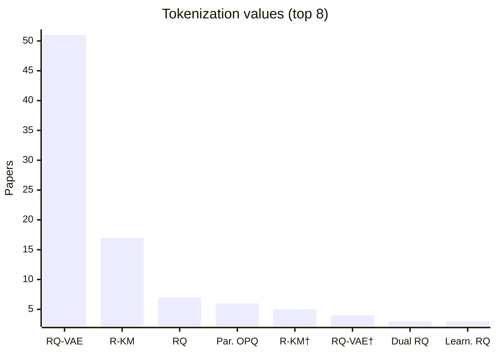

# Tokenizer Comparison

How each paper builds its Semantic IDs. Values are Table 1 entries defined in the [glossary](../guides/glossary.md); setup text is quoted from each paper's setup card.

| Paper | Information Source | Quantization | SID Length, Codebook, Collisions | Tokenizer Update | Related |
| :-- | :-- | :-- | :-- | :-- | :-- |
| [SemConv](../pages/papers/semconv.md) | `Text+CF` | `Align. RQ` | Aligned residual codebooks: 4 levels x 256 codes; Games reports 0% collisions at four levels. Explicit collision handling: not reported. | `Fixed` | Competitor: [LC-Rec](../pages/papers/lc-rec.md); Predecessor: [TIGER](../pages/papers/tiger.md) |
| [MBGen](../pages/papers/mbgen.md) | `CF` | `Bal. VQ+KM` | Three item tokens with per-position size K=64 Retail/96 IJCAI. Balanced SID: K-entry VQ codebook, K-cluster residual K-means per first-token bucket, then random collision-disambiguation token. Balanced CID: random item-number remapping and base-K digits, without features. Behavior token precedes each item. | `Fixed` | Competitor: [TIGER](../pages/papers/tiger.md); Alternative: [MMGRec](../pages/papers/mmgrec.md); Alternative: [LMIndexer](../pages/papers/lmindexer.md) |
| [TopoGR](../pages/papers/topogr.md) | `Text` | `BDQ` | BDQ/LFQ: 64 positions x 8 bits, each position mapping to 256 integer codes; implicit fixed binary vertices, not learned centroid codebooks. Reported full-SID collapse ratio <0.003; collision disambiguation not reported. | `Fixed` | Competitor: [TIGER](../pages/papers/tiger.md); Competitor: [RPG](../pages/papers/rpg.md); Alternative: [LLaDA-Rec](../pages/papers/llada-rec.md) |
| [CoST](../pages/papers/cost.md) | `Text` | `C-RQ` | 3 residual-quantization levels with a codebook of size 64 shared across levels, 96-dimensional latent; Sentence-T5 768-dimensional input. The paper states each item receives a unique 3-tuple, but the mechanism that guarantees uniqueness is not reported. | `Fixed` | Predecessor: [TIGER](../pages/papers/tiger.md); Alternative: [EAGER](../pages/papers/eager.md); Alternative: [LETTER](../pages/papers/letter.md); Alternative: [TokenRec](../pages/papers/tokenrec.md) |
| [DREAM](../pages/papers/dream.md) | `Text+CF` | `CART` | Frozen Llama-3-8B text embeddings initialize shared RQ-VAE SIDs (4 positions x 256 codes). CART refines assignments with collaborative residuals, Gumbel-Softmax/STE, diversity regularization and a static-index anchor, exporting top-8 candidates per cold item. UC3 produces a refined single-path index; CPDE preserves alternative SIDs for multi-path inference (B=4). Collision disambiguation: not reported. | `Altern.` | Predecessor: [LC-Rec](../pages/papers/lc-rec.md); Competitor: [TIGER](../pages/papers/tiger.md); Competitor: [SpecGR](../pages/papers/specgr.md) |
| [COBRA](../pages/papers/cobra.md) | `Text+SID` | `Casc. RQ` | Public: 3-level semantic IDs with codebook size 32 per level, generated from T5 embeddings following TIGER's method. Industrial: 2-level 32 x 32 sparse IDs (the w/o Dense variant uses 3 levels of 256). Items under the same sparse ID are distinguished by a generated dense vector and ANN search within that ID's candidate set; a collision-resolution rule for the sparse IDs is not reported. | `Fixed` | Competitor: [TIGER](../pages/papers/tiger.md); Alternative: [LIGER](../pages/papers/liger.md); Alternative: [CapsID](../pages/papers/capsid.md) |
| [RoFiGR](../pages/papers/rofigr.md) | `Text+Img+CF` | `CF-Aligned MM RQ` | Separate text/image residual trees, each [64,256,256,512], code dimension 32. Collisions repaired at L4 or L3-L4, preserving L1-L2; complete SIDs uniquely identify items. | `Fixed` | Predecessor: [MACRec](../pages/papers/macrec.md); Competitor: [SynGR](../pages/papers/syngr.md); Competitor: [MQL4GRec](../pages/papers/mql4grec.md) |
| [S2GR](../pages/papers/s2gr.md) | `Text+CF` | `CoBa RQ-VAE` | 3 levels x 256 codes from a codebook-balanced RQ-VAE (CoBa RQ-VAE) over Qwen3-Embedding-4B embeddings smoothed by multi-hop co-occurrence propagation; collision handling: not reported (independent coding rate 99.30% on Beauty, 76.25% industrial). | `Fixed` | Competitor: [TIGER](../pages/papers/tiger.md); Alternative: [OneRec-Think](../pages/papers/onerec-think.md); Alternative: [PLUM](../pages/papers/plum.md) |
| [Gwhere](../pages/papers/gwhere.md) | `Text+Img+Geo+CF` | `Contr. RQ` | 3-layer residual quantizer over a 96-dimensional fused latent from text, ALS collaborative, image, and spatial GraphSAGE views, trained contrastively with Gumbel-softmax assignment; 48 codewords per layer on public data, larger (not specified) on AMAP. Collision handling: not reported beyond the contrastive objective that aims to reduce code collision. | `Fixed` | Competitor: [GNPR-SID](../pages/papers/gnpr-sid.md); Alternative: [TIGER](../pages/papers/tiger.md) |
| [MACRec](../pages/papers/macrec.md) | `Text+Img` | `Cross RQ` | Separate text (LLaMA) and image (ViT-L/14) semantic IDs from RQ-VAEs with 4 levels x 256 codewords, aligned by layer-wise cross-modal contrastive and alignment losses. Conflicting IDs are resolved as in MQL4GRec by reassigning codewords according to item-codebook distances. Pre-resolution collision rates, e.g. Instruments text 2.38% and image 3.23%. | `Fixed` | Competitor: [MQL4GRec](../pages/papers/mql4grec.md); Competitor: [TIGER](../pages/papers/tiger.md); Competitor: [CID](../pages/papers/cid.md); Alternative: [CARD](../pages/papers/card.md) |
| [RecBase](../pages/papers/recbase.md) | `Text` | `Curr. RQ` | Concept IDs from a curriculum-learning RQ-VAE (CL-VAE) with 4 levels x 2,048 codes over NV-Embed-v2 text embeddings, with codebook reinitialization against collapse. Collisions are measured as a conflict rate (Figure 2) but a resolution rule is not reported. | `Fixed` | Alternative: [TIGER](../pages/papers/tiger.md); Alternative: [LC-Rec](../pages/papers/lc-rec.md) |
| [UniSID](../pages/papers/unisid.md) | `Text+Img+Attr` | `Direct SID Heads` | Three direct categorical SID heads x 2048 entries, using per-layer argmax on Qwen2.5-VL-3B outputs rather than residual quantization. Collision handling not reported. | `–` | Predecessor: [TIGER](../pages/papers/tiger.md); Competitor: [LETTER](../pages/papers/letter.md) |
| [LGRID](../pages/papers/lgrid.md) | `Text+Geo` | `DSRQ` | 4-token SID from dual-stream residual quantization of Qwen3-8B slot representations: 2 geographic codes + 2 semantic codes; per-level codebook size: not reported. For non-SID backbones, the SID embedding is concatenated with the original item-ID embedding; a collision-resolution rule is not reported. Full-SID collision rate is 39.9% on Kuaishou (RQ-VAE 98.0%, LGSID 97.0%). | `Fixed` | Competitor: [LGSID](../pages/papers/lgsid.md); Competitor: [TIGER](../pages/papers/tiger.md); Alternative: [OneLoc](../pages/papers/oneloc.md); Alternative: [GNPR-SID](../pages/papers/gnpr-sid.md) |
| [EAGER](../pages/papers/eager.md) | `Text+CF` | `Dual H-KM` | Two codes per item: behavior codes from DIN embeddings and semantic codes from Sentence-T5 embeddings, each built by hierarchical k-means with k=256 branches, splitting until each child cluster contains a single item; code length l follows from the item count and k. | `Fixed` | Competitor: [TIGER](../pages/papers/tiger.md); Alternative: [SEATER](../pages/papers/seater.md); Alternative: [LMIndexer](../pages/papers/lmindexer.md); Alternative: [CoST](../pages/papers/cost.md) |
| [EAGER-LLM](../pages/papers/eager-llm.md) | `Text+CF` | `Dual H-KM` | Separate semantic/behavioral hierarchical k-means until singleton clusters; four layers discussed. 256 values/token is a theoretical capacity example; explicit main codebook sizes not reported. | `Fixed` | Predecessor: [EAGER](../pages/papers/eager.md); Competitor: [LC-Rec](../pages/papers/lc-rec.md); Competitor: [LETTER](../pages/papers/letter.md) |
| [Align3GR](../pages/papers/align3gr.md) | `Text+CF` | `Dual RQ` | Item SCID: 3-level RQ-VAE x 256 codewords (dimension 32) over concatenated semantic (T5) and collaborative (DIN) embeddings; users receive their own SCIDs from a separate user RQ-VAE. Both are added to the LLM vocabulary. Collision handling: not reported. | `Fixed` | Competitor: [EAGER-LLM](../pages/papers/eager-llm.md); Competitor: [LC-Rec](../pages/papers/lc-rec.md); Competitor: [LETTER](../pages/papers/letter.md); Competitor: [TIGER](../pages/papers/tiger.md) |
| [DAS](../pages/papers/das.md) | `Text+CF` | `Dual RQ` | Separate user and ad SIDs from jointly trained RQ-VAEs: 3 codebooks x 512 codes, code dimension 32, k-means-initialized codebooks; ad embeddings 256-dimensional, user embeddings 1,024-dimensional. Collision handling: not reported (SIDs are also used as prefix-ngram sparse features in CTR models). | `Fixed` | Competitor: [LETTER](../pages/papers/letter.md); Competitor: [TIGER](../pages/papers/tiger.md); Alternative: [ADC-SID](../pages/papers/adc-sid.md) |
| [MQL4GRec](../pages/papers/mql4grec.md) | `Text+Img` | `Dual RQ` | Separate text (LLaMA) and image (ViT-L/14) quantitative languages from RQ-VAEs with 4 levels x 256 codewords (dimension 32). Colliding items have tokens reassigned by the distances between their residuals and code vectors, instead of an appended identifier. | `Fixed` | Competitor: [TIGER](../pages/papers/tiger.md); Alternative: [LC-Rec](../pages/papers/lc-rec.md); Competitor: [CID](../pages/papers/cid.md); Competitor: [VQ-Rec](../pages/papers/vq-rec.md); Successor: [MACRec](../pages/papers/macrec.md) |
| [FlexCode](../pages/papers/flexcode.md) | `Text+CF` | `Dual RQ-VAE` | Dual RQ-VAE; total token budgets 3/4/5/6, popularity-dependent allocation; base K=512. Main-experiment depth and collision handling not reported. | `Joint` | Competitor: [TIGER](../pages/papers/tiger.md); Competitor: [LC-Rec](../pages/papers/lc-rec.md); Competitor: [COBRA](../pages/papers/cobra.md) |
| [Dynamic-Single-Codebook](../pages/papers/dynamic-single-codebook.md) | `–` | `Dyn. KM+Disamb.` | Public data: [1024,512], semantic plus balanced disambiguation code; baseline [256,256,256]. | `Fixed` | Alternative: [RPG](../pages/papers/rpg.md); Alternative: [LLaDA-Rec](../pages/papers/llada-rec.md); Alternative: [LETTER](../pages/papers/letter.md) |
| [Tlow](../pages/papers/tlow.md) | `Text` | `Flow+PQ` | Flow plus independent PQ: C in {16,32,64,96,128}, 256 codes each; selected C per offline dataset not reported. Online: 16 x 256. Collision handling not reported. | `Fixed` | Predecessor: [RPG](../pages/papers/rpg.md); Competitor: [TIGER](../pages/papers/tiger.md); Competitor: [ETEGRec](../pages/papers/etegrec.md) |
| [JevRec](../pages/papers/jevrec.md) | `Text` | `Freq. R-KM` | Shared residual quantizer: 4 x 256; retain 2/3/4 semantic codes by training-frequency group and append one collision token, giving complete SID lengths 3/4/5. Within each group/prefix bucket collision tokens distinguish items; collision vocabulary capacity not reported. | `Fixed` | Competitor: [TIGER](../pages/papers/tiger.md); Competitor: [LETTER](../pages/papers/letter.md); Competitor: [ActionPiece](../pages/papers/actionpiece.md); Alternative: [Pctx](../pages/papers/pctx.md) |
| [ReSID](../pages/papers/resid.md) | `Attr+CF` | `GAOQ` | GAOQ, 3 levels. Branching tuples: MI(32,40,19),VG(32,64,13),IS(24,80,14),BP(32,64,18),ACS(64,96,16),SO(128,128,11),TG(192,192,5),HH(50,512,8),BPC(96,192,11),Books(256,256,8). Global anchor-vocabulary sizes and collision handling: not reported. | `Fixed` | Competitor: [LETTER](../pages/papers/letter.md); Competitor: [TIGER](../pages/papers/tiger.md); Competitor: [UNGER](../pages/papers/unger.md) |
| [Spacetime-GR](../pages/papers/spacetime-gr.md) | `Geo` | `Geo-Idx` | Industrial: two tokens, 5km x 5km block plus within-block POI index; one-to-one mapping, total vocabulary reduced from 100M to 400K. Public experiments use a single-level index; codebooks n/a. | `Fixed` | Predecessor: [TIGER](../pages/papers/tiger.md); Alternative: [OneRec](../pages/papers/onerec.md) |
| [LGSID](../pages/papers/lgsid.md) | `Text+Geo+CF` | `Geo-Idx+RQ` | Hierarchical residual quantizer over G-DPO-aligned BGE embeddings (1,024-dimensional) with a KL regularizer toward uniform cluster usage; number of levels and per-level codebook sizes K_l: not reported. Collision handling: not reported. | `Fixed` | Competitor: [TIGER](../pages/papers/tiger.md); Predecessor: [OneRec](../pages/papers/onerec.md); Alternative: [GNPR-SID](../pages/papers/gnpr-sid.md); Successor: [LGRID](../pages/papers/lgrid.md) |
| [AWARE](../pages/papers/aware.md) | `Text+Geo` | `Geo-Prefix+HClus` | ROS Spatial SIDs: hierarchical clustering of Qwen3-0.6B POI text embeddings plus multi-resolution S2-cell geospatial prefixes. Numerical SID length, branching/codebook sizes, S2 levels and collision handling: not reported. | `Fixed` | Predecessor: [ROS](../pages/papers/ros.md); Competitor: [GNPR-SID](../pages/papers/gnpr-sid.md); Competitor: [Spacetime-GR](../pages/papers/spacetime-gr.md) |
| [ROS](../pages/papers/ros.md) | `Text+Geo` | `Geo-Prefix+RQ-VAE` | Hierarchical spatial SID [g; s; u]: two S2-cell locality tokens (after removing the dataset-wide common prefix), two semantic tokens from a 2-level residual quantizer with 28 codes per level over Qwen-0.6B category embeddings, and a sequential suffix token within each (g, s) pair that makes IDs unique (at most 8 suffix values observed). | `Fixed` | Competitor: [GNPR-SID](../pages/papers/gnpr-sid.md); Competitor: [Spacetime-GR](../pages/papers/spacetime-gr.md); Alternative: [OneLoc](../pages/papers/oneloc.md); Alternative: [LGSID](../pages/papers/lgsid.md) |
| [MMGRec](../pages/papers/mmgrec.md) | `Text+Img+CF` | `Graph RQ-VAE` | Graph RQ-VAE: 3 semantic tokens plus popularity-rank collision suffix. Codebooks tuned over 64/128/256; Kwai analysis favors 128; selected per-dataset sizes not reported. | `Fixed` | Predecessor: [TIGER](../pages/papers/tiger.md) |
| [ColaRec](../pages/papers/colarec.md) | `Text+CF` | `H-KM` | GID length l=3 from hierarchical constrained K-means over pretrained LightGCN item embeddings, K=32 clusters per level (48 for Recipe). Collisions are avoided by construction: clusters hold at most K^(l-t) items and leaf positions are assigned randomly, so each item has a unique GID. | `Fixed` | Competitor: [TIGER](../pages/papers/tiger.md); Competitor: [LC-Rec](../pages/papers/lc-rec.md); Alternative: [CID](../pages/papers/cid.md); Alternative: [SEATER](../pages/papers/seater.md) |
| [GRAM](../pages/papers/gram.md) | `Text+CF` | `H-KM` | Hierarchical textual IDs: recursive k-means over item text embeddings, stopping when a cluster has fewer than c items or depth reaches l; each cluster index is mapped to an existing LLM vocabulary token chosen by TF-IDF. Final (l, k, c): Beauty (7, 128, 128); Toys (5, 32, 32); Sports and Yelp (7 or 9, 32, 32). Duplicate IDs receive an appended digit for uniqueness. | `Fixed` | Competitor: [LC-Rec](../pages/papers/lc-rec.md); Competitor: [IDGenRec](../pages/papers/idgenrec.md); Competitor: [TIGER](../pages/papers/tiger.md); Competitor: [CID](../pages/papers/cid.md); Competitor: [LETTER](../pages/papers/letter.md) |
| [VarLenRec (TIGER)](../pages/papers/varlenrec-tiger.md) | `Text` | `HARQ` | HARQ on Sentence-T5 embeddings: variable semantic length up to 10 levels x 256 codes, in hyperbolic space with curvature 1. Colliding IDs receive unique appended tokens from a disjoint 256-entry auxiliary vocabulary. | `Fixed` | Predecessor: [TIGER](../pages/papers/tiger.md); Competitor: [ETEGRec](../pages/papers/etegrec.md); Competitor: [LETTER](../pages/papers/letter.md) |
| [HiD-VAE](../pages/papers/hid-vae.md) | `Text` | `Hier. RQ` | 3-level hierarchically supervised RQ-VAE x 256 codewords (K-means initialized) over 768-dimensional SentenceTransformer embeddings; each level is aligned with a category-tag level, and a uniqueness loss pushes items apart. Measured collision rate 2.1% (Beauty), 2.8% (Sports), 1.9% (KuaiRand) versus 18.7%, 19.5%, and 17.8% for RQ-VAE. How the remaining collisions are resolved in the full model: not reported; the w/o-uniqueness variant uses TIGER's appended integer. | `Fixed` | Competitor: [TIGER](../pages/papers/tiger.md); Competitor: [LC-Rec](../pages/papers/lc-rec.md); Competitor: [VQ-Rec](../pages/papers/vq-rec.md); Alternative: [AdaSID](../pages/papers/adasid.md) |
| [KGTB](../pages/papers/kgtb.md) | `Attr+Geo+CF` | `KG-RQ` | 3-level KG residual quantization. Printed sizes at level l=1/2/3: POI/user 8^{4(l-1)}; region/category 8^{2(l-1)}. Collision handling: not reported. | `Fixed` | Competitor: [GNPR-SID](../pages/papers/gnpr-sid.md) |
| [DIGER](../pages/papers/diger.md) | `Text` | `Learn. RQ` | Pretrained RQ-VAE initialization, then jointly optimized differentiable IDs: 3 code positions x 256 entries plus one conflict code. Conflict-code assignment details not reported. Training uses Gumbel exploration with uncertainty decay; validation/inference tokenizer assignments are deterministic. | `Joint` | Predecessor: [TIGER](../pages/papers/tiger.md); Alternative: [ETEGRec](../pages/papers/etegrec.md); Competitor: [LETTER](../pages/papers/letter.md) |
| [ETEGRec](../pages/papers/etegrec.md) | `CF` | `Learn. RQ` | 3-level RQ-VAE x 256 codewords (dimension 128) over 256-dimensional SASRec collaborative embeddings; following TIGER, an extra token is appended to make IDs unique. The tokenizer is trained jointly with the generator by alternating optimization. | `Altern.` | Competitor: [TIGER](../pages/papers/tiger.md); Competitor: [LETTER](../pages/papers/letter.md); Competitor: [CID](../pages/papers/cid.md); Alternative: [AdaSID](../pages/papers/adasid.md) |
| [LETTER](../pages/papers/letter.md) | `Text+CF` | `Learn. RQ` | Main configuration: 4 residual-quantization levels x 256 codewords, with 32-dimensional code embeddings; the identifier contains 4 learned codes. Collision handling or an additional collision suffix: not reported. | `Fixed` | Predecessor: [TIGER](../pages/papers/tiger.md); Predecessor: [LC-Rec](../pages/papers/lc-rec.md); Competitor: [CID](../pages/papers/cid.md) |
| [CausalDPO](../pages/papers/causaldpo.md) | `Text` | `LLM-Vocab` | n/a (items are generated as text by the LLM and mapped to dataset items; no semantic IDs). | `Fixed` | Alternative: [OneRec](../pages/papers/onerec.md) |
| [IDGenRec](../pages/papers/idgenrec.md) | `Text` | `LLM-Vocab` | Textual IDs generated from item text by a T5-small ID generator with diverse beam search (k=10 groups, diversity penalty raised from 1 to 10), length initially in [1, 10) tokens and extended to [10, 20) when needed; uniqueness is enforced at generation time by rejecting duplicates. SentencePiece vocabulary of 32,128. | `Altern.` | Competitor: [CID](../pages/papers/cid.md); Alternative: [GRAM](../pages/papers/gram.md); Alternative: [GRLM](../pages/papers/grlm.md); Alternative: [GMC](../pages/papers/gmc.md) |
| [TokenRec](../pages/papers/tokenrec.md) | `CF` | `Masked VQ` | Masked vector-quantized tokenizer (MQ-Tokenizer) for both users and items: K parallel sub-encoders, each quantized against its own sub-codebook of L codes (K searched in 1-5, L in 128-1,024; prompt example uses K=3), over masked collaborative representations. Collision handling: not reported. | `Fixed` | Competitor: [TIGER](../pages/papers/tiger.md); Competitor: [CID](../pages/papers/cid.md); Alternative: [LC-Rec](../pages/papers/lc-rec.md); Alternative: [R3-VAE](../pages/papers/r3-vae.md) |
| [MME-SID](../pages/papers/mme-sid.md) | `Text+Img+CF` | `MM-RQ` | Separate collaborative, textual, and visual SIDs from RQ-VAEs with 4 levels x 256 codes (300 for Sports), used as LLM input embeddings alongside projected modality embeddings. The paper states that MME-SID does not need to tackle collisions because multimodal data discriminate between items; no resolution rule is described. | `Fixed` | Competitor: [TIGER](../pages/papers/tiger.md); Competitor: [LETTER](../pages/papers/letter.md); Alternative: [LC-Rec](../pages/papers/lc-rec.md); Alternative: [ADC-SID](../pages/papers/adc-sid.md) |
| [ADC-SID](../pages/papers/adc-sid.md) | `Text+Img+CF` | `MoE-VQ` | Industrial: SID length 10 with codebook size printed as "3,00" (shared 2, text 2, visual 2, behavioral 4 codes for ADC-SID). Public: SID length 6 with codebook size 100 (shared 1, text 1, visual 1, behavioral 3). The online system uses an 8-token SID. Collision handling: not reported. | `Fixed†` | Competitor: [DAS](../pages/papers/das.md); Competitor: [LETTER](../pages/papers/letter.md); Competitor: [MME-SID](../pages/papers/mme-sid.md); Competitor: [TIGER](../pages/papers/tiger.md); Competitor: [RPG](../pages/papers/rpg.md) |
| [MMQ](../pages/papers/mmq.md) | `Text+Img` | `MoE-VQ` | 6 positions: 2 shared, 2 text-specific, 2 visual-specific; codebook size 100 (Beauty), 3000 (industrial). Collision handling not reported. | `Joint` | Predecessor: [TIGER](../pages/papers/tiger.md); Alternative: [OneRec](../pages/papers/onerec.md); Alternative: [LC-Rec](../pages/papers/lc-rec.md) |
| [TransRec](../pages/papers/transrec.md) | `Text` | `Multi-Facet ID` | Three separate facets: unique random numeric ID, title and categories. Variable text-token lengths; codebook size n/a. Numeric IDs provide uniqueness while titles/attributes can be shared. Training samples five title substrings per sequence and uses each category separately; this is not a quantized SID. | `Fixed` | Competitor: [CID](../pages/papers/cid.md); Competitor: [TIGER](../pages/papers/tiger.md) |
| [GR4AD-X](../pages/papers/gr4ad-x.md) | `–` | `Multi-Path R-KM+Hash` | Two paths per advertisement, each with three levels: first-level RQ-KMeans 16384 centroids, second-level RQ-KMeans size not reported, final non-semantic feature hash size not reported. Collision disambiguation not reported; repeated retrieved advertisements are deduplicated by their highest-scoring path. | `Fixed` | Predecessor: [TIGER](../pages/papers/tiger.md); Alternative: [RPG](../pages/papers/rpg.md); Alternative: [MMQ](../pages/papers/mmq.md) |
| [Molar](../pages/papers/molar.md) | `Text+Img+CF` | `n/a` | n/a (items are represented by continuous embeddings from a fine-tuned multimodal LLM; no discrete SIDs are built). | `n/a` | – |
| [SIDScope](../pages/papers/sidscope.md) | `n/a` | `n/a` | Named exports have 3 or 4 SID levels; a single layers-by-codebook-size configuration is n/a, and nominal per-level codebook capacities are not reported uniformly across routes. Table 3's D1 counts are occupied first-level symbols, not nominal capacities. Shared full codes are measured explicitly; frozen-beam comparisons use singleton credit, uniform within-leaf expected credit, or deterministic training-popularity resolution with item-ID tie-breaking. | `n/a` | Predecessor: [GRID](../pages/papers/grid.md); Predecessor: [CARD](../pages/papers/card.md); Predecessor: [DIGER](../pages/papers/diger.md); Predecessor: [LETTER](../pages/papers/letter.md); Predecessor: [LC-Rec](../pages/papers/lc-rec.md) |
| [HoloRec](../pages/papers/holorec.md) | `–` | `Nested RQ` | Three nested granularities (8/16/32 dimensions), each with 4 residual levels x 256 codes; codebooks shared across granularities. Collision handling not reported. | `Fixed` | Predecessor: [TIGER](../pages/papers/tiger.md); Alternative: [LLaDA-Rec](../pages/papers/llada-rec.md); Alternative: [OneRec-Think](../pages/papers/onerec-think.md) |
| [CARD](../pages/papers/card.md) | `Text+Img+CF` | `NU-RQ` | 4 non-uniform RQ-VAE levels x 256 codewords (dimension 32), quantizing a vision-language embedding of a 512 x 512 rendered card (item image, title, collaborative-neighbor thumbnails). Collision handling: not reported. | `Fixed` | Competitor: [MACRec](../pages/papers/macrec.md); Competitor: [MQL4GRec](../pages/papers/mql4grec.md); Competitor: [LETTER](../pages/papers/letter.md); Competitor: [TIGER](../pages/papers/tiger.md); Competitor: [VQ-Rec](../pages/papers/vq-rec.md) |
| [ActionPiece](../pages/papers/actionpiece.md) | `Text` | `OPQ` | Each item is an unordered set of 4 OPQ codes x 256 codewords (sentence-t5-base text embeddings) plus 1 extra identification code to prevent conflicts. ActionPiece then merges co-occurring feature sets into a context-dependent vocabulary of 40,000 tokens (tuned over 5k-40k), so the same item can map to different tokens in different sequences. | `Fixed` | Competitor: [TIGER](../pages/papers/tiger.md); Predecessor: [VQ-Rec](../pages/papers/vq-rec.md); Competitor: [LMIndexer](../pages/papers/lmindexer.md); Competitor: [CID](../pages/papers/cid.md) |
| [VQ-Rec](../pages/papers/vq-rec.md) | `Multi-Dom` | `OPQ` | OPQ codes over item text embeddings, written as (M=32) x (D=256) PQ indices in the implementation; the method section uses D for the number of code sets and M for the centroids per set, so the two notations do not state the same split unambiguously. The paper argues that K-means-trained OPQ tends to give near-uniform code distributions, which keeps collisions low; a rule for items sharing a code: not reported. Downstream domains re-train PQ centroids with a permutation-based code-embedding alignment. | `Fixed` | Successor: [ActionPiece](../pages/papers/actionpiece.md); Successor: [LC-Rec](../pages/papers/lc-rec.md); Alternative: [UTGRec](../pages/papers/utgrec.md) |
| [DOS](../pages/papers/dos.md) | `Text+CF` | `Orth. RQ` | Qwen3-0.6B-embedding encodes restaurant name/categories, reservation status, prices and dishes into 1,024 dimensions. Dual user/item Transformer flows share an orthogonal residual quantizer: 3 layers x 1,024 codes, with salient-feature selection and residual propagation. Collision handling not reported. | `Fixed†` | Competitor: [DAS](../pages/papers/das.md); Alternative: [TIGER](../pages/papers/tiger.md) |
| [ACERec](../pages/papers/acerec.md) | `Text` | `Par. OPQ` | OPQ semantic IDs with m=32 orthogonal subspaces (8 to 64 tested), each with its own codebook of size M (value not restated); an Attentive Token Merger compresses the 32 tokens into 4 latent tokens for the sequence model. Collision handling: not reported. | `Fixed` | Competitor: [RPG](../pages/papers/rpg.md); Competitor: [TIGER](../pages/papers/tiger.md); Competitor: [ActionPiece](../pages/papers/actionpiece.md); Competitor: [ETEGRec](../pages/papers/etegrec.md); Predecessor: [VQ-Rec](../pages/papers/vq-rec.md) |
| [CITE](../pages/papers/cite.md) | `Text` | `Par. OPQ` | Fixed OPQ identifiers over text embeddings; 256 codes/position, lengths Sports 16, Beauty 32, Toys 16, CDs 64; collision handling and Yelp ID length not reported. Yelp text uses text-embedding-3-large. Default CITE freezes the reproduced RPG generator and learns only the transition module. | `Fixed` | Predecessor: [RPG](../pages/papers/rpg.md); Competitor: [TIGER](../pages/papers/tiger.md); Competitor: [VQ-Rec](../pages/papers/vq-rec.md) |
| [MDGR](../pages/papers/mdgr.md) | `–` | `Par. OPQ` | OPQ-based parallel codebooks: 8 x 300, 256-dimensional code vectors, using Qwen3-8B content embeddings. Complete SIDs map to item sets through an offline index; collision disambiguation not reported. | `Fixed` | Competitor: [TIGER](../pages/papers/tiger.md); Competitor: [RPG](../pages/papers/rpg.md); Competitor: [COBRA](../pages/papers/cobra.md) |
| [OneChord](../pages/papers/onechord.md) | `–` | `Par. OPQ` | Four-code OPQ, 256 codes/position; collisions remain merged as one catalog entry. | `Fixed` | Competitor: [SPRINT](../pages/papers/sprint.md); Competitor: [RPG](../pages/papers/rpg.md); Competitor: [LLaDA-Rec](../pages/papers/llada-rec.md) |
| [RPG](../pages/papers/rpg.md) | `Text+Img` | `Par. OPQ` | Parallel OPQ subspaces, with best lengths Sports 16, Beauty 32, Toys 16, and CDs 64; per-subspace codebook size: not reported as an experimental setting. Colliding items retain separate graph nodes; no guaranteed collision-free identifier is claimed. | `Fixed` | Competitor: [TIGER](../pages/papers/tiger.md); Predecessor: [VQ-Rec](../pages/papers/vq-rec.md); Alternative: [LETTER](../pages/papers/letter.md) |
| [SPRINT](../pages/papers/sprint.md) | `Text` | `Par. OPQ` | OPQ on sentence-t5-base content embeddings; four parallel codebooks x 256 codewords, four tokens/item. Collision handling: not reported. | `Fixed` | Competitor: [RPG](../pages/papers/rpg.md); Competitor: [LLaDA-Rec](../pages/papers/llada-rec.md); Competitor: [SID-MLP](../pages/papers/sid-mlp.md) |
| [LLaDA-Rec](../pages/papers/llada-rec.md) | `Text` | `Par. VQ` | Parallel semantic IDs from a Multi-Head VQ-VAE over Sentence-T5 embeddings: the embedding is split into 4 sub-vectors, each quantized by its own codebook of 256 codes (dimension 32). Collision handling: not reported. | `Fixed` | Competitor: [RPG](../pages/papers/rpg.md); Competitor: [TIGER](../pages/papers/tiger.md); Competitor: [LETTER](../pages/papers/letter.md); Competitor: [LC-Rec](../pages/papers/lc-rec.md); Competitor: [VQ-Rec](../pages/papers/vq-rec.md) |
| [PCR-CA](../pages/papers/pcr-ca.md) | `Text+CF` | `PC-AE` | PC-AE: 4 parallel codebooks x 32 entries, 16-dimensional vectors, selecting/summing two nearest codes per book. Codebooks train jointly with CTR prediction after pretraining. Unique-ID collision resolution: n/a; codes supply predictive features. | `Joint` | Alternative: [CoST](../pages/papers/cost.md) |
| [API](../pages/papers/api.md) | `Text` | `PID (P-SAE)` | Pretrained Interpretable IDs: K in {4, 8, 16} feature indices selected by a priority rule from the 32 strongest of 24,576 labeled sparse-autoencoder features of a frozen GPT-2-small, plus their relative activation strengths, which separate items whose index sequences coincide. Collision-affected items at K=4: 15.16% on Beauty (77.37% with native SAE selection). | `Fixed` | Predecessor: [GRID](../pages/papers/grid.md); Competitor: [RPG](../pages/papers/rpg.md); Competitor: [TIGER](../pages/papers/tiger.md); Competitor: [HiD-VAE](../pages/papers/hid-vae.md) |
| [PSI](../pages/papers/psi.md) | `Text` | `Post-hoc RQ` | Purely semantic IDs: conflicts are removed by assigning non-nearest centroids instead of appending a conflict token, via exhaustive candidate matching (ECM, global scoring of top-k combinations) or recursive residual search (RRS, greedy). Applied to RQ-VAE and hierarchical clustering indexers. The level study on Amazon product search compares three-level purely semantic IDs with two levels plus a conflict index (codebook size 256); the conflict-proportion study uses codebook sizes 512, 256, and 192. Levels and codebook sizes for the main tables: not reported. | `Fixed` | Predecessor: [LMIndexer](../pages/papers/lmindexer.md); Alternative: [TIGER](../pages/papers/tiger.md); Alternative: [LIGER](../pages/papers/liger.md); Successor: [Latte](../pages/papers/latte.md) |
| [PSRQ](../pages/papers/psrq.md) | `Text+Img` | `Prog. RQ` | Progressive Semantic Residual Quantization (PSRQ): layer-wise K-means over modality embeddings (text, image or audio) that preserves the prefix semantic feature, producing modal-specific and modal-joint semantic IDs; clusters per layer k = 64 (Amazon Baby), 256 (Industrial), 128 (Music4all), 3 layers. Collision handling: not reported. | `Fixed` | Alternative: [TIGER](../pages/papers/tiger.md); Alternative: [VQ-Rec](../pages/papers/vq-rec.md); Alternative: [OneRec](../pages/papers/onerec.md) |
| [QuaSID](../pages/papers/quasid.md) | `Text+CF` | `QA-RQ` | Public: 3 x 256; industrial: 4 x 1024. HaMR repels qualified full/partial collisions; additional inference-time collision resolution not reported. | `Fixed` | Predecessor: [TIGER](../pages/papers/tiger.md); Alternative: [LETTER](../pages/papers/letter.md); Alternative: [HiD-VAE](../pages/papers/hid-vae.md) |
| [APAO](../pages/papers/apao.md) | `Text` | `R-KM` | 4-level RQ-K-means codes over Llama-3.1-8B-Instruct item embeddings; codebook size and collision handling: not reported. | `Fixed` | Predecessor: [TIGER](../pages/papers/tiger.md); Predecessor: [LC-Rec](../pages/papers/lc-rec.md); Predecessor: [LETTER](../pages/papers/letter.md) |
| [Deco](../pages/papers/deco.md) | `Text / –` | `R-KM` | Fixed RQ-KMeans,4 levels x2048 codes, from multilingual E5-large metadata embeddings or provided128-dimensional Yambda item embeddings. Popularity-based collision resolution is stated; detailed rule not reported. Depth study uses2-8 nested levels x256 codes. | `Fixed` | Competitor: [TIGER](../pages/papers/tiger.md); Competitor: [RPG](../pages/papers/rpg.md); Competitor: [LLaDA-Rec](../pages/papers/llada-rec.md); Competitor: [NEZHA](../pages/papers/nezha.md) |
| [DualGR](../pages/papers/dualgr.md) | `–` | `R-KM` | Residual k-means: 3 levels x 8192 codes; collision handling not reported. | `Fixed` | Competitor: [TIGER](../pages/papers/tiger.md) |
| [GRID](../pages/papers/grid.md) | `Text` | `R-KM` | Benchmark default: RK-Means with 3 levels x 256 tokens over mean-pooled Flan-T5-XL embeddings; also R-VQ and RQ-VAE, and L x W variants (e.g. 3 x 128, 3 x 512, 2 x 256). Collisions: Table 7 compares TIGER-style appended-digit de-duplication with randomly selecting one item when SIDs conflict; which one is the default setting is not stated. | `Fixed` | Predecessor: [TIGER](../pages/papers/tiger.md); Predecessor: [OneRec](../pages/papers/onerec.md) |
| [Gryphon](../pages/papers/gryphon.md) | `–` | `R-KM` | Residual K-Means: 3 x 32000; collisions retained, generated SIDs expanded to all matching items and rescored by ILSM. | `Fixed` | Predecessor: [TIGER](../pages/papers/tiger.md); Alternative: [QuaSID](../pages/papers/quasid.md); Alternative: [PROMISE](../pages/papers/promise.md) |
| [HF-SID](../pages/papers/hf-sid.md) | `Text+Attr+Geo` | `R-KM` | 3-level RQ-KMeans with last-residual contrastive refinement: 4096 codes/level on AMap-L, 512 on AMap-S. Public-data codebook sizes and collision materialization: not reported. | `Fixed` | Competitor: [ProGEO](../pages/papers/progeo.md); Competitor: [GeoGR](../pages/papers/geogr.md); Competitor: [GNPR-SID](../pages/papers/gnpr-sid.md) |
| [KL-MOPD](../pages/papers/kl-mopd.md) | `CF` | `R-KM` | RQ-KMeans of two-tower CF embeddings: TencentGR 5x64, YooChoose 5x128, Taobao 8x64, Industry 8x310. Collision handling: not reported. | `Fixed†` | Predecessor: [TIGER](../pages/papers/tiger.md) |
| [NAU](../pages/papers/nau.md) | `–` | `R-KM` | RQ-KMeans/RQ-VAE diagnostics: 3 semantic levels plus fourth deduplication level. Codebook sizes not reported; Table 24 shows 256 occupied first-level RQ-KMeans codes. LETTER and TRACER-compatible tokenizers also evaluated; their sizes not reported. | `Fixed` | Predecessor: [TIGER](../pages/papers/tiger.md); Predecessor: [LETTER](../pages/papers/letter.md); Competitor: [TRACER](../pages/papers/tracer.md) |
| [NEO](../pages/papers/neo.md) | `Text / Audio` | `R-KM` | Separate residual K-Means vocabularies by type: 4 x 256 for audiobooks/episodes/shows, 4 x 1024 for artists. Each collision bucket resolves to one popularity-selected item. | `Fixed` | Alternative: [PLUM](../pages/papers/plum.md); Predecessor: [TIGER](../pages/papers/tiger.md); Alternative: [EAGER-LLM](../pages/papers/eager-llm.md) |
| [OneLatent](../pages/papers/onelatent.md) | `MM` | `R-KM` | Multimodal Res-Kmeans, 3 levels x 1024 codes; collision handling: not reported. | `Fixed` | Competitor: [TIGER](../pages/papers/tiger.md); Alternative: [OneRec-Think](../pages/papers/onerec-think.md) |
| [OneLive](../pages/papers/onelive.md) | `Text+Img+Audio+CF` | `R-KM` | Res-Kmeans: 3 levels x 8192 codes. Collision rates measured; collision disambiguation not reported. | `Fixed` | Predecessor: [TIGER](../pages/papers/tiger.md); Competitor: [OneRec](../pages/papers/onerec.md); Alternative: [MMQ](../pages/papers/mmq.md) |
| [OneLoc](../pages/papers/oneloc.md) | `Text+Img+Geo†` | `R-KM` | 3 layers x 8,192 codes per layer, using geo-aware residual K-means; collision handling not reported. | `Fixed` | Predecessor: [OneRec](../pages/papers/onerec.md); Competitor: [TIGER](../pages/papers/tiger.md); Competitor: [GNPR-SID](../pages/papers/gnpr-sid.md) |
| [OneRec](../pages/papers/onerec.md) | `Text+CF` | `R-KM` | 3 levels x 8,192 codes from multi-level balanced residual K-means over multimodal video embeddings aligned with user behavior; balanced K-means equalizes cluster sizes. Collision handling: not reported. | `Fixed` | Competitor: [TIGER](../pages/papers/tiger.md); Successor: [MiniOneRec](../pages/papers/minionerec.md); Alternative: [GFlowGR](../pages/papers/gflowgr.md) |
| [SPAR](../pages/papers/spar.md) | `Text+Geo` | `R-KM` | SI-SID: 3 residual K-Means codebooks x 32 codes for NYC/TKY or x 512 for AMAP, plus a fourth disambiguation index guaranteeing unique POI IDs. | `Fixed` | Competitor: [GNPR-SID](../pages/papers/gnpr-sid.md); Competitor: [PLUM](../pages/papers/plum.md); Competitor: [TIGER](../pages/papers/tiger.md) |
| [SPRIG](../pages/papers/sprig.md) | `Text / Audio` | `R-KM` | Offline residual K-means, 3 levels x 256 codes (768 shared tokens), on T5 movie embeddings/musicnn track embeddings. Item entities in KG paths are expanded into SIDs; inverse lookup maps terminal SIDs to items. Collision handling: not reported. | `Fixed` | Predecessor: [TIGER](../pages/papers/tiger.md); Predecessor: [GRID](../pages/papers/grid.md) |
| [TCBSA](../pages/papers/tcbsa.md) | `Text` | `R-KM` | Sentence-T5 text embeddings; 3 RQ-K-means levels plus fourth collision-resolution token for unique IDs. Codebook sizes not reported. Shared mapping across semantic-ID models. | `Fixed` | Predecessor: [TIGER](../pages/papers/tiger.md); Predecessor: [MiniOneRec](../pages/papers/minionerec.md); Competitor: [APAO](../pages/papers/apao.md) |
| [UNGER](../pages/papers/unger.md) | `Text+CF` | `R-KM` | DIN collaborative and Llama2-7b textual representations are integrated before fixed hierarchical k-means residual quantization; 4 levels, 256 clusters per level; item-code lookup table; main-tokenizer collision handling not reported. | `Fixed` | Predecessor: [EAGER](../pages/papers/eager.md); Competitor: [TIGER](../pages/papers/tiger.md); Competitor: [ColaRec](../pages/papers/colarec.md) |
| [GeoGR](../pages/papers/geogr.md) | `Text+Geo+CF` | `R-KM+EM` | 3 RQ-Kmeans layers over Qwen-4B POI embeddings with geographic co-visitation alignment; codebook size stated as 32 and 64 for NYC and TKY, respectively, and 4,096 for AMAP and AMAP-SH. SIDs are refined by an EM-style loop with the LLM, using a 20-candidate dynamic beam to prevent SID collisions; a final collision-resolution rule is not reported. | `Altern.†` | Competitor: [OneLoc](../pages/papers/oneloc.md); Competitor: [GNPR-SID](../pages/papers/gnpr-sid.md); Competitor: [TIGER](../pages/papers/tiger.md); Predecessor: [OneRec](../pages/papers/onerec.md) |
| [OneMall](../pages/papers/onemall.md) | `Text+Img+CF` | `R-KM+FSQ` | Two Res-Kmeans levels plus a 4096-code FSQ final level; residual-only baseline uses 3x4096. Final variant's residual codebook sizes not separately stated. FSQ reduces collisions; residual collision resolution not reported. | `Fixed` | Competitor: [TIGER](../pages/papers/tiger.md); Predecessor: [OneRec](../pages/papers/onerec.md) |
| [ProGEO](../pages/papers/progeo.md) | `Text+Geo` | `R-KM+Geo-CB` | Residual quantization with geographic rotary encoding (Geo-RoPE) at the third layer over 128-dimensional Qwen3-Embedding-8B text embeddings. Codebooks: [512, 512, 512] industrial; [32, 32, 32] NYC/TKY; [64, 64, 64] Yelp. Conflicts: industrial uses closest-location matching among POIs sharing a SID (best in Table 3); public datasets use a TIGER-style fourth-layer code because user location is unavailable. | `Fixed` | Competitor: [OneRec](../pages/papers/onerec.md); Competitor: [TIGER](../pages/papers/tiger.md); Predecessor: [GNPR-SID](../pages/papers/gnpr-sid.md); Alternative: [OneLoc](../pages/papers/oneloc.md); Alternative: [LGSID](../pages/papers/lgsid.md) |
| [CogRec](../pages/papers/cogrec.md) | `Text` | `R-KM+Graph` | BGE-base-en-v1.5 metadata embeddings (title/description/category), 768 dimensions and L2 normalization; residual K-means, 4 layers x 256 codes, 30 iterations/layer; 1,024 layer-specific tokens plus 2 boundary tokens. Intra-layer top-16 centroid graphs retain cosine >=0.15 edges; the mapping/topology is fixed across later stages. Collision handling not reported. | `Fixed` | Predecessor: [TIGER](../pages/papers/tiger.md); Competitor: [LETTER](../pages/papers/letter.md); Competitor: [EAGER](../pages/papers/eager.md); Competitor: [OneRec-Think](../pages/papers/onerec-think.md) |
| [OneRec-Think](../pages/papers/onerec-think.md) | `Text+Img+CF†` | `R-KM†` | Public: four-level hierarchical semantic IDs with 256 tokens per level (1,024 new tokens). Industrial: three levels x 8,192 itemic tokens (24,576 new tokens), plus item boundary tokens. The tokenizer algorithm is not restated; collision handling: not reported. | `Fixed` | Competitor: [TIGER](../pages/papers/tiger.md); Alternative: [LC-Rec](../pages/papers/lc-rec.md); Alternative: [GRLM](../pages/papers/grlm.md) |
| [OneRec-V2](../pages/papers/onerec-v2.md) | `Text+Img+CF†` | `R-KM†` | 3 semantic tokens using the OneRec-V1 tokenizer; codebook sizes and collision handling not reported here. | `Fixed` | Alternative: [TIGER](../pages/papers/tiger.md); Successor: [OneRec-V2-Quantized](../pages/papers/onerec-v2-quantized.md) |
| [OneRec-V2-Quantized](../pages/papers/onerec-v2-quantized.md) | `Text+Img+CF†` | `R-KM†` | not reported | `Fixed†` | Predecessor: [OneRec-V2](../pages/papers/onerec-v2.md) |
| [ReRankID](../pages/papers/rerankid.md) | `Text` | `R-KM†` | Released OpenOneRec three-code SIDs from quantized item-text embeddings; quantizer algorithm, codebook sizes and collision handling: not reported. | `Fixed` | Alternative: [OneRec-Think](../pages/papers/onerec-think.md); Predecessor: [TIGER](../pages/papers/tiger.md) |
| [SAGE-SID](../pages/papers/sage-sid.md) | `Text+Img†` | `R-KM†` | OneRec-SAGE uses Semantic IDs and OpenOneRec checkpoints/settings; SID length, codebook sizes and collision handling not reported here. | `Fixed†` | Predecessor: [OneRec-V2](../pages/papers/onerec-v2.md); Competitor: [LC-Rec](../pages/papers/lc-rec.md); Competitor: [TIGER](../pages/papers/tiger.md) |
| [GrIS (RecDMoN / RQ-GAE)](../pages/papers/gris-recdmon-rq-gae.md) | `Text+CF` | `RecDMoN / RQ-VAE` | RQ-GAE: 4 x 256 codebooks; collision handling not reported. RecDMoN: four recursive levels with branching factor 6 in Table 6, plus a fifth deduplication codebook; Appendix A reports five levels. Deduplication assignment rule not reported. | `Fixed` | Predecessor: [TIGER](../pages/papers/tiger.md); Competitor: [LETTER](../pages/papers/letter.md); Competitor: [MMGRec](../pages/papers/mmgrec.md) |
| [R3-VAE](../pages/papers/r3-vae.md) | `Text` | `Ref.-RQ` | Reference-vector-guided residual quantization VAE: inputs are projected on a learned reference vector, each layer assigns soft top-K weights over codewords, and the SID takes the top-weighted index per layer; a metric loss maximizes semantic cohesion and preference discrimination. Industrial: 3 levels x 8,192. Public: the Beauty sensitivity study fixes L=3 and K=256; codebook sizes for the other public runs: not reported. Collision handling: not reported (collision rates are measured, e.g. Table 6). | `Fixed` | Competitor: [OneRec](../pages/papers/onerec.md); Competitor: [TokenRec](../pages/papers/tokenrec.md); Competitor: [VQ-Rec](../pages/papers/vq-rec.md); Alternative: [FORGE](../pages/papers/forge.md) |
| [AdaSID](../pages/papers/adasid.md) | `Text+Img` | `RQ` | 3 residual-quantization levels x 256 codes, 32-dimensional code embeddings, 768-dimensional input features. Collisions are reduced during tokenizer training by an adaptive overlap-repulsion loss; a post-hoc disambiguation suffix or other collision-resolution rule is not reported. | `Fixed` | Predecessor: [QuaSID](../pages/papers/quasid.md); Predecessor: [TIGER](../pages/papers/tiger.md); Alternative: [HiD-VAE](../pages/papers/hid-vae.md); Alternative: [ETEGRec](../pages/papers/etegrec.md) |
| [DPE-Rec](../pages/papers/dpe-rec.md) | `– / Text+Img` | `RQ` | Fixed 64D CLHE features (released Spotify/POG; IQON3000 trained on text/image features); 3 residual-VQ tokens with C=256 for Spotify/IQON3000, 128 for POG. A fourth catalog-order token disambiguates collisions (max 74/53/171 for Spotify/POG/IQON3000). Separate level vocabularies plus boundary/MASK tokens; generated SIDs undergo exact-match or reconstructed-embedding cosine legalization, removing selected candidates for distinct outputs. | `Fixed` | Alternative: [TIGER](../pages/papers/tiger.md) |
| [HCGRec](../pages/papers/hcgrec.md) | `–` | `RQ` | Four-token residual-quantization SIDs, shared across variants; codebook sizes and collision handling: not reported. | `Fixed` | Predecessor: [LC-Rec](../pages/papers/lc-rec.md); Competitor: [MiniOneRec](../pages/papers/minionerec.md); Competitor: [TIGER](../pages/papers/tiger.md) |
| [MBGR](../pages/papers/mbgr.md) | `Text+CF` | `RQ` | Business-aware semantic IDs: each item's K token embeddings are re-encoded with its business type through a gated encoder and decoded per business; number of SID levels, codebook sizes, and collision handling: not reported. | `Fixed†` | Competitor: [TIGER](../pages/papers/tiger.md); Alternative: [OneRec](../pages/papers/onerec.md) |
| [Pctx](../pages/papers/pctx.md) | `Text+CF` | `RQ` | 3 x 256 residual semantic codes plus an auxiliary collision token of unreported vocabulary size; multiple context-conditioned SIDs/item. Same-item IDs differing only in collision token are merged; collision tokens distinguish different items. Main text names RQ-VAE; appendix specifies FAISS quantization. | `Fixed` | Competitor: [TIGER](../pages/papers/tiger.md); Competitor: [LETTER](../pages/papers/letter.md); Competitor: [ActionPiece](../pages/papers/actionpiece.md); Alternative: [LC-Rec](../pages/papers/lc-rec.md) |
| [RecoChain](../pages/papers/recochain.md) | `Text+Img` | `RQ` | 3-level RQ-Kmeans over the pretrained multimodal embeddings, plus a random fourth token s4 that makes the item-SID mapping one-to-one; codebook size per level: not reported. | `Fixed` | Alternative: [TIGER](../pages/papers/tiger.md); Alternative: [OneRec](../pages/papers/onerec.md) |
| [UniRec](../pages/papers/unirec.md) | `Text+CF` | `RQ` | Capacity-constrained residual K-means SIDs with 3 layers x 4,000 codes, using exposure-weighted capacity penalties (tolerance 1.05) instead of equal item counts; Chain-of-Attribute prefixes each SID with category tokens (L2, L3) decoded first. Collision handling: not reported. | `Fixed` | Competitor: [OneRec-V2](../pages/papers/onerec-v2.md); Competitor: [TIGER](../pages/papers/tiger.md); Predecessor: [OneRec](../pages/papers/onerec.md); Alternative: [CapsID](../pages/papers/capsid.md) |
| [SST](../pages/papers/sst.md) | `Text` | `RQ+IST` | Sentence-T5 text embeddings; TIGER-VAE, TIGER-KM or LETTER targets retain 4 levels x 256 codes. History-side IST adds semantic subwords (merge budget tuned 64-512). Collision handling not reported. | `Fixed` | Predecessor: [TIGER](../pages/papers/tiger.md); Predecessor: [LETTER](../pages/papers/letter.md) |
| [GenCDR](../pages/papers/gencdr.md) | `Cross-Dom` | `RQ+LoRA` | Universal RQ-VAE with M codebooks over item text embeddings, plus domain-specific LoRA adapters and an item-level router; numerical M and codebook size: not reported. Collision handling: not reported. | `Fixed` | Competitor: [TIGER](../pages/papers/tiger.md); Competitor: [VQ-Rec](../pages/papers/vq-rec.md); Alternative: [UTGRec](../pages/papers/utgrec.md) |
| [GREAM](../pages/papers/gream.md) | `Text+CF` | `RQ-KM` | RQ-KMeans indices over LLM last-hidden-state embeddings of GPT-5-enriched item text; fixed length 5 with 256 values per layer, where the fifth position is a conflict-resolution slot. | `Fixed` | Competitor: [EAGER-LLM](../pages/papers/eager-llm.md); Competitor: [LC-Rec](../pages/papers/lc-rec.md); Competitor: [TIGER](../pages/papers/tiger.md); Competitor: [CID](../pages/papers/cid.md) |
| [SPAR-Youku](../pages/papers/spar-youku.md) | `–` | `RQ-PIB` | Three-level RQ-PIB: residual K-means centers followed by prefix-local interaction-load balancing with frozen centers. Codebook sizes and collision handling not reported. | `Fixed` | Competitor: [TIGER](../pages/papers/tiger.md); Competitor: [OneRec](../pages/papers/onerec.md); Alternative: [UniRec](../pages/papers/unirec.md) |
| [AtSpeed](../pages/papers/atspeed.md) | `Text` | `RQ-VAE` | RQ-VAE item identifiers following LC-Rec, length L=4; codebook size and collision handling: not reported. | `Fixed` | Predecessor: [LC-Rec](../pages/papers/lc-rec.md); Alternative: [SpecGR](../pages/papers/specgr.md); Alternative: [PAD-Rec](../pages/papers/pad-rec.md) |
| [CMRec](../pages/papers/cmrec.md) | `Text+Img+CF` | `RQ-VAE` | Shared 4-token RQ-VAE identifiers: Qwen-VL-32B encodes multimodal content to 64 dimensions, with joint cross-country behavioral i2i alignment described before quantization. Codebook sizes and collision handling not reported; dynamic market attributes filter substitutions rather than form SID inputs. | `–` | Predecessor: [GenCDR](../pages/papers/gencdr.md); Competitor: [TIGER](../pages/papers/tiger.md); Alternative: [GMC](../pages/papers/gmc.md) |
| [DACT](../pages/papers/dact.md) | `Text+CF` | `RQ-VAE` | Title/description semantic embeddings plus LETTER-style CF regularization; RQ-VAE, 3 layers x 256 codes, 32-dimensional code embeddings. DACT fine-tunes with drift/stability constraints, reassigns layer 1, and updates deeper codes only when layer 1 changes. Content-encoder/CF-model identity and collision handling not reported. | `Fixed` | Predecessor: [TIGER](../pages/papers/tiger.md); Predecessor: [LC-Rec](../pages/papers/lc-rec.md); Predecessor: [LETTER](../pages/papers/letter.md) |
| [DASO](../pages/papers/daso.md) | `Text` | `RQ-VAE` | Public: official frozen MiniOneRec RQ-VAE assignments from Qwen text embeddings, 3 levels x256 codes. Internal: 4 levels x2048 codes; SID construction details not reported. Collision handling: not reported for either setting. | `Fixed` | Predecessor: [MiniOneRec](../pages/papers/minionerec.md); Competitor: [V-STAR](../pages/papers/v-star.md) |
| [DECOR](../pages/papers/decor.md) | `Text+CF` | `RQ-VAE` | Sentence-T5 embeddings; frozen RQ-VAE with 3 levels x 256 entries, plus an incremental index token resolving identical 3-token prefixes: 4-token IDs. Token assignments remain fixed while embeddings are contextually composed and fused with learned collaborative embeddings. | `Fixed` | Predecessor: [TIGER](../pages/papers/tiger.md); Alternative: [ETEGRec](../pages/papers/etegrec.md); Competitor: [LETTER](../pages/papers/letter.md); Competitor: [CID](../pages/papers/cid.md) |
| [DiGR](../pages/papers/digr.md) | `–` | `RQ-VAE` | RQ-VAE SIDs composed by mean-pooling shared position-specific SID-token embeddings; SID length, codebook sizes, tokenizer input encoder and collision handling not reported. Appendix D additionally compares R-KMeans and OPQ on Instruments. | `Fixed` | Competitor: [LC-Rec](../pages/papers/lc-rec.md); Competitor: [RPG](../pages/papers/rpg.md); Competitor: [TIGER](../pages/papers/tiger.md) |
| [Evo-Rec](../pages/papers/evo-rec.md) | `Text` | `RQ-VAE` | Three RQ-VAE semantic tokens; codebook sizes and collision handling not reported. | `Fixed` | Competitor: [SIDReasoner](../pages/papers/sidreasoner.md); Predecessor: [LC-Rec](../pages/papers/lc-rec.md); Competitor: [TIGER](../pages/papers/tiger.md) |
| [FedCGR](../pages/papers/fedcgr.md) | `Text` | `RQ-VAE` | Frozen metadata RQ-VAE: 3 levels x 256 codes; colliding items share SID scores, ties broken by validation-set item popularity. | `Fixed` | Competitor: [TIGER](../pages/papers/tiger.md); Alternative: [GenCDR](../pages/papers/gencdr.md); Predecessor: [VQ-Rec](../pages/papers/vq-rec.md) |
| [FORGE](../pages/papers/forge.md) | `Text+Img` | `RQ-VAE` | Benchmark of configurations: main 3 levels x 8,192 codewords (also 2 x 32,768), RQ-VAE with 64-dimensional codebook over CN-CLIP multimodal features. Collisions are handled by optional post-processing that caps items per SID: KNN-based reassignment (thresholds 25, 10, 5) or Random-5 random assignment of the last codeword; a no-collision-handling variant (noco) is also tested. | `Fixed` | Predecessor: [TIGER](../pages/papers/tiger.md); Alternative: [OneRec](../pages/papers/onerec.md); Alternative: [OneRec-V2](../pages/papers/onerec-v2.md) |
| [GEM-Rec](../pages/papers/gem-rec.md) | `Text` | `RQ-VAE` | 3-level RQ-VAE x 256 codewords over Sentence-T5 item embeddings, plus a leading organic/sponsored flag token. Collision handling: not reported; the theoretical analysis assumes a one-to-one item-SID mapping. | `Fixed` | Competitor: [TIGER](../pages/papers/tiger.md); Predecessor: [LIGER](../pages/papers/liger.md) |
| [GenRec-JD](../pages/papers/genrec-jd.md) | `Text+Img+CF` | `RQ-VAE` | 3-level RQ K-means over Qwen2.5-VL multimodal embeddings fine-tuned on domain collaborative pairs; codebook size per level: not reported. A linear token merger compresses each SID triplet into one input vector in the prompt. Collision handling: not reported; generated invalid SIDs are measured (HaR 4.96% for GenRec). | `Fixed` | Competitor: [TIGER](../pages/papers/tiger.md); Competitor: [LC-Rec](../pages/papers/lc-rec.md); Alternative: [LETTER](../pages/papers/letter.md) |
| [GNPR-SID](../pages/papers/gnpr-sid.md) | `Attr+Geo+CF` | `RQ-VAE` | 3-level RQ-VAE with 32 (NYC) or 64 (TKY, CA) codewords of dimension 64, k-means-initialized, plus diversity and compactness losses. Remaining collisions get an appended fourth token that makes each POI's SID unique (e.g. <d_0>, <d_1>). Table 4 reports unique SIDs and collisions before the suffix (e.g. NYC 590 collisions at lambda=0.25). | `Fixed` | Predecessor: [LC-Rec](../pages/papers/lc-rec.md); Alternative: [TIGER](../pages/papers/tiger.md); Alternative: [GeoGR](../pages/papers/geogr.md) |
| [GR-Generalize](../pages/papers/gr-generalize.md) | `Text+SID` | `RQ-VAE` | Analysis of TIGER SIDs: the mechanism study varies SID length L in {2, 3, 4, 5} (including identifier tokens) with two codebook sizes V per length (e.g. L=2 with V=1,024 or 4,096; L=3 with V=256 and a second size), at matched training compute. The default configuration for Table 1 and collision handling: not reported. | `Fixed†` | Predecessor: [TIGER](../pages/papers/tiger.md); Alternative: [LIGER](../pages/papers/liger.md); Alternative: [SpecGR](../pages/papers/specgr.md); Predecessor: [ETEGRec](../pages/papers/etegrec.md) |
| [GRC](../pages/papers/grc.md) | `–` | `RQ-VAE` | RQ-VAE: 4 levels x 300 codes, fitted to Qwen3-8B item embeddings and then frozen. Deterministic SID-to-item lookup defined; collision disambiguation not reported. | `Fixed` | Predecessor: [TIGER](../pages/papers/tiger.md); Competitor: [COBRA](../pages/papers/cobra.md) |
| [GTI](../pages/papers/gti.md) | `Text+CF / Text` | `RQ-VAE` | RQ-VAE SIDs from 1024-d embeddings. Industry: engagement-tuned Mistral-E5 embeddings, 3 x 8192. Vibrent: Qwen3-Embedding-0.6B embeddings, 4 x 256 with 32-d codes and the Wang et al. (2024) diversity regularizer for balanced codebook use. The appendix's 4 x 256 configuration additionally uses final-layer Sinkhorn-Knopp balancing to reduce collisions; residual collision resolution is not reported. | `Fixed` | Predecessor: [TIGER](../pages/papers/tiger.md); Competitor: [LC-Rec](../pages/papers/lc-rec.md) |
| [HASTE](../pages/papers/haste.md) | `Text / MM` | `RQ-VAE` | TIGER-style RQ-VAE: 3 x 256 plus a fourth collision-disambiguation token. Sports/Beauty/Toys use 1024-d text representations; Internal-fashion uses 1024-d multimodal Qwen3-VL embeddings. Section 6 also describes four 256-entry codebooks, inconsistently. | `Fixed` | Competitor: [TIGER](../pages/papers/tiger.md); Competitor: [IDGenRec](../pages/papers/idgenrec.md); Alternative: [LC-Rec](../pages/papers/lc-rec.md) |
| [IBA](../pages/papers/iba.md) | `Text` | `RQ-VAE` | RQ-VAE on Sentence-T5 text embeddings: 4 tokens; codebook sizes and collision handling not reported. | `Fixed` | Predecessor: [TIGER](../pages/papers/tiger.md); Predecessor: [LETTER](../pages/papers/letter.md); Alternative: [SIDReasoner](../pages/papers/sidreasoner.md) |
| [Intent-Driven-News](../pages/papers/intent-driven-news.md) | `Text` | `RQ-VAE` | RQ-VAE codebooks [32,64,128,1024]; generate first 3 layers only. Exact L1/L2, L3 tolerance 5; full-SID collision handling not reported. | `Fixed` | Competitor: [TIGER](../pages/papers/tiger.md); Alternative: [OneRec-Think](../pages/papers/onerec-think.md); Alternative: [DiscRec](../pages/papers/discrec.md) |
| [Latte](../pages/papers/latte.md) | `Text+CF` | `RQ-VAE` | Base PSID semantic IDs from RQ K-Means: 3 positions x 256 tokens, with PSID's ESM algorithm to prevent SID conflicts; Latte prepends one of M' learned latent tokens (2, 4, or 8; best 4 or 8) chosen freely at inference. RQ-VAE and OPQ tokenizers are also tested (Table 3). | `Fixed` | Predecessor: [PSI](../pages/papers/psi.md); Competitor: [TIGER](../pages/papers/tiger.md); Competitor: [LETTER](../pages/papers/letter.md); Competitor: [ActionPiece](../pages/papers/actionpiece.md); Predecessor: [GRID](../pages/papers/grid.md) |
| [LC-Rec](../pages/papers/lc-rec.md) | `Text` | `RQ-VAE` | 4-level RQ-VAE x 256 codewords (dimension 32) over mean-pooled LLaMA embeddings of title and description, added to the LLaMA tokenizer as new tokens. Conflicts are resolved without an extra suffix level: the last-level codewords of each conflicting group are redistributed under a uniform-distribution constraint. | `Fixed` | Competitor: [TIGER](../pages/papers/tiger.md); Competitor: [CID](../pages/papers/cid.md); Predecessor: [VQ-Rec](../pages/papers/vq-rec.md); Alternative: [TransRec](../pages/papers/transrec.md) |
| [LIGER](../pages/papers/liger.md) | `Text+SID` | `RQ-VAE` | 3-level RQ-VAE x 256 codewords (dimension 128) over sentence-T5-XXL text embeddings; following TIGER, an extra token is appended to make IDs unique. | `Fixed` | Competitor: [TIGER](../pages/papers/tiger.md); Alternative: [VQ-Rec](../pages/papers/vq-rec.md); Alternative: [COBRA](../pages/papers/cobra.md); Successor: [GEM-Rec](../pages/papers/gem-rec.md) |
| [LoopGR](../pages/papers/loopgr.md) | `Text` | `RQ-VAE` | Sentence-T5 embeddings; 3 RQ-VAE digits plus fourth anti-collision digit for unique SIDs. Codebook sizes not reported. | `Fixed` | Competitor: [TIGER](../pages/papers/tiger.md); Competitor: [RPG](../pages/papers/rpg.md); Competitor: [ActionPiece](../pages/papers/actionpiece.md) |
| [Merge-and-Branch](../pages/papers/merge-and-branch.md) | `Text` | `RQ-VAE` | Sentence-T5-XXL plus 3-level RQ-VAE, 256 codes/level, deterministic collision suffix: four-token SID. | `Fixed` | Competitor: [LETTER](../pages/papers/letter.md); Competitor: [EAGER-LLM](../pages/papers/eager-llm.md); Alternative: [AtSpeed](../pages/papers/atspeed.md) |
| [MiniOneRec](../pages/papers/minionerec.md) | `Text` | `RQ-VAE` | 3-level RQ-VAE x 256 codewords over Qwen3-Embedding-4B text embeddings; the three layers of 256 SID tokens are appended to the Qwen2.5-Instruct tokenizer vocabulary. Collision handling: not reported. | `Fixed` | Predecessor: [OneRec](../pages/papers/onerec.md); Competitor: [TIGER](../pages/papers/tiger.md); Competitor: [LC-Rec](../pages/papers/lc-rec.md) |
| [MuSID-KD](../pages/papers/musid-kd.md) | `–` | `RQ-VAE` | Main RQ-VAE: 4 positions x 256 codes; frozen and shared teacher/student mapping. R-KMeans additionally tested. Unique SIDs assumed; collision handling not reported. | `Fixed` | Predecessor: [TIGER](../pages/papers/tiger.md); Predecessor: [SID-MLP](../pages/papers/sid-mlp.md) |
| [Netflix-SID-Comparison](../pages/papers/netflix-sid-comparison.md) | `–` | `RQ-VAE` | Frozen snapshot of RQ-VAE identifiers: 4 x 1024. For collisions (<=1% example rate), return the first entity in the SID bucket. | `Fixed` | Predecessor: [TIGER](../pages/papers/tiger.md); Alternative: [RPG](../pages/papers/rpg.md); Alternative: [STAMP](../pages/papers/stamp.md); Alternative: [NEZHA](../pages/papers/nezha.md) |
| [NEZHA](../pages/papers/nezha.md) | `Text` | `RQ-VAE` | Public RQ-VAE: 3 x 512, using embeddings of textual item attributes. Production uses three levels with different, unreported codebook sizes. Collision handling not reported; hash-set verification filters invalid generated SIDs. | `Fixed` | Alternative: [AtSpeed](../pages/papers/atspeed.md); Alternative: [SpecGR](../pages/papers/specgr.md); Alternative: [RPG](../pages/papers/rpg.md) |
| [PAD-Rec](../pages/papers/pad-rec.md) | `Text+SID` | `RQ-VAE` | 4-level RQ-VAE semantic IDs over embeddings that integrate semantic and collaborative signals (following LETTER), with separator tokens between items; codebook size and collision handling: not reported. | `Fixed` | Predecessor: [LC-Rec](../pages/papers/lc-rec.md); Predecessor: [LETTER](../pages/papers/letter.md); Alternative: [AtSpeed](../pages/papers/atspeed.md); Alternative: [SpecGR](../pages/papers/specgr.md) |
| [PinGER](../pages/papers/pinger.md) | `Text+Img+CF` | `RQ-VAE` | RQ-VAE 5x2048; content-only PinCLIP input, OmniSage engagement distillation. Index resolves shared-SID item lists; insufficient leaves fall back to coarser prefixes, with round-robin interleaving across beams. | `–` | Competitor: [TIGER](../pages/papers/tiger.md); Predecessor: [STATIC](../pages/papers/static.md); Predecessor: [COBRA](../pages/papers/cobra.md) |
| [PLUM](../pages/papers/plum.md) | `Text+Img+CF` | `RQ-VAE` | SID-v2 RQ-VAE: level-l codebook size 2048/2^(l-1); number of levels not reported. If a SID maps to multiple videos, randomly sample one for recall evaluation. | `Fixed` | Predecessor: [TIGER](../pages/papers/tiger.md); Alternative: [MMQ](../pages/papers/mmq.md); Alternative: [LIGER](../pages/papers/liger.md) |
| [PrefixMem](../pages/papers/prefixmem.md) | `MM` | `RQ-VAE` | RQ-VAE on PinCLIP multimodal embeddings: 5 levels x 2048 codes. Collisions acknowledged; full-SID recall matches codes without resolving item collisions. | `Fixed` | Predecessor: [TIGER](../pages/papers/tiger.md); Predecessor: [PLUM](../pages/papers/plum.md); Predecessor: [OneRec-Think](../pages/papers/onerec-think.md) |
| [PROMISE](../pages/papers/promise.md) | `Text` | `RQ-VAE` | Public: 3-level RQ-VAE x 256 codes. Industrial: residual K-means over multimodal representations, depth 3 x 8,192 codes. Collision handling: not reported. | `Fixed†` | Competitor: [ActionPiece](../pages/papers/actionpiece.md); Competitor: [TIGER](../pages/papers/tiger.md); Alternative: [OneRec-V2](../pages/papers/onerec-v2.md) |
| [Q-BERT4Rec](../pages/papers/q-bert4rec.md) | `Text+Img+CF` | `RQ-VAE` | 4-level RQ-VAE x 256 codewords (dimension 32) over LLaMA text and CLIP-ViT image features fused by a cross-modal semantic injection module. Collisions are resolved by MQL4GRec's distance-based token reallocation. | `Fixed` | Competitor: [MQL4GRec](../pages/papers/mql4grec.md); Competitor: [TIGER](../pages/papers/tiger.md); Competitor: [VQ-Rec](../pages/papers/vq-rec.md); Competitor: [CID](../pages/papers/cid.md) |
| [QT-Mob](../pages/papers/qt-mob.md) | `Text+Geo` | `RQ-VAE` | 4 RQ-VAE levels x 256 codes, code dimension 32; collision handling not reported. | `Fixed` | Predecessor: [LC-Rec](../pages/papers/lc-rec.md) |
| [RAGR](../pages/papers/ragr.md) | `Text` | `RQ-VAE` | RQ-VAE: 4 x 256, 32-dimensional codewords, shared item/review token space. Default tokenizer fits item text only; collision handling not reported. | `Fixed` | Predecessor: [TIGER](../pages/papers/tiger.md); Predecessor: [LETTER](../pages/papers/letter.md) |
| [REGER](../pages/papers/reger.md) | `Text` | `RQ-VAE` | RQ-VAE on Sentence-T5 embeddings reduced to 128 dimensions by PCA/whitening; semantic level count and codebook sizes not reported in paper. Extra token distinguishes identical semantic codes; suffix vocabulary size/assignment not reported. Dataset-specific SID mapping shared across recommender seeds. | `Fixed` | Predecessor: [TIGER](../pages/papers/tiger.md); Competitor: [GFlowGR](../pages/papers/gflowgr.md); Competitor: [APAO](../pages/papers/apao.md); Predecessor: [Pctx](../pages/papers/pctx.md) |
| [Retrieval-Grounded-Credit](../pages/papers/retrieval-grounded-credit.md) | `Text†` | `RQ-VAE` | Domain-specific RQ-VAE: 3 levels x 256 codes; collision handling not reported. | `Fixed` | Predecessor: [SIDReasoner](../pages/papers/sidreasoner.md); Alternative: [PROMISE](../pages/papers/promise.md); Alternative: [SAPO](../pages/papers/sapo.md) |
| [SAPO](../pages/papers/sapo.md) | `Text` | `RQ-VAE` | RQ-VAE: 3 x 256 over title/category/brand/description embeddings. Paper reports training until every item has a unique tuple, with no extra collision suffix; a separate collision-assignment rule is not reported. | `Fixed` | Predecessor: [SIDReasoner](../pages/papers/sidreasoner.md); Competitor: [OneRec-Think](../pages/papers/onerec-think.md); Competitor: [TIGER](../pages/papers/tiger.md) |
| [SCRec](../pages/papers/screc.md) | `Text+CF` | `RQ-VAE` | RQ-VAE with 256 entries/codebook and latent dimension 256, quantizing fused item-text and textualized-neighbor embeddings. Semantic level count and collision handling not reported. | `Fixed` | Predecessor: [RPG](../pages/papers/rpg.md); Predecessor: [TIGER](../pages/papers/tiger.md); Predecessor: [LIGER](../pages/papers/liger.md) |
| [SIDReasoner](../pages/papers/sidreasoner.md) | `Text` | `RQ-VAE` | RQ-VAE semantic IDs with L codebooks of K codes over text-encoder embeddings, added to the Qwen3-1.7B vocabulary as new tokens; numerical L and K and collision handling: not reported. | `Fixed` | Competitor: [LC-Rec](../pages/papers/lc-rec.md); Competitor: [LETTER](../pages/papers/letter.md); Competitor: [TIGER](../pages/papers/tiger.md); Alternative: [OneRec-Think](../pages/papers/onerec-think.md) |
| [SpecGR](../pages/papers/specgr.md) | `Text+SID` | `RQ-VAE` | TIGER RQ-VAE tokenization; standard experiments use four-digit SIDs, including a final collision-identification token. Codebook sizes and suffix-assignment rule not reported. Verification excludes the identification token for unseen items. | `Fixed` | Predecessor: [TIGER](../pages/papers/tiger.md); Competitor: [LIGER](../pages/papers/liger.md); Alternative: [AtSpeed](../pages/papers/atspeed.md) |
| [STAMP](../pages/papers/stamp.md) | `Text` | `RQ-VAE` | Uses each framework's SIDs unchanged: GRID with RK-Means over Flan-T5-XL embeddings and three codebooks (codebook size not restated); FORGE's pre-processed AL-GR SIDs. Collision handling: not reported. | `Fixed` | Predecessor: [GRID](../pages/papers/grid.md); Predecessor: [FORGE](../pages/papers/forge.md); Alternative: [AtSpeed](../pages/papers/atspeed.md) |
| [STATIC](../pages/papers/static.md) | `–` | `RQ-VAE` | YouTube: 8 levels x 2048 codes; Amazon: separate RQ-VAE per domain, 4 levels x 256. Collision handling not reported. | `Fixed` | Predecessor: [PLUM](../pages/papers/plum.md); Predecessor: [TIGER](../pages/papers/tiger.md); Alternative: [LIGER](../pages/papers/liger.md) |
| [SynGR](../pages/papers/syngr.md) | `Text+Img` | `RQ-VAE` | Separate text (LLaMA) and image (ViT-L/14) semantic IDs from RQ-VAEs with 4 levels x 256 codes, merged into a unified dictionary; collision handling: not reported. | `Fixed` | Competitor: [MACRec](../pages/papers/macrec.md); Competitor: [MQL4GRec](../pages/papers/mql4grec.md); Competitor: [TIGER](../pages/papers/tiger.md); Competitor: [CID](../pages/papers/cid.md) |
| [Think2Go](../pages/papers/think2go.md) | `Attr+Geo+CF†` | `RQ-VAE` | Listwise semantic IDs built with RQ-VAE, which the paper contrasts with the pointwise semantic IDs of GNPR; numerical levels, codebook sizes, and collision handling: not reported. | `Fixed` | Competitor: [GNPR-SID](../pages/papers/gnpr-sid.md); Alternative: [OneRec-Think](../pages/papers/onerec-think.md); Alternative: [OneLoc](../pages/papers/oneloc.md) |
| [TIGER](../pages/papers/tiger.md) | `Text` | `RQ-VAE` | Main configuration: 3 residual-quantization levels x 256 codewords (32-dimensional code embeddings), plus a fourth collision-disambiguation token, giving 4 tokens per item. Colliding three-code tuples receive different fourth tokens; non-colliding tuples receive 0. The generator uses 4 x 256 item-token entries. | `Fixed` | Alternative: [VQ-Rec](../pages/papers/vq-rec.md); Successor: [LETTER](../pages/papers/letter.md); Alternative: [RPG](../pages/papers/rpg.md) |
| [Token-Weighted](../pages/papers/token-weighted.md) | `Text` | `RQ-VAE` | RQ-VAE: 4 x 256 using LLaMA2-7B item embeddings; duplicate IDs resolved by random reassignment of the final token. PQ extension uses four independently quantized embedding segments; PQ codebook sizes not reported. | `Fixed` | Predecessor: [TIGER](../pages/papers/tiger.md); Competitor: [LETTER](../pages/papers/letter.md) |
| [TriAlignGR](../pages/papers/trialigngr.md) | `Text+Img` | `RQ-VAE` | 3-level RQ-VAE with codebook sizes 4,096, 2,048, and 1,024 over gme-Qwen2-VL multimodal embeddings enriched with image captions (CMSA) and mined user interests (MDIM). Collision rates are reported: 3.1% of Beauty items share a full SID (5.1% for text-only RQ-VAE); a resolution rule is not reported. | `Fixed` | Competitor: [SIDReasoner](../pages/papers/sidreasoner.md); Predecessor: [MiniOneRec](../pages/papers/minionerec.md); Competitor: [LETTER](../pages/papers/letter.md); Competitor: [ETEGRec](../pages/papers/etegrec.md); Competitor: [LC-Rec](../pages/papers/lc-rec.md) |
| [TrieRec](../pages/papers/trierec.md) | `Text` | `RQ-VAE` | Sentence-T5-base text features; RQ-VAE: 3 semantic levels x 256 codes, dimension 32, plus a fourth collision token. Select lowest-collision tokenizer checkpoint before appending the uniqueness digit; collision-token vocabulary size not reported. | `Fixed†` | Predecessor: [TIGER](../pages/papers/tiger.md); Predecessor: [CoST](../pages/papers/cost.md); Predecessor: [LETTER](../pages/papers/letter.md) |
| [UGR](../pages/papers/ugr.md) | `Text` | `RQ-VAE` | RQ-VAE on Qwen3-Embedding-4B item embeddings; 4 layers. Codebook sizes and collision handling not reported. | `Fixed` | Competitor: [MiniOneRec](../pages/papers/minionerec.md); Competitor: [TIGER](../pages/papers/tiger.md) |
| [V-STAR](../pages/papers/v-star.md) | `Text†` | `RQ-VAE` | 3-level RQ-VAE semantic IDs (citing TIGER); the paper states each item is represented by a unique fixed-length SID. Codebook size and the mechanism that ensures uniqueness: not reported. | `Fixed` | Competitor: [MiniOneRec](../pages/papers/minionerec.md); Competitor: [TIGER](../pages/papers/tiger.md); Competitor: [LC-Rec](../pages/papers/lc-rec.md); Alternative: [OneRec](../pages/papers/onerec.md) |
| [DiscRec](../pages/papers/discrec.md) | `Text+CF` | `RQ-VAE / Learn. RQ` | 4 RQ-VAE codebooks, 256 entries/level, 32 dimensions/entry, from LLaMA2-7B title/description representations. DiscRec-T uses TIGER tokenization; DiscRec-L uses LETTER collaborative/diversity regularization with pretrained SASRec embeddings. Tokenizer trained before recommender; collision handling not reported. | `Fixed` | Predecessor: [TIGER](../pages/papers/tiger.md); Predecessor: [LETTER](../pages/papers/letter.md); Competitor: [EAGER](../pages/papers/eager.md) |
| [GFlowGR](../pages/papers/gflowgr.md) | `Text / Text+CF` | `RQ-VAE / Learn. RQ` | Uses the TIGER and LETTER tokenizers as backbones; layer count and codebook size for the experiments: not reported (Figure 1 illustrates L=3). Collision handling: not reported; the paper notes that intermediate states do not uniquely identify items. | `Fixed` | Predecessor: [TIGER](../pages/papers/tiger.md); Predecessor: [LETTER](../pages/papers/letter.md); Competitor: [OneRec](../pages/papers/onerec.md) |
| [ChronoID](../pages/papers/chronoid.md) | `Text+Time` | `RQ-VAE / Par. VQ` | Frozen text/time quantizer: residual early/late fusion or parallel quantization; default 3 codebooks x 256 entries, code dimension 42. Absolute/relative time encodings; text/time input dimensions 2560/768. Collision resolution not reported. | `Fixed` | Predecessor: [MiniOneRec](../pages/papers/minionerec.md); Predecessor: [TokenRec](../pages/papers/tokenrec.md); Competitor: [ActionPiece](../pages/papers/actionpiece.md); Predecessor: [TIGER](../pages/papers/tiger.md) |
| [LESSRec](../pages/papers/lessrec.md) | `Text / Text+CF` | `RQ-VAE / R-KM / LETTER` | RQ-VAE, RQ-Kmeans, or LETTER: 4 levels x 256 codes, fixed offline; Sentence-T5 text embeddings. RQ-Kmeans uses trainable conditional subcodebooks. Collision handling not reported. | `Fixed` | Predecessor: [TIGER](../pages/papers/tiger.md); Predecessor: [LETTER](../pages/papers/letter.md); Competitor: [DiscRec](../pages/papers/discrec.md); Competitor: [RPG](../pages/papers/rpg.md) |
| [MSCGRec](../pages/papers/mscgrec.md) | `Text+Img+CF` | `RQ-VAE+DINO` | Per-modality residual quantizers (image via DINO self-supervised quantization, LLAMA text, SASRec collaborative) with 3 levels x 256 entries each, applied directly in embedding space; an extra collision level per modality makes each item's code unique (TIGER style). The collaborative codes serve as generation targets. | `Fixed†` | Competitor: [TIGER](../pages/papers/tiger.md); Competitor: [MQL4GRec](../pages/papers/mql4grec.md); Competitor: [LETTER](../pages/papers/letter.md); Competitor: [CoST](../pages/papers/cost.md); Competitor: [ETEGRec](../pages/papers/etegrec.md) |
| [SnapLGR](../pages/papers/snaplgr.md) | `Text+Img+CF` | `RQ-VAE+PPR` | PPR-supervised RQ-VAE: [1024,512,256]. Shared SIDs represent video clusters; materialization ranks videos within each bucket by engagement value. Per-bucket retained-video cap not reported. | `Fixed` | Predecessor: [TIGER](../pages/papers/tiger.md); Predecessor: [PLUM](../pages/papers/plum.md) |
| [CAPE](../pages/papers/cape.md) | `Text†` | `RQ-VAE†` | Inherited frozen backbone identifiers: three tokens/item, with a fourth collision-resolution token for a small number of LastFM items. TIGER uses residual-quantized identifiers. Numerical codebook sizes and MiniOneRec tokenizer construction: not reported. CAPE leaves tokenization unchanged. | `Fixed` | Predecessor: [MiniOneRec](../pages/papers/minionerec.md); Predecessor: [TIGER](../pages/papers/tiger.md); Alternative: [LIGER](../pages/papers/liger.md) |
| [ISD](../pages/papers/isd.md) | `Text†` | `RQ-VAE†` | TIGER/LIGER assignments remain fixed: three semantic positions plus a collision-resolution suffix. Codebook sizes and suffix-assignment rule not reported; primary filtering diagnostic uses RQ-VAE. | `Fixed` | Predecessor: [TIGER](../pages/papers/tiger.md); Predecessor: [LIGER](../pages/papers/liger.md); Competitor: [ETEGRec](../pages/papers/etegrec.md) |
| [LION](../pages/papers/lion.md) | `Text†` | `RQ-VAE†` | TIGER instantiation; tokenizer construction, SID length, codebook sizes, and collision handling not reported. | `Fixed†` | Predecessor: [TIGER](../pages/papers/tiger.md) |
| [SID-MLP](../pages/papers/sid-mlp.md) | `Text` | `RQ-VAE†` | Fixed teacher SID mapping: four digits, three residual-quantization codes with 256-way codebook plus a conflict-avoidance digit; main experiments use sentence-T5 SIDs. Tokenizer sensitivity tests RQ-KMeans, RQ-VAE and PSID. LC-Rec retains its four SID tokens. | `Fixed` | Predecessor: [TIGER](../pages/papers/tiger.md); Predecessor: [LC-Rec](../pages/papers/lc-rec.md); Competitor: [AtSpeed](../pages/papers/atspeed.md); Competitor: [NEZHA](../pages/papers/nezha.md) |
| [SIIT](../pages/papers/siit.md) | `Text` | `Self-Imp.` | Identifiers are initialized with CID, TIGER, or LETTER codes and then regenerated by the LLM itself over 2-5 iterations. Collisions: each item takes the first unused identifier among its top-20 beam candidates; any remaining duplicates get an appended token. | `Altern.` | Competitor: [LETTER](../pages/papers/letter.md); Competitor: [TIGER](../pages/papers/tiger.md); Competitor: [CID](../pages/papers/cid.md); Predecessor: [LC-Rec](../pages/papers/lc-rec.md) |
| [LMIndexer](../pages/papers/lmindexer.md) | `Text` | `Self-Sup. ID` | Reported ID length 3; codebook sizes 512 (Amazon), 5120 (NQ), 51200 (MARCO-1M). A final ID position distinguishes collisions; its assignment rule not reported. | `Fixed` | Competitor: [TIGER](../pages/papers/tiger.md); Alternative: [CID](../pages/papers/cid.md) |
| [GenSAR](../pages/papers/gensar.md) | `Text+CF` | `Shared/Spec. RQ` | Shared/task-specific RQ-VAE; sensitivity favors 2 shared + 2 task-specific codes. Numerical codebook size and collision handling: not reported; semantic/collaborative collision rates 0.18%/0.39%. | `Fixed` | Competitor: [TIGER](../pages/papers/tiger.md); Competitor: [LC-Rec](../pages/papers/lc-rec.md); Competitor: [CID](../pages/papers/cid.md) |
| [FLASH](../pages/papers/flash.md) | `Text` | `SimHash` | SimHash: Beauty 32x256, Toys/Sports 64x256, CDs 64x512; collision counts analyzed, collision disambiguation not reported. | `Fixed` | Predecessor: [TIGER](../pages/papers/tiger.md); Predecessor: [RPG](../pages/papers/rpg.md); Competitor: [LETTER](../pages/papers/letter.md); Competitor: [DIGER](../pages/papers/diger.md) |
| [Ghost](../pages/papers/ghost.md) | `Text` | `Skeleton R-KM` | Skeleton RQ-KMeans, 256 centers/level; head length Lh, tail length Lh+Lt with inherited head prefix. Sweeps Lh=3/4/5 and Lt=1/2/3; main numerical lengths and collision handling: not reported. | `Fixed` | Competitor: [LETTER](../pages/papers/letter.md); Competitor: [LC-Rec](../pages/papers/lc-rec.md) |
| [TRACER](../pages/papers/tracer.md) | `Text` | `Soft Reassign. RQ` | All backbones use three RQ-VAE levels x 256 codes, embedding dimension 64. TRACER learns soft-assignment perturbations for target-concept items while preserving other items' original SIDs. Collision handling: not reported. | `Joint` | Predecessor: [MiniOneRec](../pages/papers/minionerec.md); Predecessor: [TIGER](../pages/papers/tiger.md); Predecessor: [LETTER](../pages/papers/letter.md); Predecessor: [ETEGRec](../pages/papers/etegrec.md) |
| [CapsID](../pages/papers/capsid.md) | `Text+CF` | `Soft-RQ` | Variable-length SIDs: K=256 capsules per depth, up to L_max=6 levels, stopping on confidence (tau=0.82) or residual norm (epsilon=0.08); SemanticBPE then merges frequent code pairs (industrial: K=1024, mean length 3.3 after merging). Collision rates are reported: 13.4% on Beauty for CapsID and 19.4% for CapsID+SemanticBPE on the industrial catalog; a resolution rule for items sharing a SID is not reported. | `Fixed` | Competitor: [COBRA](../pages/papers/cobra.md); Competitor: [TIGER](../pages/papers/tiger.md); Competitor: [ADC-SID](../pages/papers/adc-sid.md); Competitor: [ActionPiece](../pages/papers/actionpiece.md); Competitor: [ReSID](../pages/papers/resid.md) |
| [CID](../pages/papers/cid.md) | `CF` | `Spectral Clus.` | CID only: recursive N-way spectral clustering until clusters contain at most k items; k shared OOV tokens encode cluster paths plus a unique-within-cluster leaf token. Variable-length fixed IDs; recommended mean length 3-4. Table 6 sweeps N=10/20 and k=200/500/1000; Table 4 default N/k not reported. | `Fixed` | Successor: [LMIndexer](../pages/papers/lmindexer.md) |
| [SAHL](../pages/papers/sahl.md) | `Text` | `SRBQ` | SRBQ: 4/8/8/16 subspaces x 4 residual levels x 256 codes, producing 16/32/32/64 tokens in dataset order. Colliding items remain separate, equal-scored candidates; fixed catalog indices break ties. | `Fixed` | Predecessor: [RPG](../pages/papers/rpg.md); Competitor: [Tlow](../pages/papers/tlow.md); Competitor: [TIGER](../pages/papers/tiger.md) |
| [IDM/CMM](../pages/papers/idm-cmm.md) | `Text` | `Subspace RQ` | 16 subspaces x 3 residual levels x 256 codes; 48 fixed heads. Collisions retained with identical scores; each item remains a distinct catalog entry. | `Fixed` | Competitor: [RPG](../pages/papers/rpg.md); Competitor: [TIGER](../pages/papers/tiger.md); Alternative: [LLaDA-Rec](../pages/papers/llada-rec.md) |
| [GRLM](../pages/papers/grlm.md) | `Text` | `Term-ID` | Term IDs: 5 natural-language terms per item from Qwen3-4B's native vocabulary, produced by context-aware term generation (7 and 10 terms tested). Collision handling: not reported beyond relying on a large term space; an optional K-means compression maps 54,255 raw terms to K core terms (3,000-8,000). | `Fixed` | Competitor: [OneRec-Think](../pages/papers/onerec-think.md); Competitor: [IDGenRec](../pages/papers/idgenrec.md); Competitor: [TIGER](../pages/papers/tiger.md); Competitor: [GenCDR](../pages/papers/gencdr.md) |
| [UniTok](../pages/papers/unitok.md) | `Multi-Dom` | `TokenMoE` | 4-level residual quantization x 256 codes (dimension 32) inside each expert of a TokenMoE: one shared expert plus 10 domain experts (top-N routing, N = 1 or 2) over 2,048-dimensional language-model embeddings, with mutual-information calibration. Collision handling: not reported. | `Fixed` | Competitor: [LETTER](../pages/papers/letter.md); Competitor: [TIGER](../pages/papers/tiger.md); Competitor: [LC-Rec](../pages/papers/lc-rec.md); Competitor: [CID](../pages/papers/cid.md) |
| [UTGRec](../pages/papers/utgrec.md) | `Multi-Dom` | `Tree` | Universal item tokenizer on Qwen2-VL-2B (LoRA) with tree-structured codebooks: root codebook 256 and leaf codebook 512, identifier length 3, shared across domains. Conflicts are resolved by reassigning the last-level code to the second-nearest or a farther code instead of appending an extra code. | `Fixed` | Competitor: [TIGER](../pages/papers/tiger.md); Competitor: [LETTER](../pages/papers/letter.md); Competitor: [VQ-Rec](../pages/papers/vq-rec.md); Alternative: [GenCDR](../pages/papers/gencdr.md) |
| [SEATER](../pages/papers/seater.md) | `CF` | `Tree-Clus.` | Balanced k-ary tree identifiers from recursive constrained k-means over trained SASRec item embeddings; leaf-layer tokens correspond one-to-one with items and share the item's embedding. The branch count k is searched over 2, 4, 8, 16, and 32, and the paper states that k is set to 8 or 16 in the experiments; the value per dataset: not reported. | `Fixed` | Competitor: [TIGER](../pages/papers/tiger.md); Alternative: [CID](../pages/papers/cid.md); Alternative: [EAGER](../pages/papers/eager.md) |
| [GMC](../pages/papers/gmc.md) | `Cross-Dom` | `Unified RQ` | 4-level RQ-VAE x 256 codewords (dimension 32) over LLaMA-3.1-8B text embeddings (D=4,096), with a codebook shared across domains and a domain-aware contrastive loss; first-level codes separate domains and deeper levels are shared. Collision handling: not reported. | `Fixed` | Competitor: [TIGER](../pages/papers/tiger.md); Competitor: [VQ-Rec](../pages/papers/vq-rec.md); Competitor: [CID](../pages/papers/cid.md); Competitor: [IDGenRec](../pages/papers/idgenrec.md) |
| [PFA](../pages/papers/pfa.md) | `–` | `–` | Four codebooks: 128 codes/position on Kindle/Tmall, 300 on Industry. Tokenizer construction and collision handling: not reported. | `–` | Competitor: [TIGER](../pages/papers/tiger.md); Competitor: [DualGR](../pages/papers/dualgr.md) |
| [SLIDE](../pages/papers/slide.md) | `–` | `–` | Three tokens/item. FORGE uses provided SID vocabulary, sizes not restated; Taobao codebooks [32768,8192,8192]. Tokenizer algorithm and collision handling not reported. | `Fixed` | Predecessor: [FORGE](../pages/papers/forge.md); Alternative: [OneRec](../pages/papers/onerec.md); Predecessor: [TIGER](../pages/papers/tiger.md) |
| [UniSGR-V2](../pages/papers/unisgr-v2.md) | `–` | `–` | 3-level semantic IDs with 2,048 codewords per level; tokenizer inputs, quantization algorithm, training visibility and collision handling not reported. | `–` | Predecessor: [UniRec](../pages/papers/unirec.md); Competitor: [OneRec-V2](../pages/papers/onerec-v2.md); Competitor: [TIGER](../pages/papers/tiger.md) |
