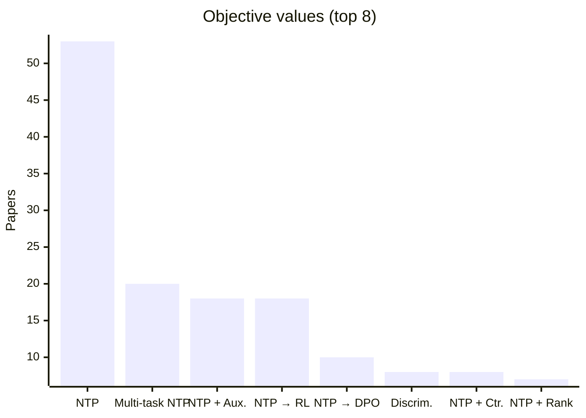

# Training Comparison

How each paper trains its tokenizer and generator. Values are Table 1 entries defined in the [glossary](../guides/glossary.md); setup text is quoted from each paper's setup card.

| Paper | Tokenizer Update | Objective | Related |
| :-- | :-- | :-- | :-- |
| [SIIT](../pages/papers/siit.md) | `Altern.` | `Multi-task NTP` | Competitor: [LETTER](../pages/papers/letter.md); Competitor: [TIGER](../pages/papers/tiger.md); Competitor: [CID](../pages/papers/cid.md); Predecessor: [LC-Rec](../pages/papers/lc-rec.md) |
| [IDGenRec](../pages/papers/idgenrec.md) | `Altern.` | `NTP` | Competitor: [CID](../pages/papers/cid.md); Alternative: [GRAM](../pages/papers/gram.md); Alternative: [GRLM](../pages/papers/grlm.md); Alternative: [GMC](../pages/papers/gmc.md) |
| [DREAM](../pages/papers/dream.md) | `Altern.` | `NTP + Aux.` | Predecessor: [LC-Rec](../pages/papers/lc-rec.md); Competitor: [TIGER](../pages/papers/tiger.md); Competitor: [SpecGR](../pages/papers/specgr.md) |
| [ETEGRec](../pages/papers/etegrec.md) | `Altern.` | `NTP + Ctr.` | Competitor: [TIGER](../pages/papers/tiger.md); Competitor: [LETTER](../pages/papers/letter.md); Competitor: [CID](../pages/papers/cid.md); Alternative: [AdaSID](../pages/papers/adasid.md) |
| [GeoGR](../pages/papers/geogr.md) | `Altern.†` | `Multi-task NTP` | Competitor: [OneLoc](../pages/papers/oneloc.md); Competitor: [GNPR-SID](../pages/papers/gnpr-sid.md); Competitor: [TIGER](../pages/papers/tiger.md); Predecessor: [OneRec](../pages/papers/onerec.md) |
| [SAHL](../pages/papers/sahl.md) | `Fixed` | `(MTP + Masked Rec.) → MTP` | Predecessor: [RPG](../pages/papers/rpg.md); Competitor: [Tlow](../pages/papers/tlow.md); Competitor: [TIGER](../pages/papers/tiger.md) |
| [OneMall](../pages/papers/onemall.md) | `Fixed` | `(NTP + Ctr.) → RL` | Competitor: [TIGER](../pages/papers/tiger.md); Predecessor: [OneRec](../pages/papers/onerec.md) |
| [CITE](../pages/papers/cite.md) | `Fixed` | `Discrim.` | Predecessor: [RPG](../pages/papers/rpg.md); Competitor: [TIGER](../pages/papers/tiger.md); Competitor: [VQ-Rec](../pages/papers/vq-rec.md) |
| [DiGR](../pages/papers/digr.md) | `Fixed` | `Discrim.` | Competitor: [LC-Rec](../pages/papers/lc-rec.md); Competitor: [RPG](../pages/papers/rpg.md); Competitor: [TIGER](../pages/papers/tiger.md) |
| [LGRID](../pages/papers/lgrid.md) | `Fixed` | `Discrim.` | Competitor: [LGSID](../pages/papers/lgsid.md); Competitor: [TIGER](../pages/papers/tiger.md); Alternative: [OneLoc](../pages/papers/oneloc.md); Alternative: [GNPR-SID](../pages/papers/gnpr-sid.md) |
| [PSRQ](../pages/papers/psrq.md) | `Fixed` | `Discrim.` | Alternative: [TIGER](../pages/papers/tiger.md); Alternative: [VQ-Rec](../pages/papers/vq-rec.md); Alternative: [OneRec](../pages/papers/onerec.md) |
| [TokenRec](../pages/papers/tokenrec.md) | `Fixed` | `Discrim.` | Competitor: [TIGER](../pages/papers/tiger.md); Competitor: [CID](../pages/papers/cid.md); Alternative: [LC-Rec](../pages/papers/lc-rec.md); Alternative: [R3-VAE](../pages/papers/r3-vae.md) |
| [VQ-Rec](../pages/papers/vq-rec.md) | `Fixed` | `Discrim.` | Successor: [ActionPiece](../pages/papers/actionpiece.md); Successor: [LC-Rec](../pages/papers/lc-rec.md); Alternative: [UTGRec](../pages/papers/utgrec.md) |
| [LGSID](../pages/papers/lgsid.md) | `Fixed` | `Discrim. / NTP` | Competitor: [TIGER](../pages/papers/tiger.md); Predecessor: [OneRec](../pages/papers/onerec.md); Alternative: [GNPR-SID](../pages/papers/gnpr-sid.md); Successor: [LGRID](../pages/papers/lgrid.md) |
| [SPRINT](../pages/papers/sprint.md) | `Fixed` | `Dual-level Flow Ctr.` | Competitor: [RPG](../pages/papers/rpg.md); Competitor: [LLaDA-Rec](../pages/papers/llada-rec.md); Competitor: [SID-MLP](../pages/papers/sid-mlp.md) |
| [LLaDA-Rec](../pages/papers/llada-rec.md) | `Fixed` | `Masked` | Competitor: [RPG](../pages/papers/rpg.md); Competitor: [TIGER](../pages/papers/tiger.md); Competitor: [LETTER](../pages/papers/letter.md); Competitor: [LC-Rec](../pages/papers/lc-rec.md); Competitor: [VQ-Rec](../pages/papers/vq-rec.md) |
| [MDGR](../pages/papers/mdgr.md) | `Fixed` | `Masked` | Competitor: [TIGER](../pages/papers/tiger.md); Competitor: [RPG](../pages/papers/rpg.md); Competitor: [COBRA](../pages/papers/cobra.md) |
| [Q-BERT4Rec](../pages/papers/q-bert4rec.md) | `Fixed` | `Masked` | Competitor: [MQL4GRec](../pages/papers/mql4grec.md); Competitor: [TIGER](../pages/papers/tiger.md); Competitor: [VQ-Rec](../pages/papers/vq-rec.md); Competitor: [CID](../pages/papers/cid.md) |
| [DPE-Rec](../pages/papers/dpe-rec.md) | `Fixed` | `Masked → RL (→ Masked KD for Fast)` | Alternative: [TIGER](../pages/papers/tiger.md) |
| [RPG](../pages/papers/rpg.md) | `Fixed` | `MTP` | Competitor: [TIGER](../pages/papers/tiger.md); Predecessor: [VQ-Rec](../pages/papers/vq-rec.md); Alternative: [LETTER](../pages/papers/letter.md) |
| [FLASH](../pages/papers/flash.md) | `Fixed` | `MTP + Aux.` | Predecessor: [TIGER](../pages/papers/tiger.md); Predecessor: [RPG](../pages/papers/rpg.md); Competitor: [LETTER](../pages/papers/letter.md); Competitor: [DIGER](../pages/papers/diger.md) |
| [IDM/CMM](../pages/papers/idm-cmm.md) | `Fixed` | `MTP + Aux.` | Competitor: [RPG](../pages/papers/rpg.md); Competitor: [TIGER](../pages/papers/tiger.md); Alternative: [LLaDA-Rec](../pages/papers/llada-rec.md) |
| [TopoGR](../pages/papers/topogr.md) | `Fixed` | `MTP + Aux.` | Competitor: [TIGER](../pages/papers/tiger.md); Competitor: [RPG](../pages/papers/rpg.md); Alternative: [LLaDA-Rec](../pages/papers/llada-rec.md) |
| [SCRec](../pages/papers/screc.md) | `Fixed` | `MTP + Ctr.` | Predecessor: [RPG](../pages/papers/rpg.md); Predecessor: [TIGER](../pages/papers/tiger.md); Predecessor: [LIGER](../pages/papers/liger.md) |
| [ACERec](../pages/papers/acerec.md) | `Fixed` | `MTP + Ctr. + Aux.` | Competitor: [RPG](../pages/papers/rpg.md); Competitor: [TIGER](../pages/papers/tiger.md); Competitor: [ActionPiece](../pages/papers/actionpiece.md); Competitor: [ETEGRec](../pages/papers/etegrec.md); Predecessor: [VQ-Rec](../pages/papers/vq-rec.md) |
| [Tlow](../pages/papers/tlow.md) | `Fixed` | `MTP + Rel.MSE` | Predecessor: [RPG](../pages/papers/rpg.md); Competitor: [TIGER](../pages/papers/tiger.md); Competitor: [ETEGRec](../pages/papers/etegrec.md) |
| [CogRec](../pages/papers/cogrec.md) | `Fixed` | `Multi-task NTP` | Predecessor: [TIGER](../pages/papers/tiger.md); Competitor: [LETTER](../pages/papers/letter.md); Competitor: [EAGER](../pages/papers/eager.md); Competitor: [OneRec-Think](../pages/papers/onerec-think.md) |
| [EAGER-LLM](../pages/papers/eager-llm.md) | `Fixed` | `Multi-task NTP` | Predecessor: [EAGER](../pages/papers/eager.md); Competitor: [LC-Rec](../pages/papers/lc-rec.md); Competitor: [LETTER](../pages/papers/letter.md) |
| [GenSAR](../pages/papers/gensar.md) | `Fixed` | `Multi-task NTP` | Competitor: [TIGER](../pages/papers/tiger.md); Competitor: [LC-Rec](../pages/papers/lc-rec.md); Competitor: [CID](../pages/papers/cid.md) |
| [GRLM](../pages/papers/grlm.md) | `Fixed` | `Multi-task NTP` | Competitor: [OneRec-Think](../pages/papers/onerec-think.md); Competitor: [IDGenRec](../pages/papers/idgenrec.md); Competitor: [TIGER](../pages/papers/tiger.md); Competitor: [GenCDR](../pages/papers/gencdr.md) |
| [GTI](../pages/papers/gti.md) | `Fixed` | `Multi-task NTP` | Predecessor: [TIGER](../pages/papers/tiger.md); Competitor: [LC-Rec](../pages/papers/lc-rec.md) |
| [Intent-Driven-News](../pages/papers/intent-driven-news.md) | `Fixed` | `Multi-task NTP` | Competitor: [TIGER](../pages/papers/tiger.md); Alternative: [OneRec-Think](../pages/papers/onerec-think.md); Alternative: [DiscRec](../pages/papers/discrec.md) |
| [KGTB](../pages/papers/kgtb.md) | `Fixed` | `Multi-task NTP` | Competitor: [GNPR-SID](../pages/papers/gnpr-sid.md) |
| [LC-Rec](../pages/papers/lc-rec.md) | `Fixed` | `Multi-task NTP` | Competitor: [TIGER](../pages/papers/tiger.md); Competitor: [CID](../pages/papers/cid.md); Predecessor: [VQ-Rec](../pages/papers/vq-rec.md); Alternative: [TransRec](../pages/papers/transrec.md) |
| [MQL4GRec](../pages/papers/mql4grec.md) | `Fixed` | `Multi-task NTP` | Competitor: [TIGER](../pages/papers/tiger.md); Alternative: [LC-Rec](../pages/papers/lc-rec.md); Competitor: [CID](../pages/papers/cid.md); Competitor: [VQ-Rec](../pages/papers/vq-rec.md); Successor: [MACRec](../pages/papers/macrec.md) |
| [NEO](../pages/papers/neo.md) | `Fixed` | `Multi-task NTP` | Alternative: [PLUM](../pages/papers/plum.md); Predecessor: [TIGER](../pages/papers/tiger.md); Alternative: [EAGER-LLM](../pages/papers/eager-llm.md) |
| [OneLatent](../pages/papers/onelatent.md) | `Fixed` | `Multi-task NTP` | Competitor: [TIGER](../pages/papers/tiger.md); Alternative: [OneRec-Think](../pages/papers/onerec-think.md) |
| [PLUM](../pages/papers/plum.md) | `Fixed` | `Multi-task NTP` | Predecessor: [TIGER](../pages/papers/tiger.md); Alternative: [MMQ](../pages/papers/mmq.md); Alternative: [LIGER](../pages/papers/liger.md) |
| [PrefixMem](../pages/papers/prefixmem.md) | `Fixed` | `Multi-task NTP` | Predecessor: [TIGER](../pages/papers/tiger.md); Predecessor: [PLUM](../pages/papers/plum.md); Predecessor: [OneRec-Think](../pages/papers/onerec-think.md) |
| [QT-Mob](../pages/papers/qt-mob.md) | `Fixed` | `Multi-task NTP` | Predecessor: [LC-Rec](../pages/papers/lc-rec.md) |
| [SemConv](../pages/papers/semconv.md) | `Fixed` | `Multi-task NTP` | Competitor: [LC-Rec](../pages/papers/lc-rec.md); Predecessor: [TIGER](../pages/papers/tiger.md) |
| [SnapLGR](../pages/papers/snaplgr.md) | `Fixed` | `Multi-task NTP` | Predecessor: [TIGER](../pages/papers/tiger.md); Predecessor: [PLUM](../pages/papers/plum.md) |
| [SPAR](../pages/papers/spar.md) | `Fixed` | `Multi-task NTP` | Competitor: [GNPR-SID](../pages/papers/gnpr-sid.md); Competitor: [PLUM](../pages/papers/plum.md); Competitor: [TIGER](../pages/papers/tiger.md) |
| [TriAlignGR](../pages/papers/trialigngr.md) | `Fixed` | `Multi-task NTP` | Competitor: [SIDReasoner](../pages/papers/sidreasoner.md); Predecessor: [MiniOneRec](../pages/papers/minionerec.md); Competitor: [LETTER](../pages/papers/letter.md); Competitor: [ETEGRec](../pages/papers/etegrec.md); Competitor: [LC-Rec](../pages/papers/lc-rec.md) |
| [Netflix-SID-Comparison](../pages/papers/netflix-sid-comparison.md) | `Fixed` | `Multi-task NTP / (Text NTP + MTP + Rank); Lang. RL after SFT` | Predecessor: [TIGER](../pages/papers/tiger.md); Alternative: [RPG](../pages/papers/rpg.md); Alternative: [STAMP](../pages/papers/stamp.md); Alternative: [NEZHA](../pages/papers/nezha.md) |
| [PAD-Rec](../pages/papers/pad-rec.md) | `Fixed` | `Multi-task NTP†` | Predecessor: [LC-Rec](../pages/papers/lc-rec.md); Predecessor: [LETTER](../pages/papers/letter.md); Alternative: [AtSpeed](../pages/papers/atspeed.md); Alternative: [SpecGR](../pages/papers/specgr.md) |
| [CAPE](../pages/papers/cape.md) | `Fixed` | `Multi-task NTP† / NTP†` | Predecessor: [MiniOneRec](../pages/papers/minionerec.md); Predecessor: [TIGER](../pages/papers/tiger.md); Alternative: [LIGER](../pages/papers/liger.md) |
| [OneChord](../pages/papers/onechord.md) | `Fixed` | `Next-item CE + Cons. KD + Rank KD` | Competitor: [SPRINT](../pages/papers/sprint.md); Competitor: [RPG](../pages/papers/rpg.md); Competitor: [LLaDA-Rec](../pages/papers/llada-rec.md) |
| [ActionPiece](../pages/papers/actionpiece.md) | `Fixed` | `NTP` | Competitor: [TIGER](../pages/papers/tiger.md); Predecessor: [VQ-Rec](../pages/papers/vq-rec.md); Competitor: [LMIndexer](../pages/papers/lmindexer.md); Competitor: [CID](../pages/papers/cid.md) |
| [AdaSID](../pages/papers/adasid.md) | `Fixed` | `NTP` | Predecessor: [QuaSID](../pages/papers/quasid.md); Predecessor: [TIGER](../pages/papers/tiger.md); Alternative: [HiD-VAE](../pages/papers/hid-vae.md); Alternative: [ETEGRec](../pages/papers/etegrec.md) |
| [AtSpeed](../pages/papers/atspeed.md) | `Fixed` | `NTP` | Predecessor: [LC-Rec](../pages/papers/lc-rec.md); Alternative: [SpecGR](../pages/papers/specgr.md); Alternative: [PAD-Rec](../pages/papers/pad-rec.md) |
| [AWARE](../pages/papers/aware.md) | `Fixed` | `NTP` | Predecessor: [ROS](../pages/papers/ros.md); Competitor: [GNPR-SID](../pages/papers/gnpr-sid.md); Competitor: [Spacetime-GR](../pages/papers/spacetime-gr.md) |
| [CapsID](../pages/papers/capsid.md) | `Fixed` | `NTP` | Competitor: [COBRA](../pages/papers/cobra.md); Competitor: [TIGER](../pages/papers/tiger.md); Competitor: [ADC-SID](../pages/papers/adc-sid.md); Competitor: [ActionPiece](../pages/papers/actionpiece.md); Competitor: [ReSID](../pages/papers/resid.md) |
| [CARD](../pages/papers/card.md) | `Fixed` | `NTP` | Competitor: [MACRec](../pages/papers/macrec.md); Competitor: [MQL4GRec](../pages/papers/mql4grec.md); Competitor: [LETTER](../pages/papers/letter.md); Competitor: [TIGER](../pages/papers/tiger.md); Competitor: [VQ-Rec](../pages/papers/vq-rec.md) |
| [ChronoID](../pages/papers/chronoid.md) | `Fixed` | `NTP` | Predecessor: [MiniOneRec](../pages/papers/minionerec.md); Predecessor: [TokenRec](../pages/papers/tokenrec.md); Competitor: [ActionPiece](../pages/papers/actionpiece.md); Predecessor: [TIGER](../pages/papers/tiger.md) |
| [CID](../pages/papers/cid.md) | `Fixed` | `NTP` | Successor: [LMIndexer](../pages/papers/lmindexer.md) |
| [CoST](../pages/papers/cost.md) | `Fixed` | `NTP` | Predecessor: [TIGER](../pages/papers/tiger.md); Alternative: [EAGER](../pages/papers/eager.md); Alternative: [LETTER](../pages/papers/letter.md); Alternative: [TokenRec](../pages/papers/tokenrec.md) |
| [DACT](../pages/papers/dact.md) | `Fixed` | `NTP` | Predecessor: [TIGER](../pages/papers/tiger.md); Predecessor: [LC-Rec](../pages/papers/lc-rec.md); Predecessor: [LETTER](../pages/papers/letter.md) |
| [DAS](../pages/papers/das.md) | `Fixed` | `NTP` | Competitor: [LETTER](../pages/papers/letter.md); Competitor: [TIGER](../pages/papers/tiger.md); Alternative: [ADC-SID](../pages/papers/adc-sid.md) |
| [DECOR](../pages/papers/decor.md) | `Fixed` | `NTP` | Predecessor: [TIGER](../pages/papers/tiger.md); Alternative: [ETEGRec](../pages/papers/etegrec.md); Competitor: [LETTER](../pages/papers/letter.md); Competitor: [CID](../pages/papers/cid.md) |
| [DiscRec](../pages/papers/discrec.md) | `Fixed` | `NTP` | Predecessor: [TIGER](../pages/papers/tiger.md); Predecessor: [LETTER](../pages/papers/letter.md); Competitor: [EAGER](../pages/papers/eager.md) |
| [FORGE](../pages/papers/forge.md) | `Fixed` | `NTP` | Predecessor: [TIGER](../pages/papers/tiger.md); Alternative: [OneRec](../pages/papers/onerec.md); Alternative: [OneRec-V2](../pages/papers/onerec-v2.md) |
| [GEM-Rec](../pages/papers/gem-rec.md) | `Fixed` | `NTP` | Competitor: [TIGER](../pages/papers/tiger.md); Predecessor: [LIGER](../pages/papers/liger.md) |
| [GenCDR](../pages/papers/gencdr.md) | `Fixed` | `NTP` | Competitor: [TIGER](../pages/papers/tiger.md); Competitor: [VQ-Rec](../pages/papers/vq-rec.md); Alternative: [UTGRec](../pages/papers/utgrec.md) |
| [GMC](../pages/papers/gmc.md) | `Fixed` | `NTP` | Competitor: [TIGER](../pages/papers/tiger.md); Competitor: [VQ-Rec](../pages/papers/vq-rec.md); Competitor: [CID](../pages/papers/cid.md); Competitor: [IDGenRec](../pages/papers/idgenrec.md) |
| [GNPR-SID](../pages/papers/gnpr-sid.md) | `Fixed` | `NTP` | Predecessor: [LC-Rec](../pages/papers/lc-rec.md); Alternative: [TIGER](../pages/papers/tiger.md); Alternative: [GeoGR](../pages/papers/geogr.md) |
| [GRAM](../pages/papers/gram.md) | `Fixed` | `NTP` | Competitor: [LC-Rec](../pages/papers/lc-rec.md); Competitor: [IDGenRec](../pages/papers/idgenrec.md); Competitor: [TIGER](../pages/papers/tiger.md); Competitor: [CID](../pages/papers/cid.md); Competitor: [LETTER](../pages/papers/letter.md) |
| [GRID](../pages/papers/grid.md) | `Fixed` | `NTP` | Predecessor: [TIGER](../pages/papers/tiger.md); Predecessor: [OneRec](../pages/papers/onerec.md) |
| [HF-SID](../pages/papers/hf-sid.md) | `Fixed` | `NTP` | Competitor: [ProGEO](../pages/papers/progeo.md); Competitor: [GeoGR](../pages/papers/geogr.md); Competitor: [GNPR-SID](../pages/papers/gnpr-sid.md) |
| [HiD-VAE](../pages/papers/hid-vae.md) | `Fixed` | `NTP` | Competitor: [TIGER](../pages/papers/tiger.md); Competitor: [LC-Rec](../pages/papers/lc-rec.md); Competitor: [VQ-Rec](../pages/papers/vq-rec.md); Alternative: [AdaSID](../pages/papers/adasid.md) |
| [Latte](../pages/papers/latte.md) | `Fixed` | `NTP` | Predecessor: [PSI](../pages/papers/psi.md); Competitor: [TIGER](../pages/papers/tiger.md); Competitor: [LETTER](../pages/papers/letter.md); Competitor: [ActionPiece](../pages/papers/actionpiece.md); Predecessor: [GRID](../pages/papers/grid.md) |
| [LESSRec](../pages/papers/lessrec.md) | `Fixed` | `NTP` | Predecessor: [TIGER](../pages/papers/tiger.md); Predecessor: [LETTER](../pages/papers/letter.md); Competitor: [DiscRec](../pages/papers/discrec.md); Competitor: [RPG](../pages/papers/rpg.md) |
| [LMIndexer](../pages/papers/lmindexer.md) | `Fixed` | `NTP` | Competitor: [TIGER](../pages/papers/tiger.md); Alternative: [CID](../pages/papers/cid.md) |
| [MBGen](../pages/papers/mbgen.md) | `Fixed` | `NTP` | Competitor: [TIGER](../pages/papers/tiger.md); Alternative: [MMGRec](../pages/papers/mmgrec.md); Alternative: [LMIndexer](../pages/papers/lmindexer.md) |
| [Merge-and-Branch](../pages/papers/merge-and-branch.md) | `Fixed` | `NTP` | Competitor: [LETTER](../pages/papers/letter.md); Competitor: [EAGER-LLM](../pages/papers/eager-llm.md); Alternative: [AtSpeed](../pages/papers/atspeed.md) |
| [MME-SID](../pages/papers/mme-sid.md) | `Fixed` | `NTP` | Competitor: [TIGER](../pages/papers/tiger.md); Competitor: [LETTER](../pages/papers/letter.md); Alternative: [LC-Rec](../pages/papers/lc-rec.md); Alternative: [ADC-SID](../pages/papers/adc-sid.md) |
| [MMGRec](../pages/papers/mmgrec.md) | `Fixed` | `NTP` | Predecessor: [TIGER](../pages/papers/tiger.md) |
| [NEZHA](../pages/papers/nezha.md) | `Fixed` | `NTP` | Alternative: [AtSpeed](../pages/papers/atspeed.md); Alternative: [SpecGR](../pages/papers/specgr.md); Alternative: [RPG](../pages/papers/rpg.md) |
| [Pctx](../pages/papers/pctx.md) | `Fixed` | `NTP` | Competitor: [TIGER](../pages/papers/tiger.md); Competitor: [LETTER](../pages/papers/letter.md); Competitor: [ActionPiece](../pages/papers/actionpiece.md); Alternative: [LC-Rec](../pages/papers/lc-rec.md) |
| [ProGEO](../pages/papers/progeo.md) | `Fixed` | `NTP` | Competitor: [OneRec](../pages/papers/onerec.md); Competitor: [TIGER](../pages/papers/tiger.md); Predecessor: [GNPR-SID](../pages/papers/gnpr-sid.md); Alternative: [OneLoc](../pages/papers/oneloc.md); Alternative: [LGSID](../pages/papers/lgsid.md) |
| [PSI](../pages/papers/psi.md) | `Fixed` | `NTP` | Predecessor: [LMIndexer](../pages/papers/lmindexer.md); Alternative: [TIGER](../pages/papers/tiger.md); Alternative: [LIGER](../pages/papers/liger.md); Successor: [Latte](../pages/papers/latte.md) |
| [QuaSID](../pages/papers/quasid.md) | `Fixed` | `NTP` | Predecessor: [TIGER](../pages/papers/tiger.md); Alternative: [LETTER](../pages/papers/letter.md); Alternative: [HiD-VAE](../pages/papers/hid-vae.md) |
| [R3-VAE](../pages/papers/r3-vae.md) | `Fixed` | `NTP` | Competitor: [OneRec](../pages/papers/onerec.md); Competitor: [TokenRec](../pages/papers/tokenrec.md); Competitor: [VQ-Rec](../pages/papers/vq-rec.md); Alternative: [FORGE](../pages/papers/forge.md) |
| [RecBase](../pages/papers/recbase.md) | `Fixed` | `NTP` | Alternative: [TIGER](../pages/papers/tiger.md); Alternative: [LC-Rec](../pages/papers/lc-rec.md) |
| [ReSID](../pages/papers/resid.md) | `Fixed` | `NTP` | Competitor: [LETTER](../pages/papers/letter.md); Competitor: [TIGER](../pages/papers/tiger.md); Competitor: [UNGER](../pages/papers/unger.md) |
| [SLIDE](../pages/papers/slide.md) | `Fixed` | `NTP` | Predecessor: [FORGE](../pages/papers/forge.md); Alternative: [OneRec](../pages/papers/onerec.md); Predecessor: [TIGER](../pages/papers/tiger.md) |
| [SPRIG](../pages/papers/sprig.md) | `Fixed` | `NTP` | Predecessor: [TIGER](../pages/papers/tiger.md); Predecessor: [GRID](../pages/papers/grid.md) |
| [SST](../pages/papers/sst.md) | `Fixed` | `NTP` | Predecessor: [TIGER](../pages/papers/tiger.md); Predecessor: [LETTER](../pages/papers/letter.md) |
| [STATIC](../pages/papers/static.md) | `Fixed` | `NTP` | Predecessor: [PLUM](../pages/papers/plum.md); Predecessor: [TIGER](../pages/papers/tiger.md); Alternative: [LIGER](../pages/papers/liger.md) |
| [TIGER](../pages/papers/tiger.md) | `Fixed` | `NTP` | Alternative: [VQ-Rec](../pages/papers/vq-rec.md); Successor: [LETTER](../pages/papers/letter.md); Alternative: [RPG](../pages/papers/rpg.md) |
| [Token-Weighted](../pages/papers/token-weighted.md) | `Fixed` | `NTP` | Predecessor: [TIGER](../pages/papers/tiger.md); Competitor: [LETTER](../pages/papers/letter.md) |
| [TransRec](../pages/papers/transrec.md) | `Fixed` | `NTP` | Competitor: [CID](../pages/papers/cid.md); Competitor: [TIGER](../pages/papers/tiger.md) |
| [UniTok](../pages/papers/unitok.md) | `Fixed` | `NTP` | Competitor: [LETTER](../pages/papers/letter.md); Competitor: [TIGER](../pages/papers/tiger.md); Competitor: [LC-Rec](../pages/papers/lc-rec.md); Competitor: [CID](../pages/papers/cid.md) |
| [UTGRec](../pages/papers/utgrec.md) | `Fixed` | `NTP` | Competitor: [TIGER](../pages/papers/tiger.md); Competitor: [LETTER](../pages/papers/letter.md); Competitor: [VQ-Rec](../pages/papers/vq-rec.md); Alternative: [GenCDR](../pages/papers/gencdr.md) |
| [Deco](../pages/papers/deco.md) | `Fixed` | `NTP + Aux.` | Competitor: [TIGER](../pages/papers/tiger.md); Competitor: [RPG](../pages/papers/rpg.md); Competitor: [LLaDA-Rec](../pages/papers/llada-rec.md); Competitor: [NEZHA](../pages/papers/nezha.md) |
| [FedCGR](../pages/papers/fedcgr.md) | `Fixed` | `NTP + Aux.` | Competitor: [TIGER](../pages/papers/tiger.md); Alternative: [GenCDR](../pages/papers/gencdr.md); Predecessor: [VQ-Rec](../pages/papers/vq-rec.md) |
| [GFlowGR](../pages/papers/gflowgr.md) | `Fixed` | `NTP + Aux.` | Predecessor: [TIGER](../pages/papers/tiger.md); Predecessor: [LETTER](../pages/papers/letter.md); Competitor: [OneRec](../pages/papers/onerec.md) |
| [Ghost](../pages/papers/ghost.md) | `Fixed` | `NTP + Aux.` | Competitor: [LETTER](../pages/papers/letter.md); Competitor: [LC-Rec](../pages/papers/lc-rec.md) |
| [HASTE](../pages/papers/haste.md) | `Fixed` | `NTP + Aux.` | Competitor: [TIGER](../pages/papers/tiger.md); Competitor: [IDGenRec](../pages/papers/idgenrec.md); Alternative: [LC-Rec](../pages/papers/lc-rec.md) |
| [HoloRec](../pages/papers/holorec.md) | `Fixed` | `NTP + Aux.` | Predecessor: [TIGER](../pages/papers/tiger.md); Alternative: [LLaDA-Rec](../pages/papers/llada-rec.md); Alternative: [OneRec-Think](../pages/papers/onerec-think.md) |
| [JevRec](../pages/papers/jevrec.md) | `Fixed` | `NTP + Aux.` | Competitor: [TIGER](../pages/papers/tiger.md); Competitor: [LETTER](../pages/papers/letter.md); Competitor: [ActionPiece](../pages/papers/actionpiece.md); Alternative: [Pctx](../pages/papers/pctx.md) |
| [MuSID-KD](../pages/papers/musid-kd.md) | `Fixed` | `NTP + Aux.` | Predecessor: [TIGER](../pages/papers/tiger.md); Predecessor: [SID-MLP](../pages/papers/sid-mlp.md) |
| [NAU](../pages/papers/nau.md) | `Fixed` | `NTP + Aux.` | Predecessor: [TIGER](../pages/papers/tiger.md); Predecessor: [LETTER](../pages/papers/letter.md); Competitor: [TRACER](../pages/papers/tracer.md) |
| [RoFiGR](../pages/papers/rofigr.md) | `Fixed` | `NTP + Aux.` | Predecessor: [MACRec](../pages/papers/macrec.md); Competitor: [SynGR](../pages/papers/syngr.md); Competitor: [MQL4GRec](../pages/papers/mql4grec.md) |
| [SID-MLP](../pages/papers/sid-mlp.md) | `Fixed` | `NTP + Aux.` | Predecessor: [TIGER](../pages/papers/tiger.md); Predecessor: [LC-Rec](../pages/papers/lc-rec.md); Competitor: [AtSpeed](../pages/papers/atspeed.md); Competitor: [NEZHA](../pages/papers/nezha.md) |
| [STAMP](../pages/papers/stamp.md) | `Fixed` | `NTP + Aux.` | Predecessor: [GRID](../pages/papers/grid.md); Predecessor: [FORGE](../pages/papers/forge.md); Alternative: [AtSpeed](../pages/papers/atspeed.md) |
| [VarLenRec (TIGER)](../pages/papers/varlenrec-tiger.md) | `Fixed` | `NTP + Aux.` | Predecessor: [TIGER](../pages/papers/tiger.md); Competitor: [ETEGRec](../pages/papers/etegrec.md); Competitor: [LETTER](../pages/papers/letter.md) |
| [ColaRec](../pages/papers/colarec.md) | `Fixed` | `NTP + Ctr.` | Competitor: [TIGER](../pages/papers/tiger.md); Competitor: [LC-Rec](../pages/papers/lc-rec.md); Alternative: [CID](../pages/papers/cid.md); Alternative: [SEATER](../pages/papers/seater.md) |
| [EAGER](../pages/papers/eager.md) | `Fixed` | `NTP + Ctr.` | Competitor: [TIGER](../pages/papers/tiger.md); Alternative: [SEATER](../pages/papers/seater.md); Alternative: [LMIndexer](../pages/papers/lmindexer.md); Alternative: [CoST](../pages/papers/cost.md) |
| [MACRec](../pages/papers/macrec.md) | `Fixed` | `NTP + Ctr.` | Competitor: [MQL4GRec](../pages/papers/mql4grec.md); Competitor: [TIGER](../pages/papers/tiger.md); Competitor: [CID](../pages/papers/cid.md); Alternative: [CARD](../pages/papers/card.md) |
| [S2GR](../pages/papers/s2gr.md) | `Fixed` | `NTP + Ctr.` | Competitor: [TIGER](../pages/papers/tiger.md); Alternative: [OneRec-Think](../pages/papers/onerec-think.md); Alternative: [PLUM](../pages/papers/plum.md) |
| [SEATER](../pages/papers/seater.md) | `Fixed` | `NTP + Ctr.` | Competitor: [TIGER](../pages/papers/tiger.md); Alternative: [CID](../pages/papers/cid.md); Alternative: [EAGER](../pages/papers/eager.md) |
| [SynGR](../pages/papers/syngr.md) | `Fixed` | `NTP + Ctr.` | Competitor: [MACRec](../pages/papers/macrec.md); Competitor: [MQL4GRec](../pages/papers/mql4grec.md); Competitor: [TIGER](../pages/papers/tiger.md); Competitor: [CID](../pages/papers/cid.md) |
| [UNGER](../pages/papers/unger.md) | `Fixed` | `NTP + Ctr.` | Predecessor: [EAGER](../pages/papers/eager.md); Competitor: [TIGER](../pages/papers/tiger.md); Competitor: [ColaRec](../pages/papers/colarec.md) |
| [COBRA](../pages/papers/cobra.md) | `Fixed` | `NTP + Dense` | Competitor: [TIGER](../pages/papers/tiger.md); Alternative: [LIGER](../pages/papers/liger.md); Alternative: [CapsID](../pages/papers/capsid.md) |
| [LIGER](../pages/papers/liger.md) | `Fixed` | `NTP + Dense` | Competitor: [TIGER](../pages/papers/tiger.md); Alternative: [VQ-Rec](../pages/papers/vq-rec.md); Alternative: [COBRA](../pages/papers/cobra.md); Successor: [GEM-Rec](../pages/papers/gem-rec.md) |
| [GR4AD-X](../pages/papers/gr4ad-x.md) | `Fixed` | `NTP + PV-RSPO + Rank + Aux.` | Predecessor: [TIGER](../pages/papers/tiger.md); Alternative: [RPG](../pages/papers/rpg.md); Alternative: [MMQ](../pages/papers/mmq.md) |
| [APAO](../pages/papers/apao.md) | `Fixed` | `NTP + Rank` | Predecessor: [TIGER](../pages/papers/tiger.md); Predecessor: [LC-Rec](../pages/papers/lc-rec.md); Predecessor: [LETTER](../pages/papers/letter.md) |
| [DualGR](../pages/papers/dualgr.md) | `Fixed` | `NTP + Rank` | Competitor: [TIGER](../pages/papers/tiger.md) |
| [Gryphon](../pages/papers/gryphon.md) | `Fixed` | `NTP + Rank` | Predecessor: [TIGER](../pages/papers/tiger.md); Alternative: [QuaSID](../pages/papers/quasid.md); Alternative: [PROMISE](../pages/papers/promise.md) |
| [LETTER](../pages/papers/letter.md) | `Fixed` | `NTP + Rank` | Predecessor: [TIGER](../pages/papers/tiger.md); Predecessor: [LC-Rec](../pages/papers/lc-rec.md); Competitor: [CID](../pages/papers/cid.md) |
| [RecoChain](../pages/papers/recochain.md) | `Fixed` | `NTP + Rank` | Alternative: [TIGER](../pages/papers/tiger.md); Alternative: [OneRec](../pages/papers/onerec.md) |
| [SpecGR](../pages/papers/specgr.md) | `Fixed` | `NTP + Rank` | Predecessor: [TIGER](../pages/papers/tiger.md); Competitor: [LIGER](../pages/papers/liger.md); Alternative: [AtSpeed](../pages/papers/atspeed.md) |
| [API](../pages/papers/api.md) | `Fixed` | `NTP + Rank + Aux. / MTP + Rank + Aux.` | Predecessor: [GRID](../pages/papers/grid.md); Competitor: [RPG](../pages/papers/rpg.md); Competitor: [TIGER](../pages/papers/tiger.md); Competitor: [HiD-VAE](../pages/papers/hid-vae.md) |
| [LoopGR](../pages/papers/loopgr.md) | `Fixed` | `NTP / NTP + Aux.` | Competitor: [TIGER](../pages/papers/tiger.md); Competitor: [RPG](../pages/papers/rpg.md); Competitor: [ActionPiece](../pages/papers/actionpiece.md) |
| [IBA](../pages/papers/iba.md) | `Fixed` | `NTP → (NTP + Aux.)` | Predecessor: [TIGER](../pages/papers/tiger.md); Predecessor: [LETTER](../pages/papers/letter.md); Alternative: [SIDReasoner](../pages/papers/sidreasoner.md) |
| [REGER](../pages/papers/reger.md) | `Fixed` | `NTP → (NTP + Aux.)` | Predecessor: [TIGER](../pages/papers/tiger.md); Competitor: [GFlowGR](../pages/papers/gflowgr.md); Competitor: [APAO](../pages/papers/apao.md); Predecessor: [Pctx](../pages/papers/pctx.md) |
| [UGR](../pages/papers/ugr.md) | `Fixed` | `NTP → (RL + Rank)` | Competitor: [MiniOneRec](../pages/papers/minionerec.md); Competitor: [TIGER](../pages/papers/tiger.md) |
| [Align3GR](../pages/papers/align3gr.md) | `Fixed` | `NTP → DPO` | Competitor: [EAGER-LLM](../pages/papers/eager-llm.md); Competitor: [LC-Rec](../pages/papers/lc-rec.md); Competitor: [LETTER](../pages/papers/letter.md); Competitor: [TIGER](../pages/papers/tiger.md) |
| [CausalDPO](../pages/papers/causaldpo.md) | `Fixed` | `NTP → DPO` | Alternative: [OneRec](../pages/papers/onerec.md) |
| [Gwhere](../pages/papers/gwhere.md) | `Fixed` | `NTP → DPO` | Competitor: [GNPR-SID](../pages/papers/gnpr-sid.md); Alternative: [TIGER](../pages/papers/tiger.md) |
| [OneLoc](../pages/papers/oneloc.md) | `Fixed` | `NTP → DPO` | Predecessor: [OneRec](../pages/papers/onerec.md); Competitor: [TIGER](../pages/papers/tiger.md); Competitor: [GNPR-SID](../pages/papers/gnpr-sid.md) |
| [OneRec](../pages/papers/onerec.md) | `Fixed` | `NTP → DPO` | Competitor: [TIGER](../pages/papers/tiger.md); Successor: [MiniOneRec](../pages/papers/minionerec.md); Alternative: [GFlowGR](../pages/papers/gflowgr.md) |
| [RAGR](../pages/papers/ragr.md) | `Fixed` | `NTP → DPO` | Predecessor: [TIGER](../pages/papers/tiger.md); Predecessor: [LETTER](../pages/papers/letter.md) |
| [Spacetime-GR](../pages/papers/spacetime-gr.md) | `Fixed` | `NTP → DPO` | Predecessor: [TIGER](../pages/papers/tiger.md); Alternative: [OneRec](../pages/papers/onerec.md) |
| [SPAR-Youku](../pages/papers/spar-youku.md) | `Fixed` | `NTP → DPO` | Competitor: [TIGER](../pages/papers/tiger.md); Competitor: [OneRec](../pages/papers/onerec.md); Alternative: [UniRec](../pages/papers/unirec.md) |
| [UniRec](../pages/papers/unirec.md) | `Fixed` | `NTP → DPO` | Competitor: [OneRec-V2](../pages/papers/onerec-v2.md); Competitor: [TIGER](../pages/papers/tiger.md); Predecessor: [OneRec](../pages/papers/onerec.md); Alternative: [CapsID](../pages/papers/capsid.md) |
| [DASO](../pages/papers/daso.md) | `Fixed` | `NTP → RL` | Predecessor: [MiniOneRec](../pages/papers/minionerec.md); Competitor: [V-STAR](../pages/papers/v-star.md) |
| [Evo-Rec](../pages/papers/evo-rec.md) | `Fixed` | `NTP → RL` | Competitor: [SIDReasoner](../pages/papers/sidreasoner.md); Predecessor: [LC-Rec](../pages/papers/lc-rec.md); Competitor: [TIGER](../pages/papers/tiger.md) |
| [GenRec-JD](../pages/papers/genrec-jd.md) | `Fixed` | `NTP → RL` | Competitor: [TIGER](../pages/papers/tiger.md); Competitor: [LC-Rec](../pages/papers/lc-rec.md); Alternative: [LETTER](../pages/papers/letter.md) |
| [GRC](../pages/papers/grc.md) | `Fixed` | `NTP → RL` | Predecessor: [TIGER](../pages/papers/tiger.md); Competitor: [COBRA](../pages/papers/cobra.md) |
| [GREAM](../pages/papers/gream.md) | `Fixed` | `NTP → RL` | Competitor: [EAGER-LLM](../pages/papers/eager-llm.md); Competitor: [LC-Rec](../pages/papers/lc-rec.md); Competitor: [TIGER](../pages/papers/tiger.md); Competitor: [CID](../pages/papers/cid.md) |
| [HCGRec](../pages/papers/hcgrec.md) | `Fixed` | `NTP → RL` | Predecessor: [LC-Rec](../pages/papers/lc-rec.md); Competitor: [MiniOneRec](../pages/papers/minionerec.md); Competitor: [TIGER](../pages/papers/tiger.md) |
| [MiniOneRec](../pages/papers/minionerec.md) | `Fixed` | `NTP → RL` | Predecessor: [OneRec](../pages/papers/onerec.md); Competitor: [TIGER](../pages/papers/tiger.md); Competitor: [LC-Rec](../pages/papers/lc-rec.md) |
| [OneLive](../pages/papers/onelive.md) | `Fixed` | `NTP → RL` | Predecessor: [TIGER](../pages/papers/tiger.md); Competitor: [OneRec](../pages/papers/onerec.md); Alternative: [MMQ](../pages/papers/mmq.md) |
| [OneRec-Think](../pages/papers/onerec-think.md) | `Fixed` | `NTP → RL` | Competitor: [TIGER](../pages/papers/tiger.md); Alternative: [LC-Rec](../pages/papers/lc-rec.md); Alternative: [GRLM](../pages/papers/grlm.md) |
| [OneRec-V2](../pages/papers/onerec-v2.md) | `Fixed` | `NTP → RL` | Alternative: [TIGER](../pages/papers/tiger.md); Successor: [OneRec-V2-Quantized](../pages/papers/onerec-v2-quantized.md) |
| [ReRankID](../pages/papers/rerankid.md) | `Fixed` | `NTP → RL` | Alternative: [OneRec-Think](../pages/papers/onerec-think.md); Predecessor: [TIGER](../pages/papers/tiger.md) |
| [Retrieval-Grounded-Credit](../pages/papers/retrieval-grounded-credit.md) | `Fixed` | `NTP → RL` | Predecessor: [SIDReasoner](../pages/papers/sidreasoner.md); Alternative: [PROMISE](../pages/papers/promise.md); Alternative: [SAPO](../pages/papers/sapo.md) |
| [ROS](../pages/papers/ros.md) | `Fixed` | `NTP → RL` | Competitor: [GNPR-SID](../pages/papers/gnpr-sid.md); Competitor: [Spacetime-GR](../pages/papers/spacetime-gr.md); Alternative: [OneLoc](../pages/papers/oneloc.md); Alternative: [LGSID](../pages/papers/lgsid.md) |
| [SAPO](../pages/papers/sapo.md) | `Fixed` | `NTP → RL` | Predecessor: [SIDReasoner](../pages/papers/sidreasoner.md); Competitor: [OneRec-Think](../pages/papers/onerec-think.md); Competitor: [TIGER](../pages/papers/tiger.md) |
| [SIDReasoner](../pages/papers/sidreasoner.md) | `Fixed` | `NTP → RL` | Competitor: [LC-Rec](../pages/papers/lc-rec.md); Competitor: [LETTER](../pages/papers/letter.md); Competitor: [TIGER](../pages/papers/tiger.md); Alternative: [OneRec-Think](../pages/papers/onerec-think.md) |
| [Think2Go](../pages/papers/think2go.md) | `Fixed` | `NTP → RL` | Competitor: [GNPR-SID](../pages/papers/gnpr-sid.md); Alternative: [OneRec-Think](../pages/papers/onerec-think.md); Alternative: [OneLoc](../pages/papers/oneloc.md) |
| [V-STAR](../pages/papers/v-star.md) | `Fixed` | `NTP → RL` | Competitor: [MiniOneRec](../pages/papers/minionerec.md); Competitor: [TIGER](../pages/papers/tiger.md); Competitor: [LC-Rec](../pages/papers/lc-rec.md); Alternative: [OneRec](../pages/papers/onerec.md) |
| [Dynamic-Single-Codebook](../pages/papers/dynamic-single-codebook.md) | `Fixed` | `NTP†` | Alternative: [RPG](../pages/papers/rpg.md); Alternative: [LLaDA-Rec](../pages/papers/llada-rec.md); Alternative: [LETTER](../pages/papers/letter.md) |
| [ISD](../pages/papers/isd.md) | `Fixed` | `NTP†` | Predecessor: [TIGER](../pages/papers/tiger.md); Predecessor: [LIGER](../pages/papers/liger.md); Competitor: [ETEGRec](../pages/papers/etegrec.md) |
| [TCBSA](../pages/papers/tcbsa.md) | `Fixed` | `NTP† / NTP → RL` | Predecessor: [TIGER](../pages/papers/tiger.md); Predecessor: [MiniOneRec](../pages/papers/minionerec.md); Competitor: [APAO](../pages/papers/apao.md) |
| [GrIS (RecDMoN / RQ-GAE)](../pages/papers/gris-recdmon-rq-gae.md) | `Fixed` | `–` | Predecessor: [TIGER](../pages/papers/tiger.md); Competitor: [LETTER](../pages/papers/letter.md); Competitor: [MMGRec](../pages/papers/mmgrec.md) |
| [KL-MOPD](../pages/papers/kl-mopd.md) | `Fixed†` | `(NTP† / (NTP + Aux.)†) → KL-weighted OPD` | Predecessor: [TIGER](../pages/papers/tiger.md) |
| [ADC-SID](../pages/papers/adc-sid.md) | `Fixed†` | `NTP` | Competitor: [DAS](../pages/papers/das.md); Competitor: [LETTER](../pages/papers/letter.md); Competitor: [MME-SID](../pages/papers/mme-sid.md); Competitor: [TIGER](../pages/papers/tiger.md); Competitor: [RPG](../pages/papers/rpg.md) |
| [DOS](../pages/papers/dos.md) | `Fixed†` | `NTP` | Competitor: [DAS](../pages/papers/das.md); Alternative: [TIGER](../pages/papers/tiger.md) |
| [MSCGRec](../pages/papers/mscgrec.md) | `Fixed†` | `NTP` | Competitor: [TIGER](../pages/papers/tiger.md); Competitor: [MQL4GRec](../pages/papers/mql4grec.md); Competitor: [LETTER](../pages/papers/letter.md); Competitor: [CoST](../pages/papers/cost.md); Competitor: [ETEGRec](../pages/papers/etegrec.md) |
| [LION](../pages/papers/lion.md) | `Fixed†` | `NTP + Aux.` | Predecessor: [TIGER](../pages/papers/tiger.md) |
| [MBGR](../pages/papers/mbgr.md) | `Fixed†` | `NTP + Aux.` | Competitor: [TIGER](../pages/papers/tiger.md); Alternative: [OneRec](../pages/papers/onerec.md) |
| [PROMISE](../pages/papers/promise.md) | `Fixed†` | `NTP + Aux.` | Competitor: [ActionPiece](../pages/papers/actionpiece.md); Competitor: [TIGER](../pages/papers/tiger.md); Alternative: [OneRec-V2](../pages/papers/onerec-v2.md) |
| [SAGE-SID](../pages/papers/sage-sid.md) | `Fixed†` | `NTP → RL` | Predecessor: [OneRec-V2](../pages/papers/onerec-v2.md); Competitor: [LC-Rec](../pages/papers/lc-rec.md); Competitor: [TIGER](../pages/papers/tiger.md) |
| [OneRec-V2-Quantized](../pages/papers/onerec-v2-quantized.md) | `Fixed†` | `NTP → RL†` | Predecessor: [OneRec-V2](../pages/papers/onerec-v2.md) |
| [GR-Generalize](../pages/papers/gr-generalize.md) | `Fixed†` | `NTP†` | Predecessor: [TIGER](../pages/papers/tiger.md); Alternative: [LIGER](../pages/papers/liger.md); Alternative: [SpecGR](../pages/papers/specgr.md); Predecessor: [ETEGRec](../pages/papers/etegrec.md) |
| [TrieRec](../pages/papers/trierec.md) | `Fixed†` | `NTP†` | Predecessor: [TIGER](../pages/papers/tiger.md); Predecessor: [CoST](../pages/papers/cost.md); Predecessor: [LETTER](../pages/papers/letter.md) |
| [PCR-CA](../pages/papers/pcr-ca.md) | `Joint` | `Discrim.` | Alternative: [CoST](../pages/papers/cost.md) |
| [MMQ](../pages/papers/mmq.md) | `Joint` | `MTP` | Predecessor: [TIGER](../pages/papers/tiger.md); Alternative: [OneRec](../pages/papers/onerec.md); Alternative: [LC-Rec](../pages/papers/lc-rec.md) |
| [DIGER](../pages/papers/diger.md) | `Joint` | `NTP` | Predecessor: [TIGER](../pages/papers/tiger.md); Alternative: [ETEGRec](../pages/papers/etegrec.md); Competitor: [LETTER](../pages/papers/letter.md) |
| [FlexCode](../pages/papers/flexcode.md) | `Joint` | `NTP` | Competitor: [TIGER](../pages/papers/tiger.md); Competitor: [LC-Rec](../pages/papers/lc-rec.md); Competitor: [COBRA](../pages/papers/cobra.md) |
| [TRACER](../pages/papers/tracer.md) | `Joint` | `NTP + Aux.` | Predecessor: [MiniOneRec](../pages/papers/minionerec.md); Predecessor: [TIGER](../pages/papers/tiger.md); Predecessor: [LETTER](../pages/papers/letter.md); Predecessor: [ETEGRec](../pages/papers/etegrec.md) |
| [Molar](../pages/papers/molar.md) | `n/a` | `Discrim.` | – |
| [SIDScope](../pages/papers/sidscope.md) | `n/a` | `n/a` | Predecessor: [GRID](../pages/papers/grid.md); Predecessor: [CARD](../pages/papers/card.md); Predecessor: [DIGER](../pages/papers/diger.md); Predecessor: [LETTER](../pages/papers/letter.md); Predecessor: [LC-Rec](../pages/papers/lc-rec.md) |
| [CMRec](../pages/papers/cmrec.md) | `–` | `NTP` | Predecessor: [GenCDR](../pages/papers/gencdr.md); Competitor: [TIGER](../pages/papers/tiger.md); Alternative: [GMC](../pages/papers/gmc.md) |
| [UniSGR-V2](../pages/papers/unisgr-v2.md) | `–` | `NTP + Rank` | Predecessor: [UniRec](../pages/papers/unirec.md); Competitor: [OneRec-V2](../pages/papers/onerec-v2.md); Competitor: [TIGER](../pages/papers/tiger.md) |
| [PinGER](../pages/papers/pinger.md) | `–` | `NTP → DPO` | Competitor: [TIGER](../pages/papers/tiger.md); Predecessor: [STATIC](../pages/papers/static.md); Predecessor: [COBRA](../pages/papers/cobra.md) |
| [PFA](../pages/papers/pfa.md) | `–` | `–` | Competitor: [TIGER](../pages/papers/tiger.md); Competitor: [DualGR](../pages/papers/dualgr.md) |
| [UniSID](../pages/papers/unisid.md) | `–` | `–` | Predecessor: [TIGER](../pages/papers/tiger.md); Competitor: [LETTER](../pages/papers/letter.md) |
