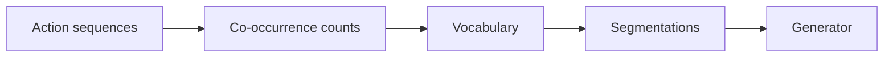

### 1. Why This Paper Matters

Existing generative recommendation (GR) models tokenize each action independently, so identical actions receive the same tokens in every sequence (Abstract). The authors argue that the same action may hold different meanings depending on its surrounding context (Abstract). ActionPiece makes the tokenization of an action depend on that context.

> "However, existing GR models tokenize each action independently, assigning the same fixed tokens to identical actions across all sequences without considering contextual relationships." (Abstract)

Based on arXiv v3.

### 2. How It Works

*Figure source: Fig. 1, original paper.*

#### Actions as Feature Sets

Each action is an unordered set of item features, so a user history is a sequence of feature sets (Abstract).

#### Vocabulary Construction

Merges are counted both within individual sets and across adjacent sets (Abstract). The two kinds of token pairs receive different weights (Sec. 1).

> "Considering the structural differences between token pairs, e.g., whether they occur within a single set or between two adjacent sets, we assign different weights to different pairs." (Sec. 1)

#### Set Permutation Regularization

Because feature sets are unordered, set permutation regularization produces multiple segmentations of the same action sequence with the same semantics (Abstract). These segmentations augment the training data and are ensembled at inference (Sec. 3.2.2).

### 3. Experimental Findings

- Vocabulary size: a larger vocabulary improves recommendation performance and reduces the normalized sequence length (NSL) (Sec. 4.4.1, Fig. 4). The authors describe vocabulary size as a trade-off between performance, sequence length, and memory efficiency (Sec. 4.4.1).
- Ablation: the gain does not come from vocabulary size alone (Sec. 4.3, Table 5).

  > "These results suggest that the performance improvement of ActionPiece is not simply due to scaling the vocabulary size up or down." (Sec. 4.3)

- Token usage: deriving different tokens for the same item from its neighbors improves token usage and acts as data augmentation (Sec. 4.3).
- Other analyses: the paper studies token usage (Sec. 4.4.2), the ensemble size (Fig. 6), and case examples (Sec. 4.5).

### 4. Limitations & Critical Analysis

**Our analysis.**

- Inference ranks several segmentations and averages them. This suggests that decoding cost grows with the ensemble size unless the segmentations run in parallel.
- VQ-Rec uses `OPQ` codes in an `Encoder` with `Scoring`; ActionPiece starts from the same kind of codes but generates merged tokens with an `Enc-Dec` generator.
