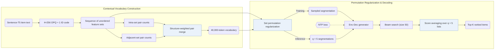

## At a Glance

Key Findings: Merging OPQ item feature sets into a 40,000-token context-dependent vocabulary improves Recall and NDCG@5/10 on Amazon Sports and Outdoors, Beauty, and CDs and Vinyl while shortening normalized sequence length, whereas scaling TIGER's vocabulary size alone does not match the gain (Sec. 4.3, Sec. 4.4.1, Table 4, Table 5, Fig. 4).
Limitation: Inference averages beam-50 rankings across q = 5 random set-permutation segmentations, and the paper does not report measured inference latency or whether evaluation ranks the full catalog (Sec. 3.3.2, Sec. 3.4, Sec. 4.1).

### 1. Why This Paper Matters

Standard generative recommendation (GR) models map each item to a fixed Semantic ID (SID) in isolation, assigning identical tokens to an action regardless of surrounding history (Abstract). Because the same item reflects different user intent across interaction contexts, ActionPiece represents each action as an unordered set of OPQ feature codes and merges co-occurring feature patterns across adjacent actions into context-dependent tokens.

> "However, existing GR models tokenize each action independently, assigning the same fixed tokens to identical actions across all sequences without considering contextual relationships." (Abstract)

### 2. How It Works

#### Actions as Feature Sets

ActionPiece quantizes Sentence-T5 item text embeddings into 4 unordered OPQ codes (256 codewords per codebook) plus 1 conflict-prevention identification code, representing each action as a 5-feature unordered set and each user history as a sequence of feature sets (Abstract, Appendix F).

#### Vocabulary Construction

Starting from the base feature tokens, ActionPiece counts co-occurring token pairs both within individual action sets and across adjacent action sets, then iteratively merges pairs into a 40,000-token context-dependent vocabulary (Abstract, Appendix G). Intra-set and inter-set pairs receive distinct merge weights to reflect their structural roles (Sec. 1).

> "Considering the structural differences between token pairs, e.g., whether they occur within a single set or between two adjacent sets, we assign different weights to different pairs." (Sec. 1)

#### Set Permutation Regularization

Because each action's feature set is unordered, permuting features before applying merge rules yields multiple token segmentations of the same action sequence that preserve semantics (Abstract). Random segmentations augment next-token prediction during training, and at inference ActionPiece decodes $`q = 5`$ permuted segmentations with beam size 50 and averages item scores across the 5 ranking lists (Sec. 3.2.2, Sec. 3.3.2).

### 3. Experimental Findings

- Main comparison and vocabulary size: on Sports and Outdoors, Beauty, and CDs and Vinyl (averaged over 5 seeds), expanding the merged vocabulary up to 40,000 tokens improves Recall@5/10 and NDCG@5/10 while reducing normalized sequence length (NSL), trading vocabulary memory against shorter decoding sequences (Sec. 4.2, Sec. 4.4.1, Table 4, Fig. 4).
- Vocabulary-scaling ablation: varying TIGER's vocabulary size alone does not reproduce ActionPiece's gains, confirming that improvements come from context-dependent merges rather than token count (Sec. 4.3, Table 5).

  > "These results suggest that the performance improvement of ActionPiece is not simply due to scaling the vocabulary size up or down." (Sec. 4.3)

- Token usage and case patterns: assigning neighbor-dependent tokens to repeated items raises vocabulary token usage and acts as sequence-level data augmentation, capturing recurring multi-action patterns in case analyses (Sec. 4.3, Sec. 4.4.2, Sec. 4.5).
- Ensemble size: averaging rankings across $`q = 5`$ permuted segmentations outperforms single-segmentation decoding as $`q`$ increases (Sec. 3.3.2, Fig. 6).

### 4. Limitations & Critical Analysis

**Stated by the authors.** Inference latency remains comparable to single-segmentation decoding only when the $`q = 5`$ permuted segmentations execute in parallel (Sec. 3.4).

**Our analysis.**

- Ensembling $`q = 5`$ beam-50 decodings multiplies compute and memory proportionally to $`q`$, suggesting a throughput penalty under constrained serving budgets.
- VQ-Rec feeds `OPQ` codes into a bidirectional `Encoder` with discriminative `Scoring`; ActionPiece starts from unordered `OPQ` feature sets as well, but merges cross-action patterns for autoregressive generation in an `Enc-Dec` generator.
