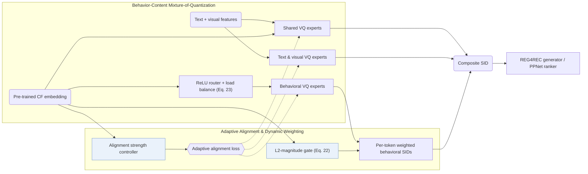

## At a Glance

Key Findings: On a 48,106,880-item industrial advertising dataset and Amazon Beauty, ADC-SID outperforms content-only (RQ-VAE, OPQ) and fixed-alignment (LETTER) baselines on R@100, N@100, and AUC, achieving its largest AUC gains on bottom-25% long-tail items and validating in a 5-day online A/B test (Sec. 4.2, Sec. 4.5, Sec. 5, Table 2, Table 5, Fig. 6).
Limitation: Behavioral token weights are computed from the L2 magnitude of a pre-trained collaborative embedding, tying weighting quality to that upstream model, while collision handling and inference latency are not reported (Sec. 3.4.1, Sec. 4.1.3).

### 1. Why This Paper Matters

Semantic IDs (SIDs) quantize item content features so related items share discrete tokens, and collaborative tokenizers inject user-item interaction signals into those codes (Abstract). Because user-item interactions follow a skewed power-law distribution, collaborative embeddings for long-tail items are sparse and noisy: uniform alignment corrupts tail content representations, while equal token weighting treats noisy and informative behavioral SIDs alike. ADC-SID regulates alignment strength per item and learns per-token behavioral weights.

> "unlike relatively uniform content features, user-item interactions are highly skewed, resulting in a significant quality gap in collaborative information between popular and long-tail items." (Abstract)

### 2. How It Works

#### Behavior-Content Mixture-of-Quantization

ADC-SID separates quantization into shared experts that capture patterns common to behavior and content, and modality-specific experts dedicated to textual, visual, and behavioral inputs (Sec. 3.2).

#### Adaptive Behavior-Content Alignment

Instead of enforcing uniform cross-view pull across the catalog, an alignment strength controller modulates behavior-content alignment strength according to item popularity so sparse behavioral signals do not overwrite long-tail content representations (Sec. 3.3.1).

> "To adaptively align behavior and content information for head and long-tail items, the alignment strength controller is proposed to calculate the alignment strength." (Sec. 3.3.1)

#### Dynamic Behavioral Weighting

A gating network computes an importance weight for each behavioral SID token from the L2 magnitude of the item's pre-trained collaborative embedding (Sec. 3.4.1, Eq. 22). Inside the behavioral branch, a ReLU-based router paired with a load-balancing loss mitigates expert collapse and uneven token assignment (Sec. 3.4.2, Eq. 23).

> "This gate suppresses noisy behavioral SIDs, improving the robustness of behavioral SIDs when incorporated with downstream recommendations." (Sec. 3.4.1)

### 3. Experimental Findings

- Main retrieval and ranking comparison: across the Southeast Asian e-commerce advertising dataset (35,154,135 users, 48,106,880 ads) and Amazon Beauty (22,363 users, 12,101 items), behavior-content aligned SIDs (RQ-Kmeans, LETTER) beat content-only SIDs (RQ-VAE, OPQ) on generative retrieval (R@50, R@100, N@50, N@100 with REG4REC) and discriminative ranking (AUC with PPNet), and ADC-SID ranks highest overall (Abstract, Sec. 4.1, Sec. 4.2, Table 1, Table 2).
- Component ablations: industrial ablations verify the contributions of the shared-specific MoE-VQ architecture, adaptive alignment controller, and learned behavioral weights against equal weighting (Sec. 4.3.2, Table 3).
- Popularity stratification: grouping items into popular (top 25%) and long-tail (bottom 25%) buckets by 30-day impression counts shows that ADC-SID delivers its largest AUC improvements on tail items without degrading head items (Sec. 4.5, Fig. 6).
- Online A/B test: a 5-day online A/B test serving 10% of random advertising traffic with an 8-token SID confirms production gains over the platform baseline (Sec. 5, Table 5).

### 4. Limitations & Critical Analysis

**Our analysis.**

- Because the behavioral gate relies on the L2 norm of an external collaborative embedding, miscalibrated norms in the upstream CF model can distort behavioral token weights (Sec. 3.4.1).
- The paper does not report a collision-resolution mechanism, and the industrial codebook size is printed with a typographical error in Sec. 4.1.3.
- MME-SID combines text, visual, and collaborative inputs via `MM-RQ` tokenization for a `Dec-Only` model with discriminative `Scoring`; ADC-SID tokenizes the same three modalities through `MoE-VQ` experts and evaluates them in an `Enc-Dec` generator (`REG4REC`) as well as `PPNet`.
