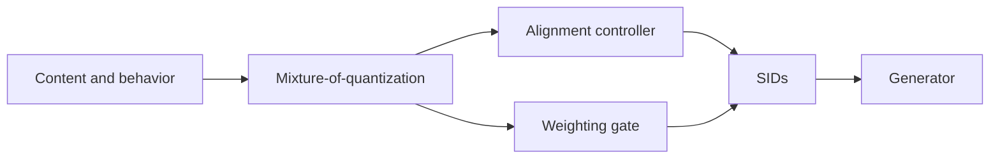

## At a Glance

Limitation: The behavioral weights are computed from the magnitude of a pre-trained collaborative embedding, so they depend on the quality of that embedding (Sec. 3.4.1).

### 1. Why This Paper Matters

Semantic IDs (SIDs) quantize item content features so that items can share knowledge, and existing methods add collaborative information to them (Abstract). User-item interactions are highly skewed, so collaborative information is much weaker for long-tail items (Abstract). The authors identify two effects: indiscriminate alignment lets this noise corrupt the content representations of tail items, and equal weights hide which behavioral SIDs are informative (Abstract).

> "unlike relatively uniform content features, user-item interactions are highly skewed, resulting in a significant quality gap in collaborative information between popular and long-tail items." (Abstract)

### 2. How It Works

#### Behavior-Content Mixture-of-Quantization

Shared experts learn information common to behavior and content, and specific experts learn modality-specific information (Sec. 3.2).

#### Adaptive Behavior-Content Alignment

An alignment strength controller sets how strongly behavior and content are aligned for head and long-tail items (Sec. 3.3.1).

> "To adaptively align behavior and content information for head and long-tail items, the alignment strength controller is proposed to calculate the alignment strength." (Sec. 3.3.1)

#### Dynamic Behavioral Weighting

A gate learns an importance score for each behavioral SID from the L2 magnitude of the pre-trained collaborative embedding (Sec. 3.4.1, Eq. 22). A ReLU-based router with load balancing reduces training imbalance among the behavioral experts (Sec. 3.4.2, Eq. 23).

> "This gate suppresses noisy behavioral SIDs, improving the robustness of behavioral SIDs when incorporated with downstream recommendations." (Sec. 3.4.1)

### 3. Experimental Findings

- Baseline families: behavior-content aligned SIDs such as RQ-Kmeans and LETTER outperform content-only SIDs such as RQ-VAE and OPQ on R@100, N@100, and AUC (Sec. 4.2, Table 2).
- Tasks: the SIDs are evaluated in both generative and discriminative tasks (Abstract).
- Behavioral weighting: the ablation compares learned weights with equal weights (Sec. 4.3.2).
- Popularity groups: with items split into popular (top 25%) and long-tail (bottom 25%) groups by impressions over the last 30 days, ADC-SID gains most on tail items (Sec. 4.5, Fig. 6).

### 4. Limitations & Critical Analysis

**Our analysis.**

- MME-SID uses the same three inputs with `MM-RQ` codes and a `Dec-Only` generator scored by `Scoring`; ADC-SID uses `MoE-VQ` codes with an `Enc-Dec` generator.
