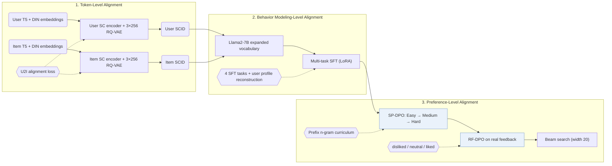

## At a Glance

Key Findings: Across public benchmarks, Align3GR reports gains of up to +17.8% in Recall@10 and +20.2% in NDCG@10 over the strongest baseline, alongside offline Recall@100 and online revenue gains in industrial deployment (Abstract, Table 1, Table 2).
Limitation: Align3GR requires sequential training across dual user/item 3-level RQ-VAEs, four-task SFT, 3-stage SP-DPO, and RF-DPO on Llama2-7B, while collision handling and inference latency are not reported (Experimental Settings).

### 1. Why This Paper Matters

Adapting a pretrained large language model (LLM) to generative recommendation introduces both semantic and behavioral misalignment between natural-language tokens and collaborative interaction patterns (Abstract). Prior LLM recommenders such as LC-Rec align item Semantic IDs (SIDs) primarily through supervised instruction tasks. Align3GR couples alignment across three levels: dual user-and-item semantic-collaborative tokenization, bidirectional multi-task SFT, and progressive curriculum + real-feedback DPO.

> "To bridge this gap, we propose Align3GR, a novel framework that unifies token-level, behavior modeling-level, and preference-level alignment." (Abstract)

### 2. How It Works

#### Token-Level Alignment

Dual semantic-collaborative (SC) encoders fuse T5 semantic embeddings and DIN behavioral embeddings for both users and items, and two 3-level RQ-VAEs (256 codewords of dimension 32 per level) quantize them into user SCIDs and item SCIDs (Fig. 2 caption, Experimental Settings). Adding both token sets directly into the Llama2-7B vocabulary avoids token fragmentation during autoregressive generation.

> "Following previous work (Zheng et al. 2024), we first expand the LLM vocabulary to include the SCID tokens of the user and the item, thus avoiding out-of-vocabulary issues and ensuring smooth integration with autoregressive generation tasks." (Behavior Modeling-level Alignment)

#### Behavior Modeling-Level Alignment

Supervised fine-tuning (SFT) extends LC-Rec with four tasks: sequential item prediction, asymmetric item prediction, intention-conditioned item prediction, and personalized preference inference (Multi-task SFT). Every task prompt includes the user's SCID tokens, and bidirectional alignment requires reconstructing the user profile text from the user SCID alongside predicting target item SCIDs (Multi-task SFT).

#### Preference-Level Alignment

Self-play DPO (SP-DPO) constructs curriculum negatives in Easy, Medium, and Hard stages according to prefix n-gram overlap on the 3-level hierarchical SCID (Preference-level Alignment). Real-feedback DPO (RF-DPO) then fine-tunes the policy on logged user interactions stratified into disliked, neutral, and liked tiers (Preference-level Alignment).

> "Specifically, considering the hierarchical nature of SCID, we divide progressive SP-DPO learning into three stages: Easy, Medium, and Hard, using a prefix-ngram match metric (Zheng et al. 2025)" (Preference-level Alignment)

### 3. Experimental Findings

- Public benchmarks: on 5-core filtered Amazon Instruments, Amazon Beauty, and Yelp (averaged over 5 seeds with beam width 20), Align3GR outperforms traditional, generative (TIGER, LETTER), and LLM-based (LC-Rec, EAGER-LLM) baselines, achieving up to +17.8% in Recall@10 and +20.2% in NDCG@10 over the strongest baseline (Abstract, Experimental Settings, Table 1).
- Multi-level ablations: ablations confirm incremental gains from dual user-item SCID tokenization (Table 3), bidirectional user-item SFT tasks (Table 4), and combining 3-stage SP-DPO with RF-DPO (Table 5, Fig. 4).
- Industrial deployment: on a large-scale advertising platform, Align3GR improves offline Recall@100 over a two-tower model and TIGER, and delivers online revenue gains in multi-week A/B tests on 10% traffic (over 40 million users) before full-scale deployment (Abstract, Table 2).

### 4. Limitations & Critical Analysis

**Our analysis.**

- Training proceeds sequentially through dual SCID tokenizers, four-task SFT, 3-stage SP-DPO, and RF-DPO, which suggests that catalog or user-distribution refreshes require multi-stage retraining.
- Users are quantized into fixed SCIDs from historical interactions, leaving cold-start users without precomputed user SCID tokens.
- EAGER-LLM feeds semantic and collaborative item features into a `Dec-Only` LLM via `Dual H-KM` codes; Align3GR tokenizes both users and items with `Dual RQ` (`RQ-VAE`) codes and adds two-phase DPO (`NTP → DPO`).
