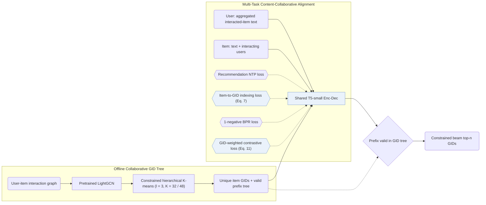

## At a Glance

Key Findings: Across full-catalog evaluation on Amazon Beauty, Sports and Outdoors, Cell Phones and Accessories, and Food.com Recipe, ColaRec outperforms collaborative, content-enhanced, and generative baselines (including TIGER and LC-Rec) on Recall@5/10 and NDCG@5/10, with ablations confirming gains from both item-to-GID indexing and contrastive alignment (Sec. 5.2, Table 2, Table 3, Table 4).
Limitation: Generative identifiers (GIDs) are built offline by running constrained hierarchical K-means over pretrained LightGCN embeddings, so cold-start items without interactions lack collaborative representations to cluster (Sec. 4.2).

### 1. Why This Paper Matters

Prompt-based LLM recommenders fuse item text and collaborative signals through natural-language generation, leaving open-ended text decoding misaligned with full-catalog item ranking (Abstract). ColaRec instead assigns each item a tree-structured Semantic ID (SID)—called a generative identifier (GID)—from a pretrained collaborative filtering graph, and trains a T5-small encoder-decoder to generate target GIDs from aggregated interacted-item text while aligning content and collaborative spaces.

> "To model collaborative signals, the GIDs are constructed from a pretrained collaborative filtering model, and the user is represented as the content aggregation of interacted items." (Abstract)

### 2. How It Works

#### Generative Identifier Construction

ColaRec extracts item embeddings from a pretrained LightGCN model and recursively partitions them with size-constrained K-means ($`l = 3`$ levels, $`K = 32`$ clusters per level on Amazon and $`K = 48`$ on Recipe) so each cluster holds at most $`K^{l-t}`$ items and each leaf maps uniquely to one item (Sec. 4.2, Sec. 5.4).

> "Specifically, we first extract item representations from a pretrained LightGCN model. Then the constrained K-means algorithm is called hierarchically based on the item representations." (Sec. 4.2)

#### Item Indexing Task

To bridge textual inputs and collaborative GIDs, an auxiliary item-indexing task feeds an item's text and its interacting users into the shared T5-small encoder-decoder and predicts the item's own GID (Sec. 4.4, Eq. 7).

#### Training Objective

ColaRec jointly optimizes the user-to-GID recommendation loss, the item-to-GID indexing loss, a list-level BPR ranking loss with 1 sampled negative, and a GID-similarity-weighted contrastive loss over item representations (Sec. 4.5, Eq. 11).

> "The idea is that items with similar GIDs should also be similar in the content-based semantic space." (Sec. 4.5)

#### Inference

At inference, constrained beam search masks out invalid transitions at each step so every decoded token path stays within the catalog's valid GID prefix tree (Sec. 4.5).

### 3. Experimental Findings

- Full-catalog comparison: under an 8:1:1 per-user random split (averaged over 3 runs) across Beauty (22,363 users / 12,101 items), Sports and Outdoors (35,598 / 18,357), Cell Phones and Accessories (27,879 / 10,429), and Food.com Recipe (17,813 / 41,240), ColaRec outperforms collaborative filtering, content-collaborative, and generative baselines on Recall@5/10 and NDCG@5/10 (Abstract, Table 1, Table 2).
- Long-tail users: stratifying users by interaction count shows consistent gains on sparse-history users (Table 3).
- Multi-task and identifier ablations: removing item text, the indexing task, the BPR loss, or the weighted contrastive loss degrades accuracy, and LightGCN-based GIDs outperform random IDs, text-only K-means IDs, and flat IDs (Table 4, Fig. 4, Fig. 5).

### 4. Limitations & Critical Analysis

**Our analysis.**

- The weighted contrastive loss pulls content representations toward the collaborative GID tree, which suggests that noisy LightGCN clusters on sparse items can distort content similarity.
- The paper does not report the numerical beam width or inference latency for constrained beam search (Sec. 4.5, Sec. 5).
- SEATER also builds balanced tree-structured identifiers (`Tree-Clus.`) from collaborative interactions (`CF`); ColaRec incorporates item metadata alongside collaborative structure (`Text+CF`) and aligns both views with auxiliary indexing and contrastive losses.
