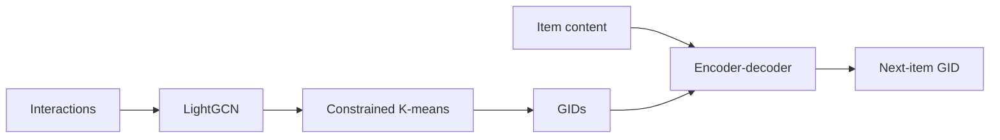

## At a Glance

Limitation: The generative identifiers (GIDs) come from offline LightGCN embeddings and clustering, so items without interactions have no collaborative representation to cluster (Sec. 4.2).

### 1. Why This Paper Matters

Existing LLM-based methods fuse content and collaborative signals but rely on textual language generation, which the authors state is not fully aligned with recommendation (Abstract). ColaRec instead decodes item identifiers with a sequence-to-sequence model tailored to recommendation (Abstract).

> "To model collaborative signals, the GIDs are constructed from a pretrained collaborative filtering model, and the user is represented as the content aggregation of interacted items." (Abstract)

### 2. How It Works

#### Generative Identifier Construction

ColaRec applies constrained K-means hierarchically to item representations from a pretrained LightGCN model (Sec. 4.2).

> "Specifically, we first extract item representations from a pretrained LightGCN model. Then the constrained K-means algorithm is called hierarchically based on the item representations." (Sec. 4.2)

#### Item Indexing Task

The indexing task maps an item's text, together with the users who interacted with it, to the item's GID (Sec. 4.4, Eq. 7). It shares the encoder-decoder with the recommendation task (Sec. 4.4).

#### Training Objective

The recommendation loss, the indexing loss, a BPR loss with one sampled negative, and a weighted contrastive loss are trained jointly (Sec. 4.5, Eq. 11).

> "The idea is that items with similar GIDs should also be similar in the content-based semantic space." (Sec. 4.5)

#### Inference

Constrained beam search limits each token to those valid under the prefix (Sec. 4.5).

### 3. Experimental Findings

- Main comparison: ColaRec reports better performance than the baselines on four benchmark datasets (Abstract, Table 2).
- Ablation: Table 4 removes the textual content, the indexing task, the BPR loss, or the contrastive loss, and replaces the GIDs with three other identifier types (Table 4).

### 4. Limitations & Critical Analysis

**Our analysis.**

- The contrastive loss pulls content representations toward the GID structure. This suggests that content similarity is reshaped by collaborative clusters, which may hurt items whose clusters are noisy.
- SEATER also uses tree-structured identifiers (`Tree-Clus.`) from `CF` input; ColaRec adds item content to the input (`Text+CF`).
