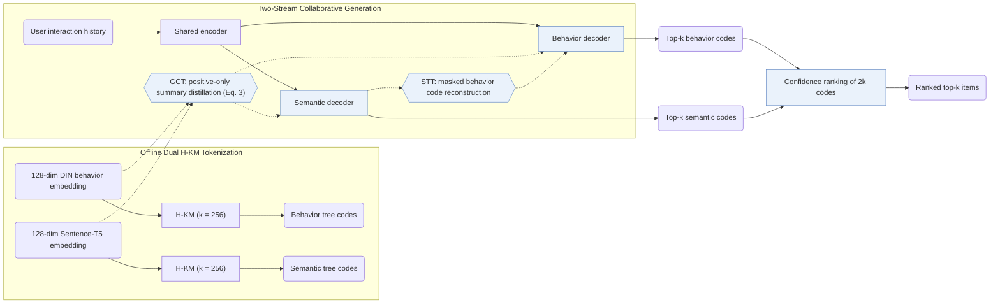

## At a Glance

Key Findings: Across Amazon Beauty, Sports and Outdoors, Toys and Games, and Yelp, EAGER outperforms sequential, tree-based, and single-stream generative baselines (Table 2), removing the two-stream architecture causes the largest ablation drop (Sec. 4.3, Table 3), and inference on Beauty takes 0.0325 s per sample against 0.0281 s for TIGER (Table 6).
Limitation: Inference runs beam search (size 100) in two separate decoders and merges 2k candidates by log-probability confidence, increasing per-sample latency on Beauty from 0.0281 s (TIGER) to 0.0325 s (Sec. 3.6, Table 6).

### 1. Why This Paper Matters

Single-stream generative recommenders construct each item's Semantic ID (SID) from either behavioral interactions or content semantics alone, discarding signals from the other view or forcing both into one shared quantization space (Abstract). EAGER combines behavioral and semantic signals through three design choices: a unified two-stream encoder-decoder architecture, separate hierarchical code trees for each view, and cross-stream alignment tasks.

> "we propose (1) a two-stream generation architecture leveraging a shared encoder and two separate decoders to decode behavior tokens and semantic tokens with a confidence-based ranking strategy" (Abstract)

### 2. How It Works

#### Behavior Codes and Semantic Codes

EAGER extracts 128-dimensional behavioral embeddings from a pre-trained DIN model and 128-dimensional semantic embeddings from Sentence-T5 (Sec. 4.1). Each embedding space is independently partitioned by hierarchical k-means (`Dual H-KM`) with branching factor $`k = 256`$ until every leaf cluster contains a single item, producing two separate hierarchical SIDs per item (Sec. 3.3, Sec. 4.1).

#### Global Contrastive Task

In the global contrastive task (GCT), each decoder appends a stream summary token and distills its hidden state toward that stream's frozen item embedding (DIN or Sentence-T5) using a positive-only cosine-distance metric rather than negative-sampling InfoNCE (Sec. 3.4, Eq. 3).

#### Semantic-Guided Transfer Task

To transfer semantic structure into behavioral decoding without collapsing the two code spaces, the semantic-guided transfer task (STT) uses the semantic stream's global feature to reconstruct masked behavior tokens and trains a binary relevance classifier (Sec. 3.5).

#### Confidence-Based Ranking

At inference, beam search in each decoder returns $`k`$ candidate paths, and EAGER ranks the combined $`2k`$ predictions by their sequence log-probability confidence score (Sec. 3.6).

> "With the 2*k prediction codes, we calculate the log probabilities over the codes as the confidence score of each prediction, which is similar to the perplexity used in the language model and the lower value indicates more confidence." (Sec. 3.6)

### 3. Experimental Findings

- Main comparison: across 5-core filtered Beauty (22,363 users / 12,101 items), Sports and Outdoors (35,598 / 18,357), Toys and Games (19,412 / 11,924), and Yelp (30,431 / 20,033), EAGER outperforms sequential, tree-based, and generative baselines on Recall@5/10/20 and NDCG@5/10/20 (Abstract, Table 1, Table 2).
- Component ablations: removing the two-stream generation (TSG) architecture causes the steepest drop, and removing GCT hurts accuracy more than removing STT (Sec. 4.3, Table 3).

  > "Removing GCT leads to more performance drops than removing STT, suggesting that global information distillation of the inter-code is slightly more important than the knowledge flow between the intra-code." (Sec. 4.3)

- Visual modality extension: on Yelp, extracting item-cover visual features with ViT-B to form a visual semantic code stream also improves over single-stream baselines (Sec. 4.4, Table 4).
- Inference latency: on Beauty with top-$`k = 5`$ and beam size 100, EAGER averages 0.0325 s per sample versus 0.0281 s for TIGER, 0.0499 s for RecForest, and 0.2349 s for full-catalog DIN scoring (Table 6).

### 4. Limitations & Critical Analysis

**Our analysis.**

- Both code trees rely on frozen DIN and Sentence-T5 encoders followed by offline hierarchical k-means down to single-item leaves, which suggests that catalog updates require re-clustering both trees.
- Merging two top-$`k`$ beam lists by raw log-probability confidence assumes that token log probabilities are calibrated across the behavior and semantic decoders (Sec. 3.6).
- CoST injects contrastive alignment into the tokenizer itself (`C-RQ`); EAGER keeps its `Dual H-KM` codes fixed and applies contrastive distillation (`GCT`) and cross-stream reconstruction (`STT`) inside the `Dual Enc-Dec` generator.
