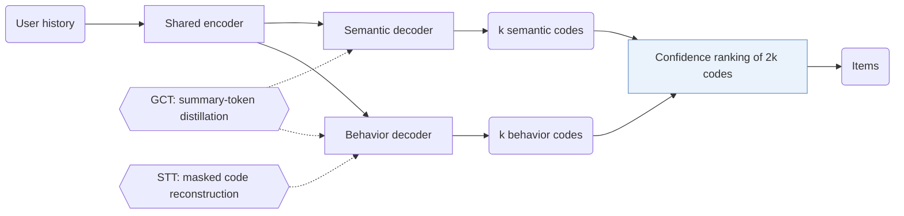

## At a Glance

Key Findings: Removing the two-stream architecture causes the largest drop in the ablation (Sec. 4.3, Table 3), and on Beauty EAGER takes 0.0325 s per sample at inference against 0.0281 s for TIGER (Table 6).
Limitation: Inference runs beam search in two decoders and merges the results, which makes EAGER slower than TIGER (Sec. 3.6, Table 6).

### 1. Why This Paper Matters

Existing generative methods use either the behavioral or the semantic side of item information, which the authors state neglects their complementary nature (Abstract). EAGER names three requirements for combining them: one architecture for both feature types, independent learning for each, and interaction between them (Abstract).

> "we propose (1) a two-stream generation architecture leveraging a shared encoder and two separate decoders to decode behavior tokens and semantic tokens with a confidence-based ranking strategy" (Abstract)

### 2. How It Works

#### Behavior Codes and Semantic Codes

A pre-trained DIN model is the behavior encoder and Sentence-T5 is the semantic encoder, with hidden size 128 (Sec. 4.1). Hierarchical k-means with cluster number 256 turns each embedding into codes (Sec. 3.3, Sec. 4.1).

#### Global Contrastive Task

A summary token in each stream is distilled toward that stream's pre-trained item embedding with a positive-only contrastive metric instead of InfoNCE (Sec. 3.4, Eq. 3).

#### Semantic-Guided Transfer Task

The semantic global feature reconstructs masked behavior codes, and a recognition objective adds a relevance classifier (Sec. 3.5).

#### Confidence-Based Ranking

Each decoder returns $`k`$ codes, and the $`2k`$ predictions are ranked by log probability (Sec. 3.6).

> "With the 2*k prediction codes, we calculate the log probabilities over the codes as the confidence score of each prediction, which is similar to the perplexity used in the language model and the lower value indicates more confidence." (Sec. 3.6)

### 3. Experimental Findings

- Main comparison: EAGER reports better performance than existing methods on four public benchmarks (Abstract).
- Ablation: removing the global contrastive task (GCT) costs more than removing the semantic-guided transfer task (STT) (Sec. 4.3, Table 3).

  > "Removing GCT leads to more performance drops than removing STT, suggesting that global information distillation of the inter-code is slightly more important than the knowledge flow between the intra-code." (Sec. 4.3)

- Visual features: on Yelp, ViT-B features of item covers produce a visual semantic code (Sec. 4.4, Table 4).
- Inference speed: with top-k 5 and beam size 100 on Beauty, RecForest takes 0.0499 s and DIN 0.2349 s per sample (Table 6).

### 4. Limitations & Critical Analysis

**Our analysis.**

- Both code sets come from frozen encoders and offline clustering. This suggests that adding items requires re-running both encoders and the clustering.
- CoST trains its codes with a contrastive objective (`C-RQ`); EAGER keeps `Dual H-KM` codes fixed and adds the contrastive term on the generator side.
