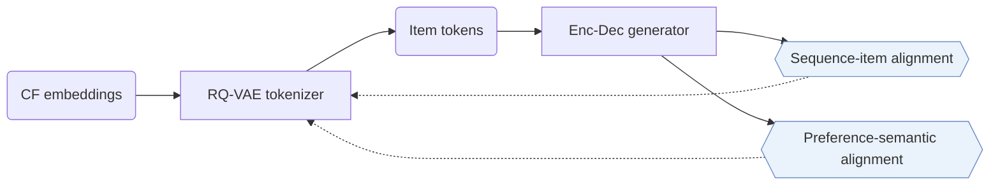
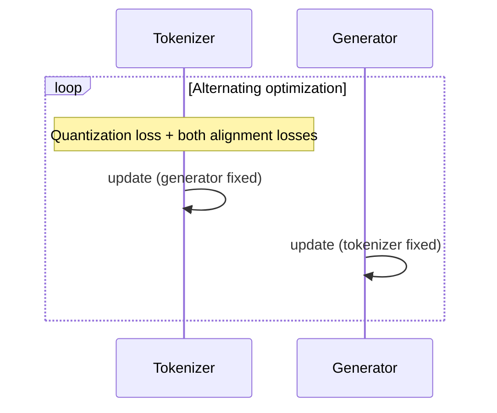

## At a Glance

Limitation: The tokenizer reads collaborative embeddings only, so items without interactions have no input to tokenize (Sec. 3.2.1).

### 1. Why This Paper Matters

Current approaches often train item tokenization and generative recommendation as separate processes (Abstract). ETEGRec couples the two inside one dual encoder-decoder framework (Abstract).

> "To enable synergistic interaction between these components, we propose a recommendation-oriented alignment strategy, which includes two key optimization objectives: sequence-item alignment and preference-semantic alignment." (Abstract)

### 2. How It Works

#### Item Tokenizer

The tokenizer takes each item's collaborative embedding, for example from SASRec, and quantizes it hierarchically (Sec. 3.2.1).

> "By taking a hierarchical scheme, we essentially organize the items in a tree-structured way, which is particularly suitable for generative tasks." (Sec. 3.2.1)

#### Recommendation-Oriented Alignment

Sequence-item alignment matches the quantized token distributions of the encoder's sequential states and of the target item's embedding (Sec. 1, Eq. 15). Preference-semantic alignment contrasts the user preference from the decoder with the target item semantics reconstructed by the RQ-VAE (Sec. 1, Eq. 16).

#### Alternating Optimization

In the tokenizer phase, the quantization loss and both alignment losses update the tokenizer while the generator stays fixed (Sec. 3.4).

> "In order to improve the training stability, we propose an alternating optimization strategy to mutually train the item tokenizer and the generative recommender." (Sec. 3.4)

### 3. Experimental Findings

- Main comparison: ETEGRec reports better performance than sequential and generative baselines (Abstract).
- Seen and unseen users: with the 5% of users with the fewest interactions on Instrument and Scientific held out as new users, ETEGRec outperforms LETTER and TIGER on both groups (Sec. 4.4.1, Fig. 2).

### 4. Limitations & Critical Analysis

**Our analysis.**

- Updating the tokenizer changes item token sequences during training. The alternating schedule is the paper's answer to this instability.
- LETTER also uses `Learn. RQ` codes but trains them before the generator; ETEGRec trains them together with the generator.
