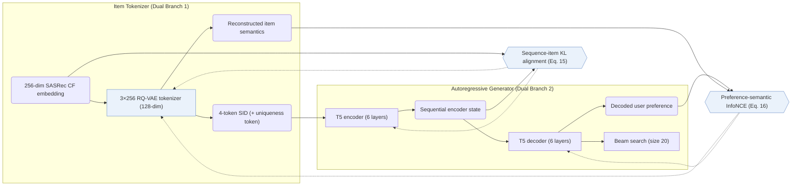
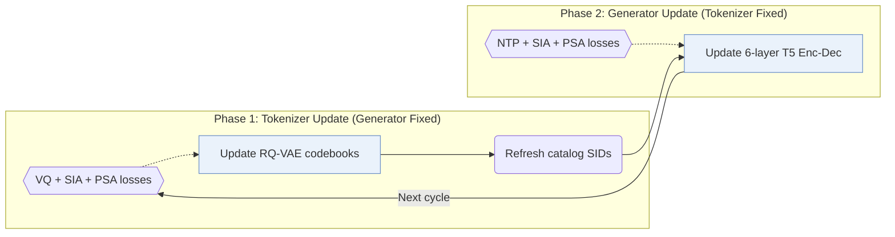

## At a Glance

Key Findings: Under full-catalog evaluation on Amazon Musical Instruments, Industrial and Scientific, and Video Games, ETEGRec outperforms sequential and fixed-tokenizer generative baselines (including TIGER, LETTER, and CID) on Recall@5/10 and NDCG@5/10, and keeps its lead on held-out unseen users (the 5% with the fewest interactions) (Sec. 4.2, Sec. 4.4.1, Table 3, Table 4, Fig. 2).
Limitation: The RQ-VAE tokenizer reads collaborative item embeddings only, leaving unseen items without interaction history unable to receive tokens, while measured inference latency is not reported (Sec. 3.2.1, Sec. 3.5).

### 1. Why This Paper Matters

Two-stage generative recommenders train the Semantic ID (SID) tokenizer offline and freeze item codes before training the sequence generator, leaving discrete tokenization decoupled from autoregressive recommendation (Abstract). ETEGRec unifies item tokenization and sequence-to-sequence recommendation inside a dual encoder-decoder architecture coupled by two alignment objectives and alternating optimization.

> "To enable synergistic interaction between these components, we propose a recommendation-oriented alignment strategy, which includes two key optimization objectives: sequence-item alignment and preference-semantic alignment." (Abstract)

### 2. How It Works

#### Item Tokenizer

The item tokenizer feeds each item's 256-dimensional collaborative embedding (extracted from SASRec) into a 3-level RQ-VAE with 256 codewords of dimension 128 per level, appending an extra token to resolve collisions so every item has a unique 4-token SID (Sec. 3.2.1, Sec. 4.1.4).

> "By taking a hierarchical scheme, we essentially organize the items in a tree-structured way, which is particularly suitable for generative tasks." (Sec. 3.2.1)

#### Recommendation-Oriented Alignment

Sequence-item alignment minimizes divergence between the quantized token distributions produced from the generator encoder's sequential state and from the target item's collaborative embedding (Sec. 1, Eq. 15). Preference-semantic alignment contrasts the user preference representation output by the generator decoder against the target item semantics reconstructed by the RQ-VAE decoder (Sec. 1, Eq. 16).

#### Alternating Optimization

Direct joint gradient updates shift discrete item codes while the generator is still adapting; ETEGRec instead alternates between a tokenizer phase (updating the RQ-VAE under quantization and both alignment losses with the generator frozen) and a generator phase (updating the T5 generator under next-token prediction and alignment losses with SIDs frozen) (Sec. 3.4).

> "In order to improve the training stability, we propose an alternating optimization strategy to mutually train the item tokenizer and the generative recommender." (Sec. 3.4)

### 3. Experimental Findings

- Full-catalog comparison: on 5-core filtered Amazon 2023 Musical Instruments (57,439 users / 24,587 items), Industrial and Scientific (50,985 / 25,848), and Video Games (94,762 / 25,612) with beam size 20, ETEGRec significantly outperforms sequential and generative baselines (paired t-tests) across Recall@5/10 and NDCG@5/10 (Abstract, Sec. 4.1, Table 2, Table 3).
- Alignment and optimization ablations: removing either sequence-item alignment, preference-semantic alignment, or alternating updates lowers accuracy, confirming that end-to-end tokenizer feedback improves over frozen tokenization (Table 4, Fig. 4).
- Generalization to unseen users: holding out the 5% of users with the fewest interactions on Musical Instruments and Industrial and Scientific from both tokenizer and generator training, ETEGRec outperforms LETTER and TIGER on both seen and unseen user groups (Sec. 4.4.1, Fig. 2).

### 4. Limitations & Critical Analysis

**Our analysis.**

- Refreshing the tokenizer between alternating phases reassigns item SIDs mid-training, requiring periodic full-catalog re-indexing to keep generator inputs consistent (Sec. 3.4).
- Section 3.5 analyzes asymptotic complexity rather than reporting wall-clock training overhead or serving latency.
- LETTER also regularizes `Learn. RQ` codes with collaborative signals, but freezes the tokenizer before generator training (`Fixed`); ETEGRec updates the `Learn. RQ` tokenizer and `Enc-Dec` generator in turns (`Altern.`).
