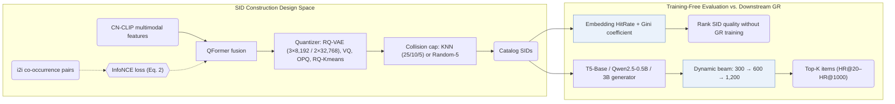

## At a Glance

Key Findings: In online A/B tests on Taobao, Semantic ID (SID) construction strategies selected from FORGE's benchmark increase transaction count by 0.35%, while offline Embedding HitRate and Gini coefficient correlate strongly with downstream HR@20–HR@1000 on the 250-million-item AL-GR dataset (Abstract, Sec. 3.4, Sec. 4.2, Table 3, Fig. 3).
Limitation: Dynamic beam search expands to 1,200 candidate SIDs at the final decoding step without reported inference latency, and the training-free SID quality metrics are validated only on the benchmark's datasets (Sec. 3.2, Sec. 3.4).

### 1. Why This Paper Matters

Industrial generative retrieval (GR) systems face a wide design space when building Semantic IDs (SIDs)—spanning feature modalities, vector quantizers, and collision resolution—while evaluating each candidate tokenizer normally requires training a full GR generator (Abstract). FORGE benchmarks these choices on a released hundred-million-item Taobao dataset (AL-GR) and introduces training-free metrics to rank SID tokenizers before generator training.

> "Specifically, FORGE provides a taxonomy of the SID construction process from several perspectives and validates their impact on downstream GR through offline experiments across diverse settings." (Abstract)

### 2. How It Works

#### Item Representation

FORGE encodes item text and images with CN-CLIP and fuses them through a QFormer (Sec. 3.1.1). An InfoNCE contrastive loss using positive pairs from the item-to-item (`i2i`) co-occurrence table injects user-behavior signals into the fused embeddings before quantization (Sec. 3.1.1, Eq. 2).

#### SID Encoding and Collision Post-Processing

Across codebooks such as 3 levels × 8,192 codewords and 2 levels × 32,768 codewords, FORGE compares RQ-VAE against random assignment, multi-codebook VQ, OPQ, and RQ-Kmeans (Sec. 3.1.2, Sec. 4.1, Table 9, Table 11). To bound items sharing the same SID prefix, KNN-based reassignment (with collision thresholds 25, 10, or 5) and Random-5 reassignment adjust the final codeword (Sec. 3.1.3).

#### Dynamic Beam Search

During autoregressive decoding, dynamic beam search widens the beam progressively across code levels—300 at step 1, 600 at step 2, and 1,200 at step 3—before mapping candidate SIDs back to catalog items (Sec. 3.2, Sec. 3.4).

#### SID Quality Metrics

To evaluate tokenizers without training a generator, Embedding HitRate measures neighbor preservation in quantized space and the Gini coefficient measures how evenly items populate the SID space (Sec. 3.4).

> "The Gini coefficient measures the deviation between a uniform SID distribution and the actual item distribution, where a lower value indicates a more balanced assignment." (Sec. 3.4)

### 3. Experimental Findings

- Training-free metric correlation: across SID configurations on AL-GR (stages S1–S3) and Amazon Clothing, both Embedding HitRate and the Gini coefficient correlate strongly with downstream GR HitRate (HR@20 to HR@1000) (Sec. 3.4, Sec. 4.2, Table 3, Table 4, Fig. 3, Fig. 4).

  > "Our experiments show that both metrics are strongly correlated with HR, thus enabling efficient SID evaluation without additional GR training." (Sec. 3.4)

- Modality, quantizer, and backbone studies: adding `i2i` collaborative contrastive alignment (Table 5), RQ-VAE quantization over RQ-Kmeans (Table 9), collision capping (Table 3), and scaling generators from T5-Base (0.2B) to Qwen2.5-0.5B and Qwen2.5-3B (Table 12) consistently improve retrieval HR.
- Industrial dataset and online A/B test: FORGE releases AL-GR—covering 14 billion interactions and 250 million items with multimodal features (Table 1 cites 131M users / 251M items)—and full-scale Taobao deployment of the benchmark-selected SID strategy raises online transaction count by 0.35% (Abstract, Sec. 3.3).

### 4. Limitations & Critical Analysis

**Our analysis.**

- The correlation between Embedding HitRate / Gini and downstream HR is established within FORGE's RQ-VAE and post-processing variants; tokenizers trained jointly with the generator may shift that relationship.
- Expanding the beam to 1,200 candidate SIDs at the final step increases decoding and item-lookup cost, and wall-clock serving latency is not reported.
- OneRec uses `R-KM` codes and OneRec-V2 uses `R-KM†` codes; FORGE evaluates `RQ-Kmeans` against `RQ-VAE` in Table 9 and adopts `RQ-VAE` with collision post-processing as its primary configuration.
