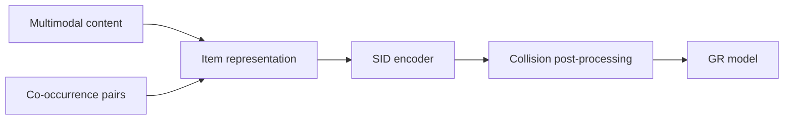

## At a Glance

Key Findings: In online A/B tests on Taobao, SID construction strategies chosen from the benchmark findings increase transaction count by 0.35% (Abstract).

### 1. Why This Paper Matters

Current studies offer limited investigation of how to construct Semantic IDs (SIDs), and their SID assessment usually needs costly generative retrieval (GR) training (Abstract). FORGE turns these choices into a benchmark.

> "Specifically, FORGE provides a taxonomy of the SID construction process from several perspectives and validates their impact on downstream GR through offline experiments across diverse settings." (Abstract)

Based on arXiv v3.

### 2. How It Works

*Figure source: Fig. 2, original paper.*

#### Item Representation

Items are encoded with CN-CLIP and fused with a QFormer (Sec. 3.1.1). An optional InfoNCE loss with positives from the item-to-item co-occurrence table adds user-behavior patterns (Sec. 3.1.1, Eq. 2).

#### SID Encoding and Collision Post-Processing

The benchmark compares RQ-VAE with random assignment, multiple VQ, OPQ, and RQ-Kmeans (Sec. 3.1.2). KNN-based and random-based post-processing cap the number of items per SID (Sec. 3.1.3).

#### Dynamic Beam Search

The beam size is 300 at the first step, 600 at the second, and 1,200 at the final step (Sec. 3.2).

#### SID Quality Metrics

Embedding HitRate and the Gini coefficient measure SID quality without GR training (Sec. 3.4).

> "The Gini coefficient measures the deviation between a uniform SID distribution and the actual item distribution, where a lower value indicates a more balanced assignment." (Sec. 3.4)

### 3. Experimental Findings

- Metrics: both metrics are strongly correlated with HR (Sec. 3.4, Sec. 4.2, Fig. 3).

  > "Our experiments show that both metrics are strongly correlated with HR, thus enabling efficient SID evaluation without additional GR training." (Sec. 3.4)

- Deployment: the strategies are deployed at full scale on Taobao (Abstract).
- Dataset: AL-GR contains 14 billion interactions and 250 million items with multimodal features (Abstract).

### 4. Limitations & Critical Analysis

**Our analysis.**

- The metric-HR correlation is shown on the benchmark's data. This suggests that it should be re-checked before the metrics replace GR training on other catalogs.
- A final beam of 1,200 suggests a high decoding cost.
- OneRec uses `R-KM` codes and OneRec-V2 uses `R-KM†` codes; FORGE's base configuration uses `RQ-VAE` codes.
