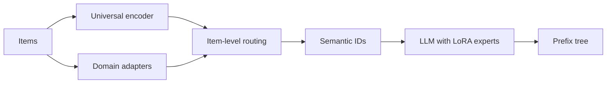

## At a Glance

Limitation: Each domain adds its own tokenizer adapter and its own offline prefix tree (Domain-adaptive Tokenization, Domain-aware Prefix-tree).

### 1. Why This Paper Matters

Traditional cross-domain recommendation relies on shared user or item IDs, which most real-world scenarios do not have (Abstract). The authors state that LLM-based approaches face an item ID tokenization dilemma and insufficient domain-specific modeling (Abstract). GenCDR moves domain adaptation into the tokenizer itself.

> "GenCDR first employs a Domain-adaptive Tokenization module, which generates disentangled semantic IDs for items by dynamically routing between a universal encoder and domain-specific adapters." (Abstract)

### 2. How It Works

#### Domain-Adaptive Tokenization

One LoRA adapter per domain learns domain-specific representations next to the universal encoder (Domain-adaptive Tokenization).

> "To effectively integrate universal and domain-specific representations, we propose an Item-level Dynamic Semantic Routing Network that adaptively balances these representations on a per-item basis." (Domain-adaptive Tokenization)

The authors state that per-item routing reduces the negative transfer of static fusion (Domain-adaptive Tokenization).

#### Cross-Domain Autoregressive Recommendation

The generator first trains a mixture of LoRA adapters on data from all domains to capture domain-agnostic interests (Cross-domain Autoregressive Recommendation). A user-level routing network regularized by a variational information bottleneck (VIB) fuses universal and domain-specific interests (Cross-domain Autoregressive Recommendation).

#### Domain-Aware Prefix Tree

For each domain, an offline prefix tree holds all valid ID sequences from the tokenizer and restricts decoding (Domain-aware Prefix-tree).

> "Finally, a Domain-aware Prefix-tree enables efficient and accurate generation." (Abstract)

### 3. Experimental Findings

- Main comparison: GenCDR reports better performance than the baselines on multiple real-world datasets (Abstract).
- Ablation: Table 3 removes the MTM component, the adapter, the specific expert, the universal experts, the MoE gate, and the prefix tree (Table 3).

### 4. Limitations & Critical Analysis

**Our analysis.**

- The prefix trees are built offline from the tokenizer output. This suggests that new items require re-tokenization and a tree rebuild.
- VQ-Rec also transfers across domains (`Multi-Dom`), with `OPQ` codes and `Scoring`; GenCDR generates `RQ+LoRA` codes with a `Dec-Only` LLM.
