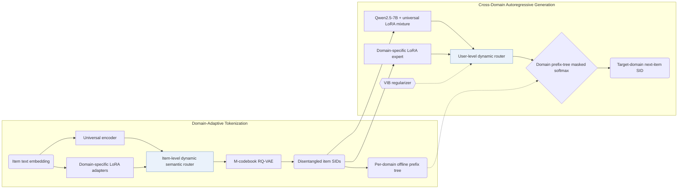

## At a Glance

Key Findings: Across six domains in three low-overlap cross-domain pairs—Amazon Sports-Clothing (1.73% item overlap), Phones-Electronics (0.55%), and Douban Books-Movies (7.48%)—GenCDR outperforms single-domain, generative (TIGER, VQ-Rec), and cross-domain baselines on Recall@10 and NDCG@10 while maintaining constant inference cost as catalog size grows (Sec. 5.1, Sec. 5.6, Table 1, Table 2, Table 3, Fig. 6).
Limitation: Each domain requires a dedicated LoRA tokenizer adapter and a separate offline prefix tree, while the number of RQ-VAE codebooks M, codebook size, collision handling, and beam width are not reported (Domain-adaptive Tokenization, Domain-aware Prefix-tree, Sec. 5.1).

### 1. Why This Paper Matters

Conventional cross-domain recommenders rely on overlapping users or shared item IDs that rarely hold across real-world platforms, whereas single-tokenizer generative recommenders struggle to balance shared semantics against domain-specific characteristics (Abstract). GenCDR pushes cross-domain adaptation into both the Semantic ID (SID) tokenizer and the autoregressive LLM generator via dynamic routing and domain-constrained prefix trees.

> "GenCDR first employs a Domain-adaptive Tokenization module, which generates disentangled semantic IDs for items by dynamically routing between a universal encoder and domain-specific adapters." (Abstract)

### 2. How It Works

#### Domain-Adaptive Tokenization

Alongside a universal encoder pre-trained across all domains, GenCDR attaches one LoRA adapter per domain to capture domain-specific item semantics, and an item-level dynamic routing network fuses the two representations before $`M`$-codebook RQ-VAE quantization (Domain-adaptive Tokenization). Per-item routing mitigates negative transfer caused by static cross-domain fusion.

> "To effectively integrate universal and domain-specific representations, we propose an Item-level Dynamic Semantic Routing Network that adaptively balances these representations on a per-item basis." (Domain-adaptive Tokenization)

#### Cross-Domain Autoregressive Recommendation

On the Qwen2.5-7B generator side, a mixture of universal LoRA experts is trained across all domains to model shared user preferences, and a user-level routing network regularized by a variational information bottleneck (VIB) loss combines universal and domain-specific LoRA outputs (Cross-domain Autoregressive Recommendation).

#### Domain-Aware Prefix Tree

For each target domain, GenCDR builds an offline prefix tree containing all valid item SID sequences from that domain's catalog and applies masked softmax during beam decoding so generation never leaves the target domain (Domain-aware Prefix-tree).

> "Finally, a Domain-aware Prefix-tree enables efficient and accurate generation." (Abstract)

### 3. Experimental Findings

- Six-domain comparison: across Sports-Clothing (1.73% item overlap, 704 shared items), Phones-Electronics (0.55%, 404), and Douban Books-Movies (7.48%, 2,058), GenCDR outperforms single-domain, generative (TIGER, VQ-Rec), and cross-domain baselines on Recall@5/10 and NDCG@5/10 (Abstract, Sec. 5.1, Table 1, Table 2).
- Module ablations: Table 3 confirms accuracy drops when removing the MTM component, the tokenizer LoRA adapter, the domain-specific expert, the universal LoRA experts, the MoE routing gate, or the domain-aware prefix tree (Table 3).
- Inference scalability: on Qwen2.5-0.5B, runtime memory and inference time stay constant as candidate catalog size scales, outperforming full-catalog scoring in TriCDR and matching TIGER's scaling curve (Sec. 5.6, Fig. 5, Fig. 6).

### 4. Limitations & Critical Analysis

**Our analysis.**

- Because the tokenizer and per-domain prefix trees are built offline (`Fixed`), adding new items or onboarding a new domain requires re-running routed RQ-VAE quantization and rebuilding the domain prefix tree.
- The paper leaves key SID hyperparameters unspecified, including the number of codebooks $`M`$, codebook size, collision resolution, and decoding beam width (Sec. 4.1.1, Sec. 5.1).
- VQ-Rec transfers discrete `OPQ` codes across domains (`Multi-Dom`) inside a discriminative `Encoder` with `Scoring`; GenCDR learns routed `RQ+LoRA` codes (`Cross-Dom`) and decodes them autoregressively with a `Dec-Only` LLM under `C-Beam`.
