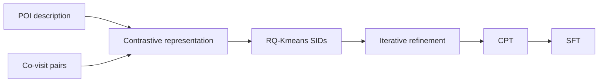

## At a Glance

Key Findings: In a three-month deployment on the AMAP platform, GeoGR reports online gains of +2.91% in WINRATE and +5.55% in PV_CTR (Abstract).
Limitation: The Semantic IDs (SIDs) are updated from the LLM's predictions, so they are tied to the LLM checkpoint used in refinement (Sec. 4.1.3).

### 1. Why This Paper Matters

The authors state that SID-based point-of-interest (POI) recommenders lack SIDs that capture cross-category spatio-temporal collaborative relationships and align poorly with large language models (LLMs) (Abstract). GeoGR addresses both for navigation services such as AMAP.

> "Instead, we explicitly model the joint constraints of geographic proximity and behavioral co-occurrence by constructing spatiotemporal co-visit POI pairs." (Sec. 4.1.1)

Based on arXiv v2.

### 2. How It Works

*Figure source: Fig. 2, original paper.*

#### Location Description

Each POI gets a description with coordinates, address, and attributes such as name, brand, categories, geohash code, consumption level, and active time period, encoded by a Qwen model (Sec. 4.1.1).

#### Co-Visit Contrastive Learning

POI pairs that frequently co-occur in trajectories are weighted by Swing similarity to downweight popular items, and an NCE loss trains on them (Sec. 4.1.1, Eq. 4).

#### Quantization and Iterative Refinement

RQ-Kmeans discretizes the LLM embeddings into hierarchical SIDs (Sec. 1).

> "As shown in Algorithm 1, the framework alternates between two phases: (1) fixing the SIDs and fine-tuning the LLM to better predict them, and (2) fixing the LLM and updating the SIDs based on its predictions." (Sec. 4.1.3)

#### Multi-Stage LLM Training

Continued pre-training (CPT) injects POI information and user behavior sequences through several prompt templates (Sec. 4.2.1). Supervised fine-tuning then trains POI generation (Abstract).

> "Since the newly introduced SID tokens are out-of-vocabulary for the base LLM, we first perform Continued Pre-Training (CPT) to warm up these tokens and inject scenario-specific recommendation knowledge." (Sec. 4.2)

### 3. Experimental Findings

- Offline comparison: GeoGR reports better performance than the baselines on multiple real-world datasets (Abstract).
- Online deployment: the three-month test served millions of users (Abstract).

### 4. Limitations & Critical Analysis

**Our analysis.**

- OneLoc adds images to its input and trains an `Enc-Dec` generator with DPO; GeoGR adds collaborative signals and trains a `Dec-Only` LLM with `Multi-task NTP`.
- GNPR-SID keeps its `RQ-VAE` codes fixed; GeoGR refines its `R-KM+EM` codes against the generator.
