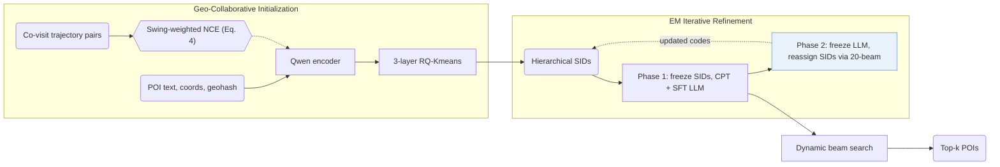

## At a Glance

Key Findings: In a three-month deployment on the AMAP platform, GeoGR reports online gains of +2.91% in WINRATE and +5.55% in PV_CTR (Abstract).
Limitation: Semantic IDs (SIDs) are updated from the LLM's predictions, tying each codebook version to the specific LLM checkpoint used during refinement (Sec. 4.1.3).

### 1. Why This Paper Matters

Standard point-of-interest (POI) SID tokenizers miss cross-category spatio-temporal co-visitation patterns and align poorly with pretrained large language models (LLMs) (Abstract). GeoGR couples Swing-weighted co-visit contrastive learning with an alternating EM-style refinement loop between RQ-Kmeans codes and a Qwen generator for industrial navigation services on AMAP.

> "Instead, we explicitly model the joint constraints of geographic proximity and behavioral co-occurrence by constructing spatiotemporal co-visit POI pairs." (Sec. 4.1.1)

### 2. How It Works

#### Location Description

Each POI prompt combines coordinates, address, name, brand, categories, geohash code, consumption level, and active time period, which a Qwen encoder maps into a dense representation (Sec. 4.1.1).

#### Co-Visit Contrastive Learning

POI pairs that frequently co-occur within user trajectories are weighted by Swing similarity to downweight popular hubs, training the encoder under an NCE contrastive objective (Sec. 4.1.1, Eq. 4).

#### Quantization and Iterative Refinement

RQ-Kmeans discretizes the aligned embeddings into initial 3-layer hierarchical SIDs (Sec. 1). GeoGR then alternates between updating the generator and reassigning SIDs from the generator's predictive distribution:

> "As shown in Algorithm 1, the framework alternates between two phases: (1) fixing the SIDs and fine-tuning the LLM to better predict them, and (2) fixing the LLM and updating the SIDs based on its predictions." (Sec. 4.1.3)

#### Multi-Stage LLM Training

Continued pre-training (CPT) warms up the out-of-vocabulary SID tokens across multi-task prompt templates covering POI metadata and user behavior sequences (Sec. 4.2.1), followed by supervised fine-tuning (SFT) for next-POI generation (Abstract).

> "Since the newly introduced SID tokens are out-of-vocabulary for the base LLM, we first perform Continued Pre-Training (CPT) to warm up these tokens and inject scenario-specific recommendation knowledge." (Sec. 4.2)

### 3. Experimental Findings

- Offline comparison: GeoGR outperforms traditional sequential, POI, and generative baselines across Foursquare and AMAP datasets (Abstract).
- Online deployment: in a three-month online A/B test serving millions of users on AMAP, GeoGR achieves +2.91% WINRATE and +5.55% PV_CTR over the multi-stage production baseline (Abstract).

### 4. Limitations & Critical Analysis

**Our analysis.**

- OneLoc incorporates visual features and aligns an `Enc-Dec` generator via DPO; GeoGR injects spatio-temporal co-visitation into tokenization and trains a `Dec-Only` LLM with `Multi-task NTP`.
- GNPR-SID freezes its `RQ-VAE` codes prior to generator training; GeoGR iteratively updates its `R-KM+EM` codes against the LLM's own predictions.
