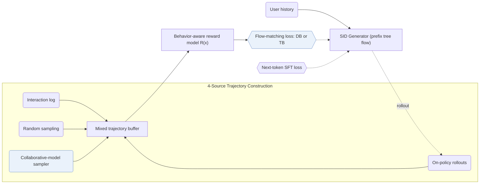

## At a Glance

Key Findings: On Taobao production data, GFlowGR reports H@20 of 0.444 and N@20 of 0.452 against 0.358 and 0.371 for SFT, and a 15-day online A/B test delivers a +0.43% lift in total revenue (Sec. 5, Table 7).
Limitation: The behavior-aware reward model fits item utility from logged user feedback, bounding fine-tuning quality by historical exposure bias (Sec. 3.2).

### 1. Why This Paper Matters

Supervised fine-tuning (SFT) with next-token cross-entropy and DPO-style post-training fit a single observed target per step while weighting heterogeneous interactions equally (Abstract). GFlowGR casts SID decoding as multi-step flow generation over a prefix tree, matching terminal generation probabilities to multi-behavior item utilities.

> "To address these challenges, we reformulate GR as a sequential set-generation problem and propose GFlowGR, a GFlowNet-based fine-tuning framework that explicitly aligns generation probabilities with item-level utilities." (Abstract)

### 2. How It Works

#### Trajectory Sampler

GFlowGR populates its training buffer from four trajectory sources while downweighting pure random rollouts that destabilize off-policy flow training and drift from the generator's current policy (Sec. 3.1).

> "There are four methods for constructing the trajectory set: interaction log, random sampling, CM-based sampling, and on-policy sampling." (Sec. 3.1)

#### Reward Model

A behavior-aware reward model aggregates heterogeneous feedback signals (such as clicks, carting, and conversions) into a scalar terminal utility for each candidate trajectory (Sec. 1, Sec. 3.2).

#### GFlowNet Objectives

Applying flow-matching conservation across the SID prefix DAG yields detailed balance (DB) on step transitions and trajectory balance (TB) over complete root-to-item paths, optimized jointly with next-token cross-entropy (Sec. 2).

### 3. Experimental Findings

- Public benchmarks: GFlowGR consistently improves both TIGER and LETTER backbones across public datasets (Abstract).
- Production offline evaluation: on Taobao data, GFlowGR outperforms both SFT and GRPO (H@20 = 0.427, N@20 = 0.408) (Sec. 5, Table 7).

  > "The results show that GFlowGR achieves H@20 of 0.444 and N@20 of 0.452, substantially outperforming SFT (0.358/0.371) and GRPO (0.427/0.408), mirroring the conclusions on public datasets." (Sec. 5)

- Online deployment: in a 15-day A/B test on 10% of traffic (50/50 split), GFlowGR raises total revenue by +0.43% and has trained Taobao search advertising models across Taobao Mobile, Xianyu, and Taobao Web since May 2025 (Sec. 5).

### 4. Limitations & Critical Analysis

**Our analysis.**

- GFlowGR modifies only the generator fine-tuning objective, which suggests its gains compose orthogonally with upstream tokenizer improvements such as LETTER.
- OneRec post-trains its generator sequentially via `NTP → DPO`; GFlowGR optimizes GFlowNet flow balance alongside next-token likelihood (`NTP + Aux.`).
