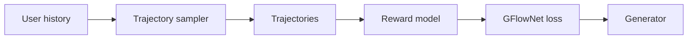

## At a Glance

Key Findings: On Taobao production data, GFlowGR reports H@20 of 0.444 and N@20 of 0.452 against 0.358 and 0.371 for SFT, and a 15-day online A/B test shows a +0.43% lift in total revenue (Sec. 5, Table 7).
Limitation: The reward model learns item utility from logged user signals, so the fine-tuning target is only as good as those logs (Sec. 3.2).

### 1. Why This Paper Matters

Generative recommendation (GR) models are usually fine-tuned with the next-token loss of supervised fine-tuning (SFT) or with DPO-style objectives (Abstract). The authors state that these objectives predict a single ground-truth item and treat all interactions as equally informative (Abstract).

> "To address these challenges, we reformulate GR as a sequential set-generation problem and propose GFlowGR, a GFlowNet-based fine-tuning framework that explicitly aligns generation probabilities with item-level utilities." (Abstract)

Based on arXiv v3.

### 2. How It Works

#### Trajectory Sampler

The trajectory set comes from four methods (Sec. 3.1). The authors state that random samples cause training instability and drift from the model's learning dynamics (Sec. 3.1).

> "There are four methods for constructing the trajectory set: interaction log, random sampling, CM-based sampling, and on-policy sampling." (Sec. 3.1)

#### Reward Model

A behavior-aware reward model quantifies item utility from heterogeneous user signals (Sec. 1, Sec. 3.2).

#### GFlowNet Objectives

The paper derives detailed balance (DB) and trajectory balance (TB) objectives from the flow-matching principle (Sec. 2).

### 3. Experimental Findings

- Public data: the paper evaluates GFlowGR with two different GR backbones (Abstract).
- Production data: GRPO reaches H@20 = 0.427 and N@20 = 0.408 (Sec. 5, Table 7).

  > "The results show that GFlowGR achieves H@20 of 0.444 and N@20 of 0.452, substantially outperforming SFT (0.358/0.371) and GRPO (0.427/0.408), mirroring the conclusions on public datasets." (Sec. 5)

- Online test: the A/B test used 10% of traffic with a 50/50 split (Sec. 5).
- Deployment: since May 2025, GFlowGR trains the GR models of Taobao search advertising, including Taobao Mobile, Xianyu, and Taobao Web (Sec. 5).

### 4. Limitations & Critical Analysis

**Our analysis.**

- GFlowGR changes only the fine-tuning objective. This suggests that its gains add to the choice of tokenizer rather than replace it.
- OneRec aligns its generator by `NTP → DPO`; GFlowGR adds a GFlowNet loss to the next-token loss (`NTP + Aux.`).
