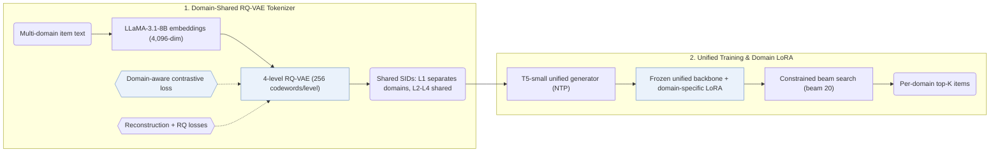

## At a Glance

Key Findings: Across five Amazon domains (Scientific, Pantry, Instruments, Arts, and Office), GMC reports improvements over ID-based, text-based, pre-trained, and generative baselines on Recall@5, Recall@10, NDCG@5, and NDCG@10 (Abstract, Table 3).
Limitation: The Semantic IDs (SIDs) come from text embeddings only, so collaborative signals reach the model only through the generator's training sequences (Sec. 3).

### 1. Why This Paper Matters

Existing multi-target cross-domain recommendation (MTCDR) methods rely on users or items shared between domains, which non-overlapped scenarios lack, while pre-trained semantic representations require large auxiliary corpora (Abstract). GMC bridges non-overlapped domains through a shared discrete token space and a single sequence-to-sequence generator.

> "The core idea of GMC is to leverage semantically quantized discrete item identifiers as a medium for integrating multi-domain knowledge within a unified generative model." (Abstract)

### 2. How It Works

#### Semantic Identifier Learning

GMC encodes item text from all domains with LLaMA-3.1-8B into 4,096-dimensional embeddings and quantizes them with a 4-level RQ-VAE (256 codewords per level, dimension 32) into SIDs shared across domains (Sec. 3). A domain-aware contrastive loss pulls quantized embeddings of same-domain items together so that first-level codes separate domains while deeper levels share codes across domains (Sec. 3.3, Eq. 6).

> "Specifically, since items within the same domain are generally more similar to each other than items from different domains, we introduce a novel domain-aware contrastive loss that brings quantized embeddings of intra-domain items closer together." (Sec. 1)

#### Domain-Specific Fine-Tuning

GMC first trains a unified T5-small generator with next-token prediction across all domains, then attaches a separate LoRA module to adapt to each target domain while keeping the unified backbone frozen (Sec. 1, Sec. 3.5).

> "Specifically, we incorporate domain-specific LoRA modules (Hu et al., 2022) into the unified recommender and update the corresponding LoRA parameters using domain-specific data, while freezing all other parameters of the unified model." (Sec. 1)

### 3. Experimental Findings

- Main comparison: across five non-overlapped Amazon domains (Scientific, Pantry, Instruments, Arts, and Office), GMC outperforms ID-based, text-based, pre-trained, and generative baselines on Recall@5, Recall@10, NDCG@5, and NDCG@10 (Abstract, Table 3).
- Ablation and code sharing: Table 4 ablates the shared codebook, the domain-aware contrastive loss, and the domain-specific LoRA modules, while Figs. 3–5 show that first-level codes separate domains and deeper levels share codes across domains.

### 4. Limitations & Critical Analysis

**Our analysis.**

- The domain-aware contrastive loss pulls items within the same domain together, which suggests a trade-off against cross-domain code sharing at coarser quantization levels.
- VQ-Rec transfers across domains with `OPQ` codes in an `Encoder` generator and `Scoring`; GMC generates `Unified RQ` codes with an `Enc-Dec` generator and `C-Beam` decoding.
