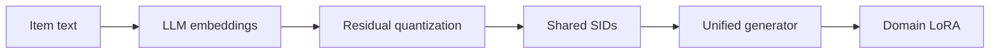

## At a Glance

Limitation: The Semantic IDs (SIDs) come from text embeddings only, so collaborative signals reach the model only through the generator's training sequences (Sec. 3).

### 1. Why This Paper Matters

Existing multi-target cross-domain recommendation (MTCDR) methods rely on users or items shared between domains, which non-overlapped scenarios do not have (Abstract). Methods based on domain-sharable semantic representations often need extensive auxiliary data for pre-training (Abstract).

> "The core idea of GMC is to leverage semantically quantized discrete item identifiers as a medium for integrating multi-domain knowledge within a unified generative model." (Abstract)

Based on arXiv v3.

### 2. How It Works

#### Semantic Identifier Learning

GMC quantizes LLM text embeddings with residual vector quantization into SIDs shared across domains (Sec. 3). A domain-aware contrastive loss is added to this step (Sec. 3.3, Eq. 6).

> "Specifically, since items within the same domain are generally more similar to each other than items from different domains, we introduce a novel domain-aware contrastive loss that brings quantized embeddings of intra-domain items closer together." (Sec. 1)

#### Domain-Specific Fine-Tuning

After unified training, each domain gets its own LoRA module (Sec. 1, Sec. 3.5).

> "Specifically, we incorporate domain-specific LoRA modules (Hu et al., 2022) into the unified recommender and update the corresponding LoRA parameters using domain-specific data, while freezing all other parameters of the unified model." (Sec. 1)

### 3. Experimental Findings

- Main comparison: on five public datasets, GMC reports better performance than a range of baselines (Abstract).

### 4. Limitations & Critical Analysis

**Our analysis.**

- The contrastive loss pulls items of one domain together. This suggests a trade-off with code sharing across domains.
- VQ-Rec also transfers across domains, with `OPQ` codes in an `Encoder` and `Scoring`; GMC generates `Unified RQ` codes with an `Enc-Dec` generator.
