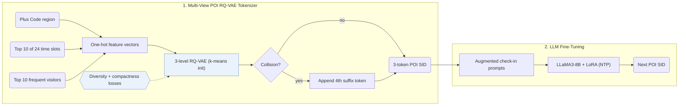

## At a Glance

Key Findings: On three benchmark datasets, GNPR-SID reports up to 16% improvement in recommendation accuracy over the compared methods (Abstract).
Limitation: Operating hours and collaborative features come from check-ins, so a new point of interest (POI) without visits has incomplete features (Sec. 4.1.1).

### 1. Why This Paper Matters

Existing generative POI recommenders assign random numeric IDs to locations, which obscures spatial and semantic similarity across POIs (Abstract). GNPR-SID replaces random IDs with Semantic IDs (SIDs) quantized from spatial, temporal, and collaborative POI features under a diversity loss.

> "To achieve this, we propose the diversity loss, which promotes the distinctiveness of codewords within each codebook layer." (Sec. 1)

### 2. How It Works

#### POI Features

GNPR-SID represents each POI with spatial, temporal, and collaborative features (Sec. 4.1.1). The spatial feature is a Google Plus Code region.

> "Compared to directly using geographic coordinates as spatial features, these region-based codes r ensure that nearby POIs are assigned the same Plus Code, allowing the model to share information among spatially adjacent POIs." (Sec. 4.1.1)

Operating hours are the 10 most visited of 24 hourly time slots, and the collaborative feature records each POI's 10 most frequent visitors (Sec. 4.1.1). All three views are encoded as one-hot vectors (Sec. 4.1.1, Eq. 1).

#### Quantization

A 3-level RQ-VAE (32 codewords per level on NYC, 64 on TKY and CA, dimension 64) quantizes the fused POI representation into discrete codes, while a diversity loss spreads codewords across the semantic space and an appended fourth token resolves any remaining collisions (Abstract, Sec. 4.1.2).

#### Training Data

To increase sequence variety before fine-tuning LLaMA3-8B with LoRA, GNPR-SID applies multiple cropping and fill-in-the-blank augmentation to user check-in trajectories (Appendix A.1).

### 3. Experimental Findings

- Main comparison: on Foursquare NYC, Foursquare TKY, and Gowalla CA, GNPR-SID improves top-1 accuracy (Acc@1) by up to 16% over traditional, Transformer, GCN, time-aware, and LLM baselines (Abstract, Table 2).
- Ablations and collision rate: Table 3 ablates the spatial, temporal, and collaborative features along with the quantization losses, while Table 4 reports unique SIDs and pre-suffix collisions across diversity-loss weights (590 collisions on NYC at $`\lambda = 0.25`$).
- Cross-city transfer: when trained on one city and evaluated on out-of-domain check-in sequences from the other cities, GNPR-SID retains transfer accuracy across cities (Sec. 6.5, Table 5).
- Efficiency: on NYC, compressing POIs into short SID token counts reduces total test time to 110.62 s compared with 230.36 s for LLM4POI, while also lowering training time and prompt token counts (Sec. 6.6, Table 6).

### 4. Limitations & Critical Analysis

**Our analysis.**

- GeoGR refines its `R-KM+EM` codes in an alternating loop with the generator; GNPR-SID trains its `RQ-VAE` codes once and keeps them fixed (`Fixed`).
- LC-Rec aligns its LLM with `Multi-task NTP` over item text; GNPR-SID encodes POI attributes, geography, and collaborative features in the tokenizer (`Attr+Geo+CF`) and fine-tunes the generator with standard `NTP`.
