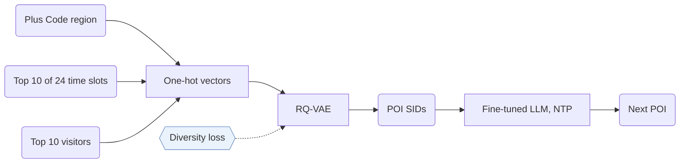

## At a Glance

Key Findings: On three benchmark datasets, GNPR-SID reports up to 16% improvement in recommendation accuracy over the compared methods (Abstract).
Limitation: Operating hours and collaborative features come from check-ins, so a new point of interest (POI) without visits has incomplete features (Sec. 4.1.1).

### 1. Why This Paper Matters

Existing generative POI recommenders usually give POIs random numeric IDs, which limits the modeling of semantic relationships between similar locations (Abstract). GNPR-SID replaces them with Semantic IDs (SIDs) learned from POI features.

> "To achieve this, we propose the diversity loss, which promotes the distinctiveness of codewords within each codebook layer." (Sec. 1)

### 2. How It Works

#### POI Features

Each POI has spatial, temporal, and collaborative features (Sec. 4.1.1). The region is a Google Plus Code.

> "Compared to directly using geographic coordinates as spatial features, these region-based codes r ensure that nearby POIs are assigned the same Plus Code, allowing the model to share information among spatially adjacent POIs." (Sec. 4.1.1)

Operating hours are the 10 most visited of 24 time slots, and the collaborative feature uses each POI's 10 most frequent visitors (Sec. 4.1.1). Each feature becomes a one-hot vector (Sec. 4.1.1, Eq. 1).

#### Quantization

The diversity loss keeps the SIDs uniformly distributed across the semantic space (Abstract).

#### Training Data

Appendix A.1 adds multiple cropping and fill-in-the-blank augmentation (Appendix A.1).

### 3. Experimental Findings

- Other analyses: the paper tests out-of-domain data (Sec. 6.5) and efficiency through training time, test time, and token counts (Sec. 6.6, Table 6).

### 4. Limitations & Critical Analysis

**Our analysis.**

- GeoGR refines its `R-KM+EM` codes against the generator; GNPR-SID trains its `RQ-VAE` codes once.
- LC-Rec trains its LLM with `Multi-task NTP` over text; GNPR-SID uses POI attributes, geography, and collaborative features with plain `NTP`.
