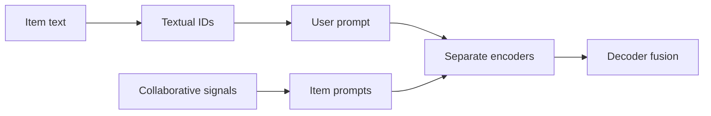

## At a Glance

Key Findings: On four benchmark datasets, GRAM reports improvements of 11.5–16.0% in Recall@5 and 5.3–13.6% in NDCG@5 over eight generative recommendation models (Abstract).
Limitation: The authors name the TF-IDF selection of vocabulary words and the small T5 models as limitations (Sec. 7).

### 1. Why This Paper Matters

Generative recommenders built on large language models (LLMs) struggle to incorporate implicit item relationships and to use rich but lengthy item information (Abstract). GRAM addresses the first with textual IDs and the second with late fusion.

> "It employs separate encoders for multi-granular prompts, delaying the fusion until the decoding stage." (Abstract)

Based on arXiv v1.

### 2. How It Works

*Figure source: Fig. 4, original paper.*

#### Semantic-to-Lexical Translation

The hierarchical IDs are textual, for example "soap-mild-mango", with words chosen by TF-IDF from the LLM vocabulary (Sec. 7).

> "To bridge collaborative semantics to LLMs, we extract collaborative signals and convert them as an additional item attribute." (Sec. 3.2.2)

#### Multi-Granular Prompts

A coarse-grained user prompt concatenates the item IDs of the history, and fine-grained item prompts carry item attributes and collaborative semantics (Sec. 3.3.1).

#### Late Fusion

The decoder uses the combined encoder outputs as the key-value matrix in cross-attention at every step (Sec. 3.3.2, Eq. 8-9).

### 3. Experimental Findings

- Efficiency: the authors analyze preprocessing and inference time in Appendix C.

### 4. Limitations & Critical Analysis

**Stated by the authors.** The authors state that the TF-IDF-based choice of vocabulary words and the use of T5-small and T5-base limit the study (Sec. 7).

**Our analysis.**

- The IDs reuse vocabulary words instead of new tokens. This suggests that the words carry pretrained meanings, which can match or conflict with the item.
- LC-Rec maps `RQ-VAE` codes to new tokens in a `Dec-Only` LLM; GRAM uses `H-KM` textual IDs in an `Enc-Dec` model.
