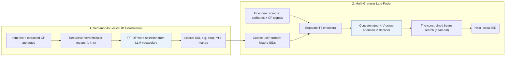

## At a Glance

Key Findings: On four benchmark datasets, GRAM reports improvements of 11.5–16.0% in Recall@5 and 5.3–13.6% in NDCG@5 over eight generative recommendation models (Abstract).
Limitation: The authors name the TF-IDF selection of vocabulary words and the small T5 models (T5-small and T5-base) as limitations (Sec. 7).

### 1. Why This Paper Matters

Generative recommenders built on large language models (LLMs) struggle to capture implicit collaborative relationships and to process lengthy item descriptions without hitting context bottlenecks (Abstract). GRAM encodes item hierarchies into lexical Semantic IDs (SIDs) drawn from the native LLM vocabulary and fuses multi-granular item prompts only at the decoder stage.

> "It employs separate encoders for multi-granular prompts, delaying the fusion until the decoding stage." (Abstract)

### 2. How It Works

#### Semantic-to-Lexical Translation

GRAM clusters item embeddings with recursive hierarchical k-means (stopping when a cluster has fewer than $`c`$ items or reaches depth $`l`$) and maps each cluster to an LLM vocabulary word via TF-IDF, producing hierarchical lexical SIDs such as `"soap-mild-mango"` with an appended digit for duplicates (Sec. 3.2.1, Sec. 7). Collaborative co-occurrence signals are extracted and formatted as an additional text attribute before clustering and prompting.

> "To bridge collaborative semantics to LLMs, we extract collaborative signals and convert them as an additional item attribute." (Sec. 3.2.2)

#### Multi-Granular Prompts

A coarse-grained user prompt concatenates the lexical SIDs of the interaction history, while separate fine-grained item prompts encode individual item attributes and collaborative semantics (Sec. 3.3.1).

#### Late Fusion

Separate encoders process the user prompt and each item prompt independently, and the decoder concatenates all encoder outputs into the key-value matrix for cross-attention at every decoding step under a Trie-constrained beam search of width 50 (Sec. 3.3.2, Eq. 8–9).

### 3. Experimental Findings

- Main comparison: across Amazon Beauty, Toys and Games, Sports and Outdoors, and Yelp, GRAM improves Recall@5 by 11.5–16.0% and NDCG@5 by 5.3–13.6% over eight generative baselines (Abstract, Table 2).
- Component and ID ablations: Table 3 ablates hierarchical clustering, collaborative attributes, and multi-granular late fusion, while Table 4 shows that hierarchical lexical SIDs outperform RQ-VAE codes and flat IDs inside GRAM.
- Inference efficiency: when evaluating all test sequences in a single batch on one NVIDIA A6000 GPU, GRAM averages 0.2008 s per user sequence on Beauty and 0.1605 s on Toys, compared with 1.8312 s and 1.8125 s for LC-Rec (Appendix C, Tables 6–7).

### 4. Limitations & Critical Analysis

**Our analysis.**

- Reusing native vocabulary words instead of out-of-vocabulary code tokens suggests that pretrained lexical meanings can either reinforce or conflict with item semantics.
- LC-Rec maps `RQ-VAE` codes to new out-of-vocabulary tokens in a `Dec-Only` LLM; GRAM builds `H-KM` lexical SIDs from existing vocabulary tokens in an `Enc-Dec` generator.
