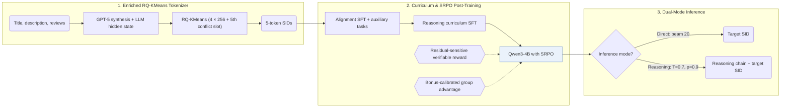
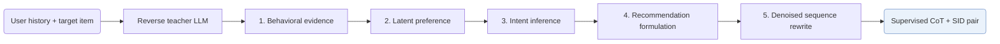

## At a Glance

Key Findings: Across Amazon Beauty, Sports and Outdoors, and Musical Instruments, GREAM outperforms generative and LLM baselines in both direct and reasoning modes while cutting RQ-KMeans index collisions by about 50% (Abstract, Sec. 4.1, Table 2).
Limitation: The item indices depend on descriptions rewritten by GPT-5, and the reasoning data comes from an external LLM, so reproduction depends on access to those models (Sec. 4.1, Sec. 4.2).

### 1. Why This Paper Matters

Large language models (LLMs) used as generative reasoning recommenders face a gap between textual semantics and collaborative filtering signals, alongside sparse and stochastic user feedback (Abstract). GREAM bridges both obstacles through enriched Semantic IDs (SIDs), a synthetic reasoning curriculum, and sparse-regularized reinforcement post-training while retaining a low-latency direct mode alongside explicit chain-of-thought generation.

> "GREAM natively supports two complementary inference modes: Direct Sequence Recommendation for high-throughput, low-latency deployment, and Sequential Reasoning Recommendation that first emits an interpretable reasoning chain for causal transparency." (Abstract)

### 2. How It Works

#### Collaborative-Semantic Alignment

For each item, GPT-5 synthesizes the title, official description, and selected user reviews into a unified description, and RQ-KMeans quantizes its LLM last-hidden-state embedding into a 5-token SID (4 layers of 256 codewords plus a 5th conflict-resolution slot) (Sec. 4.1, Eq. 4–5). Auxiliary alignment tasks ground the LLM token representations in interaction semantics (Abstract).

#### Reasoning Curriculum Activation

An external teacher LLM synthesizes training trajectories by reverse reasoning from the known ground-truth target item back to the user history, supervising Qwen3-4B before reinforcement learning (Sec. 4.2).

> "This process guides the model through a structured, five-stage logical chain—behavioral evidence extraction, latent preference modeling, intent inference, recommendation formulation, and denoised sequence rewriting" (Sec. 1)

#### SRPO

Sparse-Regularized Group Policy Optimization (SRPO) combines a prefix-aware Residual-Sensitive Verifiable Reward with Bonus-Calibrated Group Advantage Estimation so policy gradients remain informative even when exact full-SID hits are rare (Abstract, Sec. 5.2).

> "In the early stages of generative recommendation, exactly correct generations are typically rare." (Sec. 5.2)

### 3. Experimental Findings

- Main comparison: across Amazon Beauty, Sports and Outdoors, and Musical Instruments, GREAM outperforms traditional, Transformer, generative, and LLM baselines on Recall@5/10 and NDCG@5/10 in direct mode and Pass@1/5/10 in reasoning mode (Abstract, Table 2).
- Index quality and ablations: running RQ-KMeans on GPT-5-enriched embeddings lowers index collision rates by about 50% (Sec. 4.1), and Tables 3–4 verify the gains from collaborative-semantic alignment, reasoning activation, and SRPO.
- Reasoning scaling: expanding synthetic chain-of-thought data during Reasoning Activation raises Pass@Avg almost linearly across $`10^{16}`$–$`10^{19}`$ training FLOPs (Sec. 6.4, Fig. 1).

### 4. Limitations & Critical Analysis

**Our analysis.**

- Emitting a five-stage reasoning chain before the target SID suggests higher inference latency and token cost than direct beam-search decoding, though wall-clock latency is not reported.
- LC-Rec and EAGER-LLM train decoder-only LLMs with `Multi-task NTP`; GREAM extends supervised alignment with a reinforcement learning stage (`NTP → RL`).
