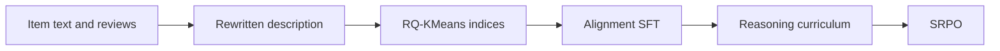

## At a Glance

Limitation: The item indices depend on descriptions rewritten by GPT-5, and the reasoning data comes from an external LLM, so reproduction depends on access to those models (Sec. 4.1, Sec. 4.2).

### 1. Why This Paper Matters

The authors state that LLMs face two obstacles as generative reasoning recommenders: the gap between textual semantics and collaborative filtering signals, and sparse, stochastic user feedback (Abstract). GREAM targets both while keeping a fast direct mode next to a reasoning mode.

> "GREAM natively supports two complementary inference modes: Direct Sequence Recommendation for high-throughput, low-latency deployment, and Sequential Reasoning Recommendation that first emits an interpretable reasoning chain for causal transparency." (Abstract)

Based on arXiv v1.

### 2. How It Works

*Figure source: Fig. 2, original paper.*

#### Collaborative-Semantic Alignment

For each item, GPT-5 rewrites the title, the official description, and selected reviews into one description (Sec. 4.1). RQ-KMeans quantizes its embedding into item indices (Sec. 4.1, Eq. 4-5). Auxiliary tasks ground the language representations in interaction semantics (Abstract).

#### Reasoning Curriculum Activation

An external LLM generates structured reasoning paths by reverse reasoning from the recommendation (Sec. 4.2).

> "This process guides the model through a structured, five-stage logical chain—behavioral evidence extraction, latent preference modeling, intent inference, recommendation formulation, and denoised sequence rewriting" (Sec. 1)

#### SRPO

Sparse-Regularized Group Policy Optimization (SRPO) uses a Residual-Sensitive Verifiable Reward and Bonus-Calibrated Group Advantage Estimation to optimize despite sparse successes (Abstract).

> "In the early stages of generative recommendation, exactly correct generations are typically rare." (Sec. 5.2)

### 3. Experimental Findings

- Main comparison: on three public benchmarks, GREAM reports consistent gains over generative and LLM baselines in both direct and reasoning settings (Abstract).
- Index quality: RQ-KMeans on the enriched embeddings reduces index collision rates by about 50% (Sec. 4.1).
- Reasoning scaling: more synthetic Chain-of-Thought data in Reasoning Activation raises Pass@Avg almost linearly across 10^16–10^19 training FLOPs (Sec. 6.4, Fig. 1).

### 4. Limitations & Critical Analysis

**Our analysis.**

- The reasoning mode emits a chain before the item index. This suggests higher latency than the direct mode.
- LC-Rec and EAGER-LLM train their LLMs with `Multi-task NTP`; GREAM adds an RL stage (`NTP → RL`).
