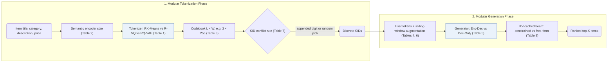

## At a Glance

Key Findings: Across 5-seed ablations on Amazon Beauty, Sports, and Toys (Tables 1–8), GRID shows that encoder-decoder generators and sliding-window data augmentation drive accuracy while several compute-heavy defaults can be replaced with more efficient alternatives without losing performance (Sec. 5).
Limitation: GRID ablates one design choice at a time around a fixed RK-Means $`(3, 256)`$ and Flan-T5-XL default without testing cross-component interactions, and does not report beam width or inference latency (Sec. 4.1).

### 1. Why This Paper Matters

Differences in tokenizers, backbones, hyperparameters, and evaluation splits make published generative recommendation (GR) results hard to compare directly (Abstract). GRID implements Semantic ID (SID) pipelines in one open modular codebase so practitioners can swap and ablate individual components under a single protocol.

> "Our comprehensive experiments with GRID reveal that many overlooked architectural components in GR models with SIDs substantially impact performance." (Abstract)

### 2. How It Works

#### Tokenization then Generation

GRID decomposes SID-based generative recommendation into an offline item tokenization phase and an autoregressive sequence generation phase (Sec. 3.1).

#### Tokenization Ablations

In the tokenization phase, GRID varies the quantization algorithm (`RK-Means`, `R-VQ`, and `RQ-VAE`), the pretrained semantic encoder scale, and the codebook depth $`L`$ and width $`W`$ around a fixed reference setup (Sec. 4.1, Tables 1–3).

> "Unless otherwise noted, we use RK-Means with (L,W)=(3,256) and Flan-T5-XL." (Sec. 4.1)

#### Generation Ablations

In the generation phase, GRID ablates the number of hashed user tokens, encoder-decoder versus decoder-only backbones, sliding-window sequence augmentation, appended-digit versus random-pick collision handling, and Trie-constrained versus unconstrained beam search with KV caching (Sec. 4.2, Tables 4–8).

### 3. Experimental Findings

- Main finding: across 5-seed runs on 5-core Amazon Beauty, Sports, and Toys, several compute- or engineering-heavy components—including learned `RQ-VAE` over `RK-Means` and Trie-constrained beam search over unconstrained beam search—can be replaced with cheaper alternatives without hurting ranking metrics (Sec. 4.2, Sec. 5, Tables 1 and 8).
- High-impact components: encoder-decoder backbones outperform decoder-only generators and sliding-window data augmentation consistently lifts Recall and NDCG across benchmarks (Sec. 5, Tables 5 and 6).

  > "Conversely, other, often overlooked design choices prove to be vital, such as encoder-decoder architectures and data augmentation." (Sec. 5)

### 4. Limitations & Critical Analysis

**Our analysis.**

- Varying one axis at a time against the fixed `RK-Means` $`(3, 256)`$ and Flan-T5-XL baseline (Sec. 4.1) suggests that interaction effects—such as whether constrained decoding matters more at smaller codebook widths—remain untested.
- TIGER pairs `RQ-VAE` codes with an `Enc-Dec` generator; GRID adopts OneRec's `R-KM` (`RK-Means`) tokenizer as its benchmark default.
