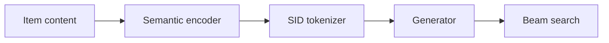

### 1. Why This Paper Matters

Varied modeling techniques, hyperparameters, and experimental setups make direct comparisons between generative recommendation (GR) proposals difficult (Abstract). GRID gives these proposals one modular framework in which components can be swapped and ablated.

> "Our comprehensive experiments with GRID reveal that many overlooked architectural components in GR models with SIDs substantially impact performance." (Abstract)

Based on arXiv v1.

### 2. How It Works

#### Tokenization then Generation

GRID splits GR with Semantic IDs (SIDs) into a tokenization phase and a generation phase (Sec. 3.1).

#### Tokenization Ablations

The study varies the tokenizer algorithm, the size of the semantic encoder, and the number of residual layers $`L`$ and tokens per layer $`W`$ (Sec. 4.1).

> "Unless otherwise noted, we use RK-Means with (L,W)=(3,256) and Flan-T5-XL." (Sec. 4.1)

#### Generation Ablations

The study varies the number of user tokens, encoder-decoder versus decoder-only, data augmentation, de-duplication IDs, and constrained versus unconstrained beam search (Sec. 4.2).

### 3. Experimental Findings

- Main finding: several components assumed essential, which often cost compute or engineering, can be replaced with more efficient alternatives without losing performance (Sec. 5).

  > "Conversely, other, often overlooked design choices prove to be vital, such as encoder-decoder architectures and data augmentation." (Sec. 5)

### 4. Limitations & Critical Analysis

**Our analysis.**

- The ablations change one component at a time against a default configuration (Sec. 4.1). This suggests that interactions between components are not covered.
- TIGER uses `RQ-VAE` codes; GRID's default uses `R-KM` codes, the same tokenization as OneRec.
