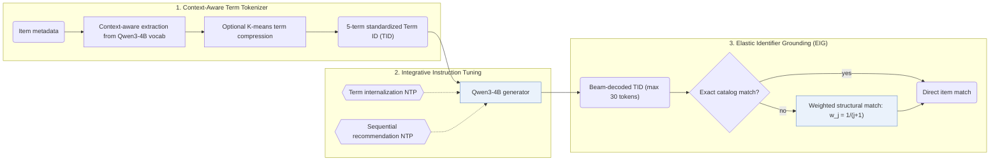

## At a Glance

Key Findings: Across in-domain Amazon benchmarks (Beauty, Sports, and Toys) and cross-domain pairs (Sports-Clothing and Phones-Electronics), GRLM outperforms generative and LLM baselines while achieving a top-10 Term ID valid rate of 0.989–0.998 (Abstract, Tables 2, 3, and 5).
Limitation: A generated Term ID that matches no item is grounded by structural matching, so part of the final ranking comes from the grounding step rather than the generator (Sec. 3.3).

### 1. Why This Paper Matters

Free-text item identifiers expose the vast output space of a large language model (LLM), whereas numeric Semantic IDs (SIDs) require out-of-vocabulary token expansion and alignment training (Abstract). GRLM represents each item as a short sequence of standardized keywords drawn directly from the LLM's native vocabulary.

> "Text-based methods introduce LLMs' vast output space, leading to hallucination, while methods based on Semantic IDs (SIDs) encounter a semantic gap between SIDs and LLMs' native vocabulary, requiring costly vocabulary expansion and alignment training." (Abstract)

### 2. How It Works

#### Context-Aware Term Generation

Context-aware Term Generation converts item metadata into standardized 5-term Term IDs (TIDs) using words from the Qwen3-4B vocabulary, with an optional K-means compression that maps 54,255 raw terms to 3,000–8,000 core terms (Abstract, Appendix A.4).

#### Integrative Instruction Fine-Tuning

Integrative Instruction Fine-tuning jointly trains Qwen3-4B on term internalization tasks and sequential next-TID prediction under a multi-task next-token prediction objective (Abstract).

#### Elastic Identifier Grounding

At inference, beam search generates candidate TIDs up to 30 tokens; when a generated TID has no exact catalog match, Elastic Identifier Grounding (EIG) scores catalog items by structural term overlap with position weight $`w_j = \frac{1}{j+1}`$ for the $`j`$-th generated term (Sec. 3.3).

> "By exploiting the decompositional nature of TIDs, EIG combines direct mapping with structural mapping to ground TIDs into actual items efficiently." (Sec. 1)

### 3. Experimental Findings

- In-domain and cross-domain accuracy: GRLM outperforms sequential, SID-based, and text-ID baselines on Amazon Beauty, Sports, and Toys (Table 2), on cross-domain pairs Sports-Clothing and Phones-Electronics (Table 3), and on a ten-category merged Amazon corpus (Appendix Table 7) (Abstract).
- Validity, ablations, and scaling: Table 4 confirms the contributions of context-aware term generation, integrative tuning, and EIG; Table 5 reports a top-10 valid TID rate of 0.989–0.998, and Appendix Tables 8–9 evaluate TID lengths (5, 7, and 10 terms) and vocabulary compression.

  > "Moreover, through detailed analytical experiments, we provide evidence that our TID-based method exhibits robust scaling properties while significantly mitigating hallucination." (Sec. 1)

### 4. Limitations & Critical Analysis

**Our analysis.**

- TIGER adds numeric `RQ-VAE` codes as out-of-vocabulary tokens; GRLM composes `Term-ID` identifiers from words already in the native LLM vocabulary.
- IDGenRec also uses native vocabulary words (`LLM-Vocab`) but updates its ID generator alongside the recommender (`Altern.`); GRLM extracts its TIDs once offline (`Fixed`).
