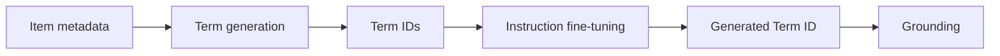

## At a Glance

Limitation: A generated Term ID that matches no item is grounded by structural matching, so part of the final ranking comes from the grounding step, not from the generator (Sec. 3.3).

### 1. Why This Paper Matters

Text-based item identifiers expose the large output space of an LLM, while Semantic IDs (SIDs) need costly vocabulary expansion and alignment training (Abstract). GRLM takes a middle path with standardized keywords.

> "Text-based methods introduce LLMs' vast output space, leading to hallucination, while methods based on Semantic IDs (SIDs) encounter a semantic gap between SIDs and LLMs' native vocabulary, requiring costly vocabulary expansion and alignment training." (Abstract)

### 2. How It Works

#### Context-Aware Term Generation

Context-aware Term Generation converts item metadata into standardized Term IDs (TIDs) (Abstract).

#### Integrative Instruction Fine-Tuning

Integrative Instruction Fine-tuning optimizes term internalization and sequential recommendation together (Abstract).

#### Elastic Identifier Grounding

If no exact match exists, Elastic Identifier Grounding (EIG) scores items by structural matching, where the $`j`$-th generated term has weight $`w_j = \frac{1}{j+1}`$ (Sec. 3.3).

> "By exploiting the decompositional nature of TIDs, EIG combines direct mapping with structural mapping to ground TIDs into actual items efficiently." (Sec. 1)

### 3. Experimental Findings

- Main comparison: GRLM reports better performance than the baselines in multiple scenarios (Abstract).
- Scaling and hallucination: the authors state that TIDs scale well and reduce hallucination (Sec. 1).

  > "Moreover, through detailed analytical experiments, we provide evidence that our TID-based method exhibits robust scaling properties while significantly mitigating hallucination." (Sec. 1)

### 4. Limitations & Critical Analysis

**Our analysis.**

- TIGER adds `RQ-VAE` codes as new tokens; GRLM uses `Term-ID` words already in the vocabulary.
- IDGenRec also uses vocabulary words (`LLM-Vocab`) but updates its ID generator during training (`Altern.`); GRLM generates its TIDs once.
