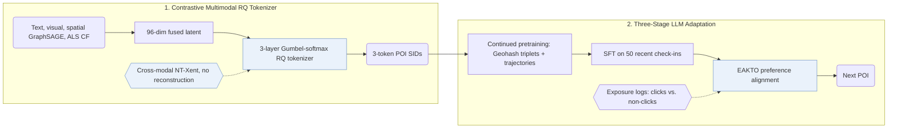

## At a Glance

Key Findings: In long-term online A/B tests on Amap, Gwhere reports improvements of 5.83% in P-CTR and 6.20% in U-CTR over the production baseline (Abstract).
Limitation: The paper does not report a post-quantization collision rule, decoding strategy, or Amap codebook size, and deployed Gwhere-0.5B runs at about 30 ms p99 latency versus 20 ms for the cascade-ranking baseline at 50 QPS (Fig. 4).

### 1. Why This Paper Matters

Scaling generative retrieval to industrial next point-of-interest (POI) recommendation is hindered by colliding token assignments, heterogeneous item modalities, and structured spatial mobility patterns (Abstract). Gwhere learns discriminative Semantic IDs (SIDs) via a reconstruction-free contrastive residual tokenizer and aligns an LLM generator across pretraining, supervised fine-tuning, and exposure-log preference optimization.

> "Gwhere first learns discriminative POI SIDs through a contrastive residual-quantization tokenizer that aligns textual, visual, spatial, and collaborative signals." (Abstract)

### 2. How It Works

#### Contrastive Item Tokenization

Gwhere fuses textual, visual, spatial GraphSAGE, and ALS collaborative views into a 96-dimensional latent vector and assigns 3-layer residual codewords (48 codewords per layer on public benchmarks) via Gumbel-softmax (Sec. 3.2.2, Sec. 4.1.2). An NT-Xent contrastive objective pulls each POI's quantized vector toward its own modal views and pushes away in-batch negatives without any reconstruction decoder or loss (Sec. 3.2, Sec. 3.2.2).

#### Continued Pretraining

Before supervised fine-tuning on the 50 most recent check-ins, Gwhere runs continued pretraining on two corpora built from desensitized Amap trajectories and POI metadata to inject spatial-semantic alignment and mobility transitions (Sec. 3.3.1, Table 1).

> "Each entry is a triplet of (SID, Geohash, Text Description), where Geohash is a 6-character string encoding the POI's precise geographical coordinates" (Sec. 3.3.1)

#### EAKTO

Exposure-Aware Kahneman-Tversky Optimization (EAKTO) adapts KTO to unpaired binary implicit feedback from real impression logs (Sec. 3.4).

> "In contrast, KTO (Ethayarajh et al., 2024) operates on simpler binary signals (desirable / undesirable), aligning with the natural structure of exposure logs (clicks vs. non-clicks)." (Sec. 3.4)

### 3. Experimental Findings

- Offline public and industrial benchmarks: Gwhere improves top-1 accuracy (Acc@1) over traditional, sequential, and LLM baselines on Foursquare NYC, Foursquare TKY, and Gowalla CA (Table 4), and outperforms Amap's cascade-ranking system across LLM scales on an industrial corpus of 10,000K users and 83,100K POIs (Abstract, Table 3).
- Online A/B and serving latency: in one-week and one-month online A/B tests on Amap's homepage, Gwhere lifts P-CTR by 5.83% and U-CTR by 6.20% (Abstract, Table 6), serving 50 QPS on 2 NVIDIA H20 GPUs at about 30 ms p99 latency for Gwhere-0.5B versus 20 ms for cascade ranking (Fig. 4).

### 4. Limitations & Critical Analysis

**Our analysis.**

- Training the residual tokenizer purely for contrastive separability without a reconstruction loss suggests that SID prefixes need not form a coarse-to-fine semantic hierarchy.
- GNPR-SID builds `RQ-VAE` codes with reconstruction plus diversity losses and trains with plain `NTP`; Gwhere builds reconstruction-free `Contr. RQ` codes and adds exposure-aware preference alignment (`NTP → DPO`).
