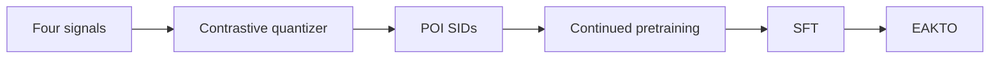

## At a Glance

Key Findings: In long-term online A/B tests on Amap, Gwhere reports improvements of 5.83% in P-CTR and 6.20% in U-CTR over the production baseline (Abstract).

### 1. Why This Paper Matters

The authors state that scaling generative retrieval to industry is hard because of redundant or colliding token assignments and weak integration of heterogeneous item signals (Abstract). Next point-of-interest (POI) recommendation adds structured spatial entities and mobility patterns (Abstract).

> "Gwhere first learns discriminative POI SIDs through a contrastive residual-quantization tokenizer that aligns textual, visual, spatial, and collaborative signals." (Abstract)

### 2. How It Works

#### Contrastive Item Tokenization

The quantizer assigns codewords by Gumbel-softmax (Sec. 3.2.2). An NT-Xent loss pulls the quantized representation toward the item's own modal representations and away from other items in the batch (Sec. 3.2.2). The tokenizer has no reconstruction loss (Sec. 3.2).

#### Continued Pretraining

Two corpora from desensitized Amap trajectories and POI metadata cover semantic alignment and behavior patterns (Sec. 3.3.1, Table 1).

> "Each entry is a triplet of (SID, Geohash, Text Description), where Geohash is a 6-character string encoding the POI's precise geographical coordinates" (Sec. 3.3.1)

#### EAKTO

Exposure-Aware Kahneman-Tversky Optimization (EAKTO) adapts KTO to the clicks and non-clicks of exposure logs (Sec. 3.4).

> "In contrast, KTO (Ethayarajh et al., 2024) operates on simpler binary signals (desirable / undesirable), aligning with the natural structure of exposure logs (clicks vs. non-clicks)." (Sec. 3.4)

### 3. Experimental Findings

- Offline: the paper evaluates Gwhere on public datasets and Amap's industrial dataset (Abstract).
- Deployment: Gwhere serves Amap's homepage under high-concurrency and low-latency constraints (Abstract).

### 4. Limitations & Critical Analysis

**Our analysis.**

- Without a reconstruction loss, the quantizer trains only for separability. This suggests that SID prefixes need not form a semantic hierarchy.
- GNPR-SID builds `RQ-VAE` codes and trains with plain `NTP`; Gwhere builds `Contr. RQ` codes and adds preference alignment.
