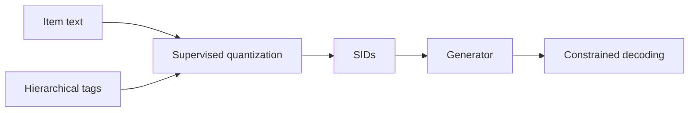

## At a Glance

Limitation: The tokenizer needs multi-level item tags, which an LLM must generate for datasets without them, so ID quality depends on tag quality (Sec. 3.4).

### 1. Why This Paper Matters

The authors state that unsupervised tokenization gives Semantic IDs (SIDs) two flaws: they are semantically flat, and different items collide on entangled representations (Abstract).

> "Concurrently, to combat representation entanglement and prevent ID collisions at the source, we design a novel uniqueness loss that directly penalizes the latent representation overlap between distinct items." (Sec. 1)

Based on arXiv v2.

### 2. How It Works

#### Hierarchical Tag Generation

For datasets without hierarchical tags, such as KuaiRand, an LLM produces them in a two-stage "retrieval-then-classification" workflow (Sec. 3.4, Sec. 1).

#### Hierarchically Supervised Quantization

The trained codebooks can predict the item tags, which gives each recommendation a traceable semantic path (Abstract).

#### Uniqueness Loss

The uniqueness loss penalizes latent overlap between different items (Sec. 1). The authors state that the loss also raises recommendation diversity (Abstract).

> "This mechanism not only resolves the critical ID collision problem but also promotes recommendation diversity by ensuring a more comprehensive utilization of the item representation space." (Abstract)

#### Generation

A generator predicts the next item's SID from the user history (Sec. 3.3).

> "During inference, constrained decoding ensures that generated IDs correspond to valid items." (Sec. 3.3)

### 3. Experimental Findings

- Main comparison: on three public benchmarks, HiD-VAE reports better performance than the compared methods (Abstract).

### 4. Limitations & Critical Analysis

**Our analysis.**

- TIGER uses unsupervised `RQ-VAE` codes with plain `Beam` search; HiD-VAE uses tag-supervised `Hier. RQ` codes with the same `Enc-Dec` generator and constrained decoding.
