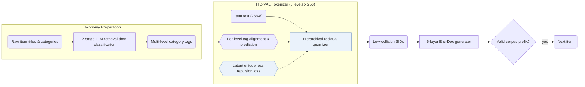

## At a Glance

Key Findings: HiD-VAE cuts Semantic ID collision rates to 2.1% on Beauty, 2.8% on Sports, and 1.9% on KuaiRand versus 18.7%, 19.5%, and 17.8% for unsupervised RQ-VAE, outperforming baselines across all three benchmarks (Abstract, Table 1, Table 3).
Limitation: Hierarchically supervised quantization requires multi-level category tags, forcing datasets without taxonomies to rely on LLM-synthesized tags (Sec. 3.4).

### 1. Why This Paper Matters

Unsupervised residual quantization produces flat code hierarchies whose entangled latent spaces map distinct items to identical Semantic IDs (SIDs) (Abstract). HiD-VAE supervises each quantization depth with explicit category tags and penalizes latent overlap before discretization.

> "Concurrently, to combat representation entanglement and prevent ID collisions at the source, we design a novel uniqueness loss that directly penalizes the latent representation overlap between distinct items." (Sec. 1)

### 2. How It Works

#### Hierarchical Tag Generation

When a catalog lacks multi-level taxonomies (such as KuaiRand), an LLM synthesizes hierarchical tags through a two-stage "retrieval-then-classification" pipeline over item titles and raw categories (Sec. 1, Sec. 3.4).

#### Hierarchically Supervised Quantization

Each RQ-VAE codebook depth aligns with and predicts the corresponding level of item tags, turning the discrete code prefix into an interpretable coarse-to-fine category path (Abstract).

#### Uniqueness Loss

A uniqueness repulsion loss penalizes latent proximity between distinct items prior to nearest-codeword rounding, reducing collisions while spreading items across the codebook (Abstract, Sec. 1).

> "This mechanism not only resolves the critical ID collision problem but also promotes recommendation diversity by ensuring a more comprehensive utilization of the item representation space." (Abstract)

#### Generation

A 6-layer encoder-decoder predicts the target SID from the user's interaction history under valid-prefix constrained decoding (Sec. 3.3).

> "During inference, constrained decoding ensures that generated IDs correspond to valid items." (Sec. 3.3)

### 3. Experimental Findings

- Main comparison and collisions: across Amazon Beauty, Sports and Outdoors, and KuaiRand, HiD-VAE outperforms traditional, sequential, and generative baselines while lowering SID collision rates from 18.7% / 19.5% / 17.8% (RQ-VAE) to 2.1% / 2.8% / 1.9% (Abstract, Table 1, Table 3).

### 4. Limitations & Critical Analysis

**Our analysis.**

- TIGER pairs unsupervised `RQ-VAE` codes with unconstrained `Beam` search and integer collision suffixes; HiD-VAE supervises `Hier. RQ` codebooks with category tags, repels colliding latents during training, and applies constrained decoding.
