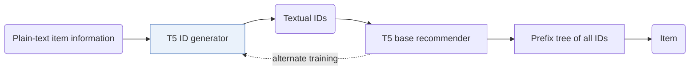
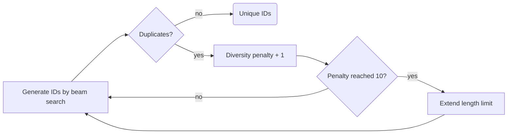

## At a Glance

Limitation: Item IDs change whenever the ID generator is updated, so the prefix tree of valid IDs must be rebuilt during training (Sec. 2.4).

### 1. Why This Paper Matters

The authors state that generative recommendation struggles to encode items in the text-to-text framework with concise yet meaningful IDs (Abstract). Because IDGenRec's IDs are plain words, user histories become platform-agnostic text, which opens zero-shot transfer (Abstract).

> "We propose an alternate training strategy that trains the LLM-based ID generator and the base recommender asynchronously, ensuring that their learned knowledge is well-aligned." (Sec. 1)

### 2. How It Works

#### ID Generator

The generator reads plain-text item information, such as title, category, price, description, creation time, popularity, and location (Sec. 2.2). T5 is the backbone of both models (Sec. 2.6).

#### Unique ID Generation

The generator keeps generating until each item has a unique ID (Sec. 2.3).

> "If a duplicate is detected, the algorithm increases the diversity penalty in the beam search." (Sec. 2.3)

The penalty grows by 1 per iteration, and if it reaches 10 without a unique ID, the length limit is extended (Sec. 3.2).

#### Base Recommender

The base recommender decodes the target ID under a prefix-tree constraint (Sec. 2.4).

> "To ensure that the decoded ID corresponds to an actual existing item, we adopt a constrained sequence decoding strategy (De Cao et al., 2020). More specifically, a prefix tree is used to store all generated candidate IDs." (Sec. 2.4)

### 3. Experimental Findings

- Standard setting: IDGenRec reports better performance than existing models in sequential recommendation (Abstract).
- Zero-shot setting: a model trained on 19 datasets and tested on 6 unseen datasets from other platforms performs comparably to or better than some supervised traditional recommenders (Abstract).

### 4. Limitations & Critical Analysis

**Our analysis.**

- Unique IDs come from raising the diversity penalty and the length limit. This suggests that IDs of similar items can be pushed apart by arbitrary words.
- CID builds `Spectral Clus.` IDs from `CF` signals and keeps them fixed; IDGenRec builds `LLM-Vocab` IDs from text and updates them.
