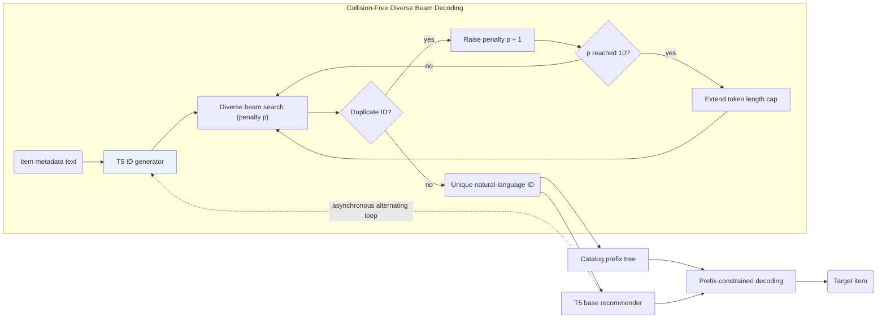

## At a Glance

Key Findings: Pre-trained on a 19-dataset corpus and evaluated zero-shot on 6 unseen datasets across platforms, IDGenRec matches or surpasses supervised traditional recommenders while outperforming sequential baselines in standard evaluation (Abstract, Tables 4 and 7).
Limitation: Updating the textual ID generator changes item IDs across the catalog, requiring periodic prefix-tree reconstruction during alternating training (Sec. 2.4).

### 1. Why This Paper Matters

Out-of-vocabulary numeric codebooks tie a generative recommender to a single catalog, whereas raw item titles are long and noisy (Abstract). IDGenRec trains a T5 ID generator to compress item metadata into short, unique natural-language token sequences (`LLM-Vocab`), turning user histories into platform-agnostic text that transfers zero-shot across domains.

> "We propose an alternate training strategy that trains the LLM-based ID generator and the base recommender asynchronously, ensuring that their learned knowledge is well-aligned." (Sec. 1)

### 2. How It Works

#### ID Generator

Both the ID generator and the base recommender use T5 backbones (Sec. 2.6). The ID generator reads plain-text item metadata—title, category, price, description, creation time, popularity, and location—and decodes concise word-piece identifiers from the native vocabulary (Sec. 2.2).

#### Unique ID Generation

Diverse beam search enforces strict catalog uniqueness at generation time: whenever a candidate ID collides with an existing item, the diversity penalty increments by 1 up to 10, after which the maximum token length is extended until a unique ID emerges (Sec. 2.3, Sec. 3.2).

> "If a duplicate is detected, the algorithm increases the diversity penalty in the beam search." (Sec. 2.3)

#### Base Recommender

The base T5 recommender formats user histories as sequences of textual item IDs and decodes the next item's ID over a prefix tree storing all valid catalog identifiers, alternating updates asynchronously with the ID generator (Sec. 1, Sec. 2.4).

> "To ensure that the decoded ID corresponds to an actual existing item, we adopt a constrained sequence decoding strategy (De Cao et al., 2020). More specifically, a prefix tree is used to store all generated candidate IDs." (Sec. 2.4)

### 3. Experimental Findings

- Standard sequential setting: IDGenRec outperforms traditional and P5-family sequential baselines on standard benchmarks (Abstract, Table 4).
- Zero-shot cross-platform transfer: trained once on 19 datasets and tested directly on 6 unseen datasets including cross-platform benchmarks, IDGenRec matches or outperforms supervised traditional recommenders trained in-domain (Abstract, Table 7).

### 4. Limitations & Critical Analysis

**Our analysis.**

- Enforcing uniqueness by raising beam diversity penalties and extending token length suggests that dense clusters of similar items receive increasingly divergent surface words in later iterations.
- CID constructs fixed `Spectral Clus.` numeric IDs from `CF` graphs; IDGenRec generates `LLM-Vocab` natural-language IDs from item text and updates them in alternation (`Altern.`).
