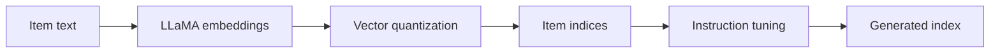

## At a Glance

Limitation: The item indices come from text embeddings only, so collaborative semantics enter only through the tuning tasks (Sec. III-B).

### 1. Why This Paper Matters

Items in recommender systems are often indexed by IDs outside the vocabulary of a large language model (LLM), which leaves a semantic gap between the two (Abstract).

> "In essence, LLMs capture language semantics while recommender systems imply collaborative semantics, making it difficult to sufficiently leverage the model capacity of LLMs for recommendation." (Abstract)

### 2. How It Works

#### Item Indexing

LC-Rec encodes item text with LLaMA and quantizes the embeddings (Sec. III-B). Uniform semantic mapping redistributes the last-level codewords of items that would otherwise share an index (Sec. III-B2).

#### Alignment Tuning

Sequential item prediction is the main objective (Sec. III-C1). Two explicit tasks map titles or descriptions to indices and back (Sec. III-C2). Implicit tasks add asymmetric item prediction, intention-based prediction, and preference inference (Sec. III-C3).

> "On the one hand, the LLM should be capable of accurately identifying the item indices based on the associated title or description. On the other hand, it is expected that LLM can naturally capture relevant item information from its indices." (Sec. III-C2)

#### Training

All tasks are formatted as conditional language generation for one instruction-tuned model (Sec. III-D).

> "To this end, we employ LLaMA [25] as our backbone model and then optimize it via instruction tuning." (Sec. III-D)

### 3. Experimental Findings

- Main comparison: LC-Rec outperforms traditional recommenders and existing LLM-based recommenders (Abstract).

### 4. Limitations & Critical Analysis

**Our analysis.**

- TIGER uses the same `RQ-VAE` codes with an `Enc-Dec` generator; LC-Rec uses a `Dec-Only` LLM trained with `Multi-task NTP`.
