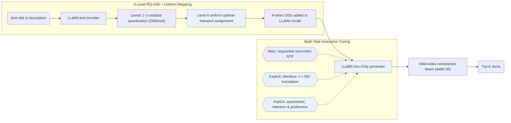

## At a Glance

Key Findings: Across Amazon Instruments, Arts, and Games under full-catalog evaluation, LC-Rec outperforms traditional sequential recommenders, TIGER, and prior LLM-based recommenders (Abstract, Table 3).
Limitation: Item indices are quantized solely from LLaMA text embeddings, so collaborative signals enter only indirectly during instruction tuning (Sec. III-B).

### 1. Why This Paper Matters

Indexing catalog items with out-of-vocabulary code tokens leaves a semantic gap between natural-language pretraining and collaborative user histories in large language models (LLMs) (Abstract). LC-Rec bridges this gap by resolving final-level RQ-VAE collisions via uniform semantic mapping and co-training explicit index-text translation alongside implicit collaborative alignment tasks.

> "In essence, LLMs capture language semantics while recommender systems imply collaborative semantics, making it difficult to sufficiently leverage the model capacity of LLMs for recommendation." (Abstract)

### 2. How It Works

#### Item Indexing

LC-Rec encodes item titles and descriptions with LLaMA and quantizes the pooled embeddings through a 4-level × 256 RQ-VAE (Sec. III-B). Rather than appending an arbitrary fifth integer to separate colliding items, uniform semantic mapping solves a uniform-distribution assignment over the final codebook level so colliding items receive distinct residual-nearest codewords (Sec. III-B2).

#### Alignment Tuning

Instruction tuning combines three task families: sequential next-item index prediction as the primary task (Sec. III-C1), two explicit bidirectional alignment tasks mapping item titles or descriptions to their discrete indices and back (Sec. III-C2), and implicit alignment tasks covering asymmetric item prediction, intention-based prediction, and preference inference (Sec. III-C3).

> "On the one hand, the LLM should be capable of accurately identifying the item indices based on the associated title or description. On the other hand, it is expected that LLM can naturally capture relevant item information from its indices." (Sec. III-C2)

#### Training

All alignment and recommendation tasks are formatted as conditional natural-language instructions sharing one LLaMA decoder-only model and decoded with constrained beam search that masks invalid index prefixes (Sec. III-D).

> "To this end, we employ LLaMA [25] as our backbone model and then optimize it via instruction tuning." (Sec. III-D)

### 3. Experimental Findings

- Main comparison: under full-catalog ranking on Amazon Instruments, Arts, and Games, LC-Rec outperforms traditional sequential models, TIGER, and prior LLM recommenders, while ablations confirm consistent gains from both uniform semantic mapping and each alignment task family (Abstract, Tables 3 and 4).

### 4. Limitations & Critical Analysis

**Our analysis.**

- TIGER pairs `RQ-VAE` codes with a lightweight from-scratch `Enc-Dec` Transformer under single-task `NTP`; LC-Rec appends `RQ-VAE` tokens to a pretrained `Dec-Only` LLaMA vocabulary and grounds them through `Multi-task NTP` instruction tuning.
