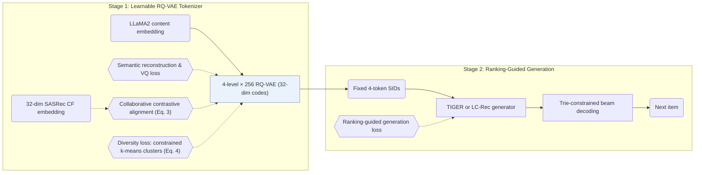

## At a Glance

Key Findings: On Instruments, LETTER-TIGER reports Recall@10 of 0.1122 against 0.1058 for TIGER, and adding either regularization alone also improves TIGER (Table 2).
Limitation: The collaborative regularization needs embeddings from a separately trained CF model (Sec. 3.1).

### 1. Why This Paper Matters

Earlier item identifiers—plain IDs, raw text, or unregularized codebook codes—fall short in encoding semantics, carrying collaborative signals, or mitigating code assignment bias. LETTER regularizes an RQ-VAE tokenizer along all three axes and plugs the resulting 4-level Semantic IDs (SIDs) into two generative backbones, TIGER and LC-Rec (Sec. 4.1.3).

> "LETTER incorporates Residual Quantized VAE for semantic regularization, a contrastive alignment loss for collaborative regularization, and a diversity loss to mitigate code assignment bias." (Abstract)

### 2. How It Works

#### Semantic Regularization

An RQ-VAE quantizes each item's content embedding across 4 residual levels with 256 codewords of dimension 32 per level, preserving a coarse-to-fine semantic hierarchy (Sec. 3.1, Sec. 4.1.4).

#### Collaborative Regularization

A contrastive alignment loss pulls each item's quantized residual embedding toward its embedding from a pre-trained collaborative filtering (CF) model (Sec. 3.1, Eq. 3). The paper names SASRec and LightGCN as candidate CF teachers and uses 32-dimensional SASRec embeddings in the experiments (Sec. 3.1, Sec. 4.1.3).

> "Intuitively, collaborative regularization encourages items with similar collaborative interactions to exhibit similar code sequences." (Sec. 3.1)

#### Diversity Regularization

A diversity loss clusters codebook embeddings via constrained k-means, pulling embeddings within the same cluster together while pushing distinct clusters apart (Sec. 3.1, Eq. 4). This regularizer counteracts code assignment bias—where popular codes absorb disproportionately many items—and downstream item generation bias (Sec. 1).

> "As illustrated in Figure 5(a), a biased code embedding distribution is more likely to cause biased code assignment in the latent space, where some codes are assigned to more items." (Sec. 3.1)

#### Training and Generation

LETTER trains the RQ-VAE tokenizer with the combined semantic, collaborative, and diversity loss (Eq. 5), then freezes the resulting item SIDs for generator training and inference (Sec. 3.2). During generator training, a ranking-guided generation loss sharpens relative scores among hard negative SIDs (Abstract, Sec. 1). At inference, a prefix trie restricts beam search to valid catalog identifiers.

> "To ensure generating valid identifiers, we follow (Hua et al., 2023) to employ constrained generation (De Cao et al., 2020) via Trie" (Sec. 3.2.2)

### 3. Experimental Findings

- Main results: plugging LETTER into TIGER (LETTER-TIGER) and LoRA-tuned LLaMA2-7B LC-Rec (LETTER-LC-Rec) improves Recall and NDCG@5/10 over both backend models across Amazon Instruments, Amazon Beauty, and Yelp (Sec. 4.2, Table 1).
- Regularization ablation: adding either collaborative regularization or diversity regularization alone improves over TIGER, and combining both with the ranking-guided loss yields the highest scores (Sec. 4.3.1, Table 2).
- Code usage trade-off: collaborative alignment compresses items into fewer active codes (dropping from 148 to 76), whereas diversity regularization restores codebook coverage (Sec. 4.3.2, Fig. 6).

  > "Although adding collaborative regularization decreases the code utilization of TIGER (from 148 to 76), integrating diversity regularization inversely compensates for the drop in code utilization." (Sec. 4.3.2)

- Collaborative similarity preservation: code-sequence similarity under LETTER correlates more closely with CF similarity than unregularized RQ-VAE codes (Sec. 4.3.4, Tables 3 and 4).
- Hyperparameter sensitivity: varying identifier length $`L`$, codebook size $`N`$, loss weights $`\alpha`$ and $`\beta`$, cluster count $`K`$, and temperature $`\tau`$ shows that extending $`L`$ from 4 to 8 degrades accuracy due to autoregressive error accumulation (Sec. 4.3.5).

  > "Continuously increasing the identifier length from 4 to 8 will inversely degrade the performance. This is reasonable because autoregressive generation suffers from error accumulation (Ren et al., 2024b)." (Sec. 4.3.5)

  Enlarging the codebook size $`N`$ excessively also lowers accuracy by fitting noise in item content embeddings.

  > "However, 2) blindly expanding N might inversely hurt the performance, where larger codebook size might be more susceptible to noise in the item's semantic information, potentially leading to the over-fitting of some meaningless semantics." (Sec. 4.3.5)

### 4. Limitations & Critical Analysis

**Stated by the authors.** The conclusion outlines three directions for future work: incorporating richer multi-behavior signals into tokenization, extending learnable tokenization to cross-domain recommendation, and combining natural-language user instructions with tokenized interaction histories (Sec. 6).

**Our analysis.**

- The tokenizer is trained once and held fixed (`Fixed`), so catalog updates require re-running CF training and RQ-VAE optimization. ETEGRec instead alternates tokenizer and generator updates (`Altern.`), and DIGER backpropagates generator gradients directly into the tokenizer (`Joint`).
- Collaborative regularization requires a pre-trained CF embedding for every item, which suggests that cold-start items without prior interactions receive no collaborative signal in their SIDs.
- Because collaborative alignment shrinks active codebook usage from 148 to 76 while diversity regularization expands it (Sec. 4.3.2), the loss weights $`\alpha`$ and $`\beta`$ must balance collaborative grouping against uniform code allocation.
