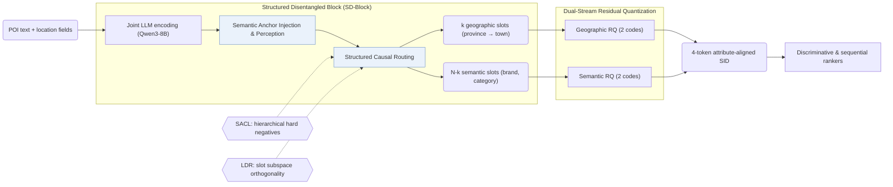

## At a Glance

Key Findings: On Kuaishou and Foursquare, LGRID reports up to a 5.44% relative AUC gain over SID baselines, and reduces the full-SID collision rate to 39.9% against 97.0% for LGSID (Abstract).
Limitation: The geographic slots mirror a fixed administrative hierarchy of province, city, district, and town (Sec. 3.4.1).

### 1. Why This Paper Matters

Standard Semantic ID (SID) pipelines compress all item attributes into one vector before quantization, entangling geography, brand, and category while leaving individual SID positions uninterpretable and prone to collisions (Abstract). LGRID routes LLM hidden states into dedicated geographic and semantic slots and quantizes each stream separately so that every SID position corresponds to an explicit attribute.

### 2. How It Works

#### Structured Disentangled Block

The Structured Disentangled Block (SD-Block) encodes all POI fields jointly with Qwen3-8B and partitions the hidden states into $`N`$ slot tokens through Semantic Anchor Injection, Anchor-Guided Perception, and Structured Causal Routing (Sec. 3.4). The $`N`$ slots split into $`k`$ hierarchical geographic slots (province, city, district, town) and $`N-k`$ semantic slots such as brand and category (Sec. 3.4.1).

#### Synergistic Alignment Learning

Synergistic Alignment Learning trains each slot to be both decodable into its ground-truth attribute and discriminative across items (Abstract, Sec. 3.5). Its contrastive objective (SACL) samples hierarchical hard negatives that share coarse administrative prefixes but differ at finer levels (Sec. 3.5.2), while Latent Diversity Regularization (LDR) enforces orthogonality across slot subspaces (Sec. 3.5.3).

> "To prevent inter-slot redundancy, we impose Latent Diversity Regularization (LDR), which encourages subspace orthogonality so that each slot captures non-overlapping features." (Sec. 3.5.3)

#### Dual-Stream Residual Quantization

Dual-Stream Residual Quantization (DSRQ) quantizes the geographic slot representation and the semantic slot representation in two separate residual streams (2 geographic codes + 2 semantic codes), producing a 4-token SID whose positions map directly to geographic and semantic attributes (Abstract, Sec. 3.6.2).

### 3. Experimental Findings

- Ranking and collision reduction: across ten discriminative and sequential rankers (including DIN, DIEN, SIM, and HSTU) on Kuaishou and Foursquare, LGRID achieves up to a 5.44% relative AUC gain over SID baselines and cuts the full-SID collision rate on Kuaishou to 39.9%, compared with 98.0% for RQ-VAE and 97.0% for LGSID (Abstract, Tables 1 and 5).
- Attribute decoding: probing the learned slots recovers coarse-grained geographic fields with over 99% accuracy and outperforms field-wise encoding on POI self-retrieval (Abstract, Tables 2–4).
- Hierarchical hard negatives: in the SACL ablation, replacing vanilla negative sampling with hierarchical hard negatives raises fine-grained town-level discrimination from 37.17% to 83.51% (Sec. 4.4, Table 6).

  > "In the SACL group, vanilla sampling yields limited fine-grained discrimination (Town: 37.17%), whereas hierarchical hard negatives raise it to 83.51%." (Sec. 4.4)

### 4. Limitations & Critical Analysis

**Our analysis.**

- A 39.9% full-SID collision rate on Kuaishou still leaves many POIs sharing identical 4-token SIDs, which suggests that LGRID fits discriminative ranking—where the SID embedding is concatenated alongside the original item-ID embedding (Sec. 3.6.3)—better than standalone autoregressive item generation.
- TIGER quantizes a single fused representation with `RQ-VAE`; LGRID disentangles geographic and semantic slots before two-stream quantization (`DSRQ`) and feeds discriminative rankers (`Disc.`).
