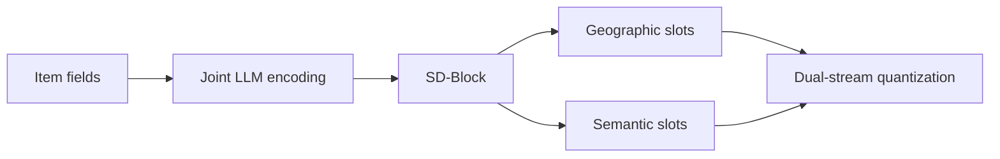

## At a Glance

Key Findings: On Kuaishou and Foursquare, LGRID reports up to a 5.44% relative AUC gain over SID baselines, and reduces the full-SID collision rate to 39.9% against 97.0% for LGSID (Abstract).
Limitation: The geographic slots mirror a fixed administrative hierarchy of province, city, district, and town (Sec. 3.4.1).

### 1. Why This Paper Matters

Existing Semantic ID (SID) frameworks build one representation and then quantize it (Abstract). The authors state that this mixes geography, brand, and category, causes information loss and collisions, and gives SID positions no clear meaning (Abstract). LGRID gives each SID position an explicit attribute.

Based on arXiv v1.

### 2. How It Works

*Figure source: Fig. 2, original paper.*

#### Structured Disentangled Block

The Structured Disentangled Block (SD-Block) splits the hidden states into $`N`$ slot tokens with Semantic Anchor Injection, Anchor-Guided Perception, and Structured Causal Routing (Sec. 3.4). There are $`k`$ geographic slots and $`N-k`$ semantic slots such as brand and category (Sec. 3.4.1).

#### Synergistic Alignment Learning

Alignment learning makes the slots both decodable and discriminative (Abstract). Contrastive learning uses hierarchical hard negatives (Sec. 3.5.2).

> "To prevent inter-slot redundancy, we impose Latent Diversity Regularization (LDR), which encourages subspace orthogonality so that each slot captures non-overlapping features." (Sec. 3.5.3)

#### Dual-Stream Residual Quantization

The two streams are quantized separately, so SID positions correspond to item attributes (Abstract).

### 3. Experimental Findings

- Attribute decoding: accuracy is over 99% for coarse-grained geographic fields (Abstract).
- Hard negatives: they raise town-level discrimination from 37.17% to 83.51% (Sec. 4.4).

  > "In the SACL group, vanilla sampling yields limited fine-grained discrimination (Town: 37.17%), whereas hierarchical hard negatives raise it to 83.51%." (Sec. 4.4)

### 4. Limitations & Critical Analysis

**Our analysis.**

- A full-SID collision rate of 39.9% still leaves many items sharing an SID. Discriminative ranking tolerates shared SIDs better than generation would.
- TIGER quantizes one representation with `RQ-VAE`; LGRID quantizes two streams (`DSRQ`) and feeds a discriminative ranker.
