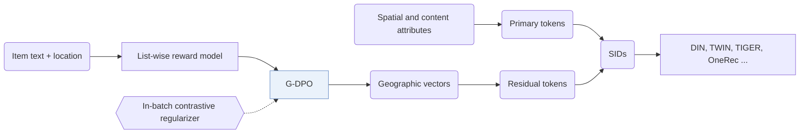

## At a Glance

Limitation: LLM alignment needs a separately trained list-wise reward model before G-DPO, and the residual tokens change whenever that alignment is redone (Abstract).

### 1. Why This Paper Matters

Text-based recommenders encode item text with prompts and tokenize items into discrete Semantic IDs (SIDs) (Abstract). In local-life services, the authors state that putting location into the prompt misses fine-grained spatial characteristics and real distances between items (Abstract).

> "However, in domain-specific tasks such as local-life services, simply injecting location information into prompts fails to capture fine-grained spatial characteristics and real-world distance awareness among items." (Abstract)

### 2. How It Works

#### Reward Model

A list-wise reward model learns spatial relationships among items (Introduction).

> "The RL-based alignment module first trains reward models using distance-aware list-wise sampling to capture and compress real-world spatial relationships." (Introduction)

#### G-DPO Alignment

G-DPO uses the reward model to inject spatial knowledge and collaborative signals into the LLM (Abstract). An in-batch contrastive loss keeps each item's embedding close to the reference model's output (G-DPO, Eq. 7-8).

> "To preserve LLMs' semantic representations during G-DPO updates, we introduce an in-batch contrastive loss as a similarity regularizer, as shown in Eq. 7." (G-DPO)

#### Hierarchical Geographic Item Tokenization

Primary tokens come from discrete spatial and content attributes, and residual tokens come from the aligned LLM's geographic vectors (Abstract).

### 3. Experimental Findings

- Main comparison: on Kuaishou industry datasets, LGSID outperforms discriminative and generative recommendation models (Abstract).
- Downstream models: Table 1 uses the SIDs in DIN, DIEN, SIM, TWIN, and ETA, and Table 2 in TIGER and OneRec (Tables 1-2).
- Other analyses: the paper reports ablations, visualizations, and case studies (Abstract).

### 4. Limitations & Critical Analysis

**Our analysis.**

- Primary tokens need discrete attributes. This suggests that items with missing attributes need a fallback.
- LGRID uses `DSRQ` codes for discriminative ranking only; LGSID uses `Geo-Idx+RQ` codes for both ranking and generation.
