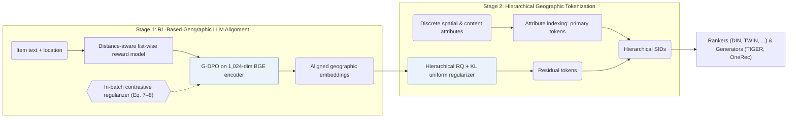

## At a Glance

Key Findings: On Kuaishou local-life recommendation data, LGSID improves five discriminative rankers (DIN, DIEN, SIM, TWIN, ETA) and two generative backbones (TIGER and OneRec) over existing item tokenizers (Tables 1–2).
Limitation: LLM alignment needs a separately trained list-wise reward model before G-DPO, and the residual tokens change whenever that alignment is redone (Abstract).

### 1. Why This Paper Matters

Text-based recommenders encode item descriptions through prompts and quantize the resulting embeddings into discrete Semantic IDs (SIDs). In local-life services, placing location text into a prompt misses fine-grained spatial structure and real-world physical distances among stores. LGSID aligns the item-encoding LLM to physical distance relationships via reinforcement learning before hierarchical tokenization.

> "However, in domain-specific tasks such as local-life services, simply injecting location information into prompts fails to capture fine-grained spatial characteristics and real-world distance awareness among items." (Abstract)

### 2. How It Works

#### Reward Model

A list-wise reward model is trained on distance-aware item lists to score spatial proximity among local-life items (Introduction).

> "The RL-based alignment module first trains reward models using distance-aware list-wise sampling to capture and compress real-world spatial relationships." (Introduction)

#### G-DPO Alignment

Geographic Direct Preference Optimization (G-DPO) uses the trained reward model to align a 1,024-dimensional BGE encoder toward spatial distance relationships and collaborative signals. An in-batch contrastive regularizer keeps each updated item embedding close to the reference model's semantic representation (G-DPO, Eq. 7–8).

> "To preserve LLMs' semantic representations during G-DPO updates, we introduce an in-batch contrastive loss as a similarity regularizer, as shown in Eq. 7." (G-DPO)

#### Hierarchical Geographic Item Tokenization

Each item's SID combines two parts: primary tokens indexed directly from discrete spatial and content attributes, followed by residual tokens produced by a hierarchical residual quantizer with a KL uniform-usage regularizer over the G-DPO-aligned geographic vectors (Abstract, Hierarchical Geographic Item Tokenization).

### 3. Experimental Findings

- Discriminative and generative backbones: on Kuaishou local-life feed data (50,000,000 samples across 2,325,266 items), plugging LGSID tokens into five discriminative rankers (DIN, DIEN, SIM, TWIN, ETA) in Table 1 and two generative backbones (TIGER and OneRec) in Table 2 outperforms existing item tokenizers (Tables 1–2).
- Alignment coverage and stability: Table 3 shows higher semantic and geographic coverage after G-DPO alignment, while Tables 5 and 6 evaluate multi-run stability and sensitivity to the contrastive similarity weight (Tables 3, 5, and 6).

### 4. Limitations & Critical Analysis

**Our analysis.**

- Primary tokens depend on discrete spatial and category attributes, which suggests that POIs with missing metadata require a fallback path.
- All experiments run on a proprietary Kuaishou dataset without a public POI benchmark, and codebook sizes and collision rates are not reported; the later LGRID paper reports a 97.0% full-SID collision rate for LGSID on Kuaishou.
- LGRID uses `DSRQ` codes for discriminative ranking only (`Disc.`); LGSID uses `Geo-Idx+RQ` codes as features for discriminative rankers and as targets for `Enc-Dec` generators (`Disc. / Enc-Dec`).
