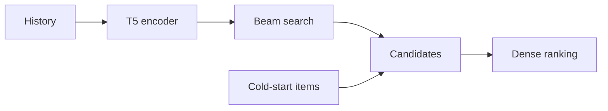

## At a Glance

Limitation: Every cold-start item joins the candidate set, and the design assumes that cold-start items are few (Sec. 3).

### 1. Why This Paper Matters

Sequential dense retrieval stores one representation per item, so memory grows with the catalog (Abstract). Generative retrieval predicts Semantic IDs (SIDs) instead, but a fair comparison of the two was missing (Abstract).

> "Our findings indicate that the model's learned conditional probabilities tends to overfit to items seen during training, leading to a significantly reduced capability to generate cold-start items." (Sec. 2.4)

Based on arXiv v2.

### 2. How It Works

#### Input and Training

Each SID token embedding adds the item's text representation and two position embeddings (Sec. 3). Training combines a cosine-similarity loss toward the next item's text representation with next-token prediction on its SID (Sec. 3).

#### Hybrid Inference

The decoder proposes candidates, and the encoder output ranks them together with the cold-start items (Sec. 3, Algorithm 1).

> "During inference, the decoder retrieves K items by beam search, then supplemented with cold-start items and ranked with the encoder's output embeddings." (Sec. 3)

The authors base this design on an assumption about cold-start items (Sec. 3).

> "This design choice is based on the hypothesis that cold-start items are relatively sparse compared to in-set items, as recommendation systems periodically update themselves to incorporate newly introduced items." (Sec. 3)

### 3. Experimental Findings

- Reporting setup: generative retrieval returns 20 items, which are ranked with the cold-start items (Sec. 4.2).
- Main result: LIGER narrows the gap to dense retrieval and improves cold-start recommendation on the evaluated datasets (Abstract).

### 4. Limitations & Critical Analysis

**Our analysis.**

- The final order comes from the dense embedding. The generated SID selects candidates but does not decide their order.
- TIGER retrieves by `Beam` search only; LIGER adds a dense loss (`NTP + Dense`) and `Hybrid` ranking.
